# IdentityIQ Introduction

English study notes for the first course in the Identity Security Engineer, IdentityIQ learning path. These explanations follow the twelve verified topics in order. Course wording is paraphrased; saved illustrations retain their original English. The course is listed as two hours and is the prerequisite foundation for IdentityIQ Essentials.

**Coverage:** all twelve topic bodies were read, including the available flashcard explanations, five request-process markers, three event-driven provisioning accordions and all four role-example tabs. Sixty-two image files were saved. Five video demonstrations are identified below, but their full narration and video footage are not included. No knowledge check or certification exam was submitted.

## 1. Course Overview

IdentityIQ is SailPoint's enterprise identity-security solution for environments that need control over their deployment and detailed integration with existing applications. This introductory course establishes the vocabulary and capabilities that technical implementers and administrators will use in later training.

The course first explains IdentityIQ and its identity-centered data model, then develops requests, event-driven provisioning, certifications, policies, analytics, roles and extension options. The final topic points to additional training and documentation.

The course's introductory list summarizes ten subject areas, while its navigation contains twelve topics because Course Overview and Interacting with Course Content are separate entries. This study book follows the navigation's full twelve-topic sequence.

Navigation at the top and bottom moves between topics. The displayed illustrations belong to the viewed course version; this book reorganizes the content into a continuous reading layout.

## 2. Interacting with Course Content

The original course combines text, expandable images, video demonstrations, interactive explanations and unscored review questions. Identity University tracks reading progress and resumes at the previous position.

The navigation menu allows movement between topics and displays completion checkmarks and a percentage.

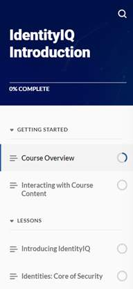

For offline study, the available explanations are expanded into paragraphs and the retained illustrations can be opened at a larger size. Executable exercises, LMS tracking and video playback are not reproduced. A knowledge-check feedback label visible in the source does not represent an answer submitted while preparing these notes.

## 3. Introducing IdentityIQ

### Identity security in a complex enterprise

IdentityIQ combines visibility into identities and access, application integration, access-change automation and governance. Its value depends on bringing trustworthy information from the enterprise into one manageable model.

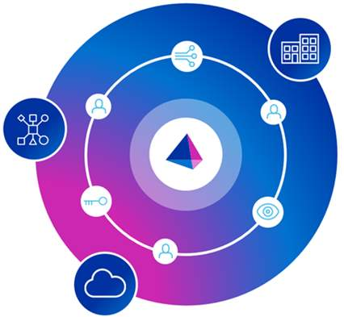

### Benefits: three flashcards expanded

Central visibility helps identify inappropriate access, policy violations and weaknesses in access controls.

Repeatable reviews and records help organizations demonstrate their security and privacy controls. The course mentions HIPAA and GDPR as examples of regulatory contexts; it does not establish that using the product alone guarantees compliance.

Timely access helps new workers become productive. Automation reduces repetitive administration and supports consistent service delivery.

### Core modules and integrated solutions

Compliance Manager and Lifecycle Manager are IdentityIQ modules. They share collected application-access information in the IdentityIQ database, the user interface and the implementation foundation.

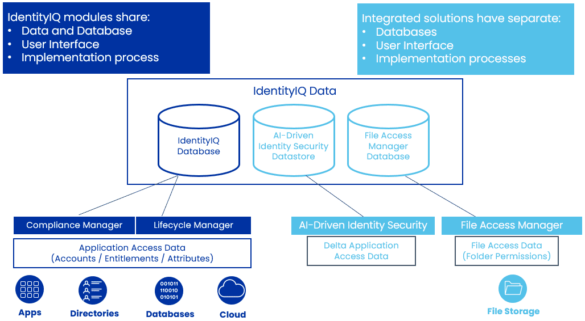

File Access Manager and AI-Driven Identity Security are separate solutions that can integrate with IdentityIQ. They have their own storage, interfaces and implementation work. AI services add machine-learning-based insight into access. File Access Manager concerns unstructured data, including file and folder permissions and sensitive-data visibility.

### Lifecycle Manager

Lifecycle Manager handles self-service access requests, configurable approvals, preventative policy checks and lifecycle events as people join, move or leave. Batch operations support changes for groups, such as removing access to a retired application or granting access after a merger.

Provisioning sends approved changes to connected applications and confirms the resulting access. The business model and workflow configuration determine how those requests are handled.

### Compliance Manager

Compliance Manager supports periodic certifications and policy scanning. Managers or data owners review whether existing access remains necessary. Policy detection identifies access that conflicts with business rules.

### Deployment options

A deployment in the organization's own data center gives its team control and operational responsibility for IdentityIQ.

A public-cloud deployment moves infrastructure to a cloud consumption model, with AWS and Azure used as examples. The organization still needs a team to operate IdentityIQ; hosting it in a cloud does not by itself turn it into a provider-managed SaaS service.

A managed-service deployment places infrastructure and IdentityIQ administration with a service provider. The model suits organizations that need the product's flexibility but do not operate all of it internally.

**Review:** distinguish a core IdentityIQ module, a separately integrated solution and a deployment arrangement. These are different decisions.

## 4. Identities: Core of Security

### Identity cubes

An identity represents a subject with enterprise access: an employee, contractor, partner or non-human user. The identity cube brings together that subject's descriptive attributes, accounts and access information.

The three vocabulary cards distinguish the following concepts.

An attribute is a property of an identity, account, application or entitlement. Attribute values can drive decisions; location may influence access, for example.

An entitlement describes the permission held when an account uses an application.

Aggregation reads information from applications. Periodic aggregation keeps identity information aligned with the enterprise's current records.

### Aggregation and correlation

Governance starts with integrated, normalized data. Aggregation collects it; correlation rules match each application's records to the correct identity cube. Collecting an account and identifying its owner are related but distinct tasks.

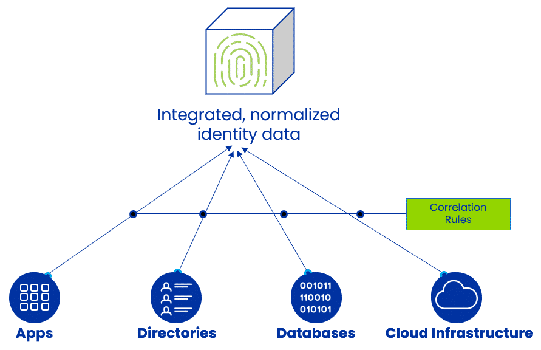

### A common foundation for governance and lifecycle changes

The normalized identity model supports roles and policies. Compliance Manager uses that model to help confirm that people hold appropriate access.

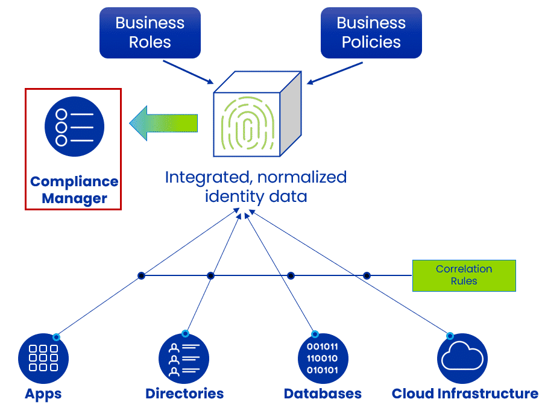

Lifecycle Manager uses the same foundation when managing changes over time. New access decisions are evaluated in the context of the business model and existing access.

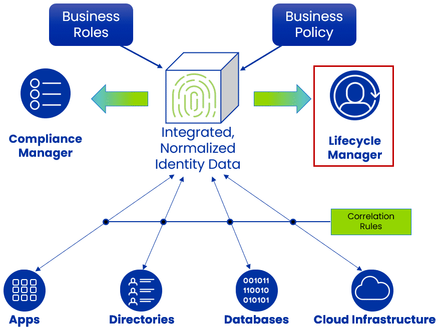

**Review:** an identity cube is the central representation of a subject, rather than a single application account. Data quality and correct correlation affect both review and automation.

## 5. Access Requests

### Request access within the business model

Lifecycle Manager allows additions and removals of roles and entitlements. Administrators decide what is requestable and who may act for whom. Self-service and automated provisioning reduce routine work, while targeted approval and manual-provisioning tasks support situations requiring a person to act.

### Demonstration coverage

The source contains an approximately five-minute-thirty-seven-second demonstration of a manager requesting access. English captions were available in the player. A complete caption transcript was not obtained through the exposed browser controls, so this book does not claim to reproduce the video's narration or every action shown. The page's accompanying five-step process is expanded below.

### The five process markers

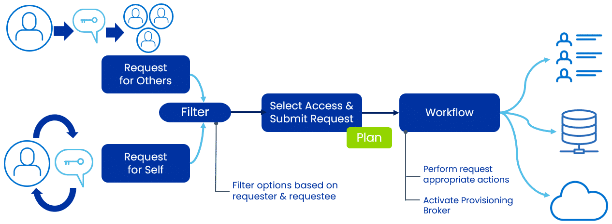

**1. Start the request.** The requester signs in and selects the kind of request. Their configured status and permissions determine whether they can act for themselves or another person.

**2. Filter the available access.** Requestability flags limit what can be selected. Implementation-specific rules can further restrict the choices visible to the requester.

**3. Select and submit.** Provide the information required for the request type, including the desired access where relevant, and submit it through the course example's interface.

**4. Build a provisioning plan.** Submission represents the requested changes in a provisioning plan and starts the appropriate workflow.

**5. Process the workflow.** The workflow determines policy evaluation, approval handling and the path into provisioning.

### Configuration decisions

Decide whether managers can request for anyone or only direct reports, which self-service changes are permitted, and whom the helpdesk can assist. Select the processing workflow for each request type. IdentityIQ provides default settings and workflows, which an implementation can configure for its needs.

**Missing material at this point:** the full video, narration transcript and any video-only screen details are not included. The two page illustrations and all five marker explanations were retained.

## 6. Event-Driven Provisioning

Event-driven provisioning automatically keeps access aligned with changes in a subject's job or organizational relationship. It can grant necessary access, change existing access and remove rights that no longer apply.

### Three process accordions expanded

IdentityIQ monitors identity information for changes or events.

When an event is detected, it can initiate provisioning. A department attribute changing is the course's example.

The configured actions are written to target systems. Access dependent on the old department can be removed as part of that response.

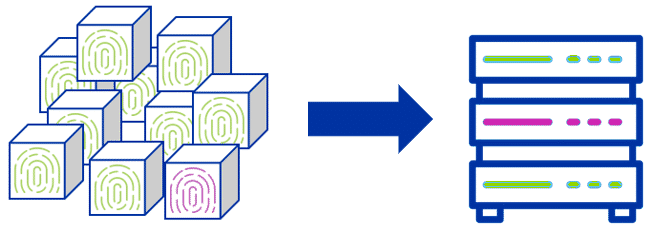

### Lifecycle events and Rapid Setup

Lifecycle events describe common employment changes. Joiners enter the organization, movers change attributes such as job, department or location, and leavers depart. Rapid Setup provides preconfigured processes to streamline these events.

The event must be represented in data and connected to a configured response. A business fact matters to automation when the implementation knows how to recognize and handle it.

## 7. Certification and Access Reviews

Certification reviews existing access on enterprise systems. A certifier can be a manager or an application or entitlement owner. The reviewer decides whether the current access remains appropriate; the role is not always performed by the person's manager.

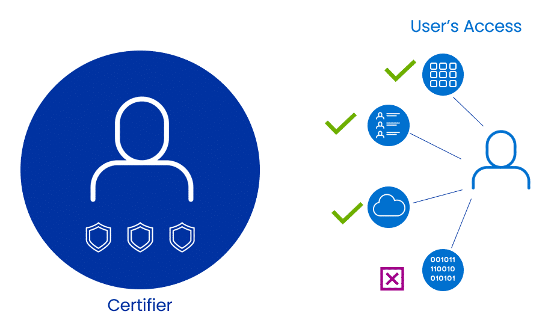

Reviews should recur on a schedule suited to the organization, with quarterly and annual reviews given as examples.

### The manager-certification timeline

**1. Define the campaign.** A compliance officer configures the population, reviewers, start date, duration and other milestones. The example asks managers to review their direct reports.

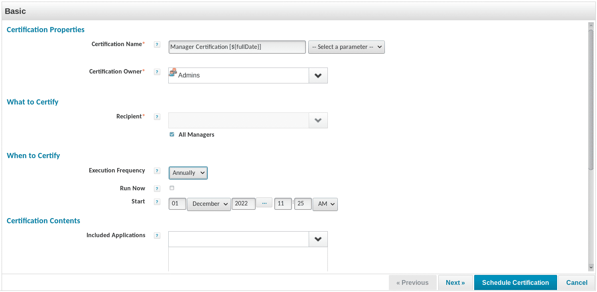

**2. Compile the data.** IdentityIQ gathers identities, accounts and access information. Generation time depends on campaign size and complexity and can range from minutes to much longer periods.

**3. Create individual access reviews.** Each designated certifier receives review work, with notifications when configured. The course gives two or four weeks as example review windows.

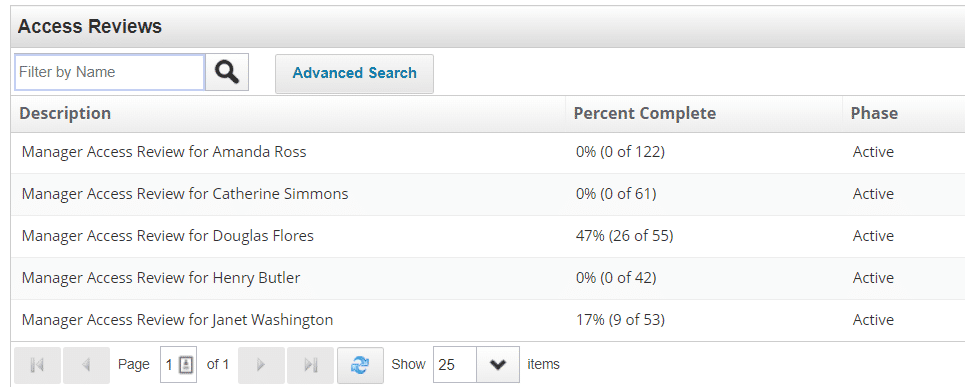

**4. Make decisions.** Managers approve or revoke access for the reviewed users. An integrated AI recommendation service can provide peer-based suggestions, but the review still requires a decision.

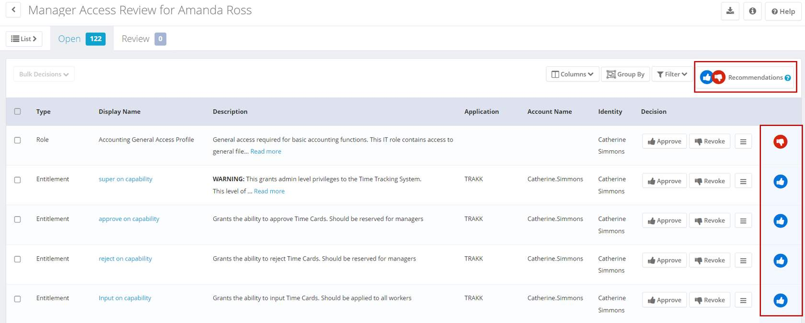

**5. Challenge, sign off and revoke.** An optional challenge phase allows affected users to dispute a removal. Certifiers can reconsider before final sign-off. IdentityIQ then begins the required revocation process.

**Review:** a campaign organizes the work; an access review is an individual reviewer's task. Recording a decision and executing the removal are different stages.

## 8. Policies

### Define undesirable conditions

An IdentityIQ policy describes access conditions the organization does not want. It can be used to examine existing access or evaluate a proposed change.

Separation of Duties policies detect incompatible responsibilities. The example combines the ability to approve new vendors with the ability to pay them, creating an opportunity for one person to control too much of the transaction.

Dormant accounts are another concern. Unused accounts may incur costs and can remain compromised without an active user noticing.

A further example detects non-managers holding management-level application access.

### Detective and preventative use

Detective checking examines access already present. Preventative evaluation checks proposed changes against existing rights and policy before the request is fulfilled. The precise response depends on configuration; detection should not be interpreted as a guarantee that every violation is automatically removed.

**Video gap:** the source includes two demonstrations under Detective and Preventative Policy Usage. Neither video nor its complete narration transcript is preserved here. The page's written explanations and illustrations are included.

### Act on a violation

The violation owner receives work to review the issue. Depending on the violation, actions can include allowing an exception, correcting it, or having an administrator initiate a broader certification of the identity.

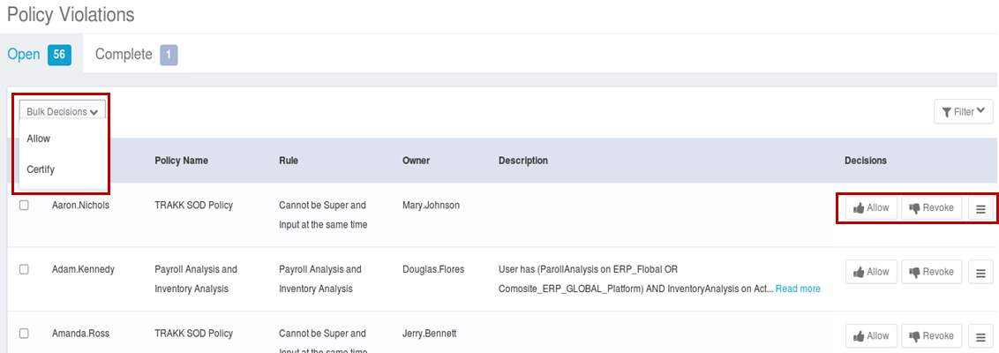

An SoD violation can offer Revoke, allowing the owner to choose which conflicting access to remove.

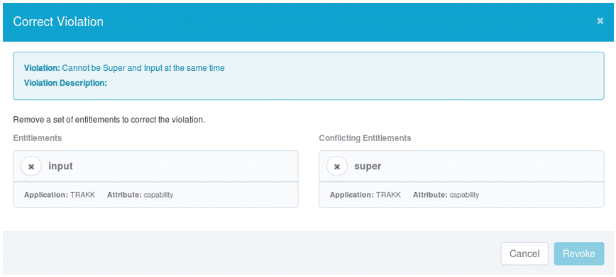

The purpose is to assign awareness and responsibility, including when resolution requires action outside IdentityIQ. A time-limited exception can permit the condition temporarily; it is flagged again after expiry if still present.

## 9. Analytics and Reports

### Advanced Analytics

Advanced Analytics searches the IdentityIQ database. Available search fields depend on configuration, including which attributes have been designated searchable. Identity search is common, but the course also lists activity, role, entitlement and audit searches.

Results can be viewed, saved as a query, saved as a report or exported to CSV. A configured extended attribute can be searchable; searching is not restricted to only the standard predefined identity attributes.

**Video gap:** the Identity Search demonstration is not transcribed or saved in this edition. Its written introduction and original search screenshot are retained.

### Reports

The course describes more than fifty standard reports grouped by category. They support compliance visibility and operational decisions and can be run as provided or configured for the organization's needs. The number is a statement from the viewed course version.

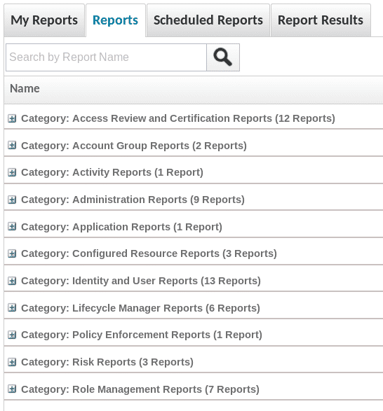

My Reports concerns configured reports and searches saved as reports, rather than only custom report definitions or every accessible report template.

**Video gap:** the Reports demonstration is not transcribed or saved. The page's report-category illustration is included.

## 10. Roles

### Group access to improve decisions

A role packages entitlements into a manageable object. Roles are optional, but can make requests, approvals and reviews more efficient and less error-prone.

Instead of repeatedly selecting the individual rights for email, a company directory and other baseline applications, the example bundles them into one employee role. Maintaining the role updates the definition of that access grouping.

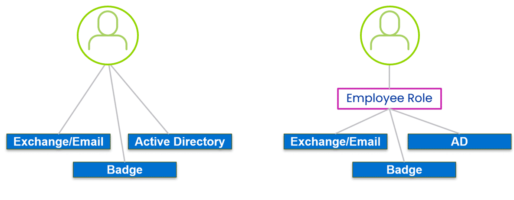

### Catherine's Prism example: all four tabs

Catherine manages five people who need to manage technicians in Prism. She requests access for the team.

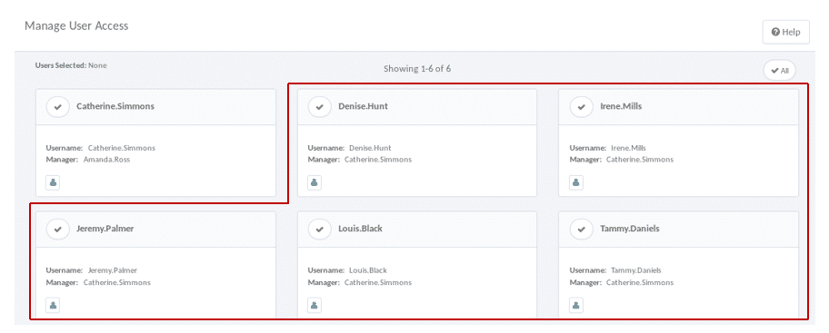

She knows the team needs Approvals, Cycle, Manager and Level 2, but assumes that Super is also necessary.

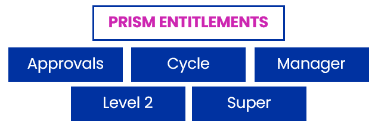

A cursory approval gives all five people excessive access. The problem is an inaccurate understanding of the required entitlement set.

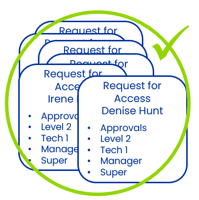

A well-defined, clearly named role packages the necessary rights so Catherine and the approver do not need to guess at individual technical permissions.

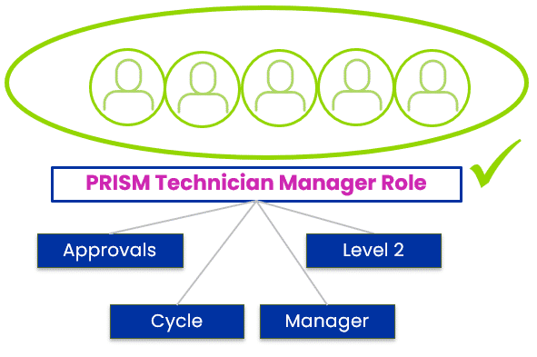

### Automatic assignment and removal

Assignment rules can match identity attributes such as department or job title. The course illustrates finance access assigned through such a match.

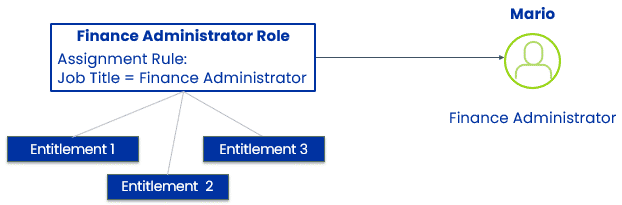

When a relevant attribute changes and the person no longer meets the rule, IdentityIQ can remove the role and the associated entitlements according to the implementation's provisioning configuration.

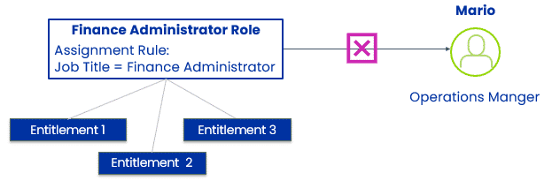

### Build the role model with the business

Business analysts, application owners and business teams should jointly define roles. IdentityIQ supports Entitlement Analysis, IT Role Mining and Business Role Mining, as well as manual role creation. Mining results can be exported for analysis outside the product, and workshops or spreadsheets can support the business design.

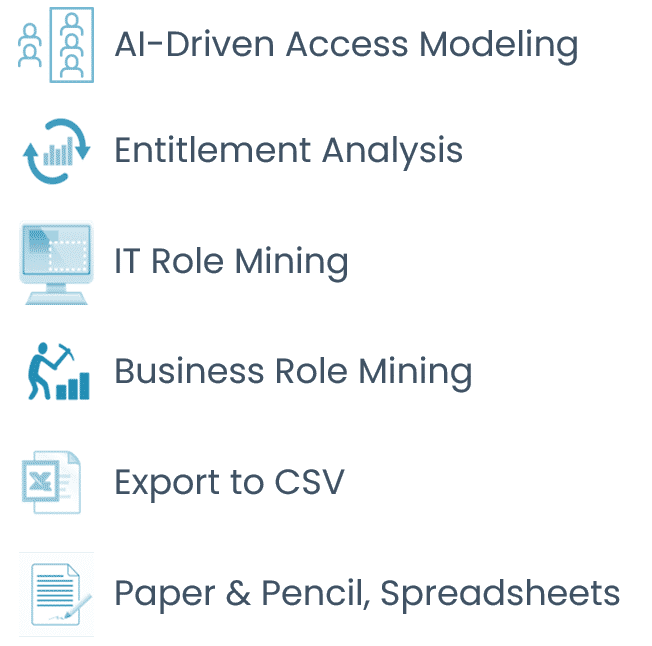

**Review:** role analysis proposes a useful grouping; business ownership establishes whether that grouping is appropriate.

## 11. Extending IdentityIQ

### Five extension levels: flashcards expanded

An implementation can add extended attributes such as department, location and job title to carry the organization's required context.

Rules insert custom logic at supported points. Branding adapts the interface's colors and logos.

Custom workflows support business processes beyond the configuration of the provided workflows.

Custom QuickLinks can start workflows for organization-specific actions.

Custom connectors may be needed for specialized or internally developed applications. The course's statement that SailPoint provides over one hundred connectors describes its viewed version rather than a current catalog count.

### Standard and extended attributes

Standard identity-cube attributes are included by the product. Extended attributes add implementation-specific information, such as employee number, department or title. Those values can drive provisioning, policy evaluation and automation.

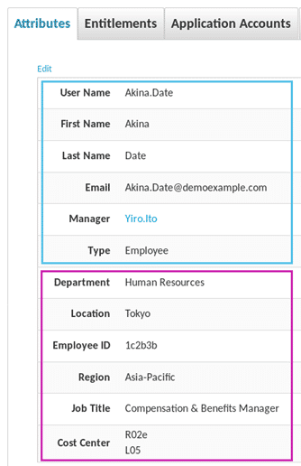

Designating an extended attribute as searchable makes it available in relevant search, filter and reporting options.

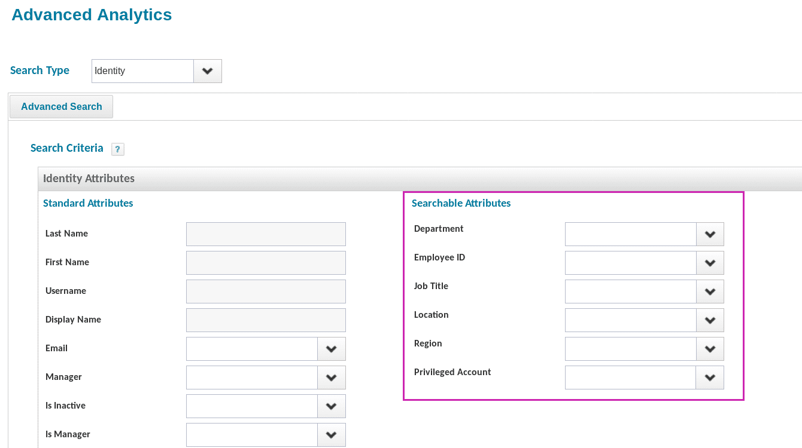

The lesson lists six object categories supporting extensions: identity cubes, entitlements, roles, applications, accounts and certifications. Its application example adds classifications for SOX regulation and sensitive information.

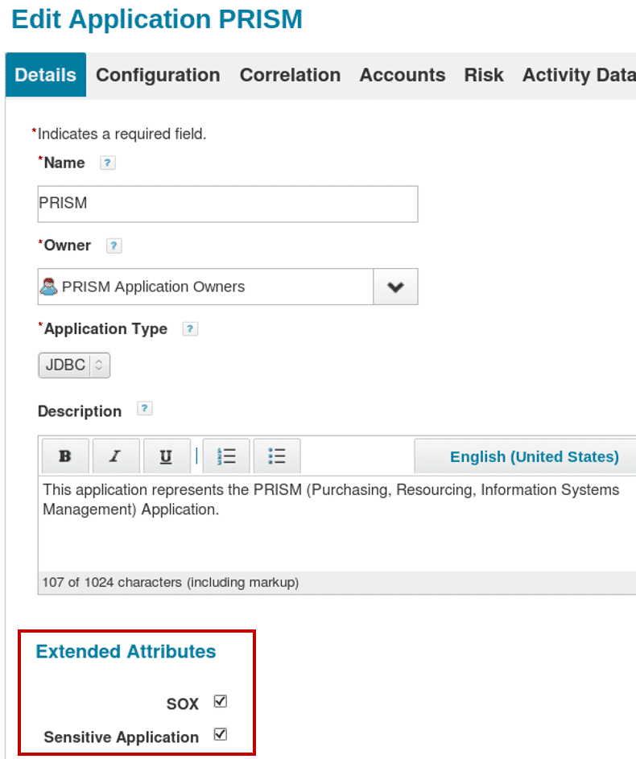

### Matching and conditional logic

Employee number can correlate accounts with identities. An attribute-defined team-lead population can be permitted to request access for others. A Teller job title can trigger role assignment, and department/title changes can start a review or another business process.

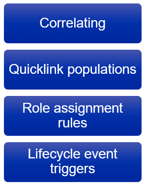

Attributes can also restrict a batch job's population, require extra approvals for sensitive access or select different provisioning sets for employees and contractors.

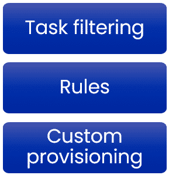

### Plugins

Plugins add functionality to the existing product. The course describes a SailPoint support plugin that packages diagnostic information and a SQL Browser Tool providing administrators with read-only database inspection. It points to community and partner sources for plugins. No plugin or software package was downloaded or executed while creating these notes.

## 12. Next Steps

The course points technical implementers and administrators to IdentityIQ Essentials next, followed by deeper implementation training. Business administrators have separate function-focused learning options.

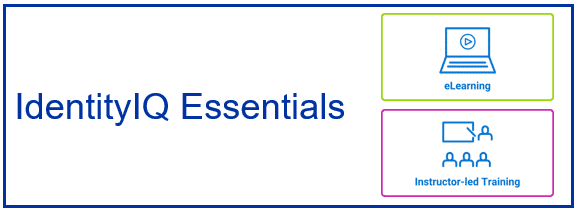

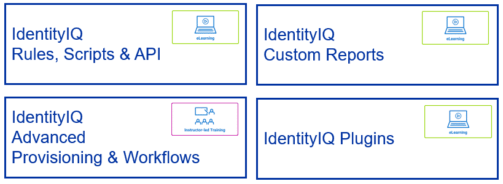

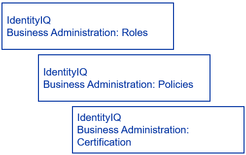

Useful external references include the [IdentityIQ Help Center](https://documentation.sailpoint.com/identityiq/help/iiqlandingpage.html), [Lifecycle Manager](https://documentation.sailpoint.com/identityiq/help/lcm/lifecycle_manager.html), [Compliance Manager](https://documentation.sailpoint.com/identityiq/help/systemconfig/compliance_manager.html), [certifications](https://documentation.sailpoint.com/identityiq/help/certification/certs_accessrev_introduction.html), [Advanced Analytics](https://documentation.sailpoint.com/identityiq/help/search/advanceanalytics.html) and [reporting](https://documentation.sailpoint.com/identityiq/help/reports/report_introduction.html).

The [SailPoint Community](https://community.sailpoint.com/) supports questions, peer discussion and ideas. These links are preserved as external references; the linked documentation and other courses are not represented as captured content in this Introduction chapter.

## Coverage and missing material

All twelve topic bodies were inspected. The available flashcard explanations, five access-request markers, three event-driven provisioning accordions, the certification timeline and four role-example tabs are represented in expanded study prose. All sixty-two inline image URLs encountered were downloaded and placed beside their topics, with source URLs and hashes recorded in saved-assets.json.

Five demonstration videos are not saved or fully transcribed: Access Requests; the two policy-use demonstrations; Identity Search; and Reports. English captions were observed on the Access Requests player, but its complete caption track was not exposed through the inspected browser controls. Five video-poster background files were also not saved; their exact paths are listed in coverage.json. No complete original audiovisual equivalent is claimed.

The original review questions and executable activities are not reproduced as completed assessments. No quiz was answered or reset. The source course had pre-existing completed topics and feedback states. Reading may update normal LMS progress. No live IdentityIQ tenant, lab, account, workflow, role, policy or certification decision was changed.

This is the first compiled course in the five-course learning path. Essentials, Rules/Scripts/API and Custom Reports remain pending study chapters. Advanced Provisioning and Workflows is gated by an IdentityIQ Essentials completion prerequisite; its visible outline is recorded separately, without bypassing the gate.
