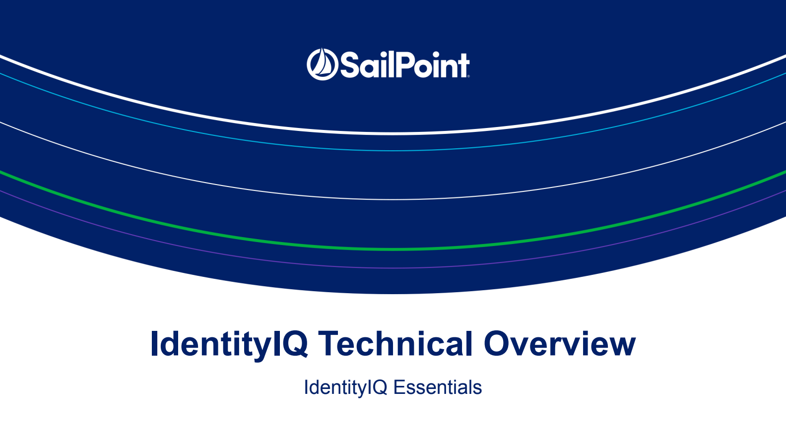
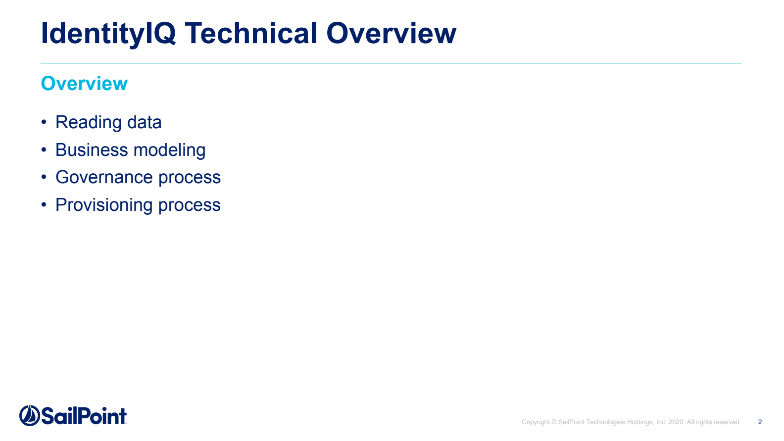
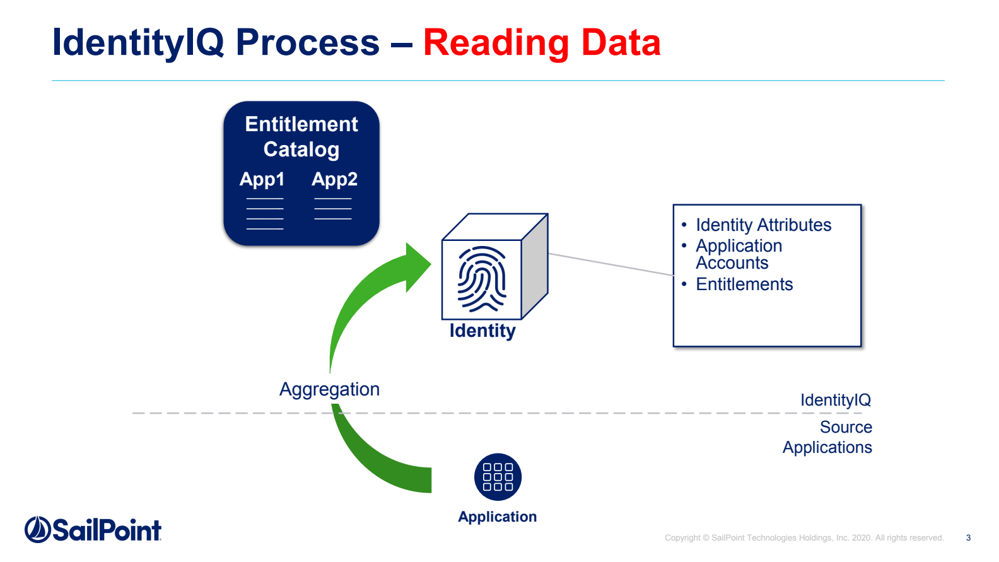
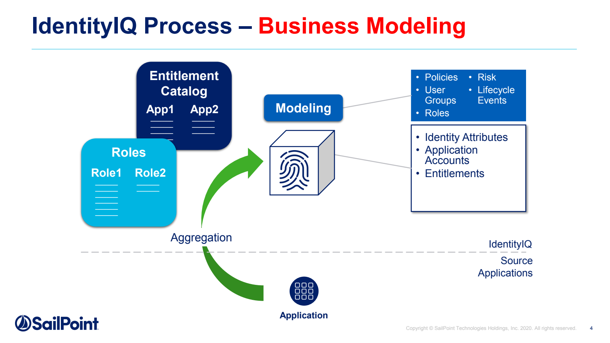
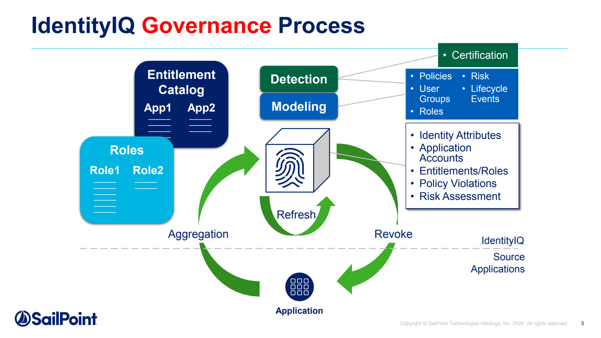
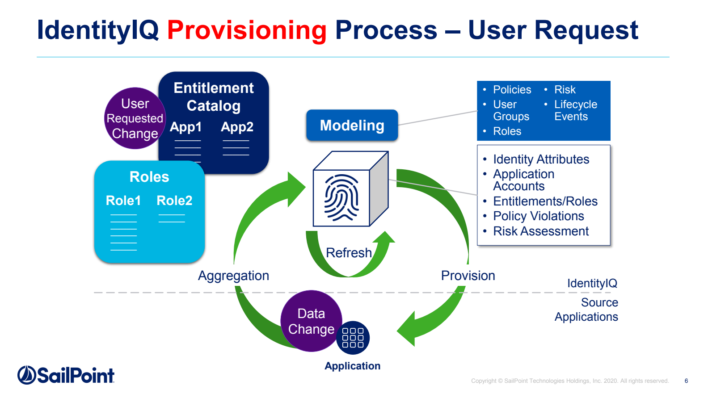
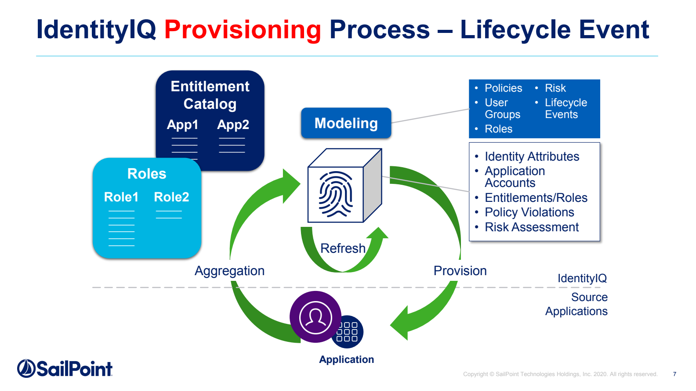
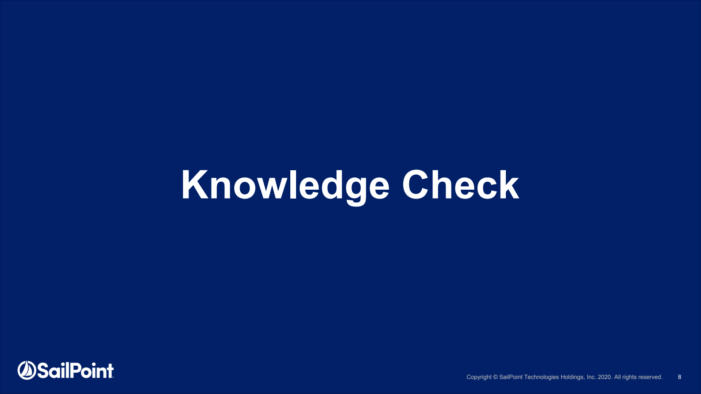

## 2. IdentityIQ Technical Overview

### The identity and application model

An **Identity Cube** represents a managed person. Reading information into IdentityIQ is **aggregation**, and a connected source is represented by an **Application** object. An authoritative application, or system of record, supplies the identities that IdentityIQ should manage. This might be HR, Active Directory or another appropriate source, depending on the organization's design.

An Identity Cube brings together two different kinds of information. **Identity attributes** describe the person, such as an identifier, name or email address. **Account attributes** describe that person's account on a particular application and follow that application's schema. An entitlement describes a right available through an account, such as permission to approve purchase orders.

As applications are aggregated, account and entitlement information is associated with the relevant Identity Cubes. Available access rights are also represented in the **Entitlement Catalog**, organized by application. The catalog describes the access that exists; an individual's Cube describes the access associated with that person.

### Business modeling

The data becomes useful for governance when the business defines what appropriate access looks like. Policies might prohibit a person from both approving and paying a vendor, or identify accounts unused for 180 days. These are examples from the course, rather than universal policy settings.

People can be grouped by their IdentityIQ responsibilities or enterprise access needs. A technical implementer and a business analyst may require different rights within IdentityIQ. Enterprise roles model responsibilities such as bank teller and group the permissions required for that job.

A risk model assigns numerical values to relevant access and other factors, producing a score that helps prioritize attention. Lifecycle-event definitions describe what counts as a joiner, mover or leaver and what should happen when such a change is detected.

### Aggregation, refresh and certification

**Aggregation reads external information; refresh computes information about identities.** A refresh can evaluate policy violations, calculate risk, detect or assign roles, and process lifecycle events, according to its configuration. Aggregation and refresh are related operations with distinct responsibilities.

Certification asks an accountable reviewer, often a manager, whether a person's access is appropriate. The reviewer approves access that should remain or requests revocation. Policy remediation and certification decisions can lead to manual work items or automatic removal where the application's integration supports it and is configured accordingly.

### Request-driven provisioning

The narration's example is a request for the **Time Sheet Approver** entitlement. The user searches the access items they are allowed to request and submits the selection. A workflow handles the request, potentially collecting approvals and identifying policy violations before fulfillment.

If the request proceeds, IdentityIQ changes the target application through the configured provisioning path. Some integrations can execute the change automatically; others send a work item for a person to perform it. The desired access change and its actual implementation are separate facts.

IdentityIQ subsequently aggregates to confirm the target state. Depending on the connector, this can be a targeted read for the affected account or must wait for a later bulk aggregation. A refresh then recalculates the identity's picture using the newly observed information.

### Event-driven provisioning

Requests are not the only trigger. When an employee is added to HR, aggregation can bring that person into IdentityIQ. The configured joiner-processing path can then provision the baseline, or **birthright**, accounts and entitlements that the employee needs. The business defines both the event criteria and the resulting access.

A useful study sequence is: **read → correlate and model → calculate → decide → change → confirm**. This is a reading aid summarizing the processes above, not an additional named product feature.

The handout ends this section with a Knowledge Check title slide. No assessment questions or answers are included here.

