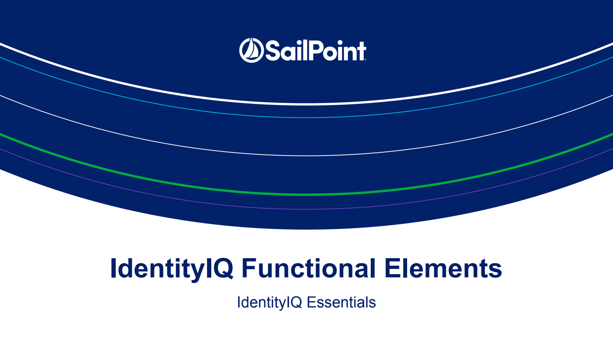
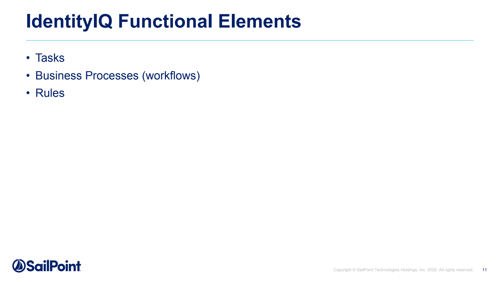
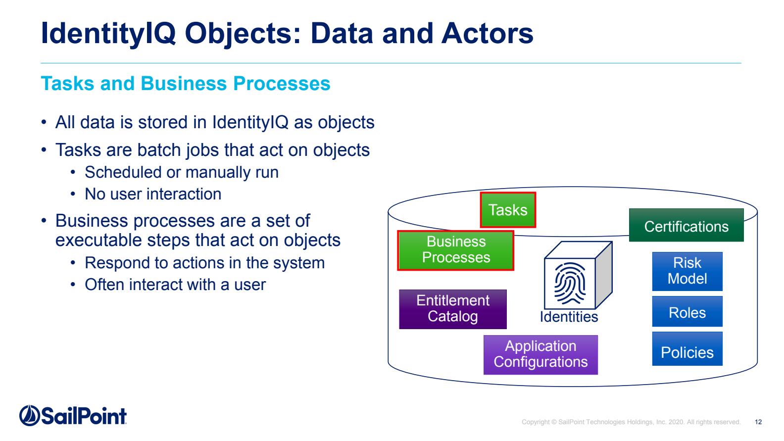
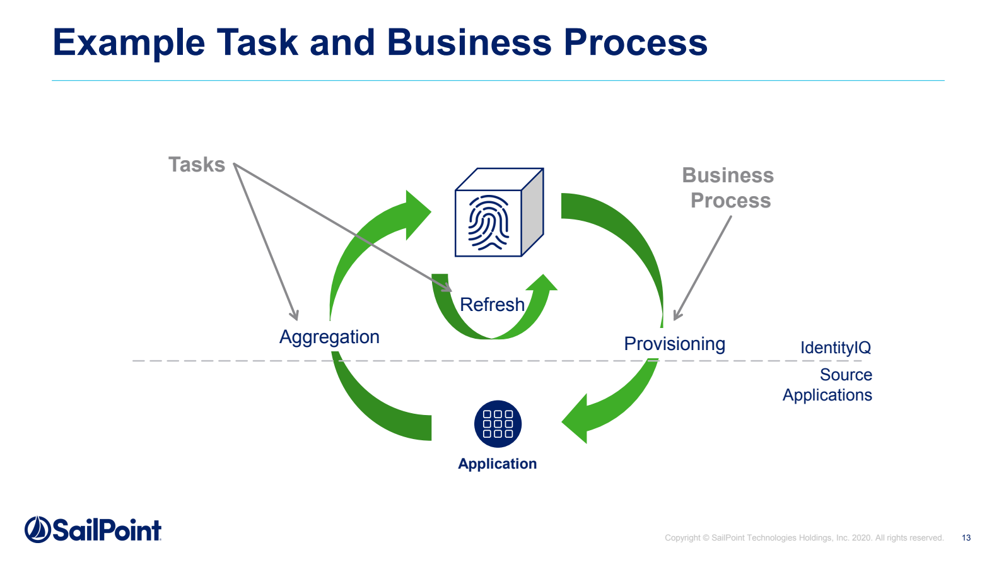
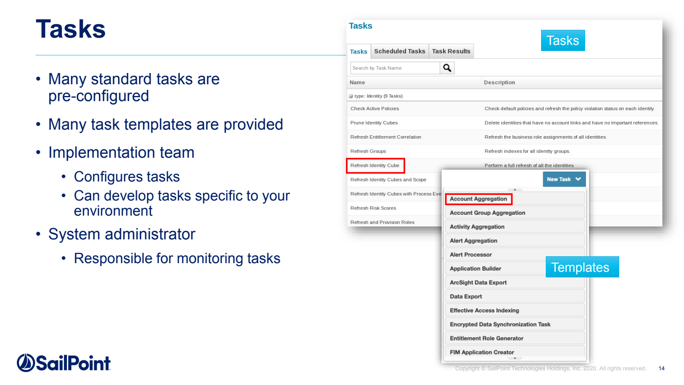
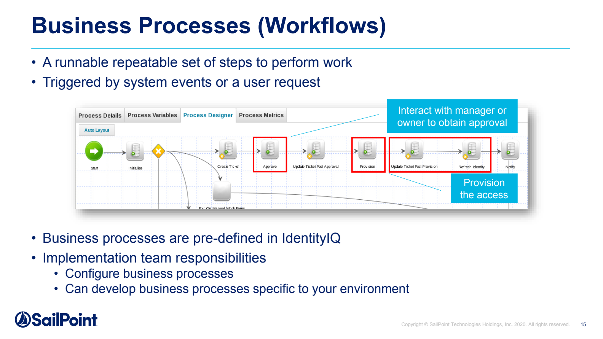
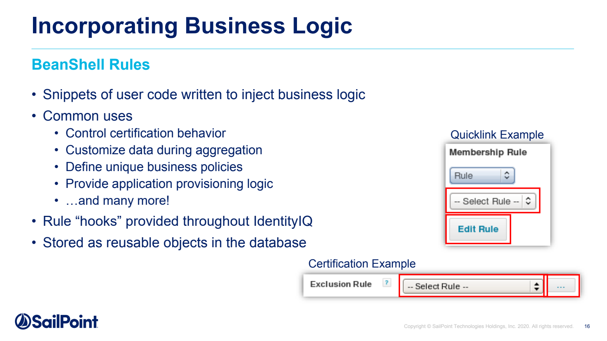
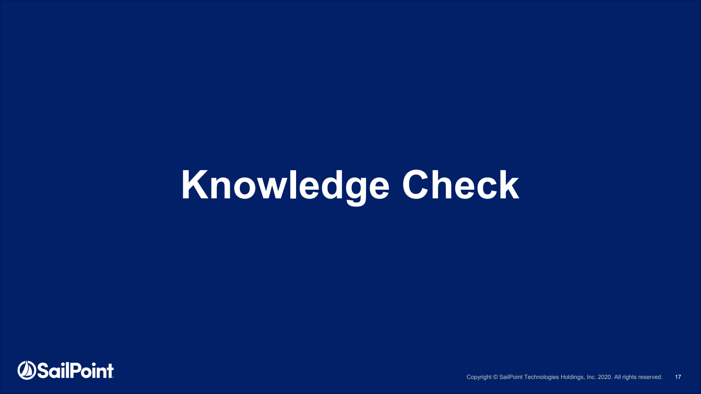

## 3. IdentityIQ Functional Elements

### Objects and the components that act on them

IdentityIQ uses an object-oriented model. Identities, roles, applications, certifications, tasks and workflows are represented as objects persisted in the database. The course emphasizes using object methods when writing code against IdentityIQ, rather than treating customization as direct manipulation of database tables.

Objects hold configuration or state. **Tasks** and **business processes** perform work against those objects. For example, an Application object describes how a source is configured; an aggregation task uses that definition to read the source. A provisioning business process coordinates the work required when a user requests access.

### Tasks

A task is a background or batch operation that runs without an interactive conversation with a user. A person can launch it manually or configure a schedule. Aggregation and identity refresh are typical examples.

IdentityIQ includes predefined tasks and task templates. The implementation team decides which tasks are required, configures existing definitions or creates additional ones, and selects appropriate schedules. The administrator checks that the tasks run when expected and investigates failures and errors. A configured schedule alone is not evidence of a successful run.

### Business processes and workflows

**Business process** and **workflow** refer to the same underlying concept. Business-facing screens generally use the former wording; implementation tools and object definitions often use the latter.

A workflow is an executable sequence of steps triggered by an event or request. Unlike a batch task, it often interacts with people to collect data or obtain approvals. In the illustrated provisioning example, the process obtains approval, provisions access, updates associated tickets and refreshes the identity.

Implementers commonly configure supplied workflows by setting variables and approver choices. Where necessary, they can change individual steps or replace a process with a custom workflow. This distinction matters when deciding whether a requirement needs configuration, workflow modification or another extension.

### Rules

Rules insert organization-specific behavior at supported extension points. The course describes them as BeanShell code with Java-like syntax. Examples include changing certification inclusion, transforming aggregation data, implementing a policy condition or supplying application provisioning logic.

The narration illustrates a certification exclusion rule that omits executives. A rule is stored as its own reusable object, so appropriate certifications can reference the same logic. Rule-selection controls associate an existing rule with a supported hook, while the editor allows its logic to be defined.

Rules are optional: not every configuration requires custom code. The course's statement that there are more than 80 rule locations is a claim about its course version, not a verified current count.

### Compare the three elements

| Element | How it starts | Typical interaction | Course example |
| --- | --- | --- | --- |
| Task | Manual launch or schedule | Runs in the background | Aggregate accounts or refresh identities |
| Business process / workflow | System activity or user request | May collect information or approvals | Approve and fulfill an access request |
| Rule | Called at a configured extension point | Supplies custom logic to its caller | Exclude a category of identities from a certification |

