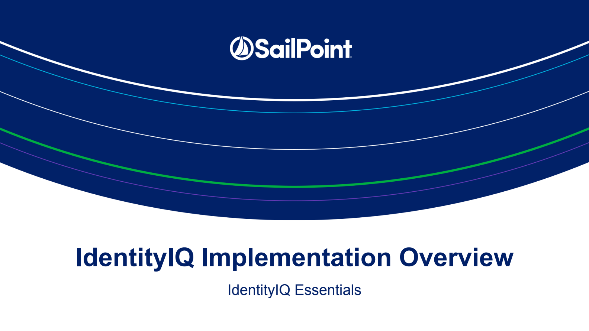
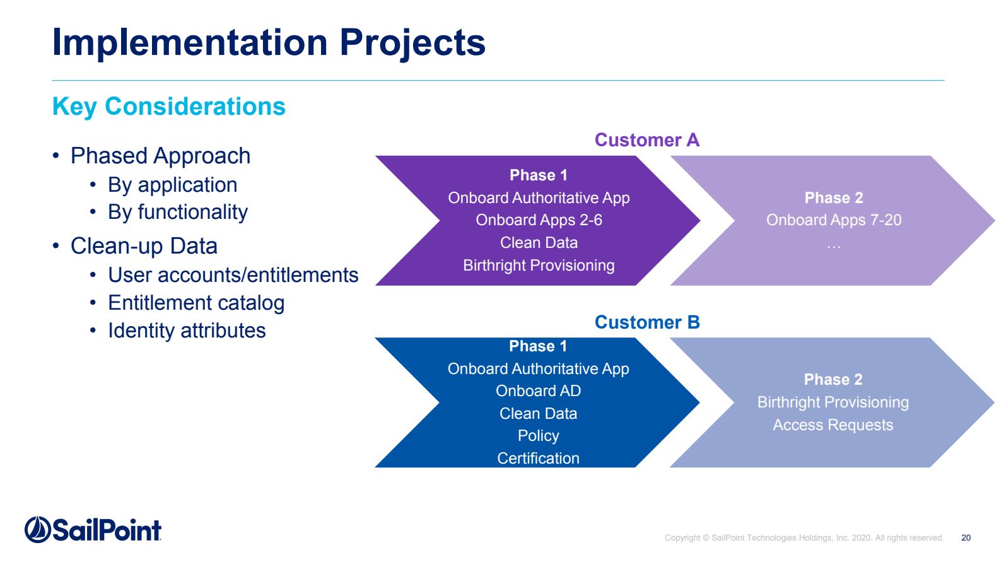
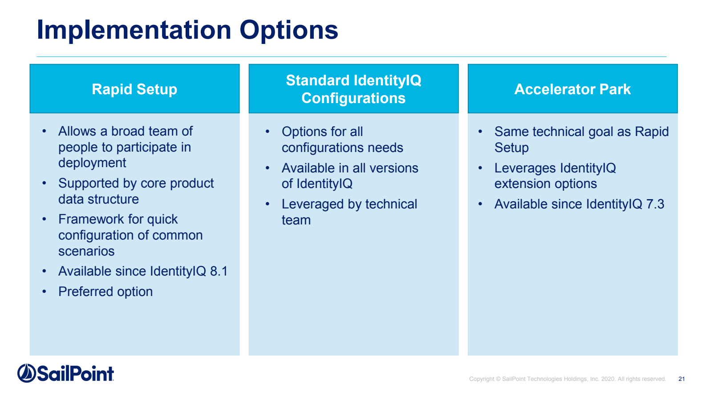
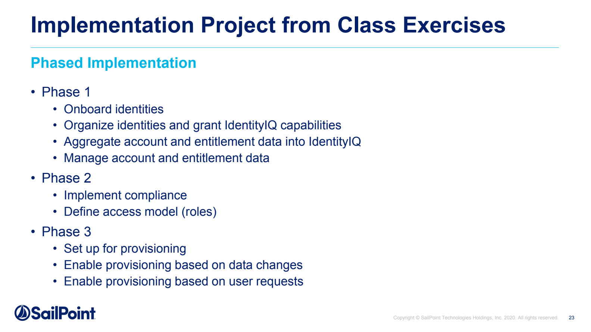
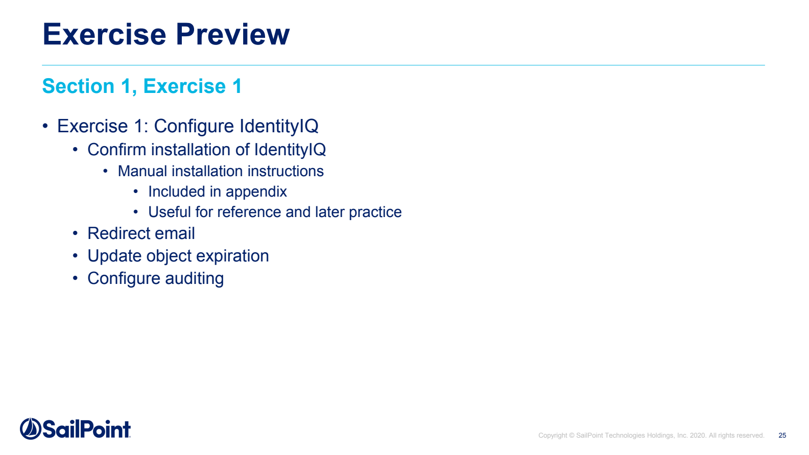

## 4. IdentityIQ Implementation Overview

### Plan phased delivery and clean data

Two foundations apply across implementation projects: break the work into practical phases, and make the identity and access data reliable. An initial phase must include the authoritative information used to create identities, but the number of additional applications and features can be deliberately limited.

The course compares two rollout patterns. One customer starts with an authoritative application plus five business-critical applications and delivers birthright provisioning, then adds more applications in later phases. Another starts with authoritative data and Active Directory, establishes policy and certification controls, and adds provisioning afterward. These are illustrations of phased delivery, not prescribed project sizes.

Data quality affects both governance and automation. Incorrect entitlement data distorts policy findings, risk assessments and role analysis. Incorrect identity attributes can assign access to the wrong people: an employee inaccurately classified as Finance could receive a Finance role through automated logic.

### Configuration approaches

**Rapid Setup** groups common configuration choices into focused menus and supports scenarios such as onboarding and lifecycle handling. Its targeted permissions can let business analysts and data owners participate alongside technical staff. The course describes it as a core-product feature introduced in 8.1 and the preferred framework for the common scenarios it covers.

**Standard IdentityIQ configuration** provides the broader, more flexible settings used when the Rapid Setup options do not cover a requirement. It remains part of the implementation toolbox rather than a separate replacement product.

**Accelerator Pack** is the name used in the narration for an earlier extensibility-based approach to similar scenarios. It uses extended attributes and rule hooks and may therefore interact with an organization's other customizations. The supplied slide spells the name “Accelerator Park”; the notes retain the narration's wording while leaving the original illustration untouched. The course says existing implementations can continue using their framework; this is historical course context, not a current migration recommendation.

### The class implementation project

Phase 1 creates the identity foundation, organizes people and their IdentityIQ capabilities, loads other account and entitlement data, and checks its quality. The exercises use different implementer and analyst personas to demonstrate shared responsibilities.

Phase 2 introduces compliance functions and roles. Learners detect policy violations, configure a targeted access review and establish an access model that later supports provisioning.

Phase 3 prepares the applications for provisioning and tests both data-driven and user-requested changes. Request configuration includes which access items are requestable, who may request for whom, and which approvals must occur. The results need to be tested rather than inferred from saved settings.

### Preparation for Exercise 1

IdentityIQ is already installed in the training environment. Exercise 1 confirms that installation and applies development-oriented global settings: email redirection, work-item archiving, object retention and audit choices. Manual installation practice is a later optional appendix exercise, not a prerequisite operation that was run while creating these notes.

The expanded Exercise 1 study instructions and original pages are in the linked practice companion, keeping the numbered module sequence intact.

### Related practice and source pages

[Training environment and course reference](../practice-companion.html#practice-reference) · [Exercise 1.1 — Configure IdentityIQ](../practice-companion.html#practice-1-1)

