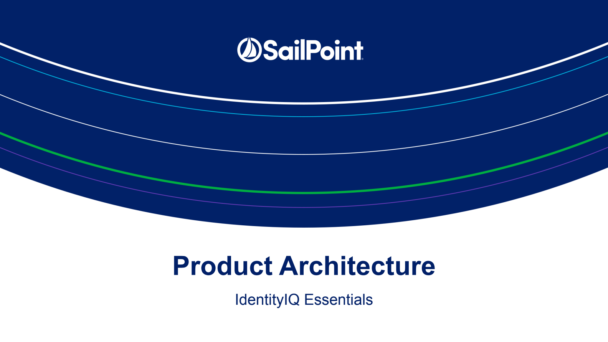
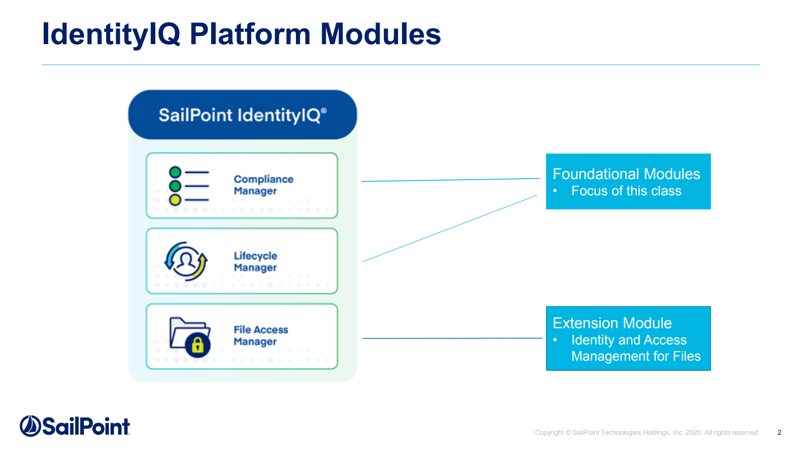
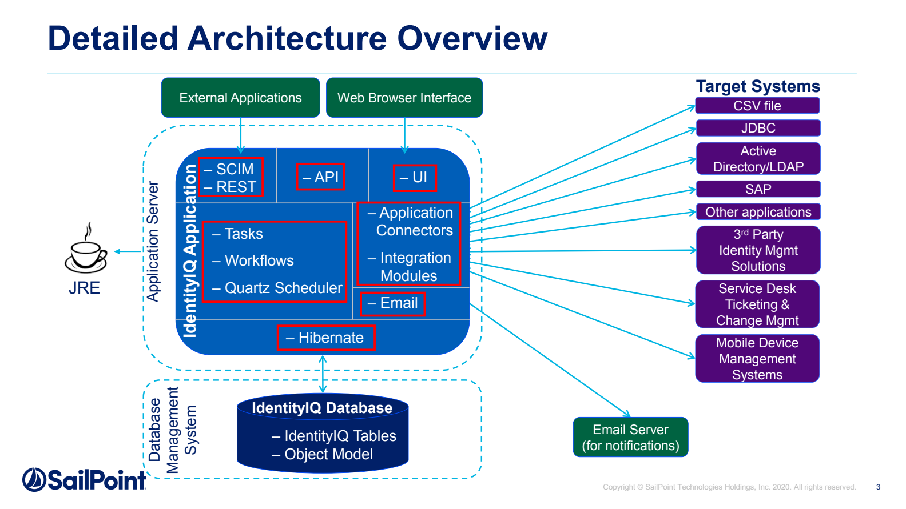
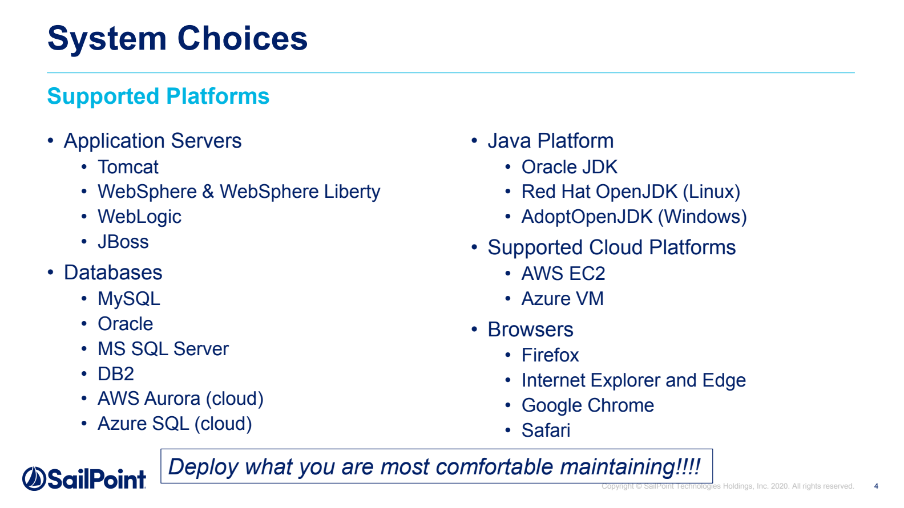
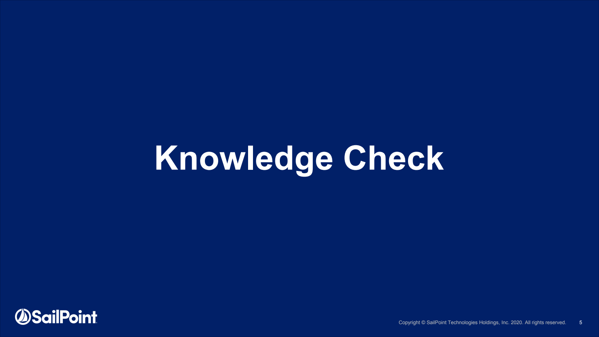

## 5. Product Architecture

### Platform layers and foundational modules

The architecture lesson focuses on Compliance Manager and Lifecycle Manager as foundational application-governance and access-management modules. File Access Manager extends governance into file data. Other introductory material groups the platform differently; these notes retain this lesson's specific framing rather than forcing a single module count across differently scoped presentations.

IdentityIQ is a Java web application running inside an application server with a Java runtime. A relational database persists its objects. An email service provides notifications through SMTP. The architecture separates the application's execution environment from the database and the enterprise applications it manages.

### Reading the architecture diagram

Inside the application server, tasks and workflows execute the business logic. **Quartz** schedules recurring work. **Hibernate** maps the Java object model to the relational database and handles the database-specific persistence layer.

Connectors and integration modules reach managed systems such as directories, databases, SAP, service-desk products and other applications. Their network access and credentials are dependencies of the operation they perform; having the IdentityIQ website available does not by itself prove those integrations can connect.

The diagram also separates several interfaces:

- **Browser UI:** the normal interactive experience for administrators and business users.
- **External REST interfaces:** allow other systems to interact with IdentityIQ, for example to initiate an appropriate process.
- **SCIM REST interface:** supplies standardized identity-management operations for integrations using that model.
- **Internal Java API:** provides broader access to IdentityIQ objects and is used by custom rules and implementation code.

The course mentions more than 100 connector types in its narration. That number is preserved as a course-version statement, not a verified count of currently offered connectors.

### Platform selection

The slide lists the application servers, databases, Java platforms, cloud-hosting options and browsers associated with the course version. Its general architectural lesson is to select a supported stack the organization can operate and maintain competently. The displayed list includes older products, so it should be read as historical course material rather than a present-day support matrix.

A practical way to review the diagram is to identify the dependency for each operation: browser-to-application access, application-to-database persistence, application-to-target connectivity, and notification delivery. These are different paths and can fail independently.

### Related practice and source pages

[Exercise 1.1 — Configure IdentityIQ](../practice-companion.html#practice-1-1)

