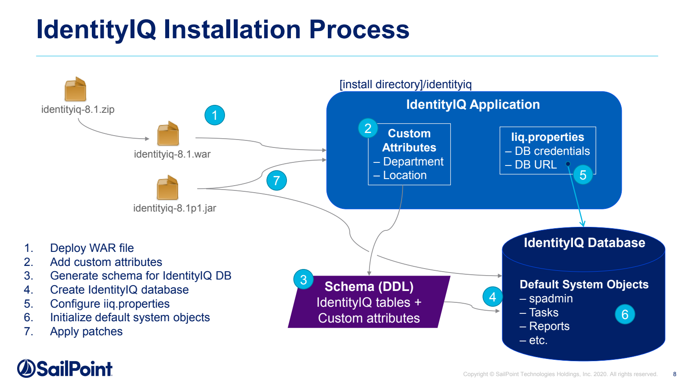
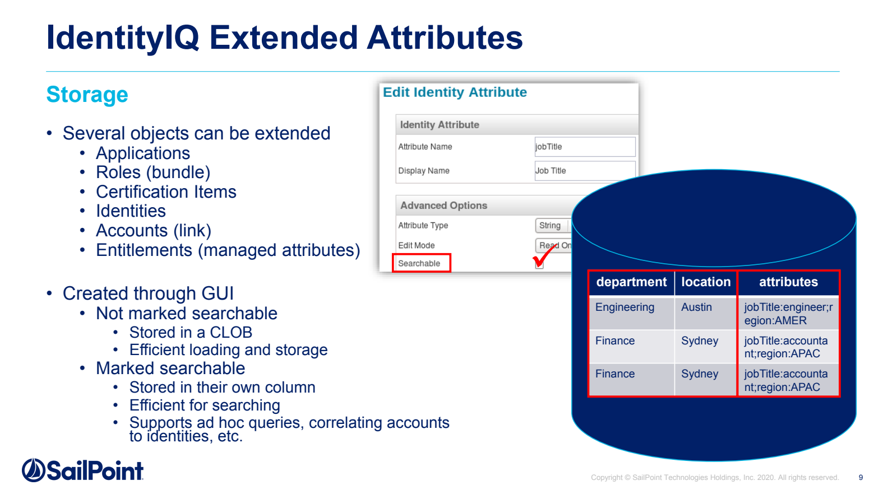
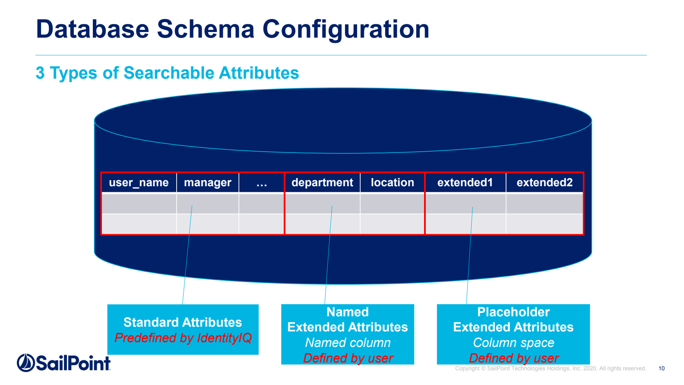
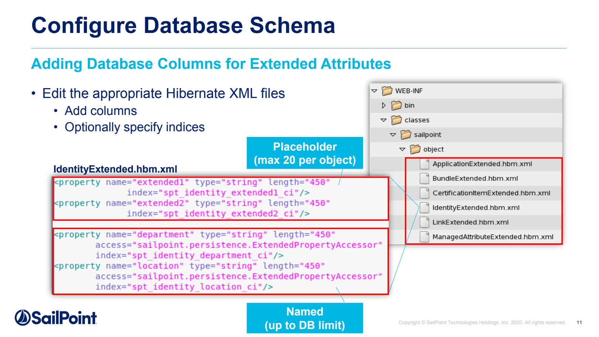
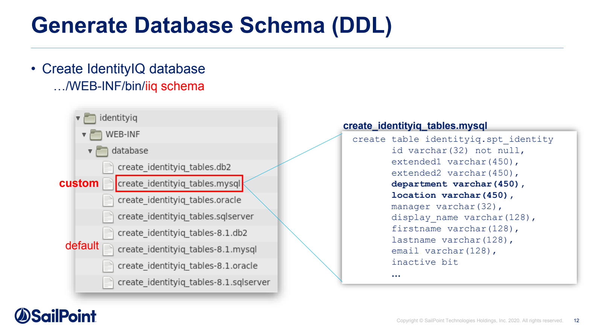
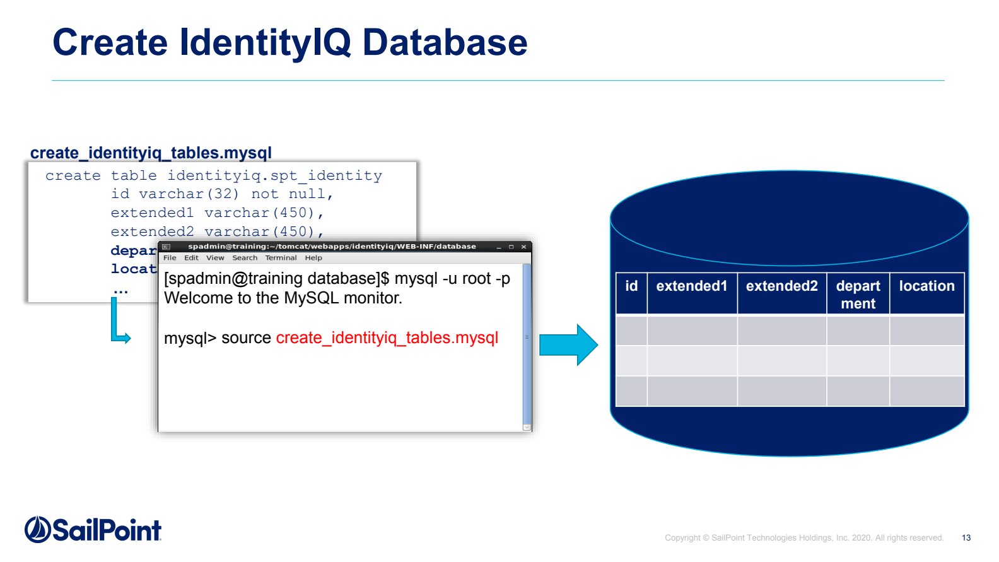
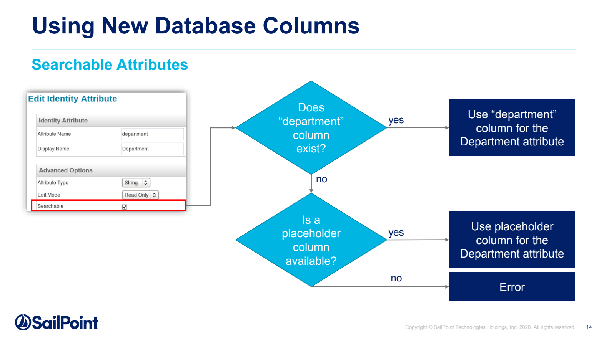
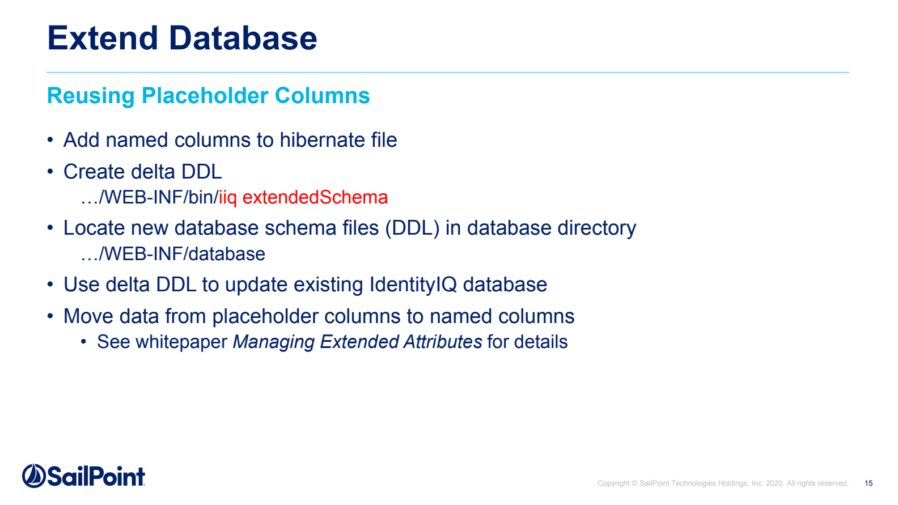
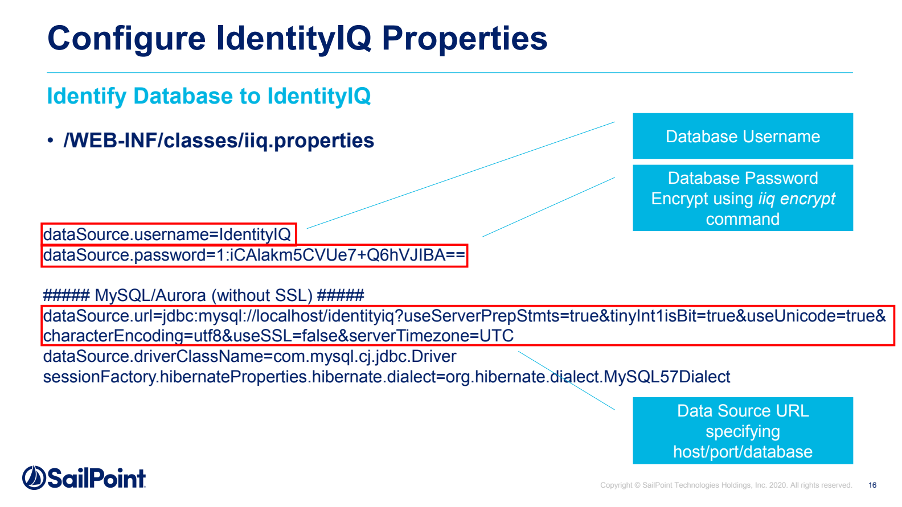
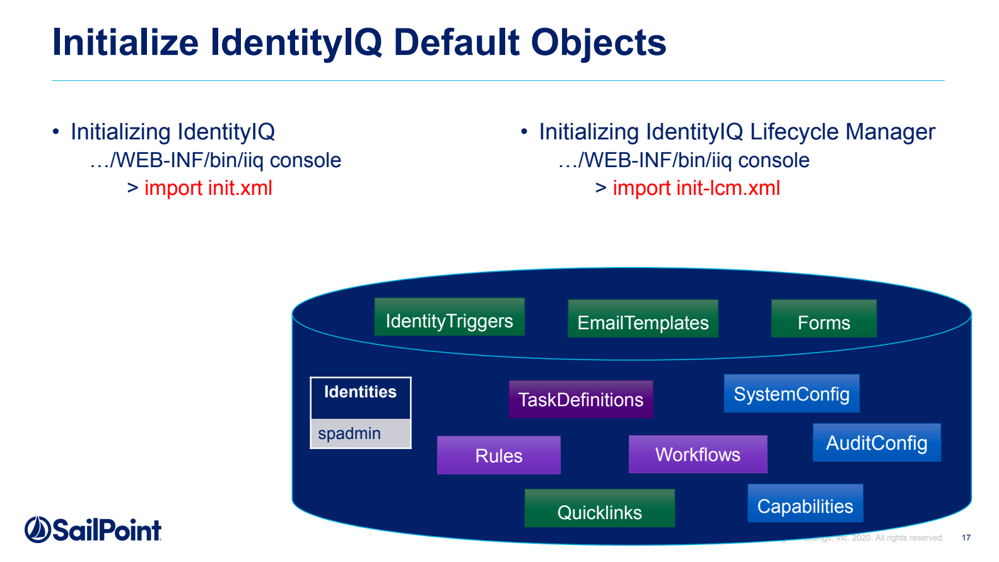

## 6. IdentityIQ Installation

### Installation sequence and its dependencies

The example assumes the application server and database server already exist. It then shows seven stages:

1. Unpack the distribution and deploy its WAR into the application-server environment.
2. Define the required implementation-specific extended attributes in the relevant Hibernate mapping files.
3. Generate database schema DDL that includes those customizations.
4. Create the IdentityIQ database using the appropriate generated script.
5. Configure the database connection in `WEB-INF/classes/iiq.properties`.
6. Initialize the supplied system objects, plus Lifecycle Manager objects when applicable.
7. Apply the appropriate patch following the version-specific installation instructions.

This sequence explains dependencies: the schema must describe the desired columns before the database is created, and the console needs working database connectivity before it can import objects. The lesson describes patches as cumulative for its example release. No software was installed or patched during the preparation of these notes.

### Extended attributes and internal object names

Applications, roles, certification items, identities, accounts and entitlements can have extended attributes. The narration highlights identities as a common example and connects three user-facing terms to internal names: **role → Bundle**, **account → Link**, and **entitlement → ManagedAttribute**.

A non-searchable extended attribute is stored within the object's attribute data, described here as a CLOB, or character large object. Multiple attribute values can share that storage. A searchable attribute has its own database column, making it suitable for efficient filtering, correlation and repeatedly accessed report or rule criteria.

The narration explains that selecting **Searchable** affects storage and availability in features such as Advanced Analytics. Accessing data in a CLOB remains possible, but it may be inefficient for repeated searches. Searchability is therefore both a functional and a database-design consideration.

### Standard, named and placeholder columns

Standard columns are supplied by IdentityIQ. **Named extended columns** are added for requirements whose attribute names are known, such as department or location. **Placeholder columns**, such as `extended1`, reserve space for later searchable attributes whose names were not known when the database was designed.

The course describes a limit of 20 placeholder columns per object for its version. Named columns are still constrained by the database and implementation design; they are not literally unlimited. Indexes can improve searches while adding work to updates, so indexing is a deliberate design choice.

Relevant Hibernate mapping files, such as `IdentityExtended.hbm.xml`, define the additional columns and optional indexes. Adding an attribute through a screen does not eliminate the need for appropriate storage in the database schema.

### Generating and applying the schema

The lesson uses `WEB-INF/bin/iiq schema` to generate DDL scripts in `WEB-INF/database`. The generated scripts cover the supported database types of that release; choose the one for the actual database engine.

The narration distinguishes the generated customized creation script from the similarly named default script distributed with the product. Using the wrong one can omit the extended columns. In its MySQL example, the database administrator runs the selected DDL through the database console to create the database structures.

### How a searchable attribute gets a column

When a searchable attribute is configured, IdentityIQ first looks for a matching named column. If one exists, it uses that column. Otherwise, it assigns an available placeholder and records that association. If neither is available, configuration fails and the schema needs to be extended before another searchable attribute can be added.

A useful example is Department. A named `department` column supplies dedicated storage; without that column, an unused placeholder can hold its values. Merely choosing Searchable cannot create limitless additional storage.

### Extending an existing database

The course describes reclaiming placeholder capacity by defining named columns for known attributes, generating delta DDL with `iiq extendedSchema`, applying the schema changes, and moving the existing data into its intended columns. This is different from rerunning a full create-database script.

The narration points to a separate Managing Extended Attributes reference for the detailed migration procedure. That external document has not been captured or verified in this batch. The notes explain the process, but do not supply an unverified production migration recipe.

### Properties and initial objects

`iiq.properties` identifies the database endpoint, username, password, driver and dialect. The lesson's example shows an encrypted password generated through the IdentityIQ encryption utility and explains enabling the block for the chosen database type while disabling irrelevant examples. Connection strings and example settings on the original slide are historical training material.

The IdentityIQ Console imports `init.xml` to create the standard objects, including the initial administrative identity and default configurations, tasks, rules, reports and workflows. If Lifecycle Manager is included, `init-lcm.xml` adds its objects. XML imports are also a mechanism for bringing in implementation-specific object definitions.

The console does **not** require the web application server to be running, but it **does** require its database connection to work. A successful console startup therefore provides an early connectivity check. Browser access additionally requires the application server and deployed web application to be available.

**Player-label discrepancy:** Module 6's embedded player displayed “Product Architecture” as its heading, while its navigation title and caption text describe IdentityIQ Installation. The notes follow the verified module navigation and actual narration.

### Related practice and source pages

[Training environment and course reference](../practice-companion.html#practice-reference) · [Exercise 1.1 — Configure IdentityIQ](../practice-companion.html#practice-1-1) · [Appendix — synonyms, Linux, installation and lab tools](../practice-companion.html#practice-appendix)

