## 7. Creating Identity Cubes

### What the cube represents

An Identity Cube is the collected view of one person or other entity that holds access. It includes identity attributes, application accounts, entitlements and roles, risk information, policy findings and rights within IdentityIQ. It is more than an account record from a single application.

The narration distinguishes four ways information reaches this view: aggregation **discovers** data; a request initiates a change; an assignment establishes access through business logic; and calculations produce results such as risk scores or policy violations. These mechanisms explain why two fields visible on a cube can have different origins and update paths.

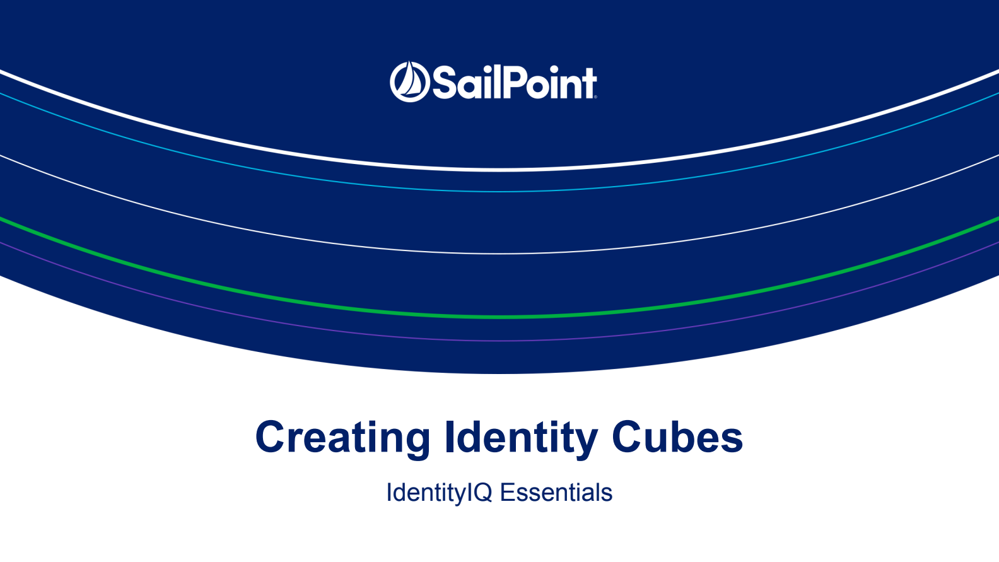

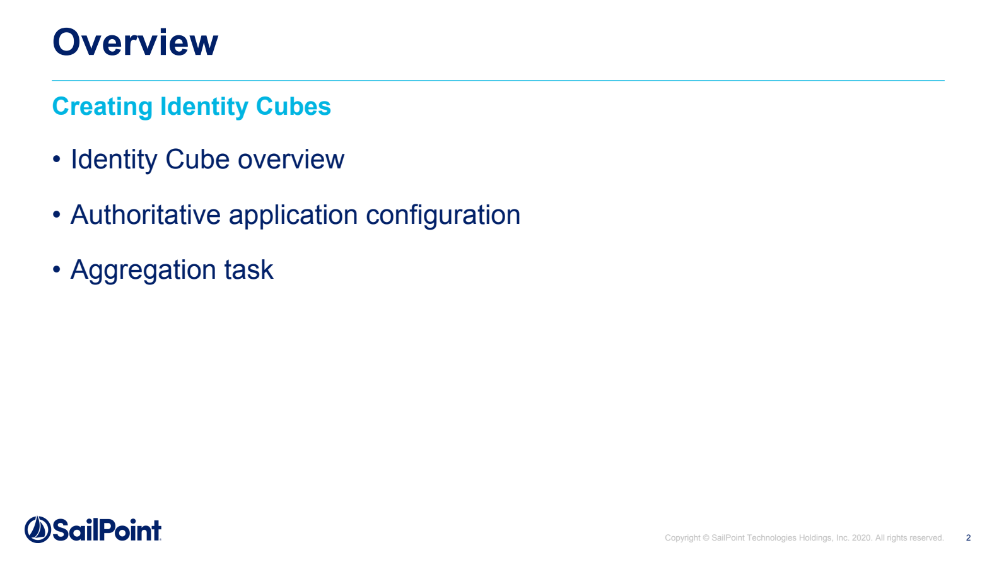

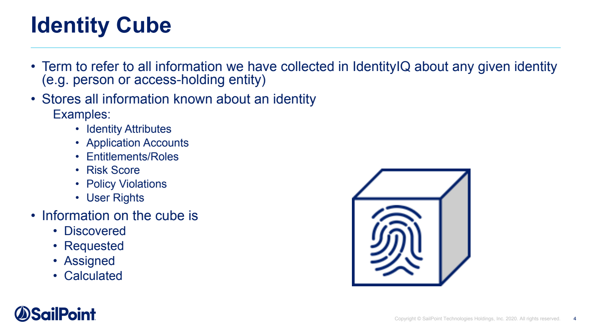

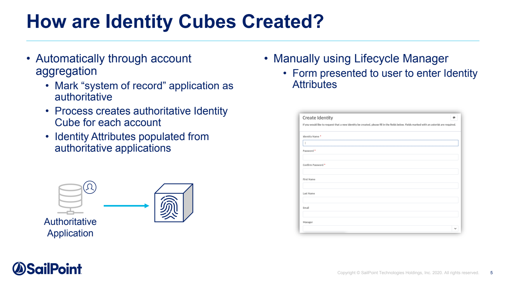

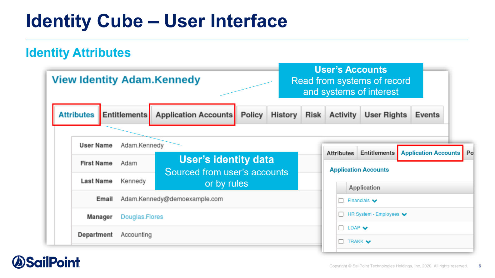

### Configure the authoritative source

An authoritative application supplies the population from which authoritative identities are created. Account aggregation is the normal creation path; the Create Identity Quicklink is a separate manual path through Lifecycle Manager.

For an application definition, set its name and owner, select the connector type, and provide the connectivity details required by that connector. Mark the source authoritative only when it is intended to supply those identity records. The lesson recommends workgroup ownership once the implementation's responsibility model is established.

The account schema defines which fields to read and how to identify and display accounts. The narration's example excludes an unnecessary social-security-number field: a source can contain more data than identity management needs. Some connectors supply a useful initial schema; open-ended sources such as files and JDBC require more definition.

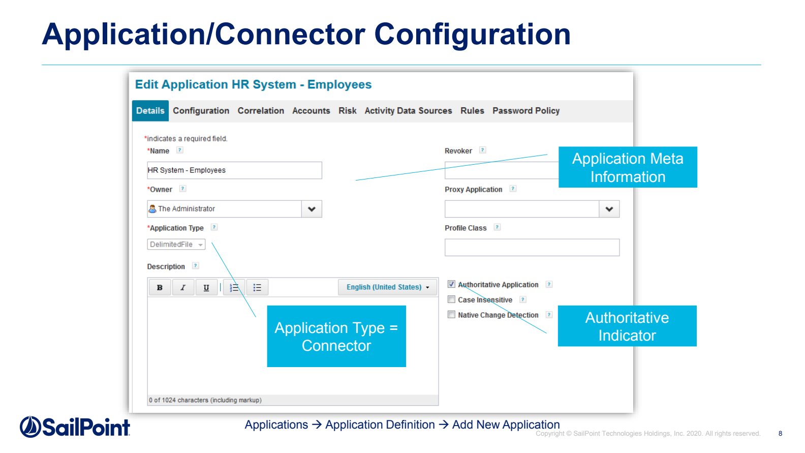

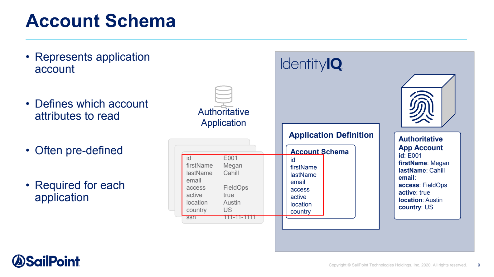

### Interpret and aggregate the data

After connectivity and schema configuration, Rapid Setup defines account and manager correlation and any needed account-state or identity-type classification. Account correlation links an account to an identity; manager correlation links one identity to another. Locked and disabled are account states, while service and bot classifications describe identity types. Available controls vary with what the connector already knows and manages.

Create an Account Aggregation task for the chosen application. The task reads the application definition, invokes the connector and configured rules, and creates or updates the corresponding identity/account representation. Detect Deleted Accounts helps reconcile a complete source read with accounts that no longer exist; later delta-processing lessons explain why a partial input cannot safely be treated as the complete account population.

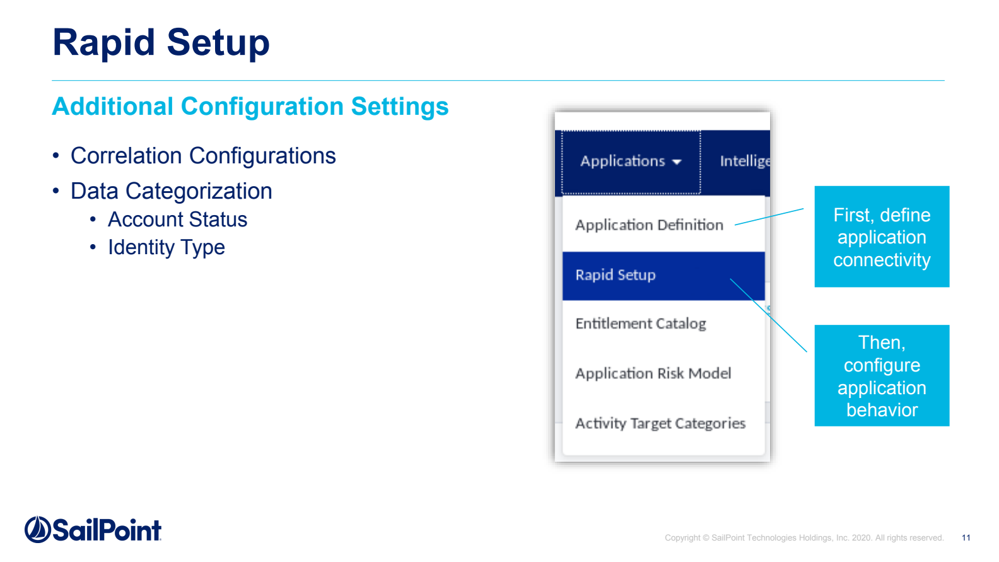

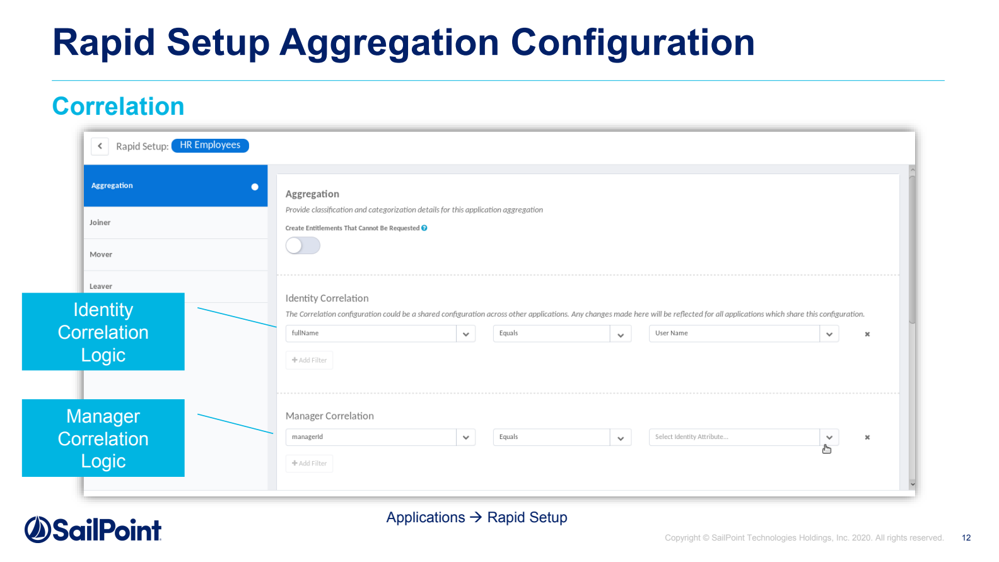

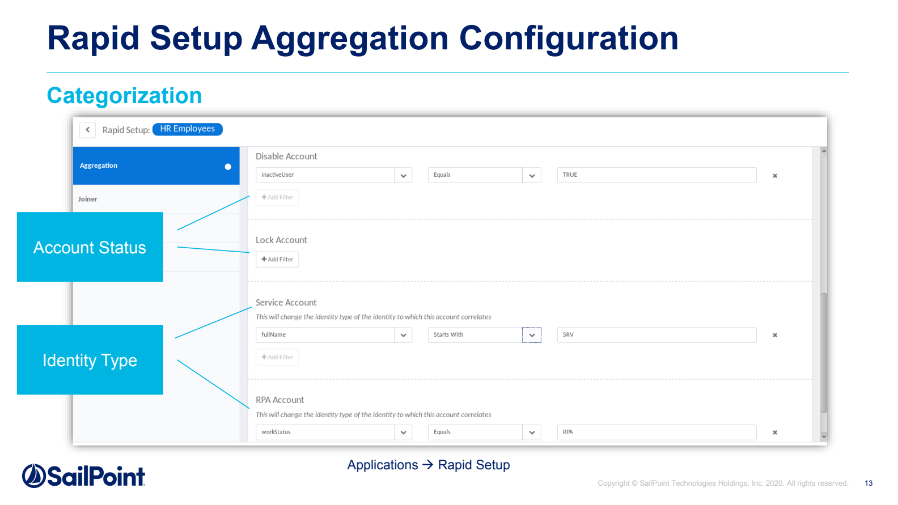

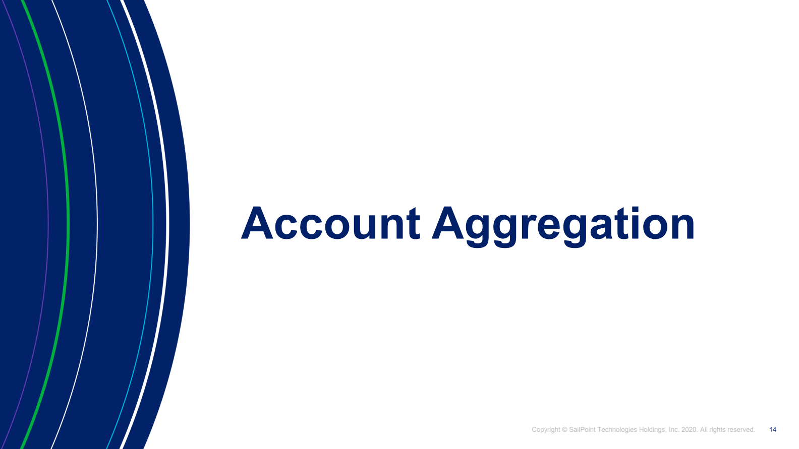

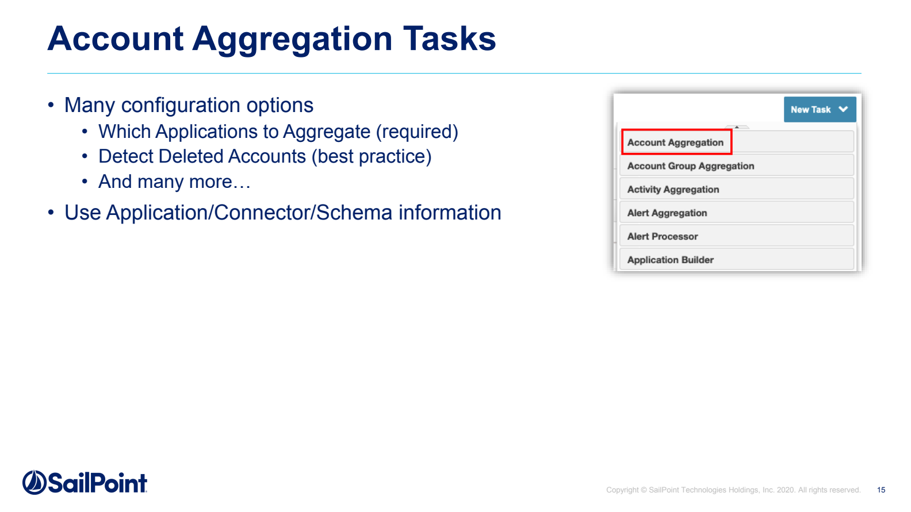

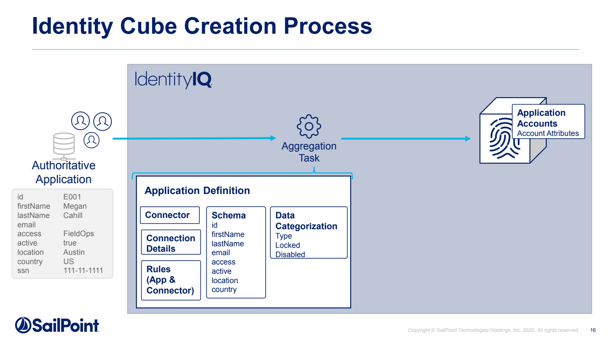

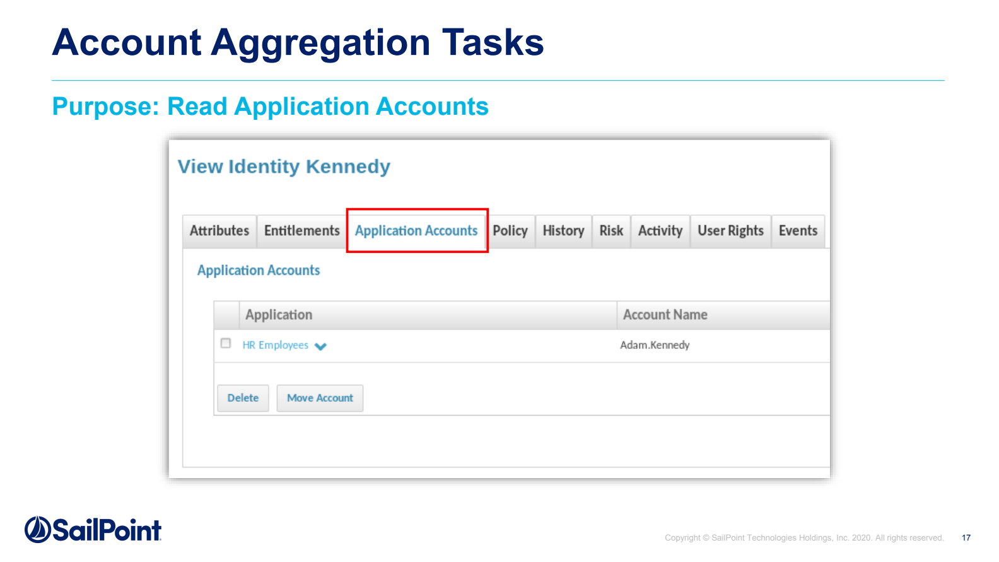

### Exercise 1.2 study sequence

Define HR Employees and HR Contractors from the provided delimited files. Discover and review the schemas, select the identifier and display fields, mark cost center multi-valued, and configure filtering and any required row merging. Test connections and preview the data before aggregation. Apply the supplied training creation rule, configure Rapid Setup classification, then execute each aggregation and inspect its task results and resulting cubes.

The important verification is not just that a task completed: account identifiers, multi-valued data and account status must mean what the source owners intended. The original exercise pages, including their exact training settings, appear in the practice companion linked below.

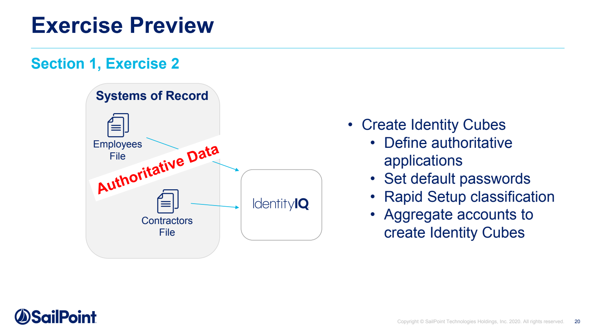

### Related practice and source pages

[Exercise 1.2 — Create Identity Cubes](../practice-companion.html#practice-1-2)

