## 8. Identity Attributes and Mappings

### Turn account data into identity data

Identity attributes drive searches, role assignment, reporting and lifecycle decisions. Standard attributes support the base product; extended attributes express installation-specific requirements. Standard attributes are searchable by default in the course model, while searchable extensions depend on the database capacity introduced in Module 6.

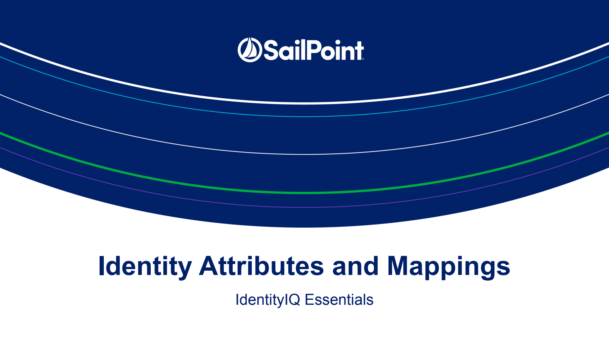

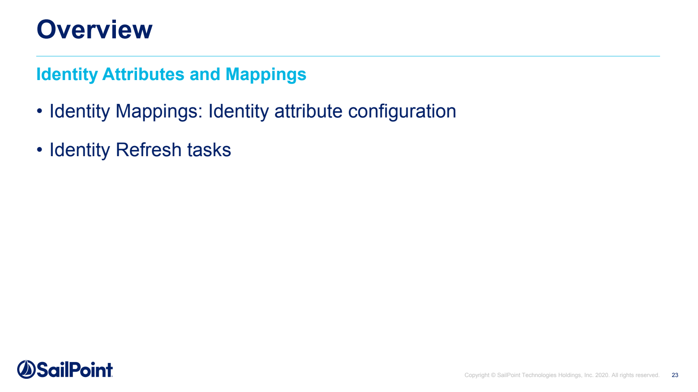

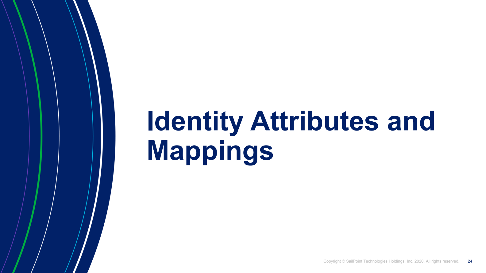

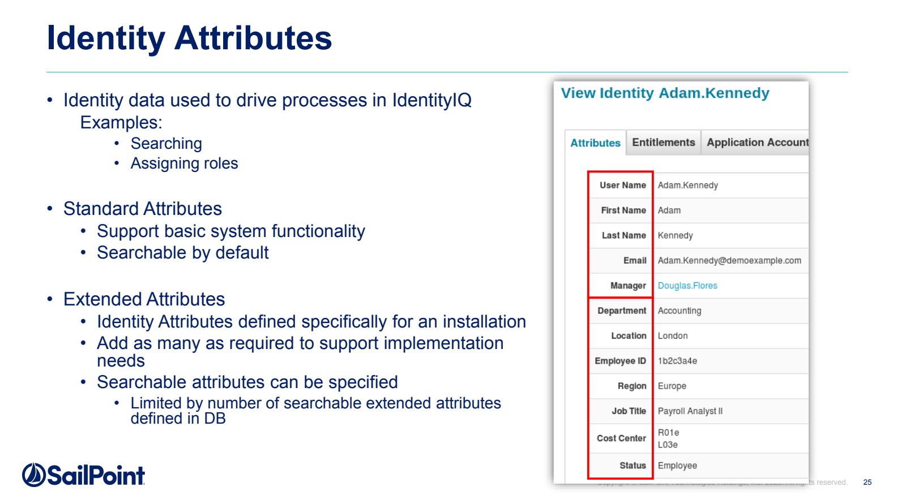

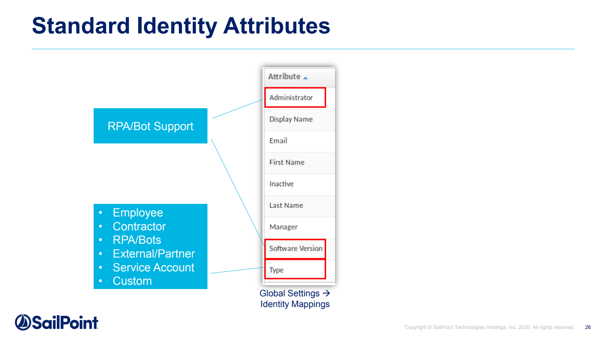

An identity mapping supplies a property name, display label, data type, edit behavior and source mappings. A source can be an application account attribute or a rule. The same identity attribute can have sources for different authoritative populations, such as employees and contractors. Account data must exist before those mappings can populate a useful identity-level value.

Searchable attributes support correlation and query criteria. Multi-valued attributes can represent several cost centers. A Group Factory setting makes an attribute eligible for dynamically defined groups, such as a group for each region. An Identity-typed attribute stores a relationship to another identity rather than merely an unrelated text label; the course discusses a version-specific limit on certain extended identity relationships.

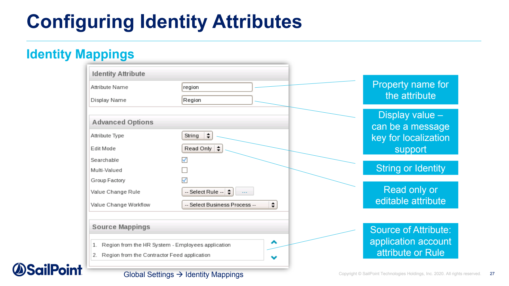

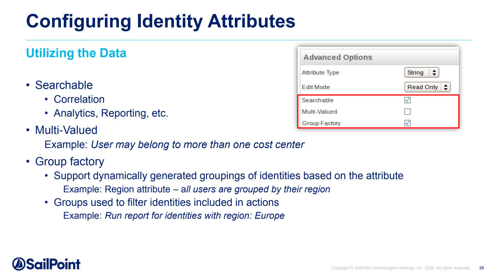

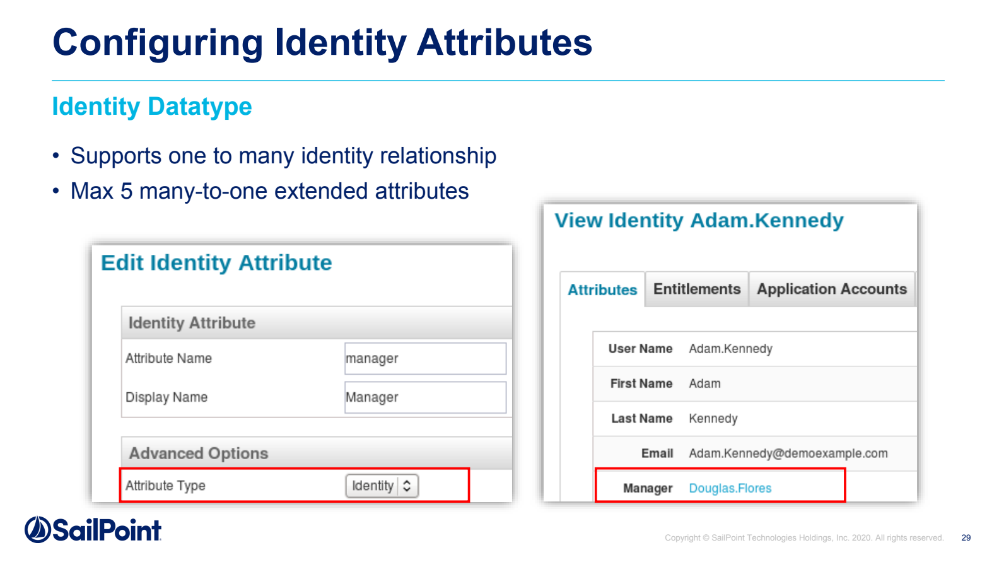

### Connect managers and run refresh

Manager correlation maps a source account's manager identifier to an attribute on the manager's Identity Cube. It can be configured in the application definition, Rapid Setup or a rule. A manager's name merely appearing in a source field does not prove that this relationship has resolved correctly.

Refresh performs the configured calculations: promoting account data into identity attributes, marking manager status, preparing entitlement information for certification, evaluating roles, checking policies and processing events. Select the actions the implementation actually needs rather than enabling every available calculation indiscriminately.

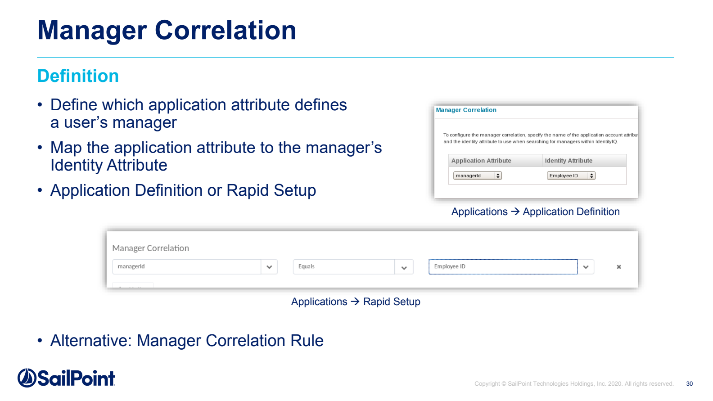

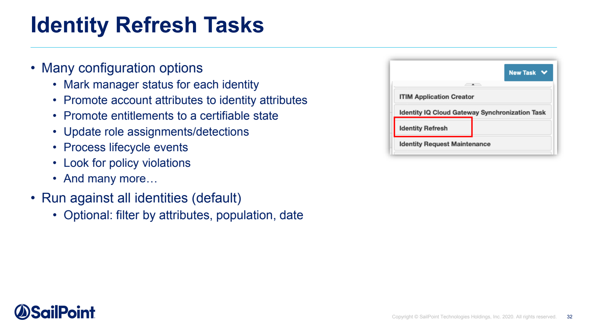

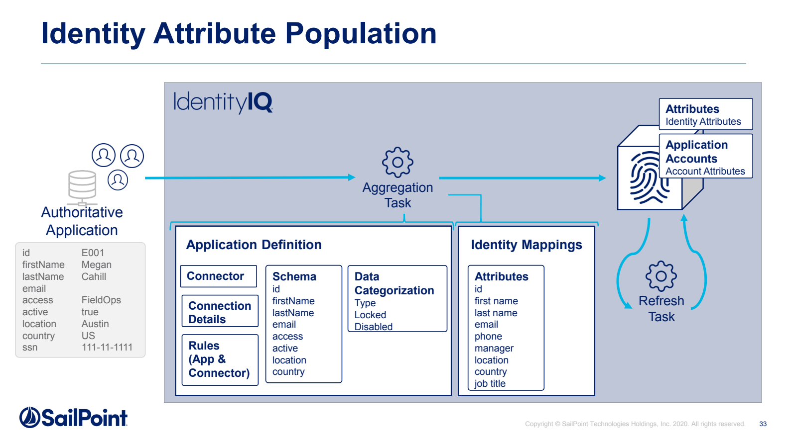

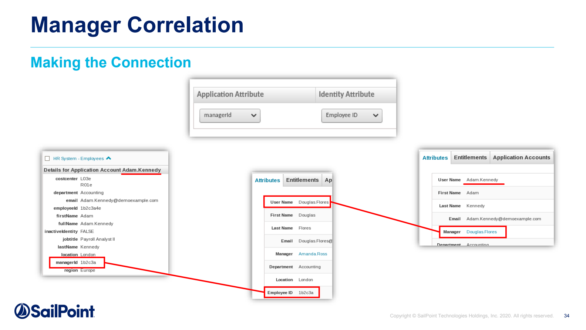

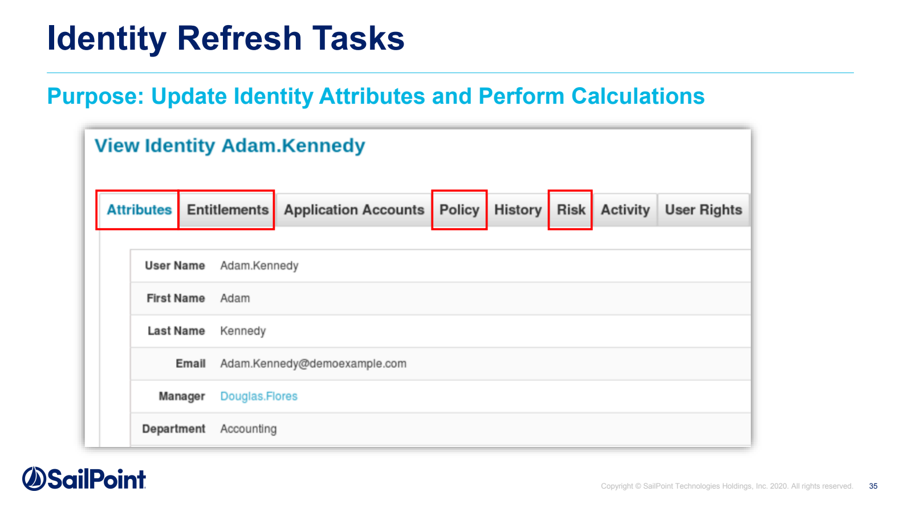

### Schedule and verify

Aggregation frequency depends on the business use case and source importance. Certification preparation and operational provisioning can need different schedules. Refresh timing should follow the data it depends on and run its heavier calculations only as often as required.

Exercise 1.3 configures sources for standard and extended attributes, defines employee/contractor account and manager correlations, and runs a focused refresh. It then updates the UI attribute list and uses Advanced Analytics to investigate inactive identities and missing managers. Compare the source account, identity attribute and displayed field separately when diagnosing a missing value.

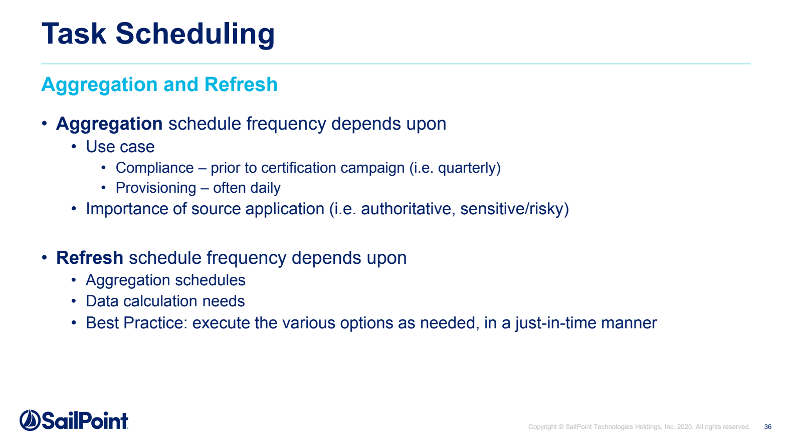

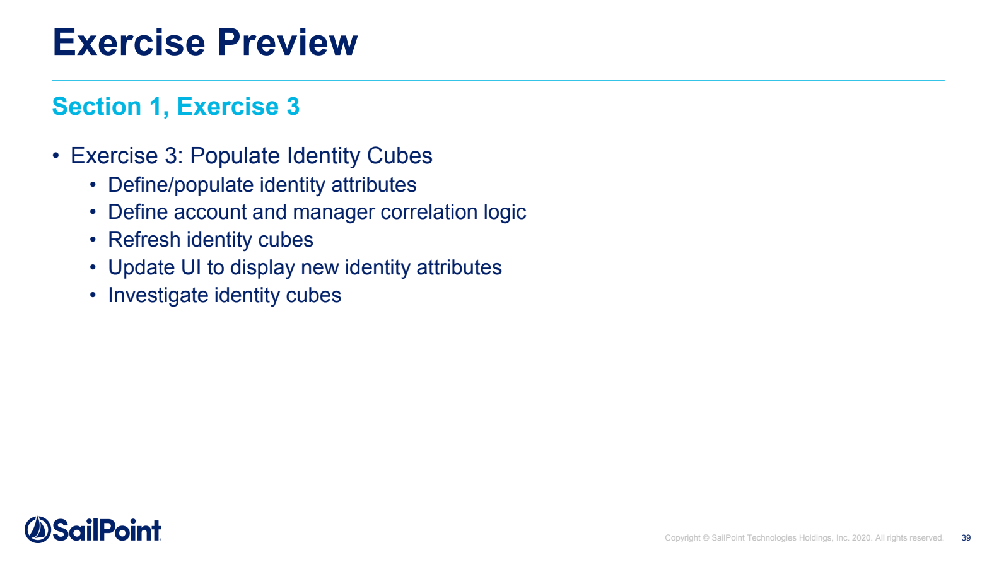

### Related practice and source pages

[Exercise 1.3 — Populate Identity Cubes](../practice-companion.html#practice-1-3)

