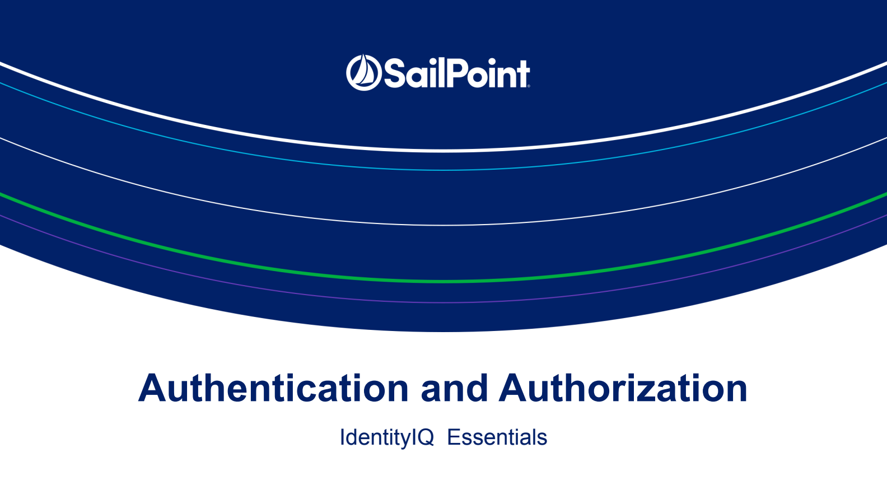
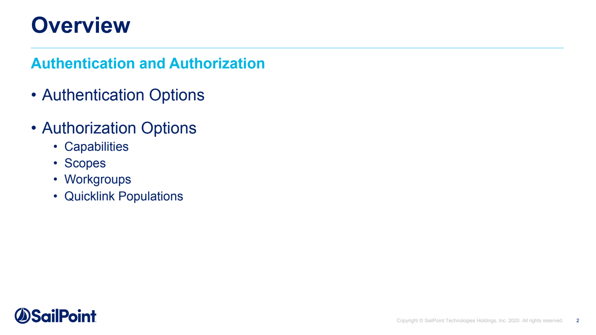
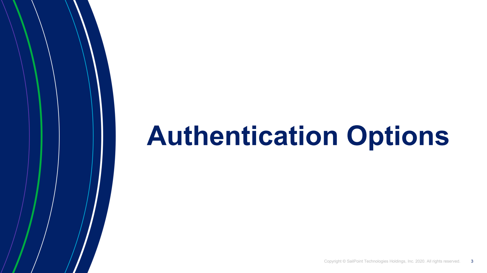
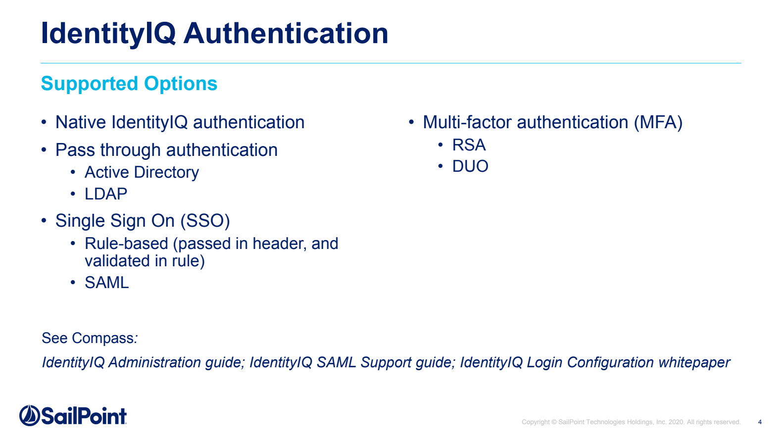
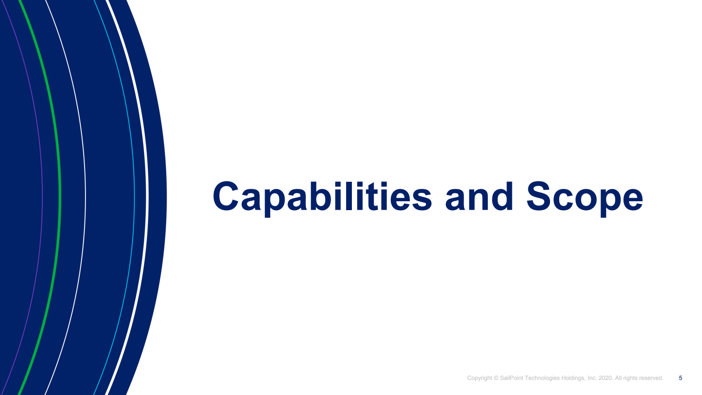
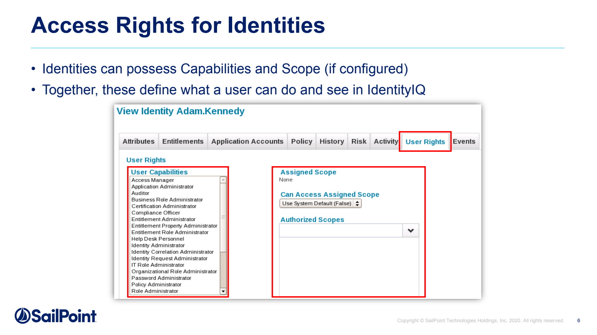
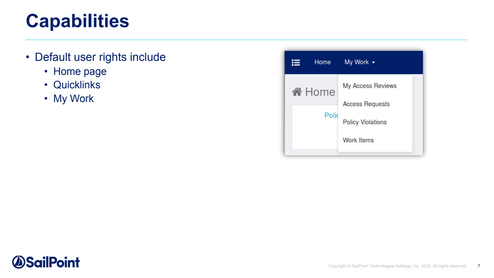
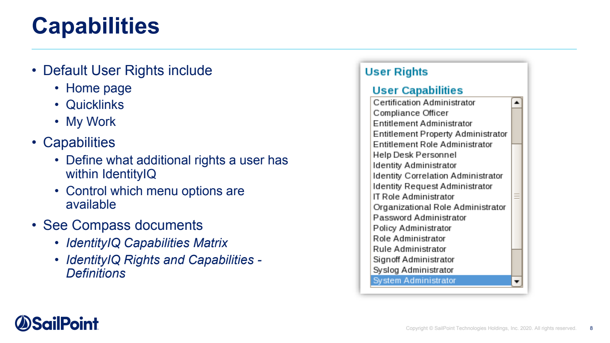
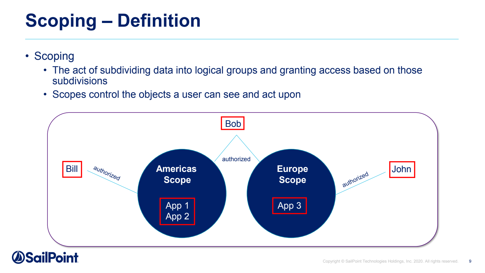
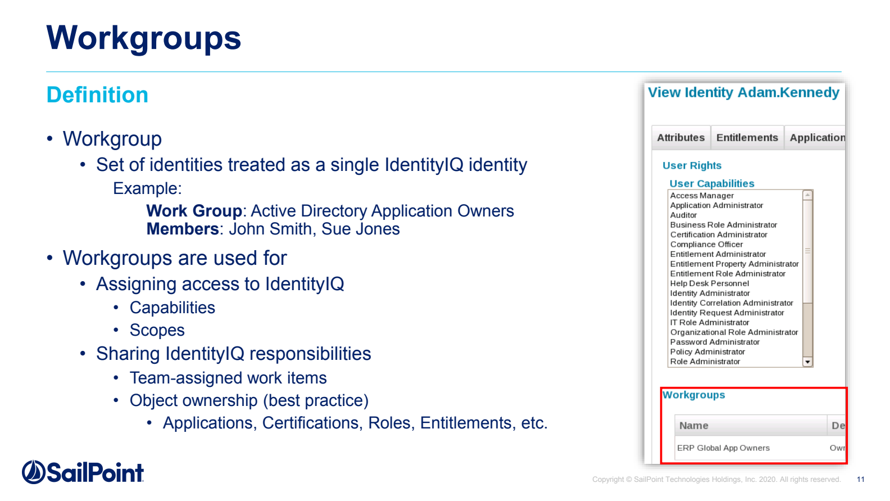

## 9. Authentication and Authorization

### Proving identity versus granting rights

Authentication establishes who is signing in. The course lists native IdentityIQ authentication, directory pass-through, SSO mechanisms and MFA integrations available in its version. These slides are historical training material, not a current support matrix or a recommendation to select any particular legacy provider.

Authorization determines what an authenticated identity can do and see. **Capabilities** add functional rights and control available operations and menus. **Scopes**, when configured, divide the managed data into logical areas and restrict which objects a person can see or act upon. The regional illustration shows that permission to use a feature and permission to see a particular region's objects are distinct.

### Share responsibility through workgroups

A workgroup is a set of identities treated as a shared IdentityIQ identity for appropriate operations. It can own applications, roles, certifications or entitlements; receive shared work items; and convey capabilities and scopes to members. An Active Directory owner workgroup avoids making a single person's account the only operational owner.

Do not confuse a workgroup with an account group on a target application, a saved population or an attribute-generated group. Their names may sound similar, but their operational purposes differ.

Exercise 1.6 configures LDAP pass-through and the account attributes used for login, then tests the intended sign-in path in the training VM. Its additional password-reset exercise enables the feature, configures challenge answers and tests the resulting flow. These are recorded study steps; no authentication settings or user credentials were changed while creating this book.

### Related practice and source pages

[Exercise 1.4 — Organize Identities](../practice-companion.html#practice-1-4) · [Exercise 1.6 — Enable Pass-Through Authentication](../practice-companion.html#practice-1-6)

