## 10. Organizing Identities

### Populations are reusable identity queries

A population stores search criteria that identify a set of identities. It can combine several conditions, such as active contractors in a region. Saving it preserves the query rather than a permanently frozen list of people. Tasks, certifications and reports can use that population to define their target identities.

Create a population from an identity search in Advanced Analytics. Use Setup → Groups to inspect its name, owner, description, enabled state, visibility and current matching identities. Public/private here concerns the population definition's availability in IdentityIQ, not a change to GitHub repository visibility.

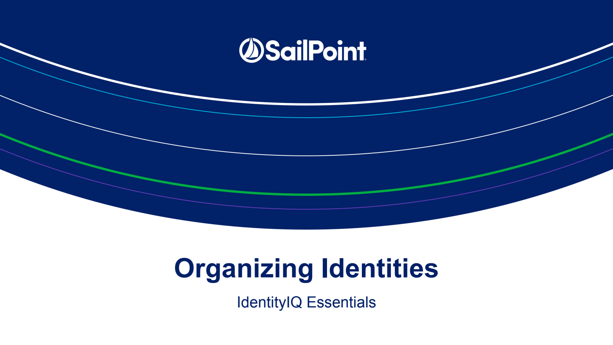

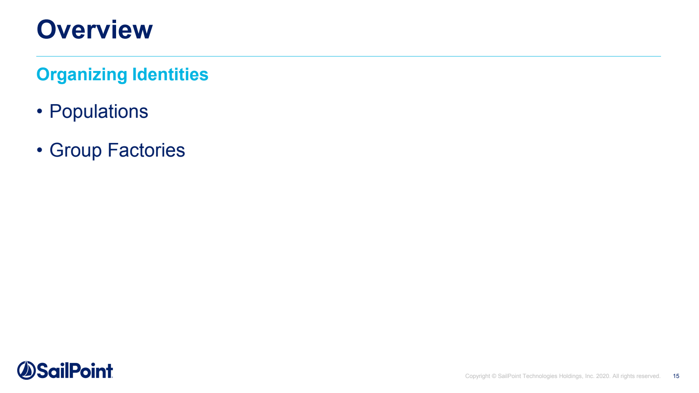

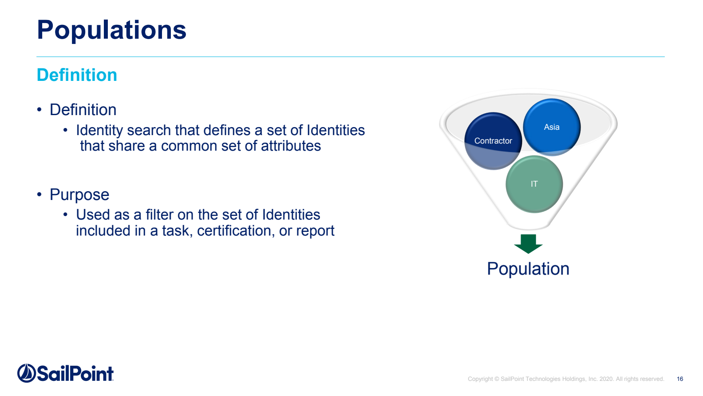

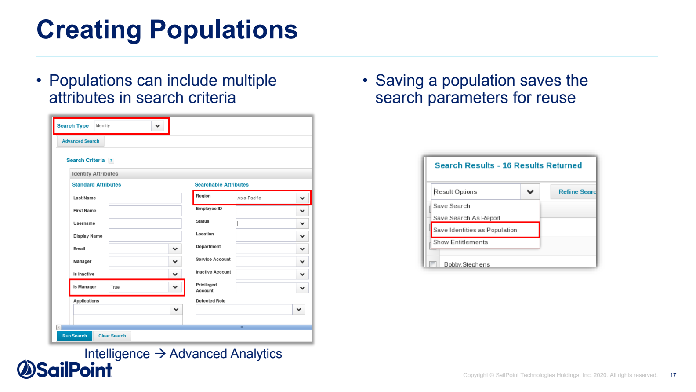

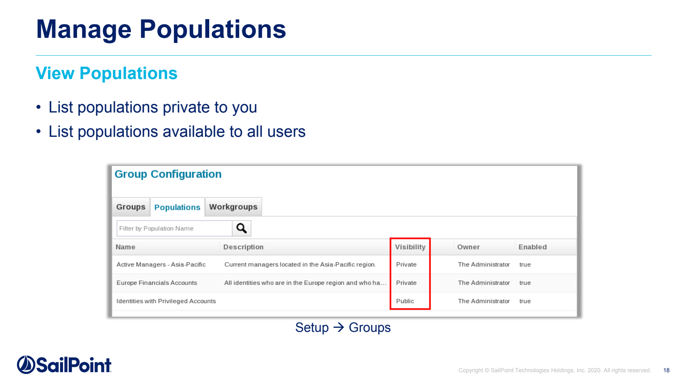

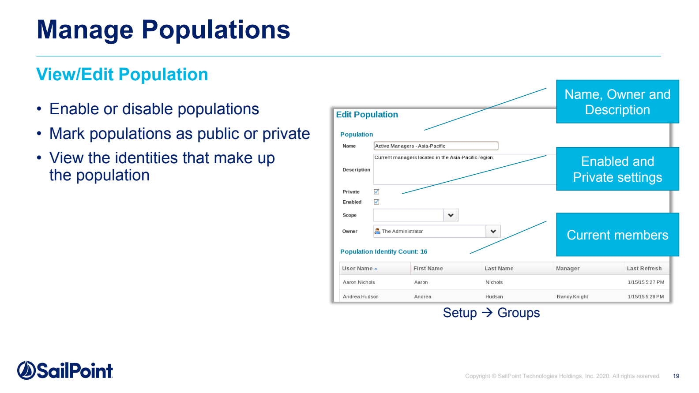

### Group factories organize one attribute at a time

An attribute-based group factory creates a subgroup for each value of one identity attribute, such as Location. Mark the identity attribute appropriately, define the group factory, and run Refresh Groups. The example generates Austin, London, Paris, Tokyo and Sydney groups.

There are two different freshness questions. The set of subgroup definitions is updated by Refresh Groups, so a newly introduced location may need that task before its subgroup exists. Membership is evaluated against the current identity criteria when the group is used. Refreshing group definitions and resolving current members are therefore related but distinct.

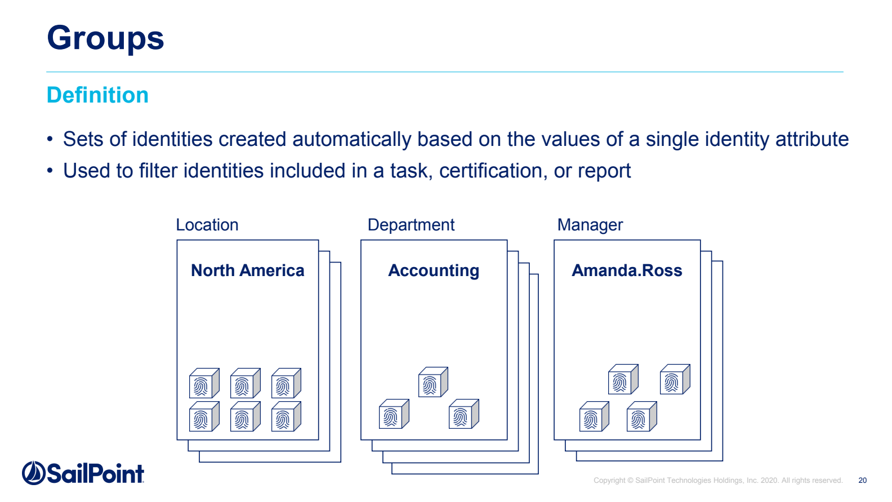

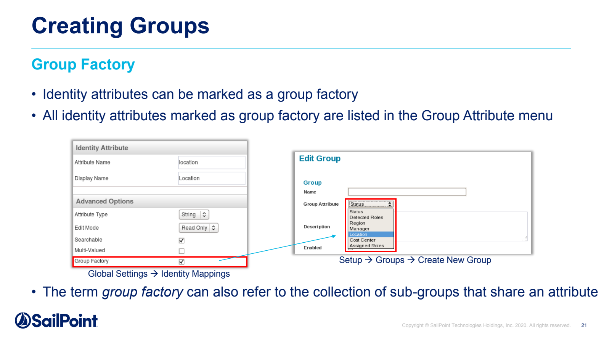

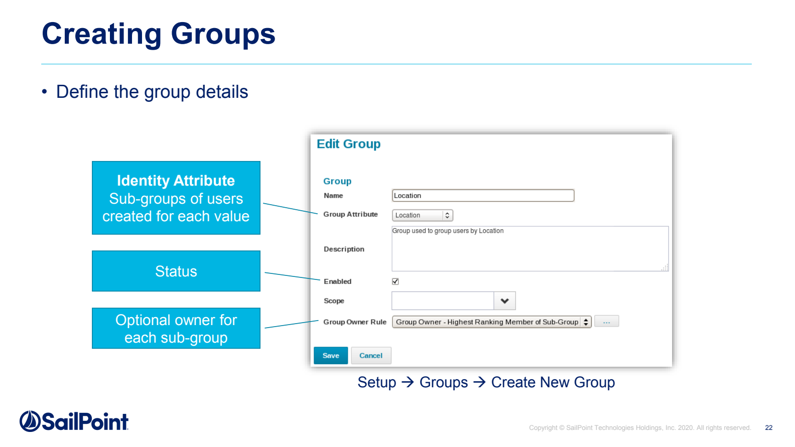

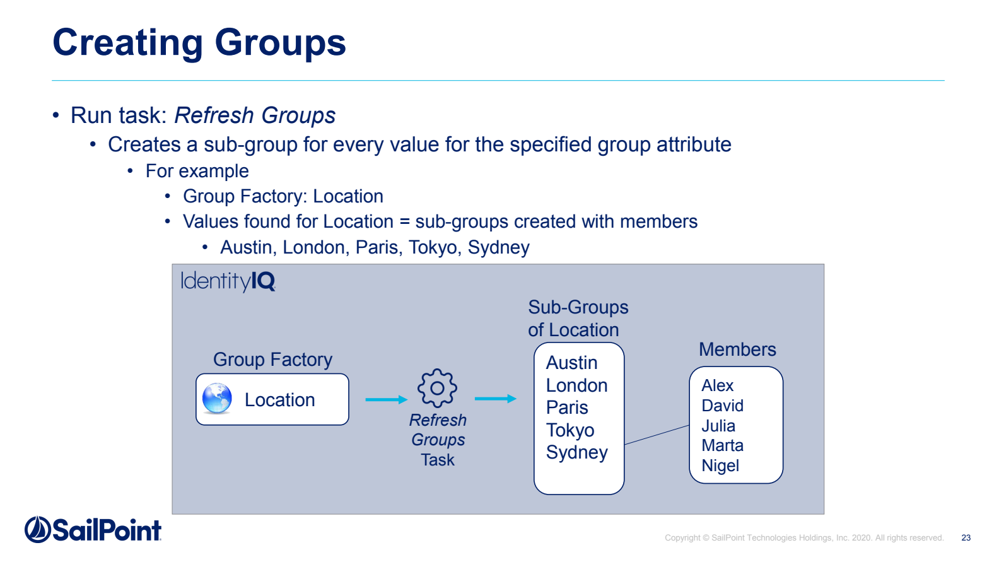

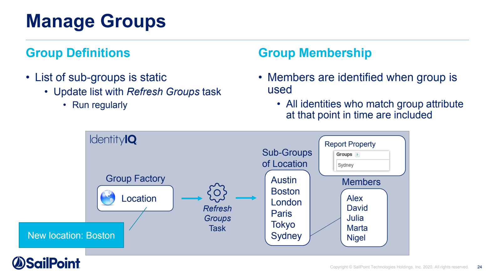

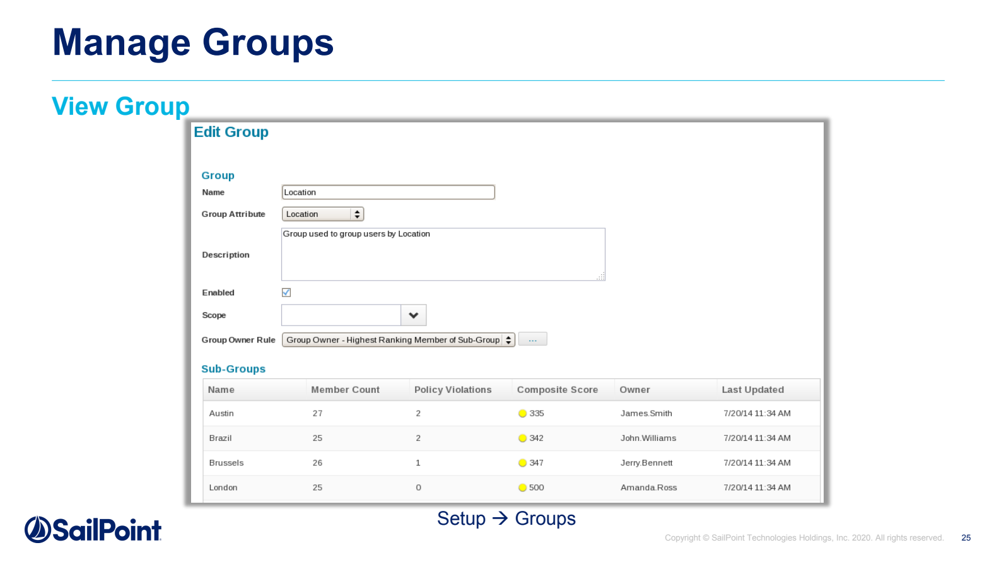

### Choose the appropriate grouping tool

Populations support flexible, multi-condition criteria and are created individually. Group factories generate single-attribute groups in bulk. Both store membership criteria and query dynamically at use time. The slide also distinguishes their applicability in task filters and identity selectors; do not assume every grouping control accepts both interchangeably.

Exercise 1.4 creates active-employee, active-contractor and authoritative-identity populations; generates groups; and establishes Admins, Business Analysts and Operations workgroups. It verifies capabilities through a report and an identity's User Rights view, configures Rapid Setup notifications and transitions away from reliance on the initial administrator. The provided training instructions, rather than these notes, contain the exact exercise accounts and settings.

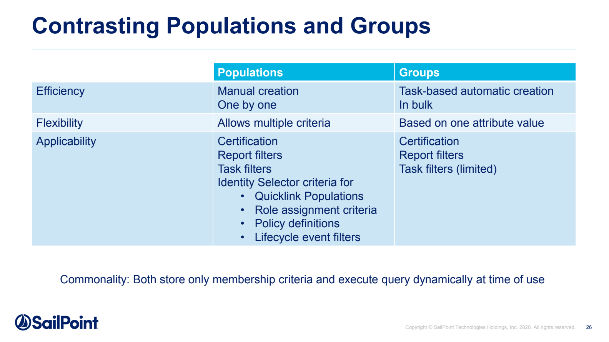

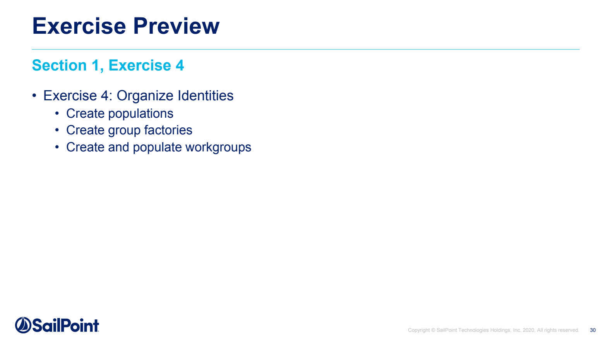

### Related practice and source pages

[Exercise 1.4 — Organize Identities](../practice-companion.html#practice-1-4)

