## 11. Onboarding Additional Applications

### Plan the application and its access model

After authoritative identities exist, additional systems supply the accounts and access to govern. Plan onboarding in phases. Establish connectivity, account identifiers and useful account attributes, and decide which values represent entitlements or native account groups. A group on a target system can imply a set of permissions; its membership is access data, not membership in an IdentityIQ workgroup.

The course points to connector documentation and deployment questionnaires covering staffing, application requirements and migration/rollback planning. Those references are listed in the original slides; their current external contents are not archived here.

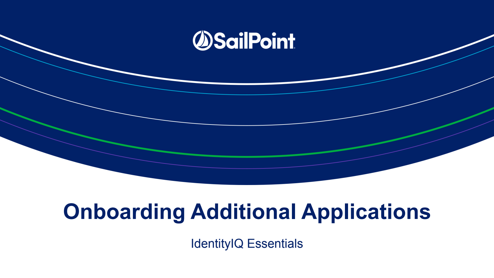

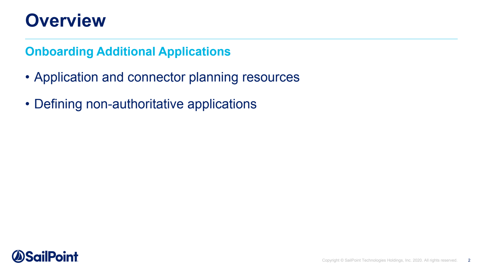

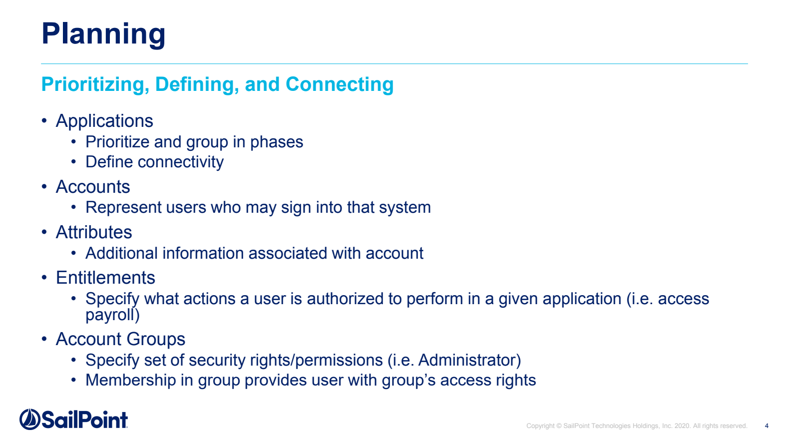

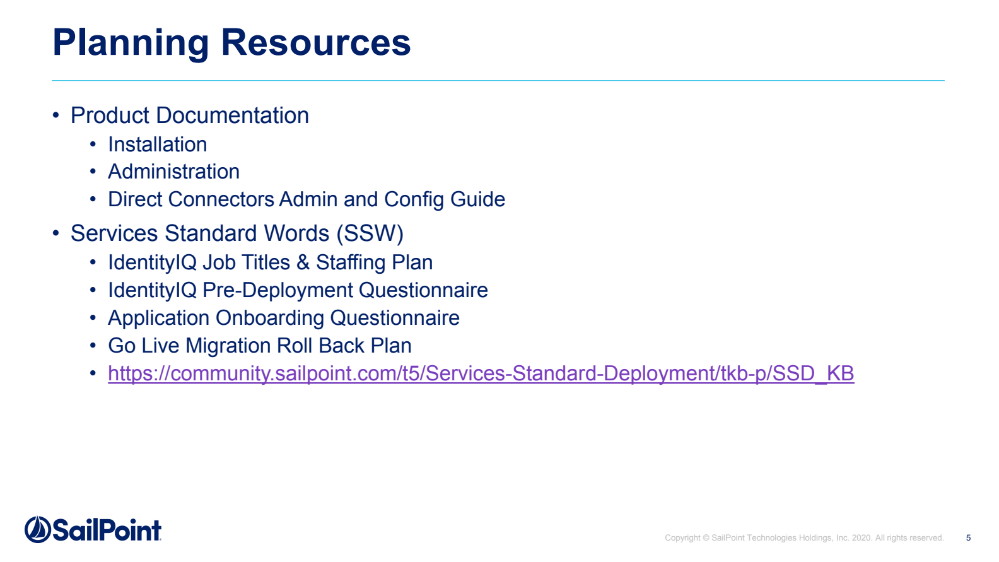

### Configure schema, groups and interpretation

A non-authoritative application still requires an account schema. Identify the unique account attribute and display attribute. Mark the relevant access-bearing fields **Entitlement** so they participate in the identity's access picture, and **Managed** when their values should become governed Entitlement Catalog objects with descriptions, owners and request-related metadata.

Group schemas represent native account-group objects. Their definitions explain what membership means and can provide group descriptions and indirect permissions. The account schema's group-object reference connects an account's membership field, such as `memberOf`, to the appropriate group schema.

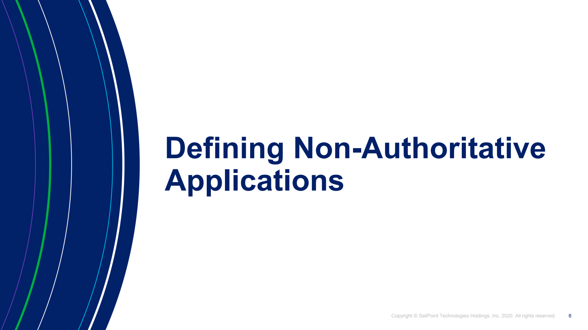

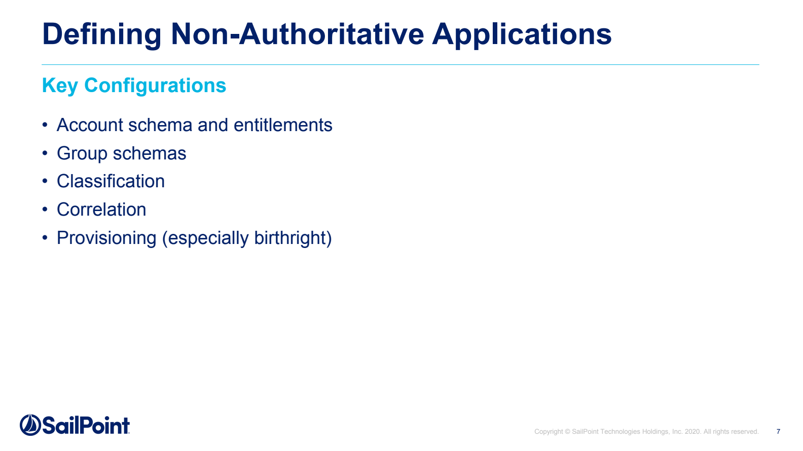

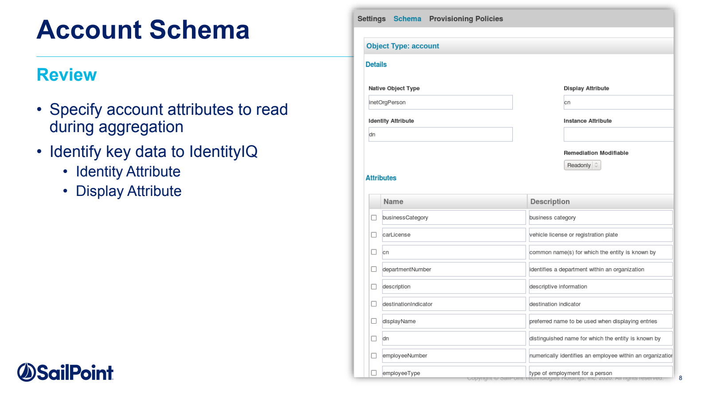

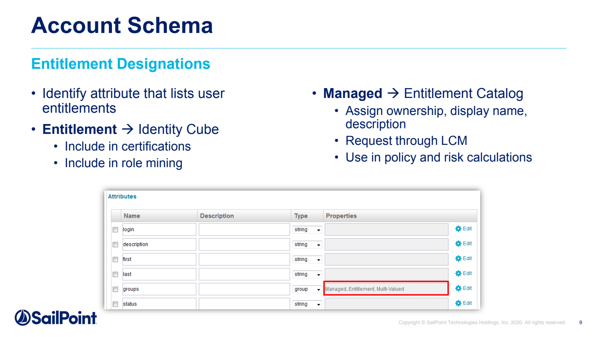

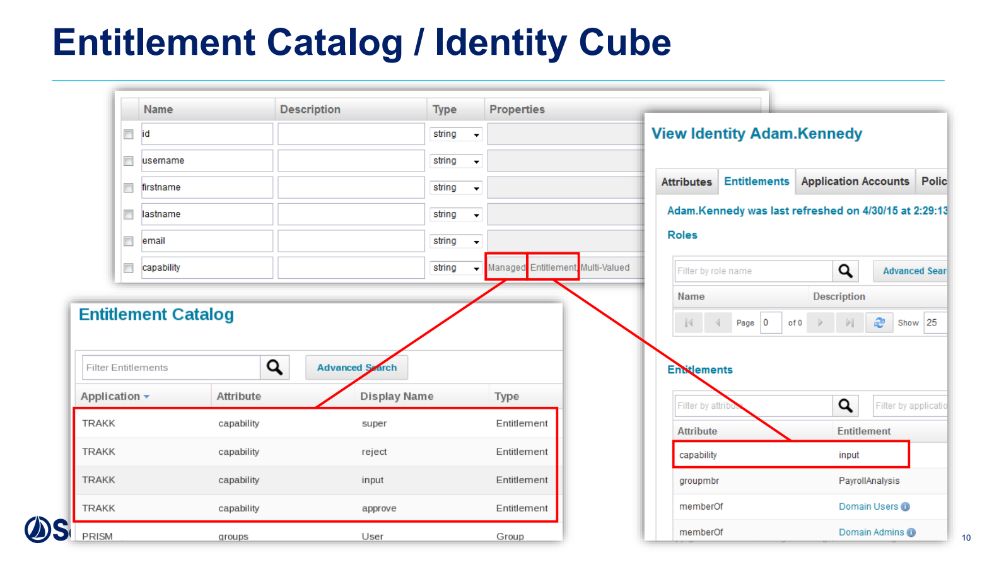

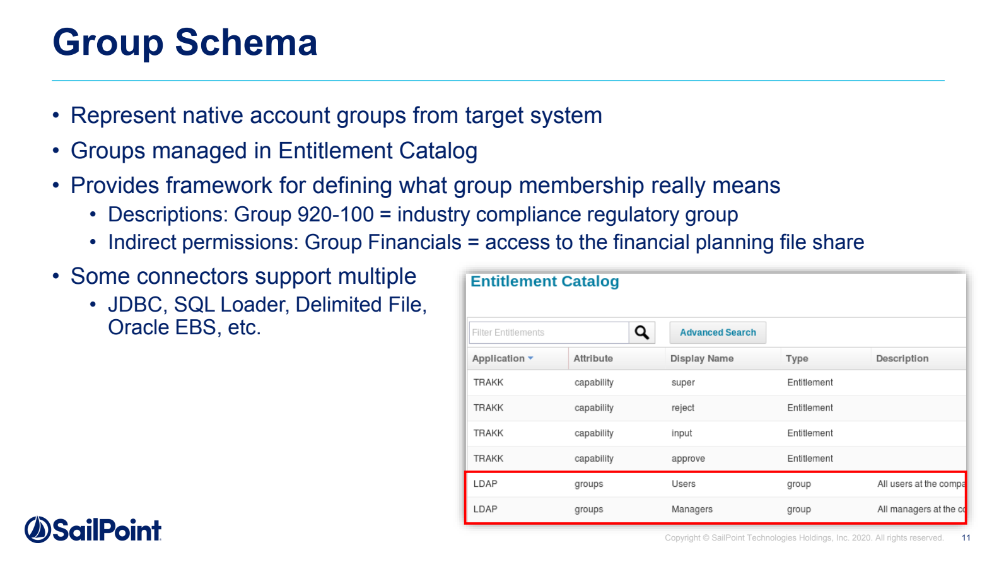

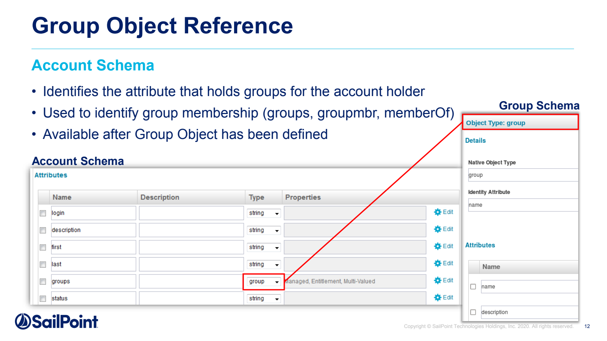

### Make requestability a deliberate decision

The course contrasts infrastructure systems with large, technically named entitlement sets and business applications with access items users can understand. It recommends different requestability defaults for these scenarios in its Rapid Setup example. This is a design pattern to evaluate, not evidence that every entitlement in a real deployment should share the same setting.

Also configure correlation, locked/disabled classification and service/bot interpretation as needed, and anticipate provisioning requirements. The final comparison slide separates account groups, workgroups, populations and group factories.

The LDAP and business-application exercises apply this process: configure connection and search settings, inspect provided schemas, preview accounts and groups, define correlation and classification, then aggregate and inspect the resulting identities and catalog entries.

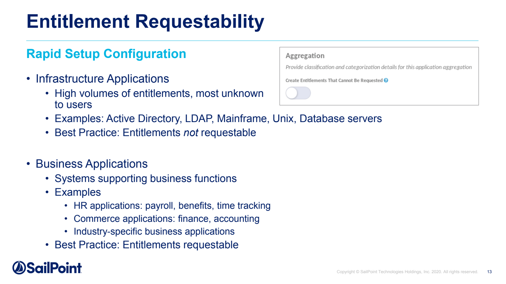

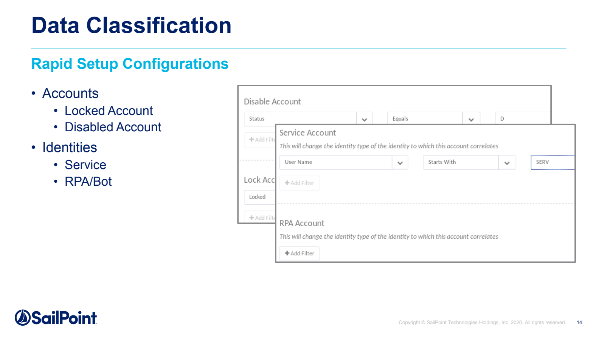

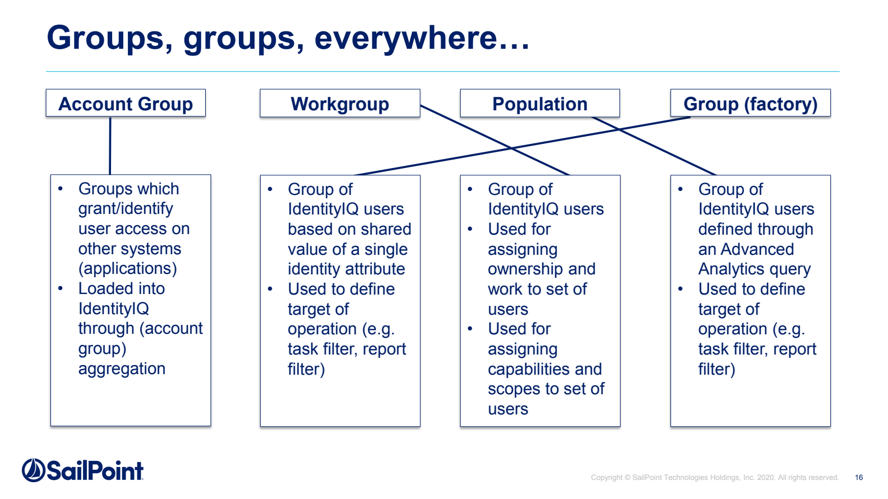

### Related practice and source pages

[Exercise 1.5 — Define LDAP Application](../practice-companion.html#practice-1-5) · [Section Two — overview and contents](../practice-companion.html#practice-section-2) · [Exercise 2.1 — Define Business Applications](../practice-companion.html#practice-2-1)

