## 12. Account Correlation

### Attach accounts to the correct identity

Correlation matches an application account to its authoritative Identity Cube. Success adds the account to the intended existing cube. Unsuccessful correlation can create a non-authoritative, uncorrelated cube, which needs investigation rather than being assumed to represent a new employee.

The supplied precedence is **correlation rule → configured correlation logic → default logic**. Rapid Setup provides a straightforward account-attribute-to-identity-attribute match. The correlation wizard supports ordered conditions in a reusable definition. A rule handles cases beyond simple matching but runs for each account during each aggregation, so its correctness and cost matter.

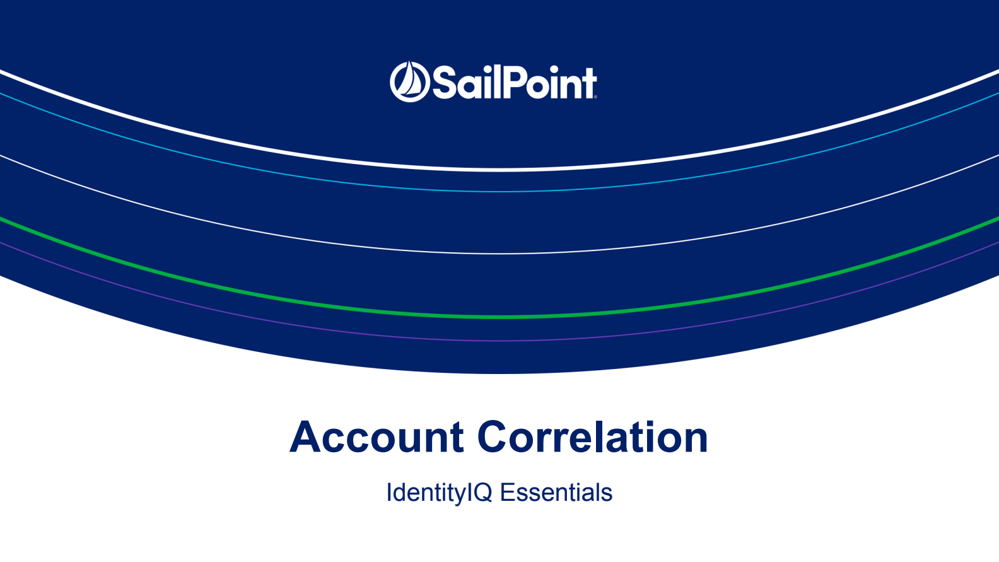

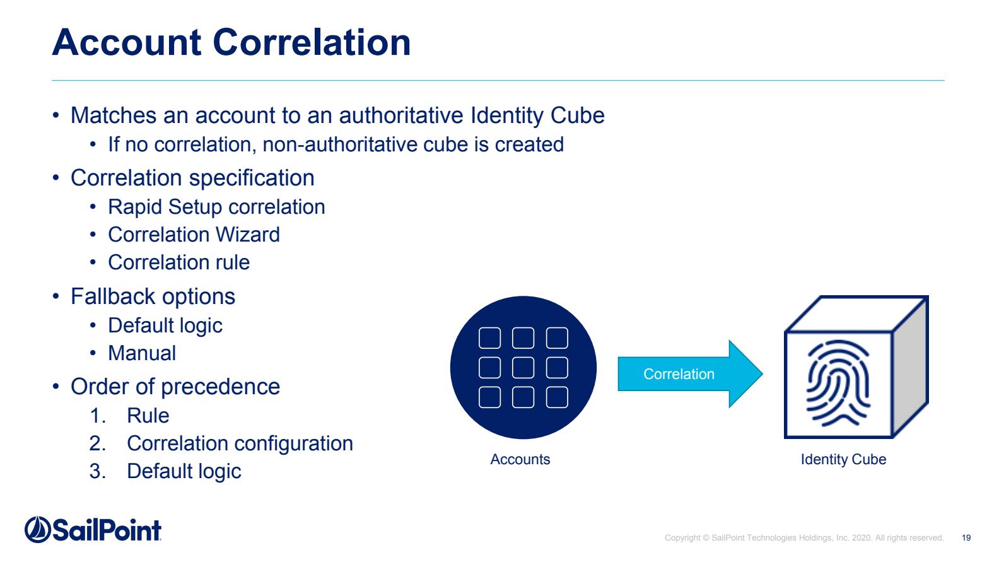

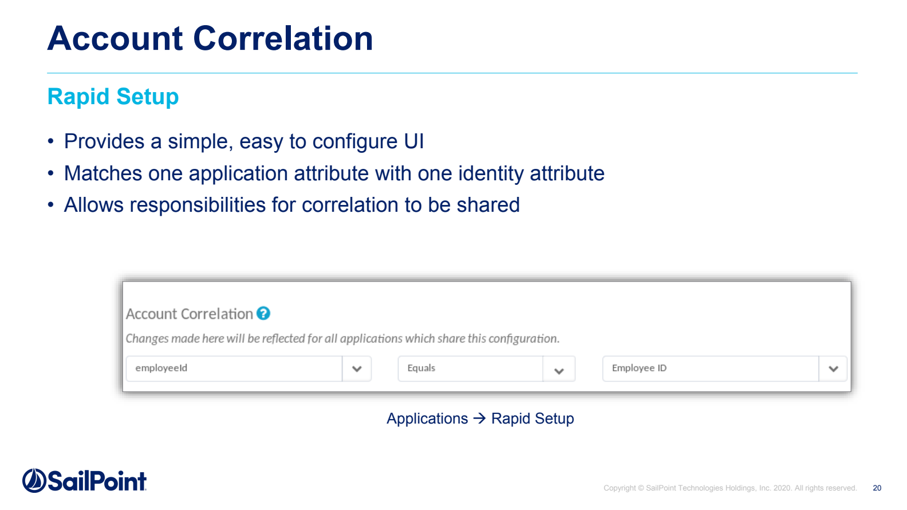

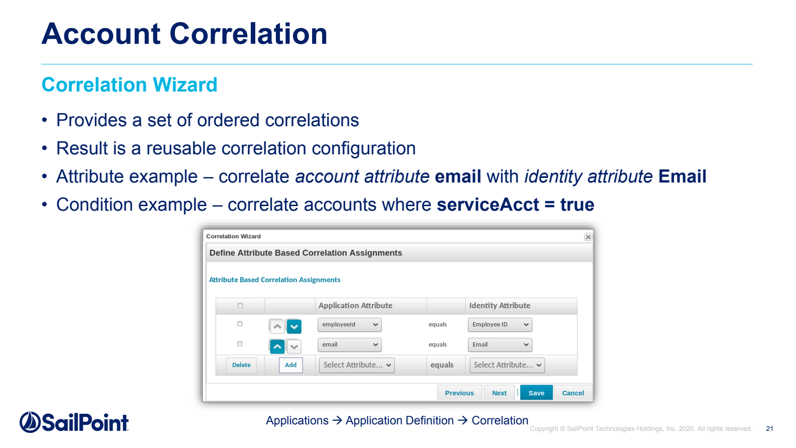

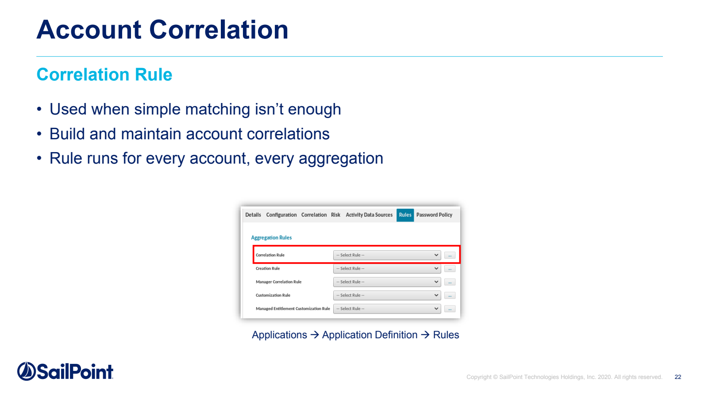

### Understand the processing pipeline

The connector reads native data and performs any supported filtering, merging and connector-level manipulation. Application customization can normalize the resulting resource object before correlation and creation/update. A wrong source value, schema choice or transformation can therefore produce a correlation problem even when the matching expression looks reasonable.

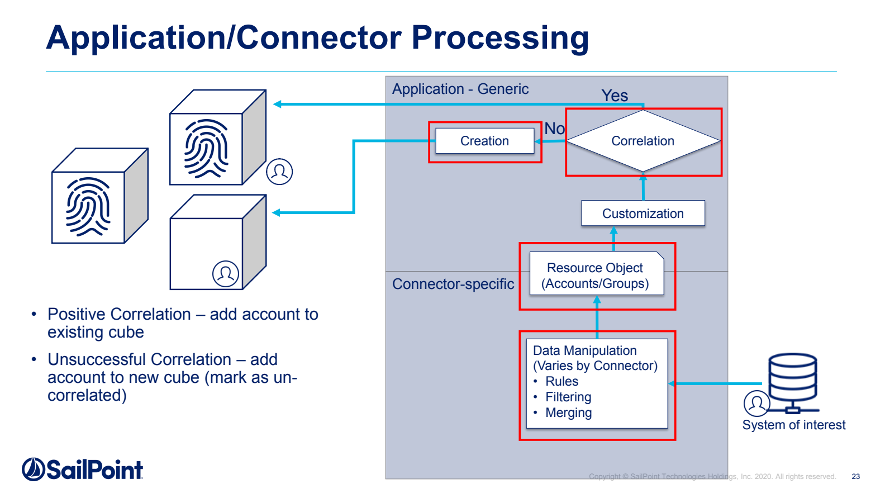

### Repair exceptions and confirm the outcome

Identity Correlation allows investigated accounts to be manually assigned to identities; the course says this relationship is retained. Moving an account from the wrong Cube is a separate repair. Correct systemic logic as well, so later aggregations do not keep producing equivalent exceptions.

After resolving ownership, inspect and prune truly empty non-authoritative cubes using the intended maintenance task. Pruning is cleanup after a verified repair, not a substitute for investigating ownership. Refresh then promotes the relevant access information into the certification-ready identity picture.

The related exercises inspect LDAP correlation, update the Email identity source, enable pass-through, and later use an Uncorrelated Accounts report to investigate and repair exceptional accounts. Their exact training data and verification screens are preserved in the practice companion.

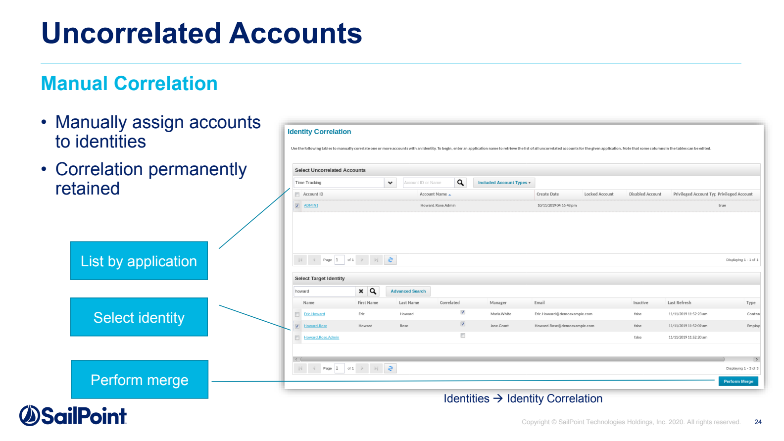

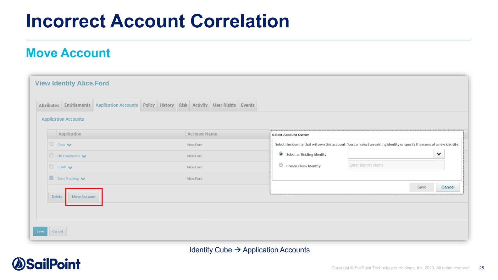

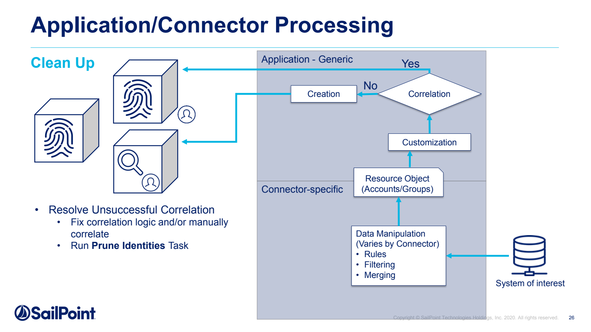

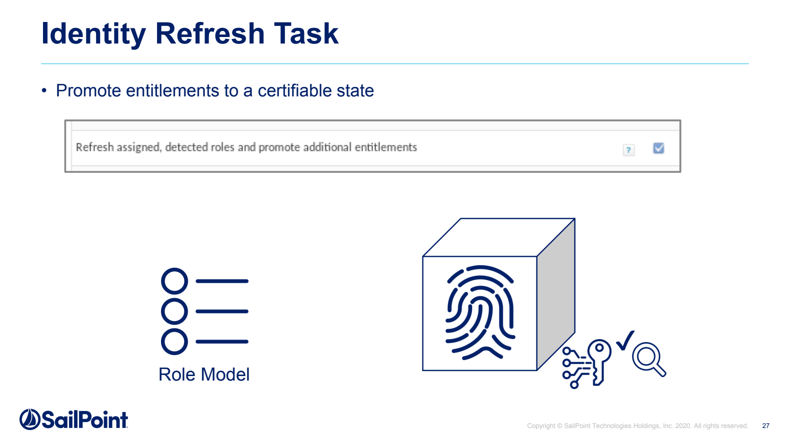

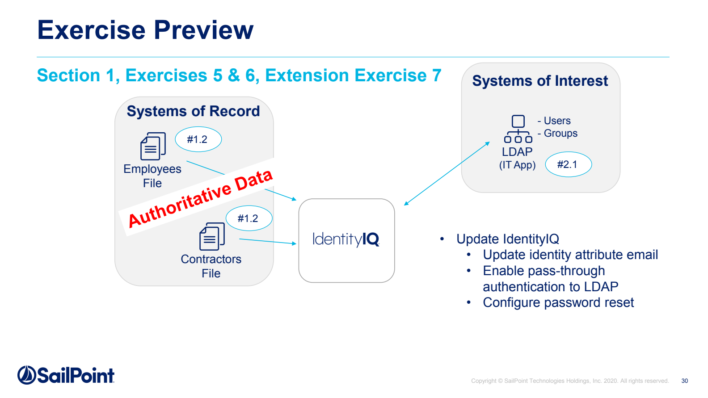

### Related practice and source pages

[Exercise 1.5 — Define LDAP Application](../practice-companion.html#practice-1-5) · [Exercise 2.3 — Uncorrelated Accounts and Data Maintenance](../practice-companion.html#practice-2-3)

