## 13. IdentityIQ Connectors

### Connector code and application configuration

A connector is the software component that reads or writes a resource and presents normalized resource objects. An Application is the configured representation of a particular resource: its connector selection, connection details, schemas and other settings. Two applications can use the same connector with different configurations.

Schemas, resource-object concepts and application-level rule locations are broadly consistent. Connection properties, connector-level rule opportunities and support for one or several group types vary. Read capability does not automatically prove that every provisioning operation is implemented.

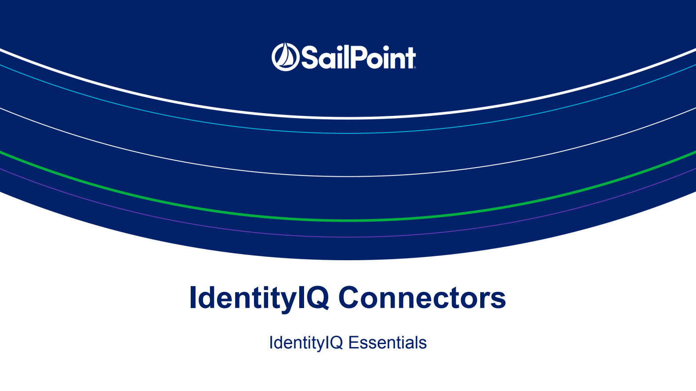

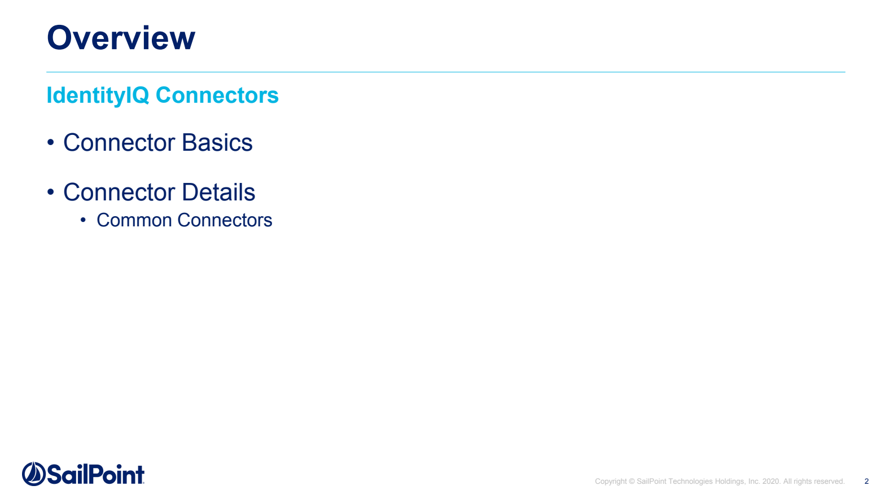

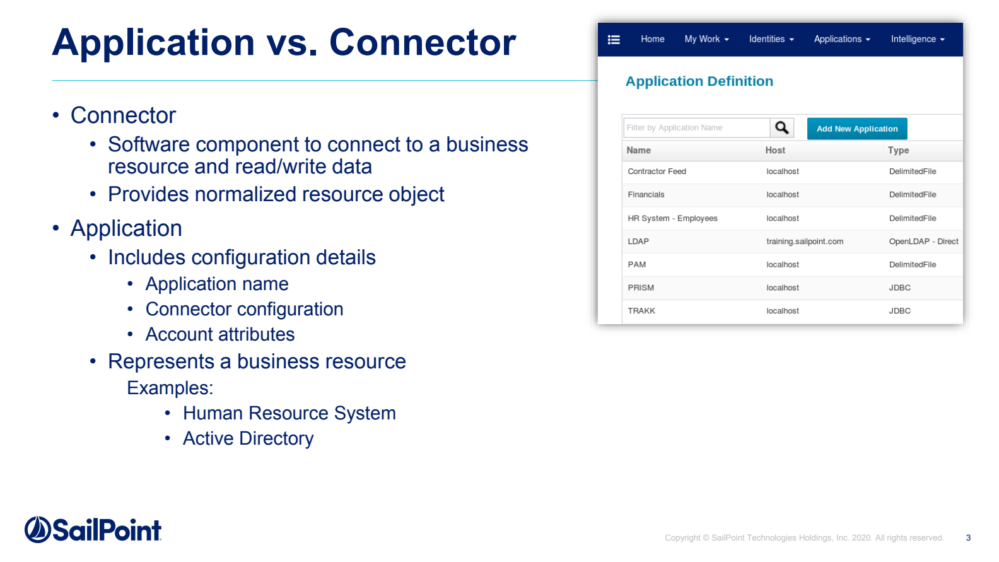

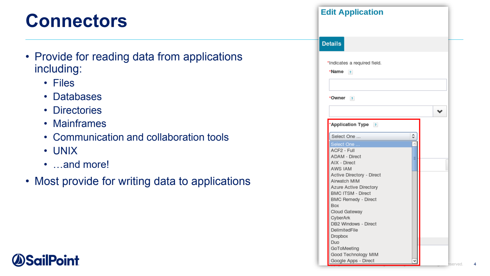

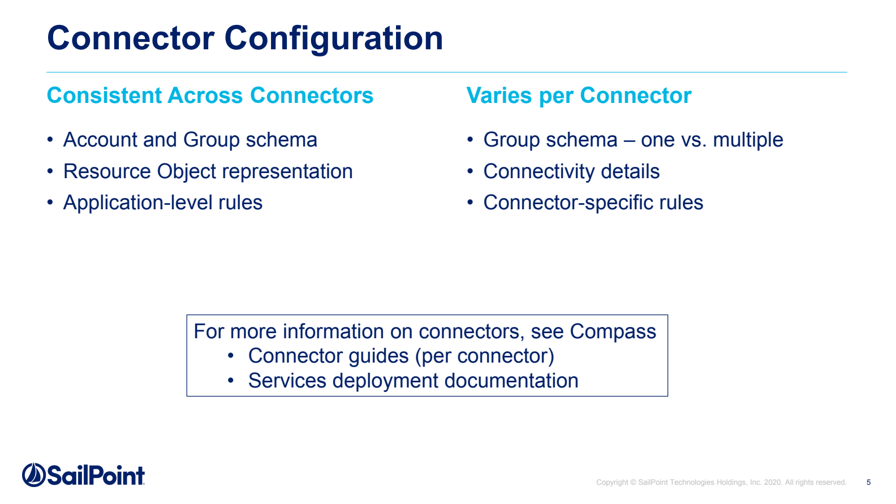

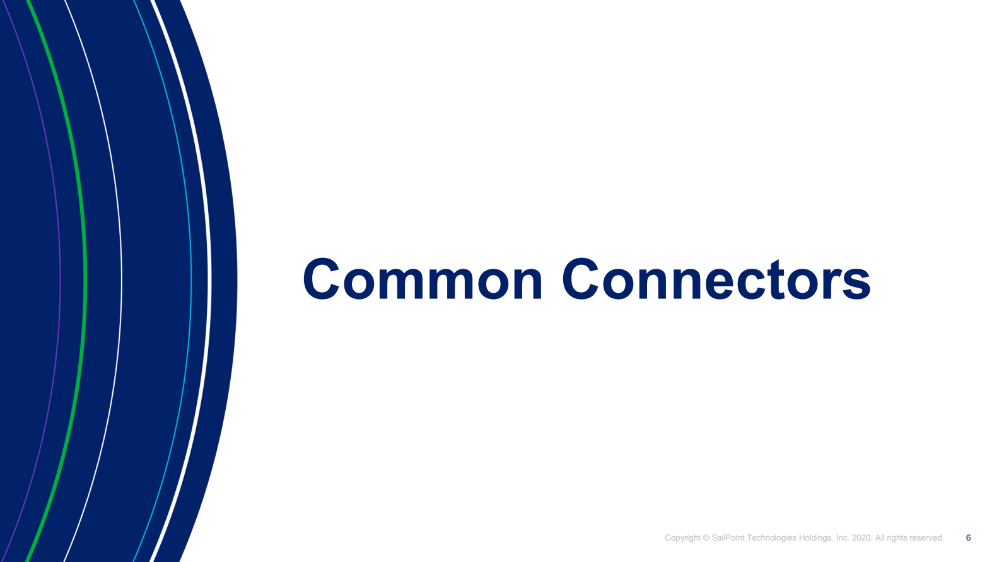

### Common connector patterns

The Delimited File example reads accounts and entitlements from a defined file and schema, with optional filtering, merging and rules. JDBC reads database information using connection details and SQL queries; its write behavior in the course requires a JDBC provisioning rule.

LDAP supplies a directory schema and needs connection credentials and search DNs. The Active Directory example adds its version-specific IQService requirement for provisioning. Web Services connects through target URLs and supported operations. These details describe the course's implementations; consult the exact connector documentation before applying them to another release.

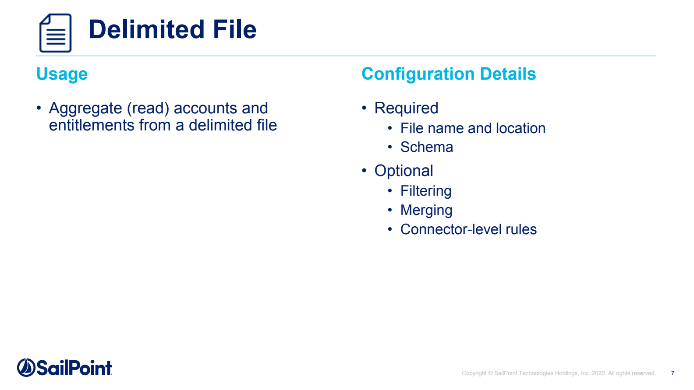

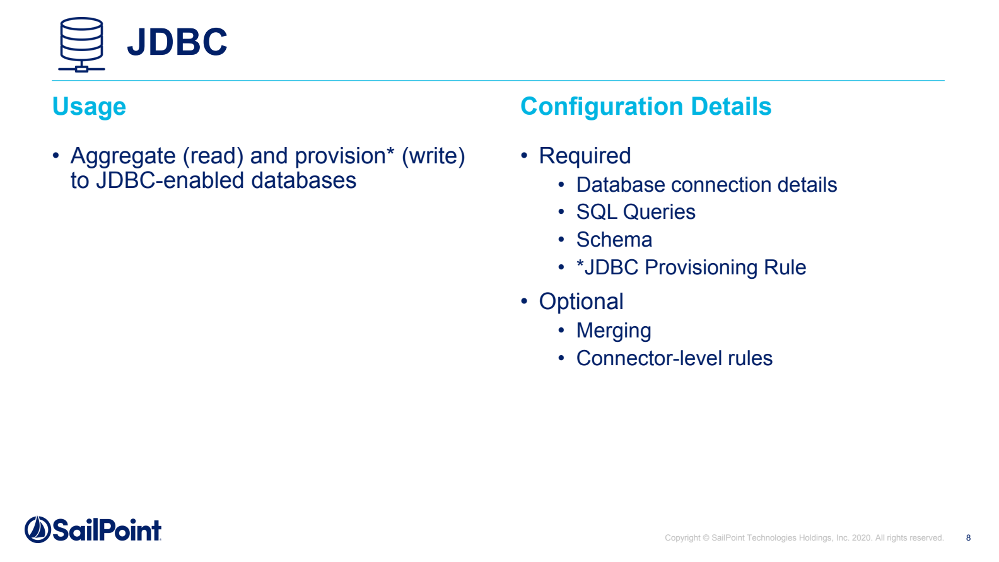

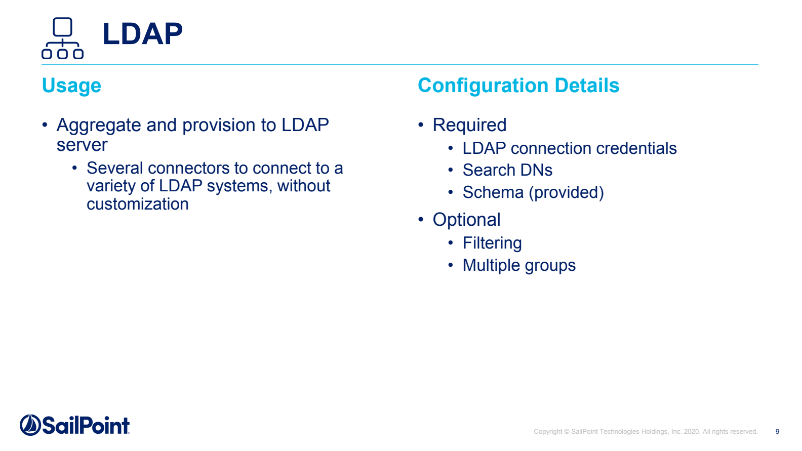

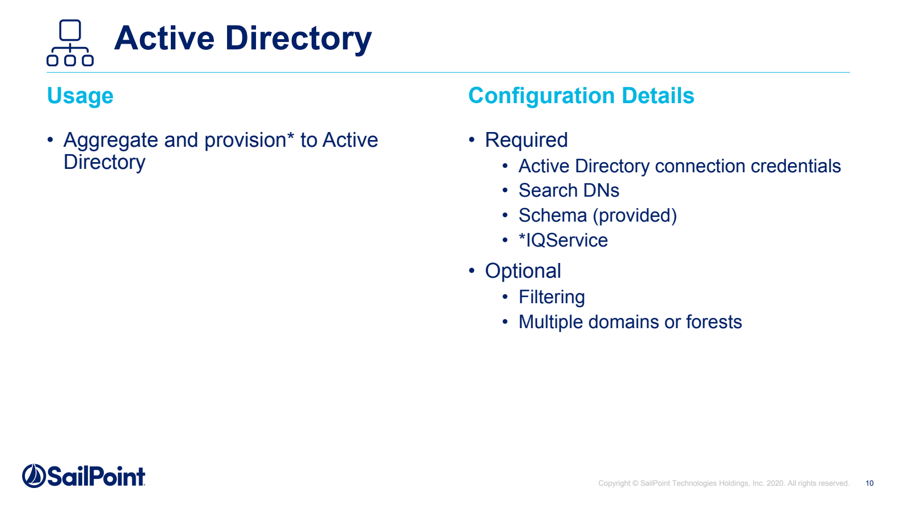

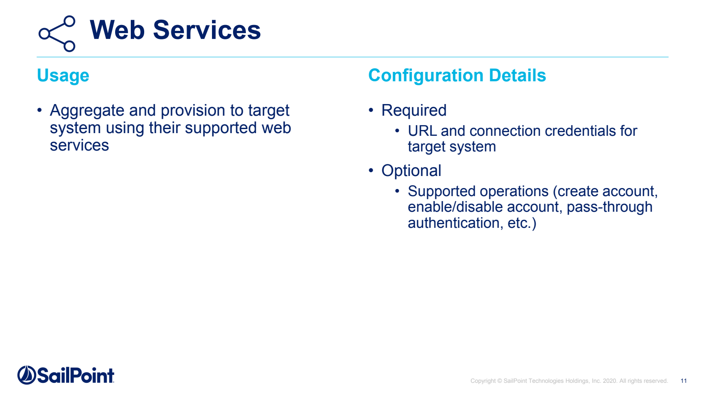

The IdentityIQ Loopback Connector treats identities as accounts and workgroups/capabilities as entitlements, allowing governance concepts to apply to IdentityIQ's own access model. SQL Loader presents delimited data through a database-style table model. Neither should be confused with a generic claim that every connector behaves identically.

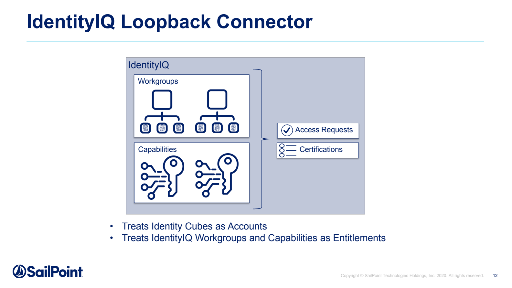

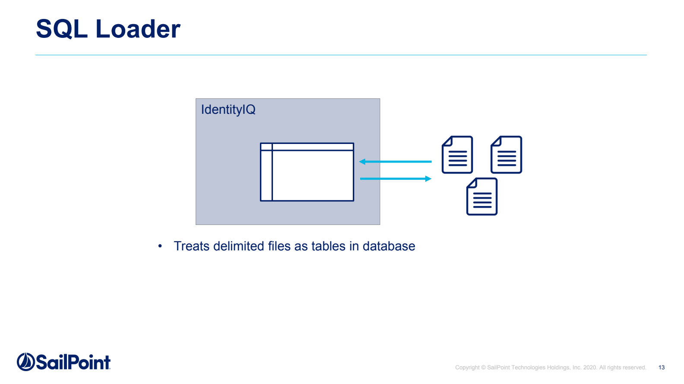

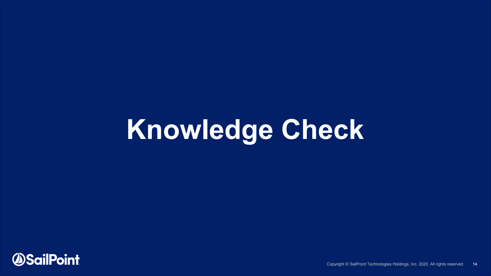

### Exercise connection

Section 2 onboards Time Tracking, Chat, Finance and other business applications. It then builds a Sequential Task Launcher for ordered aggregation and refresh work, schedules the sequence, compares task results and constrains a refresh to selected identities. This demonstrates the dependency between reading accounts and calculating their identity-level effects.

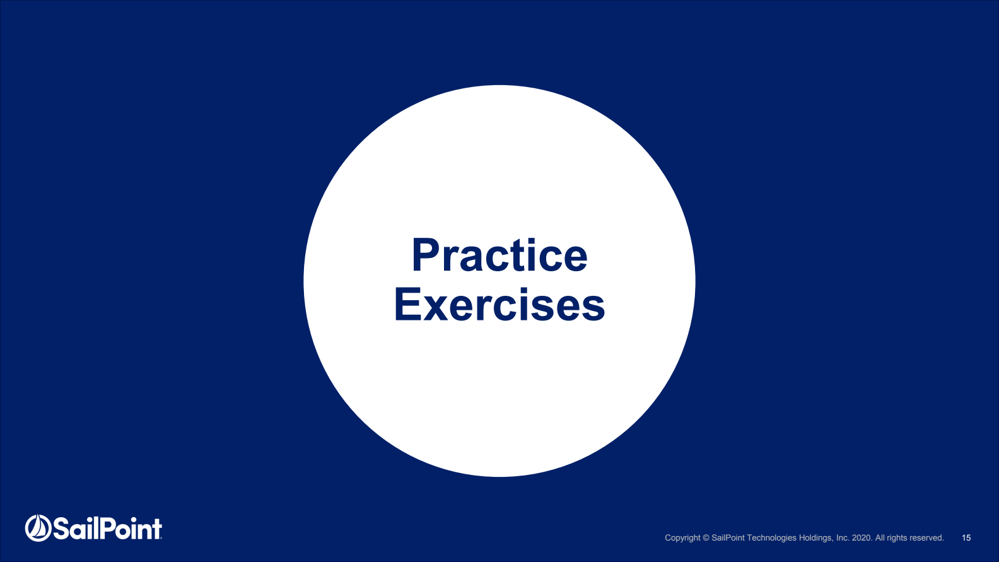

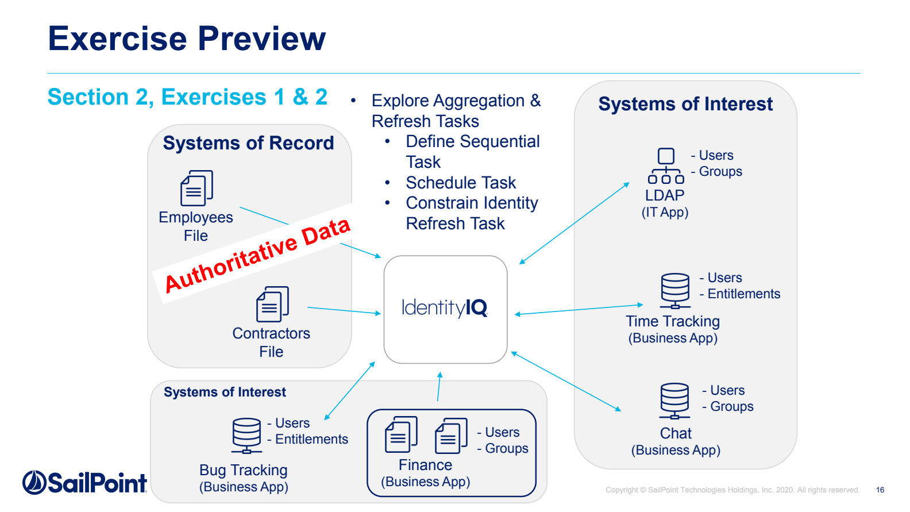

### Related practice and source pages

[Exercise 1.5 — Define LDAP Application](../practice-companion.html#practice-1-5) · [Section Two — overview and contents](../practice-companion.html#practice-section-2) · [Exercise 2.1 — Define Business Applications](../practice-companion.html#practice-2-1) · [Exercise 2.2 — Aggregation and Refresh Tasks](../practice-companion.html#practice-2-2)

