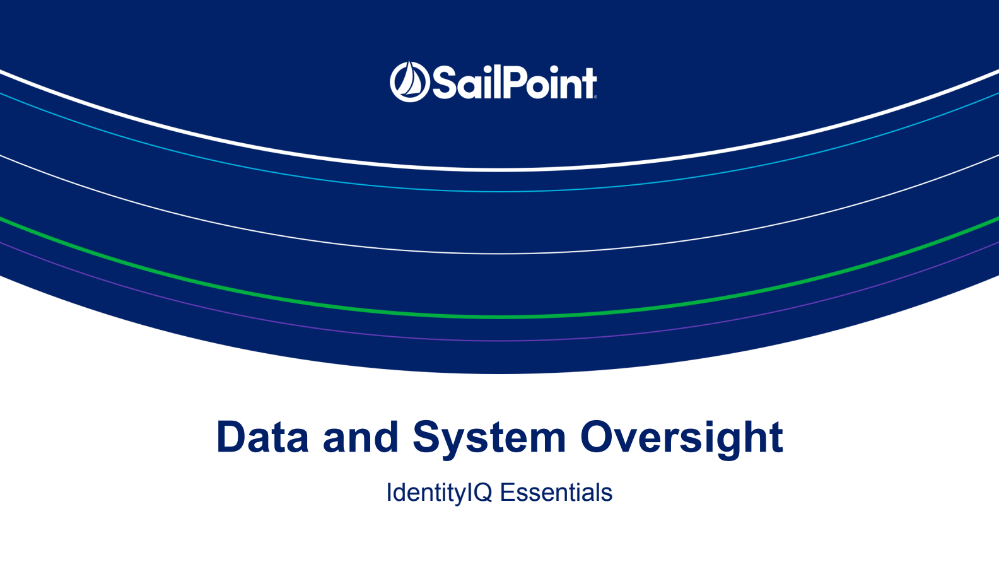
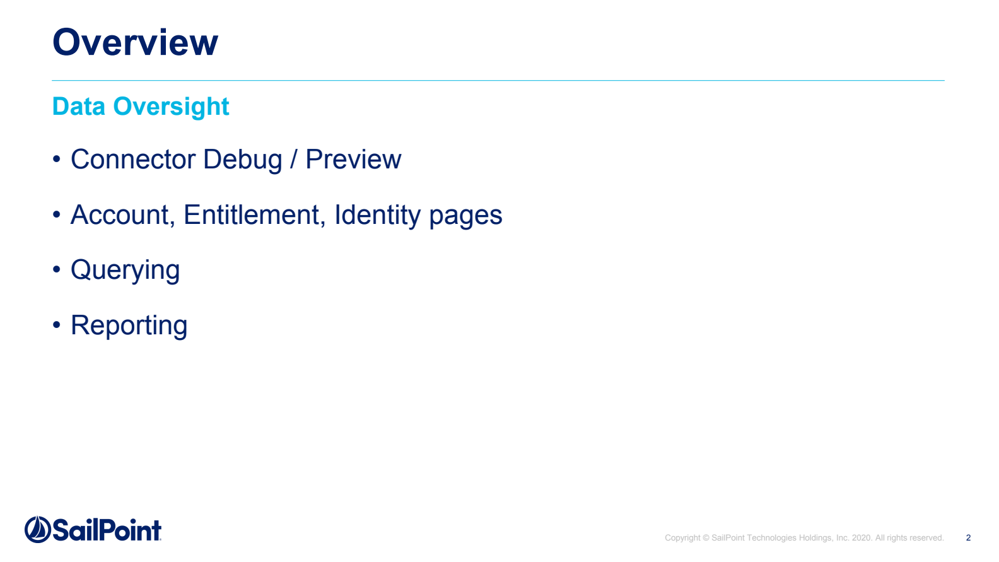
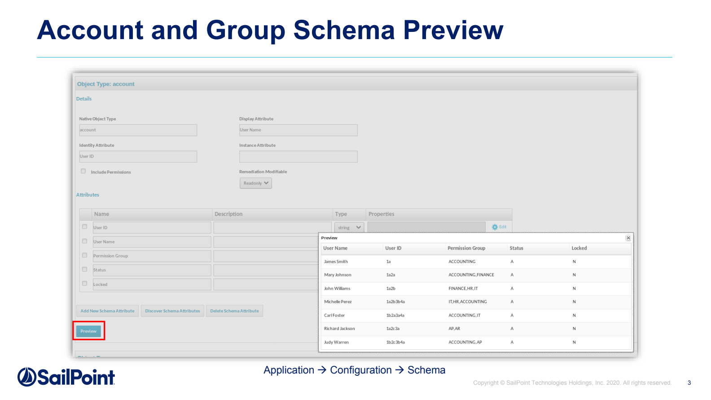
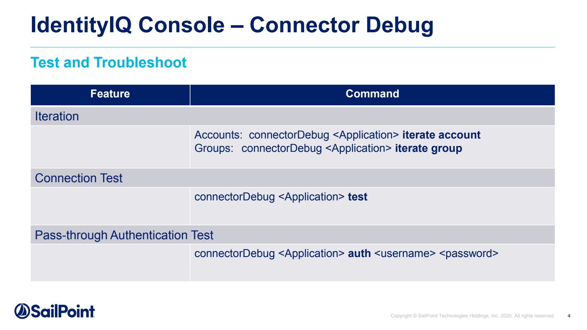
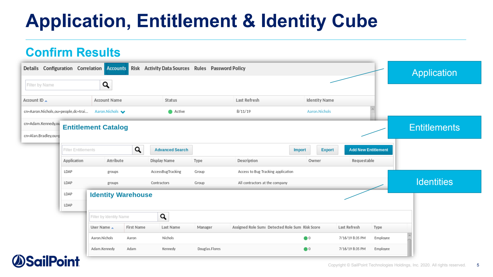
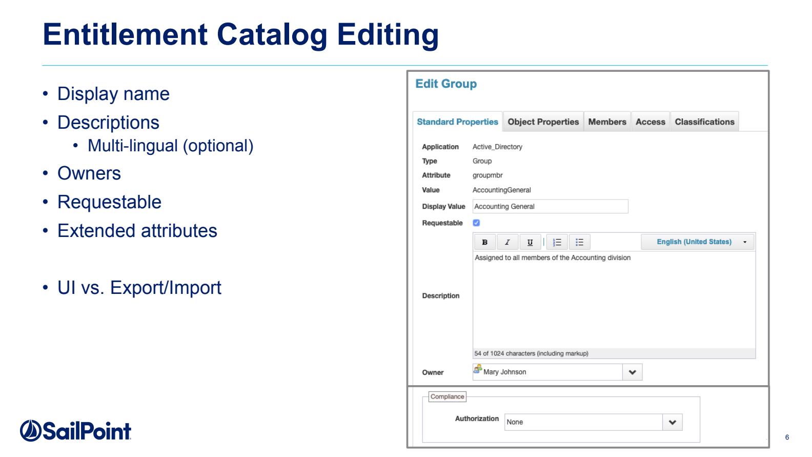
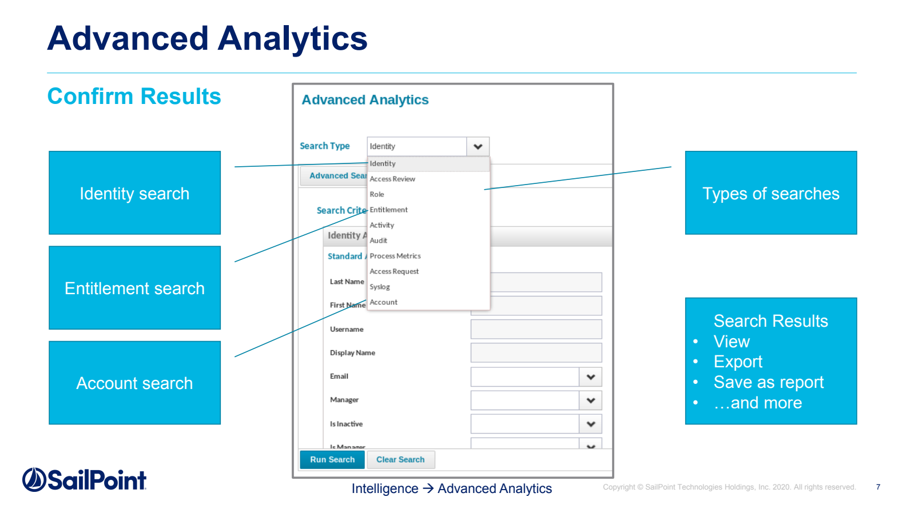
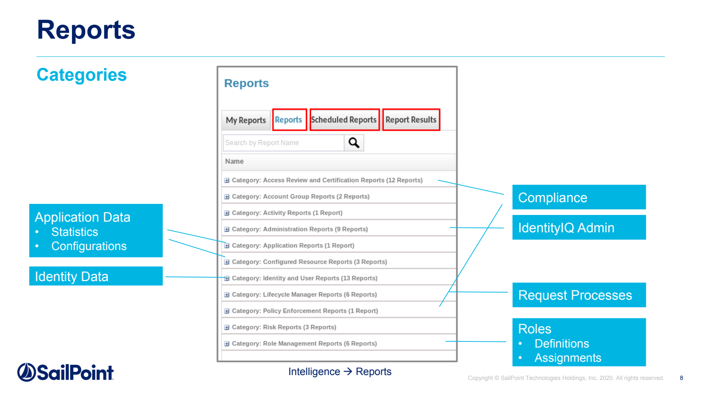
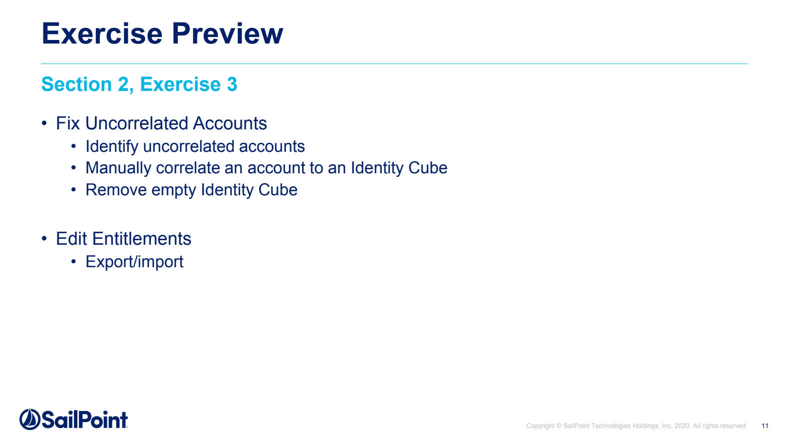

## 14. Data Oversight

### Verify data before and after loading

Use schema Preview to inspect account and group data before a full aggregation. The Console's connectorDebug commands test connectivity, iterate native accounts or groups and, where supported, test pass-through authentication. Iteration is a diagnostic read; it is not the same as loading all those objects into IdentityIQ.

After aggregation, inspect the application, Entitlement Catalog and Identity Cube. Check the account's actual ownership and access fields rather than relying only on a successful task status.

### Make catalog data useful

Entitlement governance depends on meaningful metadata. The lesson highlights display names, descriptions, optional translations, owners, requestability and extended attributes. The UI supports individual edits; export/edit/import supports controlled bulk updates. Preserve the identity of each catalog object when editing its metadata.

Advanced Analytics provides identity, account and entitlement queries. Results can be viewed, exported or reused as reports. The report catalog includes application statistics/configuration, identity data, roles, compliance, administration and request-process reporting. Choose the view that answers the actual question: a person's accounts, the definition of an entitlement, and the number of uncorrelated accounts are different questions.

### Exercise 2.3 study sequence

Run the Uncorrelated Accounts report, inspect the exceptions and compare them to authoritative identity data. Manually correlate only after establishing the intended owner. Run the prune task to remove the resulting empty cubes, then verify the Identity Warehouse again.

For catalog maintenance, export the Finance entitlements, update the intended display names and owners, import the result, and verify the UI. The original practice pages preserve the exact fields and example records; no catalog changes were performed while building these notes.

### Related practice and source pages

[Section Two — overview and contents](../practice-companion.html#practice-section-2) · [Exercise 2.3 — Uncorrelated Accounts and Data Maintenance](../practice-companion.html#practice-2-3)

