## 15. System Oversight

### Keep background operations healthy

Tasks aggregate data, refresh identities, run rules, move certifications through their lifecycle, check remediations and prune or archive old objects. A Sequential Task Launcher coordinates ordered tasks. Reliable recurring execution is part of system health, not merely an installation-time concern.

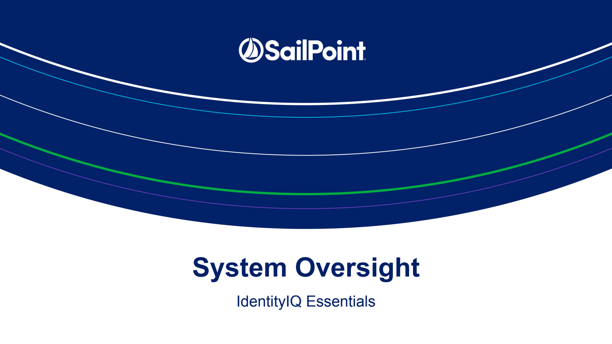

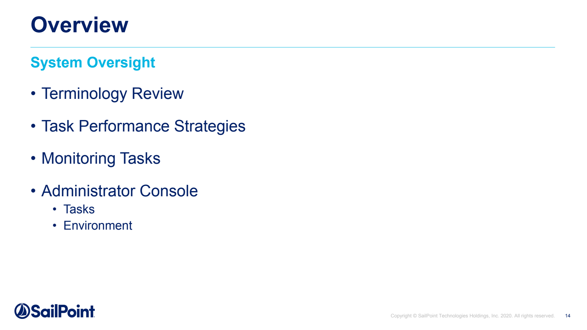

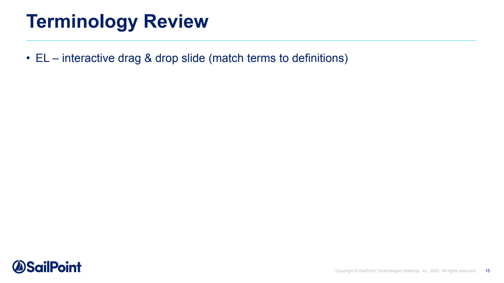

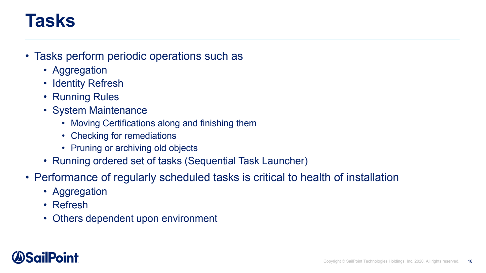

### Distinguish optimization strategies

Ordinary IdentityIQ aggregation optimization still reads every account but avoids processing unchanged ones. Disabling that optimization processes every read account. Connector-based delta aggregation reads only changes after a connector-specific benchmark and is not universally available. A custom changed-record file is another pattern; because it omits unchanged accounts, it must not be interpreted as the entire source for deletion detection.

Partitioning divides suitable aggregation work. The slide gives version-specific guidance about connector support, partition limits and loss limits; the retained diagram is the reference for those course values.

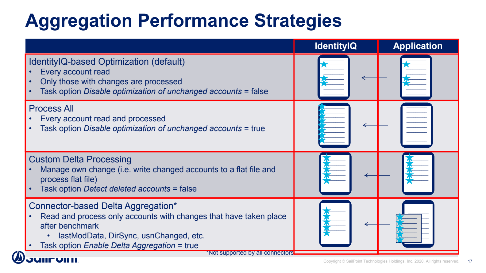

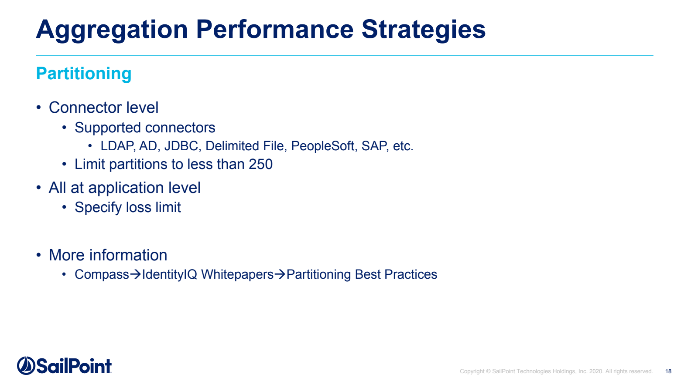

### Tune refresh around its purpose

Separate frequent attribute/role/provisioning calculations from less-frequent policy and risk work when appropriate. Delta refresh processes identities marked as changed; other filters or timestamps can target the work. Multi-threading uses multiple threads on one server, while partitioning can distribute work across servers.

The maintenance slide lists scheduled jobs for core maintenance, expired mitigations, sunset notifications, expired work items and identity-request completion. These are distinct responsibilities: a finished connector action does not by itself prove that a request's maintenance-driven status has advanced.

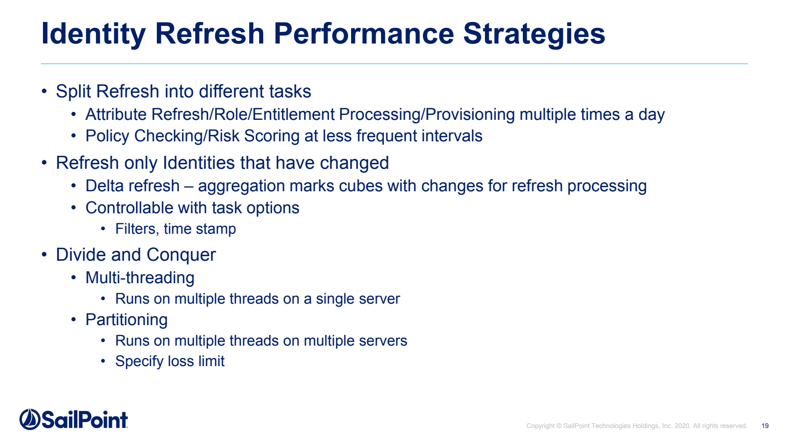

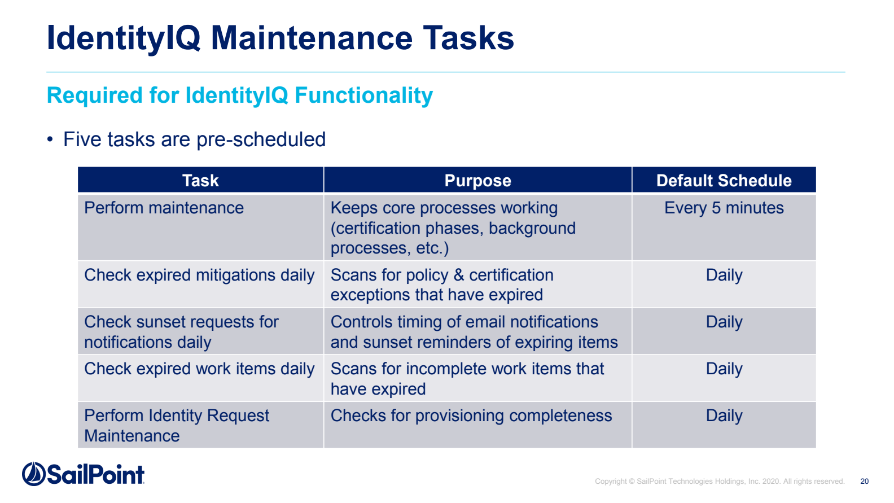

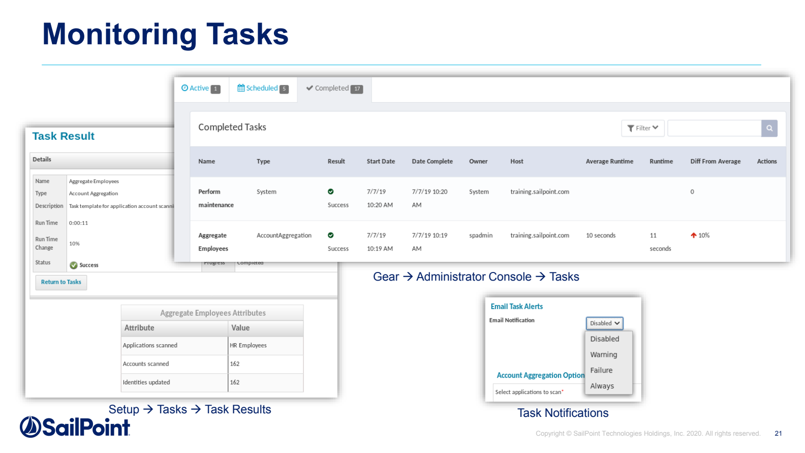

### Observe tasks and the environment

The Administrator Console provides active, scheduled and completed task views, execution statistics and environment information. The course identifies System Administrator or FullAccessAdminConsole capability for its full console access. Environment views help separate application status, host configuration and installed-module information.

Exercise 3.1 tests delta refresh, runs a rule through a task, inspects the maintenance schedule, configures failure notification and observes task/maintenance-window behavior. It intentionally stops a training service for testing; those disruptive VM actions are documented only, not performed here.

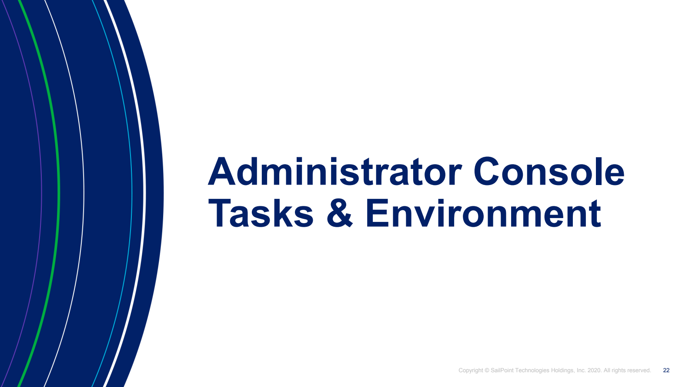

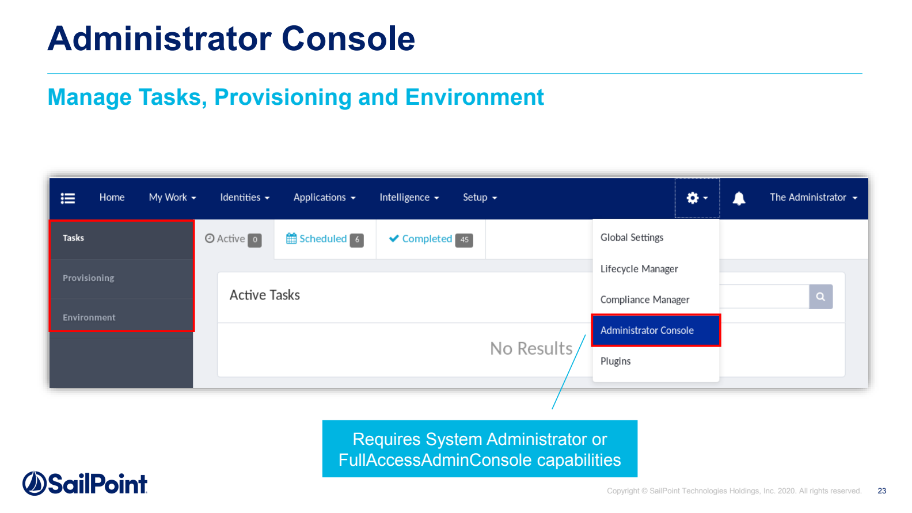

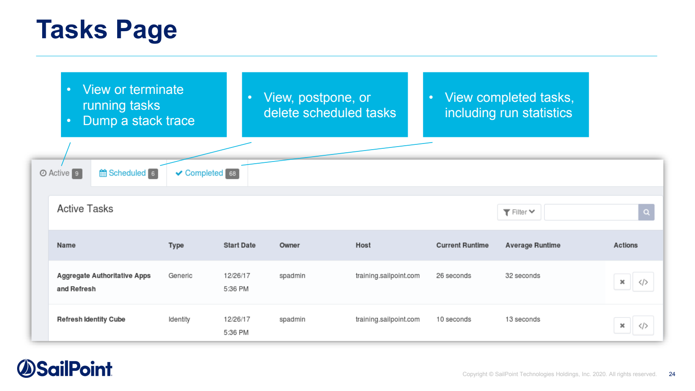

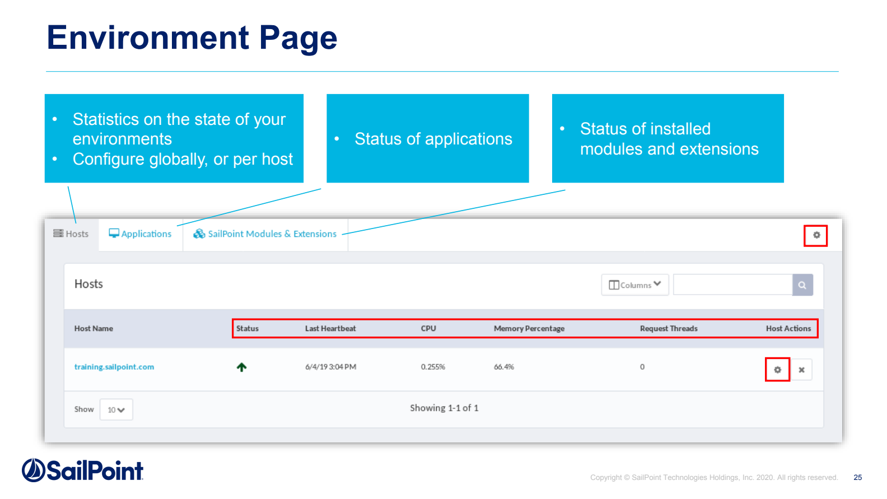

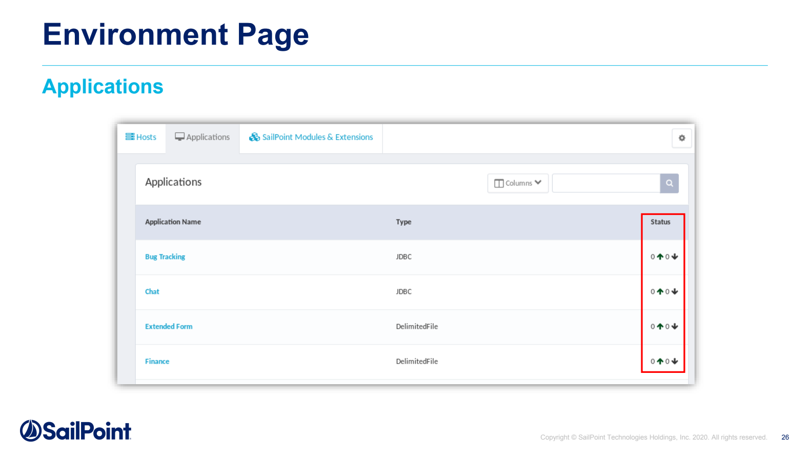

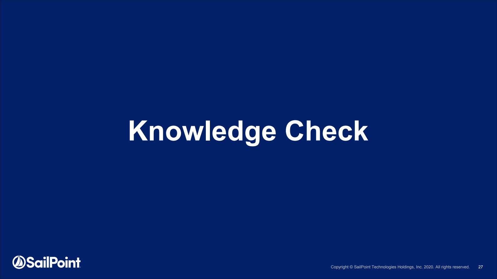

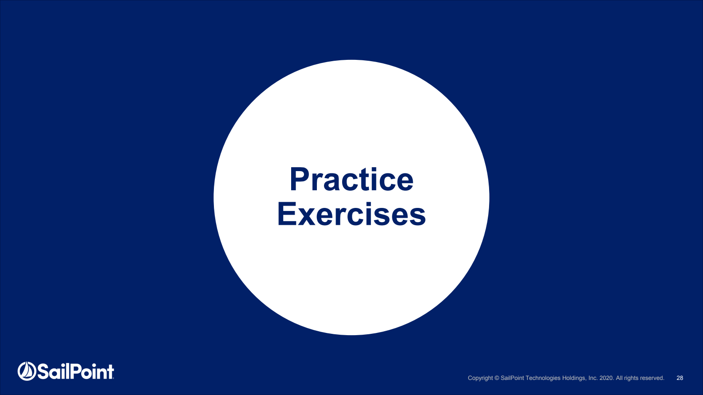

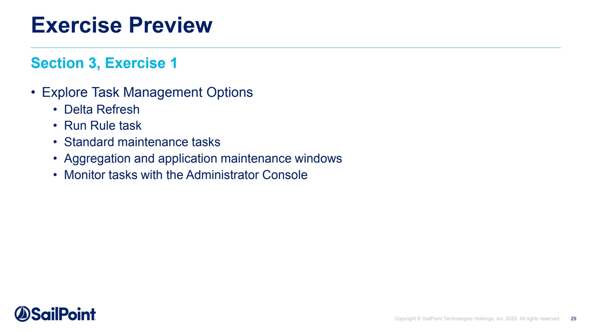

### Related practice and source pages

[Exercise 2.2 — Aggregation and Refresh Tasks](../practice-companion.html#practice-2-2) · [Section Three — overview and contents](../practice-companion.html#practice-section-3) · [Exercise 3.1 — Task Management Options](../practice-companion.html#practice-3-1)

