## 16. Logging

### Choose the record that answers the question

The course distinguishes application logging, standard output, redirected email, audit events and Syslog incidents. They capture different evidence. A missing notification, an access-request audit event and a Java exception should not all be investigated through the same screen.

Standard-output print statements can help a quick training test, but the course discourages them for production diagnostics because they print without the structured logger controls. Application logging instead uses named loggers and severity levels.

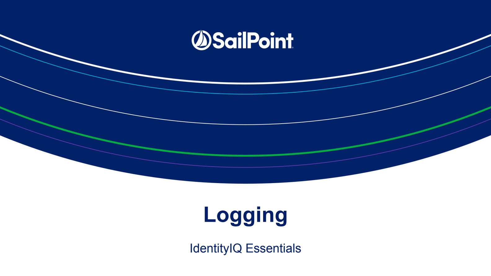

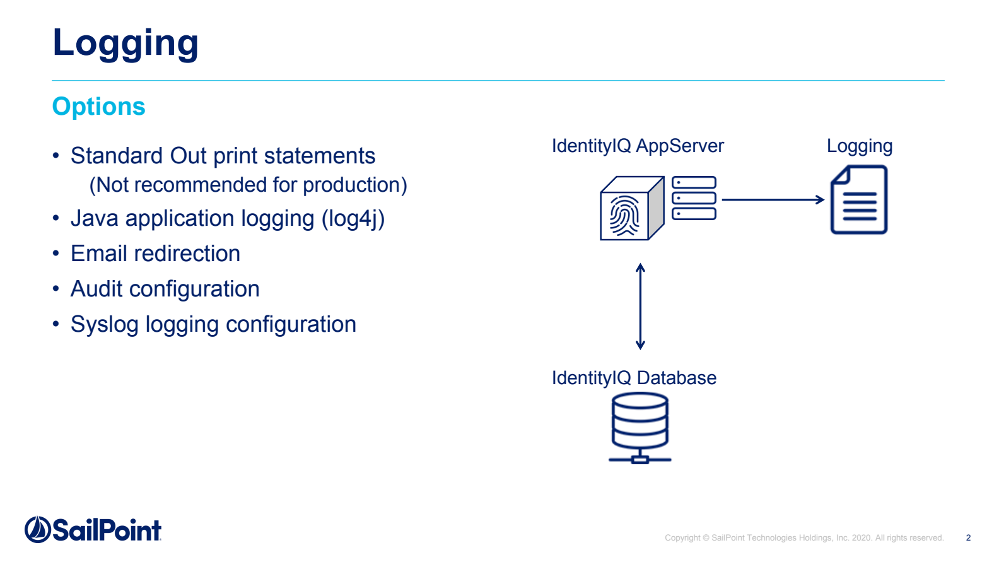

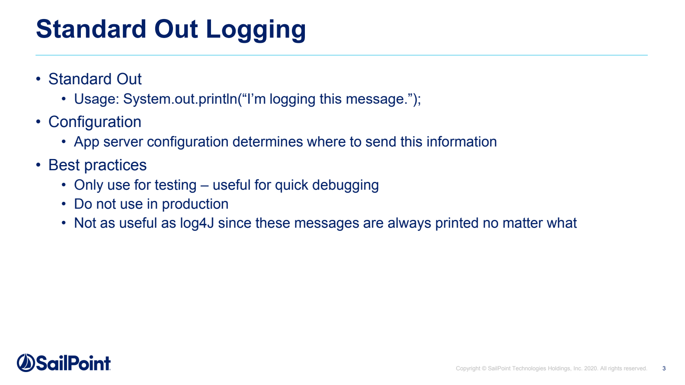

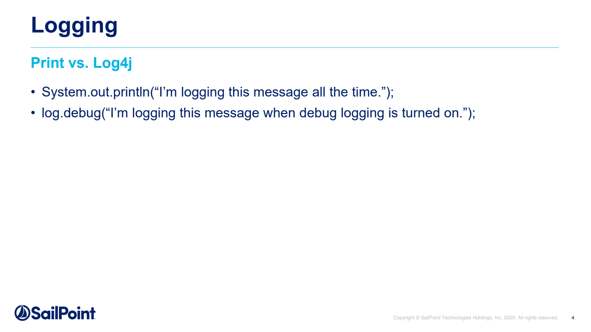

### Configure application logging deliberately

The course's Log4j configuration is in `WEB-INF/classes/log4j2.properties`. It illustrates root and class-specific loggers, output-file settings and levels such as ERROR, WARN, INFO, DEBUG and TRACE. More detailed levels produce more output; enable a relevant class while investigating rather than treating maximum verbosity as a permanent operating state.

The reload example shows periodic configuration checking and a Debug Pages control to force a reload. These are observations about the course build, not guaranteed timing for another deployment.

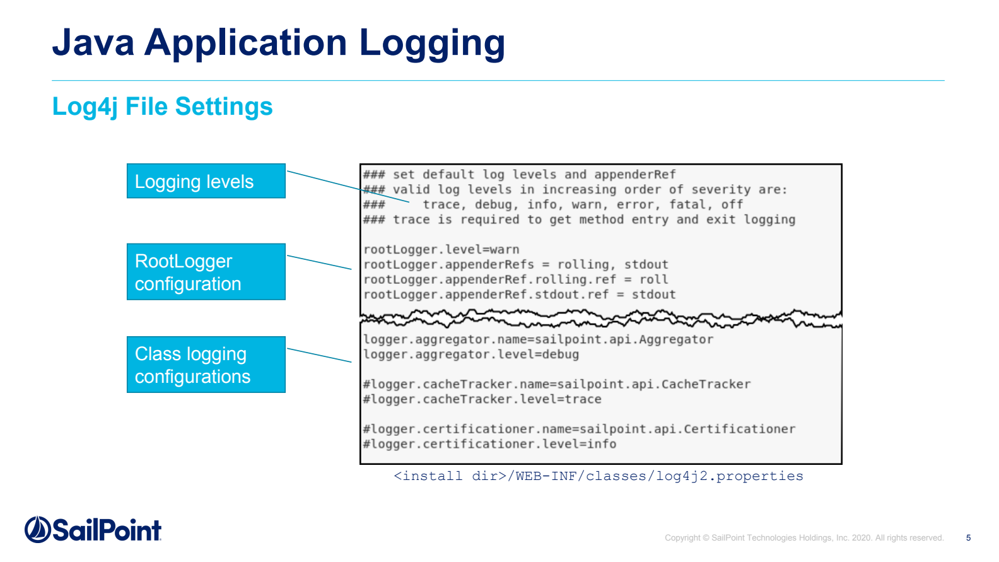

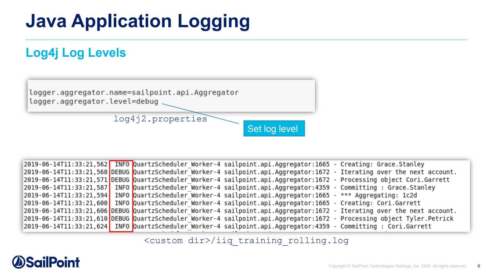

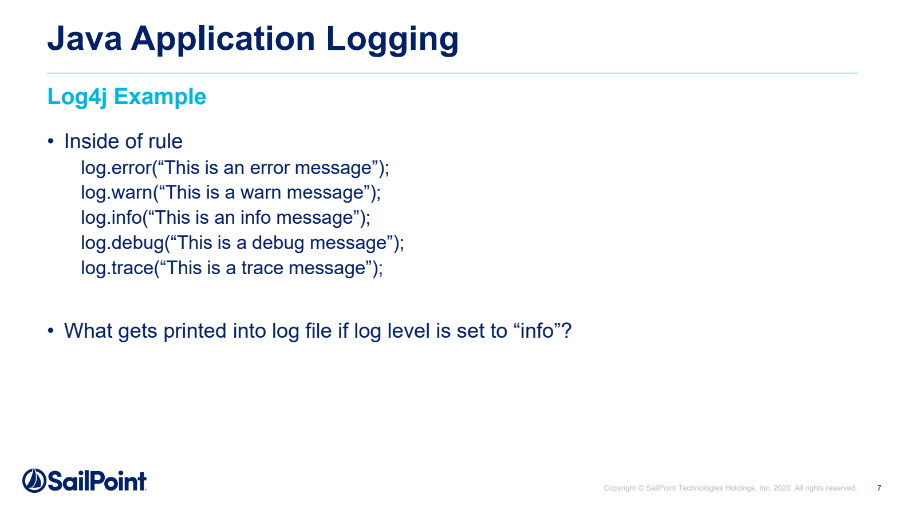

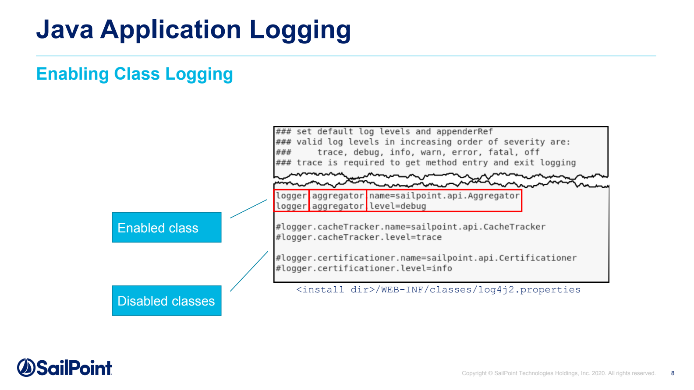

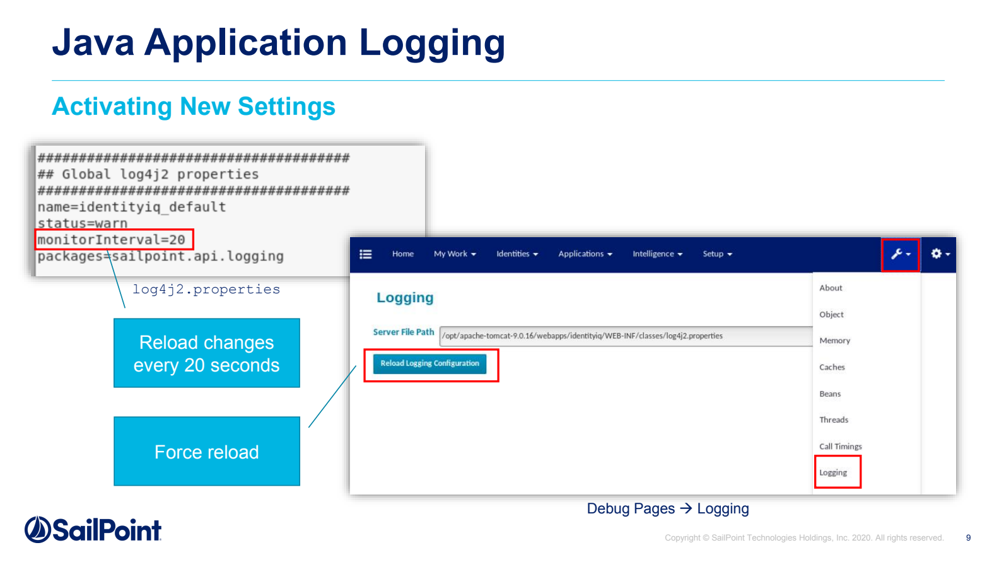

### Email, audit and incident information

Development email redirection sends notifications to a file or a designated recipient so their content can be inspected. Audit Configuration selects the business/system actions recorded; Advanced Analytics searches those audit entries. When the UI gives an incident code, Syslog Search can retrieve its details. Syslog retention is configured separately from the application log file.

Exercise 3.2 changes trace/debug settings for the refresh executor, runs the same task and compares the output. It also examines Rapid Setup loggers. The learning objective is to connect an operation, its relevant logger and the resulting evidence, then return to suitable logging levels. No logger configuration was changed in a live tenant while preparing this material.

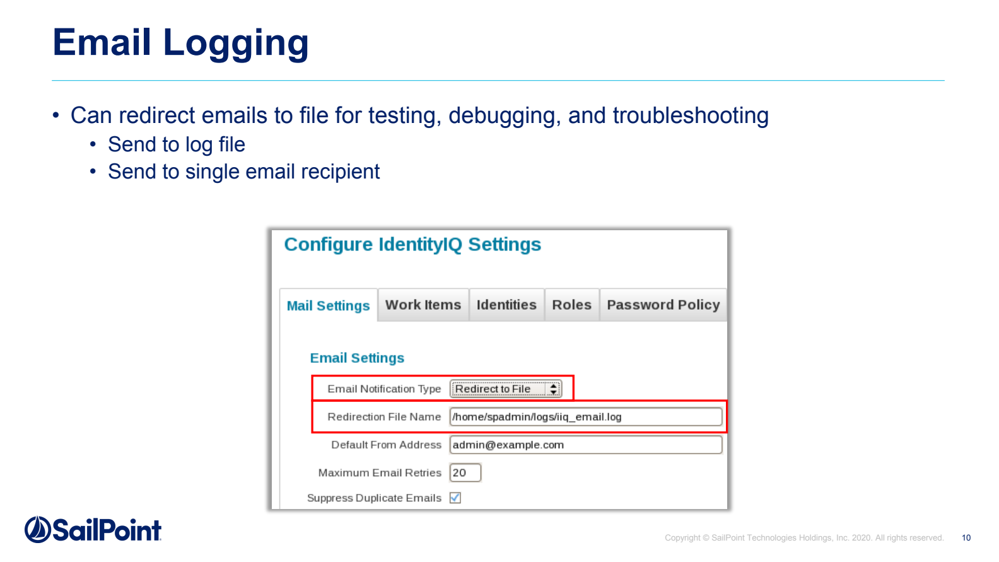

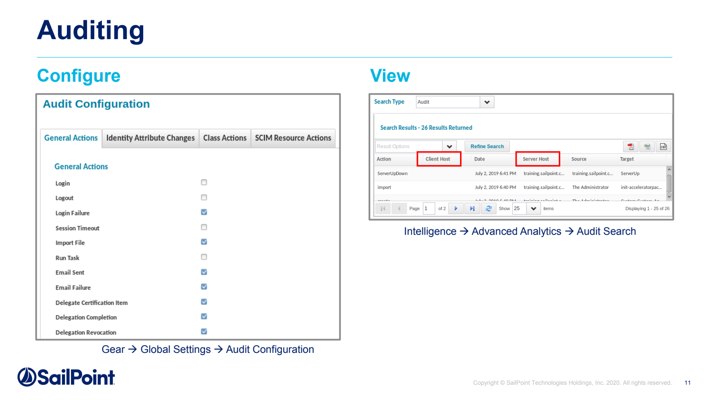

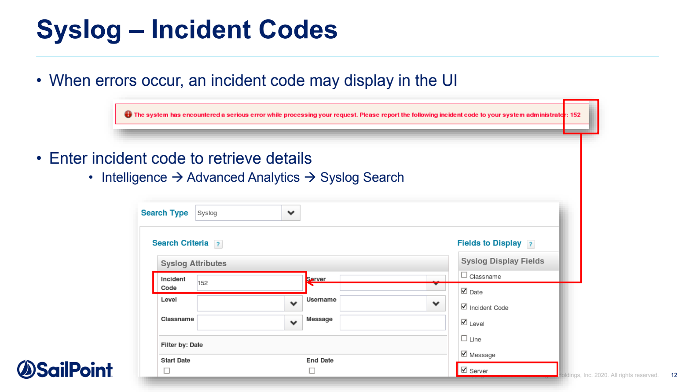

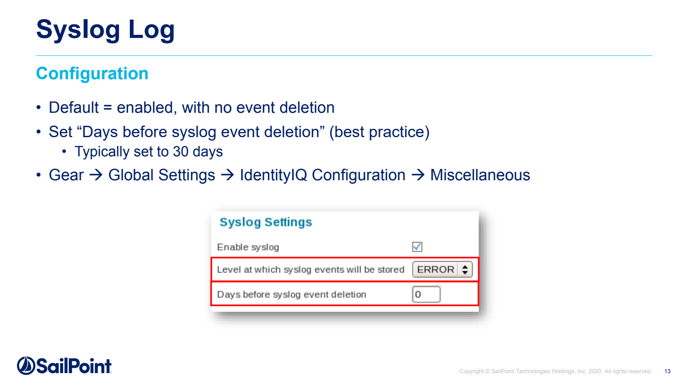

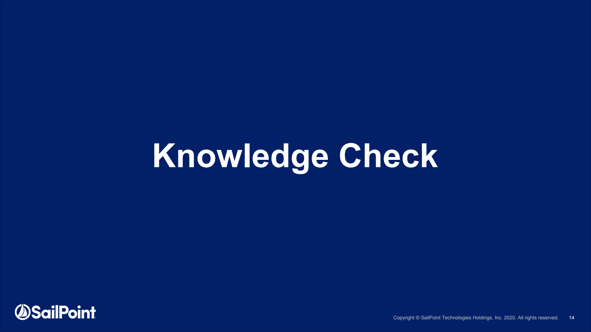

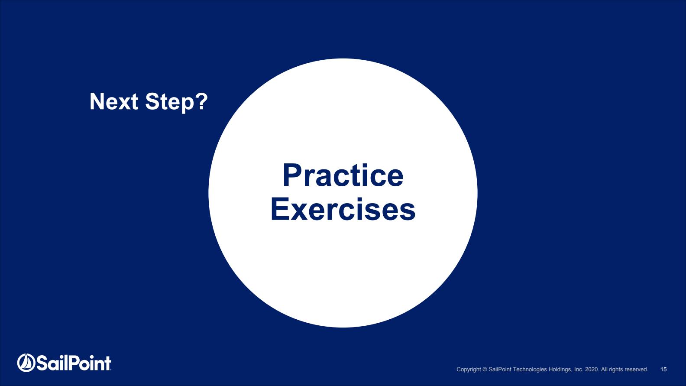

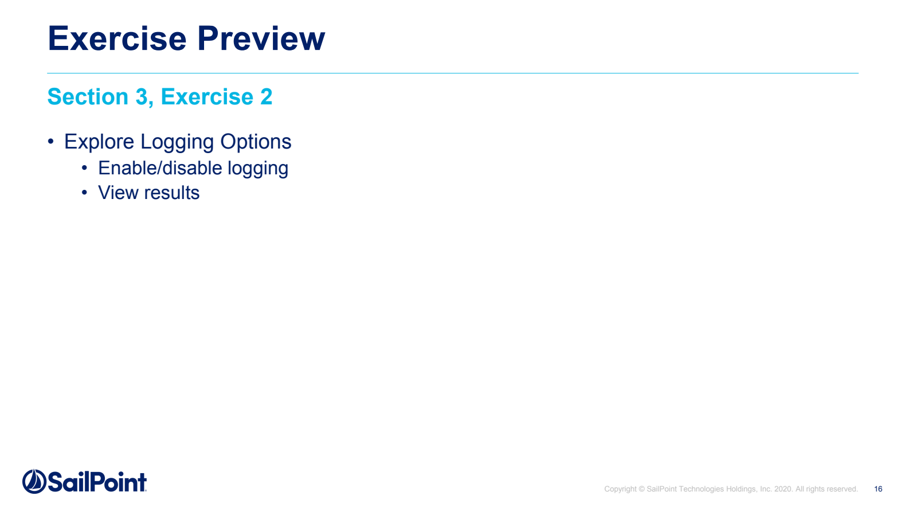

### Related practice and source pages

[Section Three — overview and contents](../practice-companion.html#practice-section-3) · [Exercise 3.2 — Explore Log4j](../practice-companion.html#practice-3-2)

