## 17. Troubleshooting

### Work methodically across the environment

The lesson emphasizes detailed observations, product familiarity, repeatable tests and changing one variable at a time. The database, Java runtime, application server, network and connected systems all participate in IdentityIQ behavior. A failed operation is not automatically a defect in IdentityIQ code.

Record the expected result, actual result, affected object and time. Reproduce the smallest useful example, inspect the relevant evidence and validate a single change. This study sequence synthesizes the troubleshooting principles on the original slide.

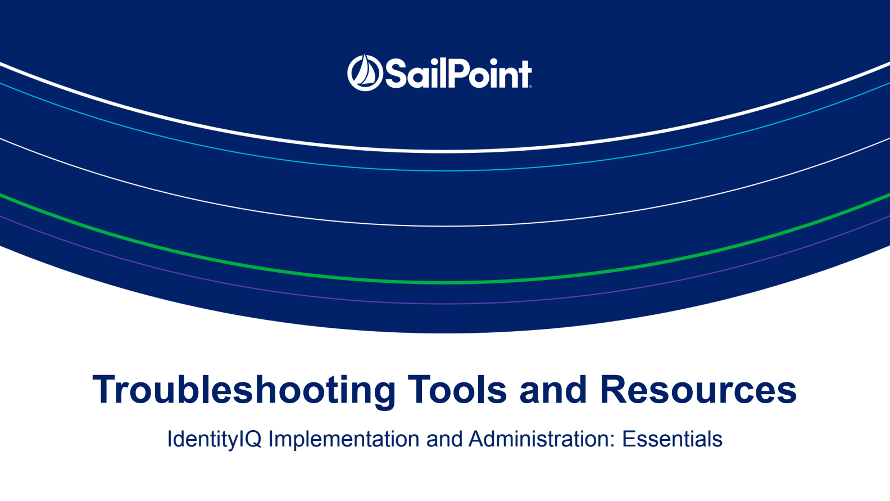

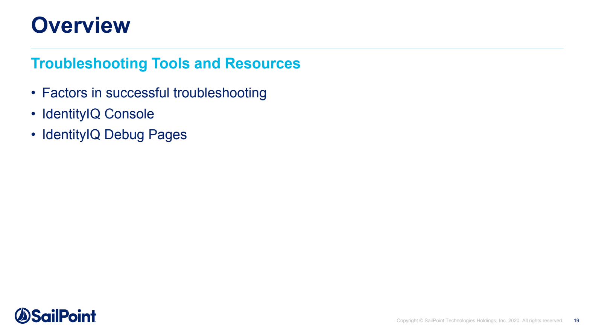

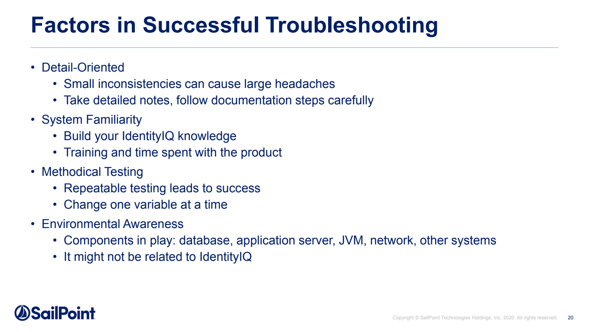

### Console and XML objects

The IdentityIQ Console connects to the database independently of the browser UI. Its commands can list/count objects, retrieve their XML, run rules or tasks, test connectors and export/import definitions. The lesson presents authentication behavior specific to its training build; the notes do not recommend relying on an initial default administrator credential.

Checkout/export/import operate on object definitions. When moving definitions between instances, the course highlights clean exports and the import `noid` option to avoid carrying instance-specific identifiers and timestamps as though they were portable business configuration. Use the appropriate command syntax from the guide rather than guessing from an abbreviated example.

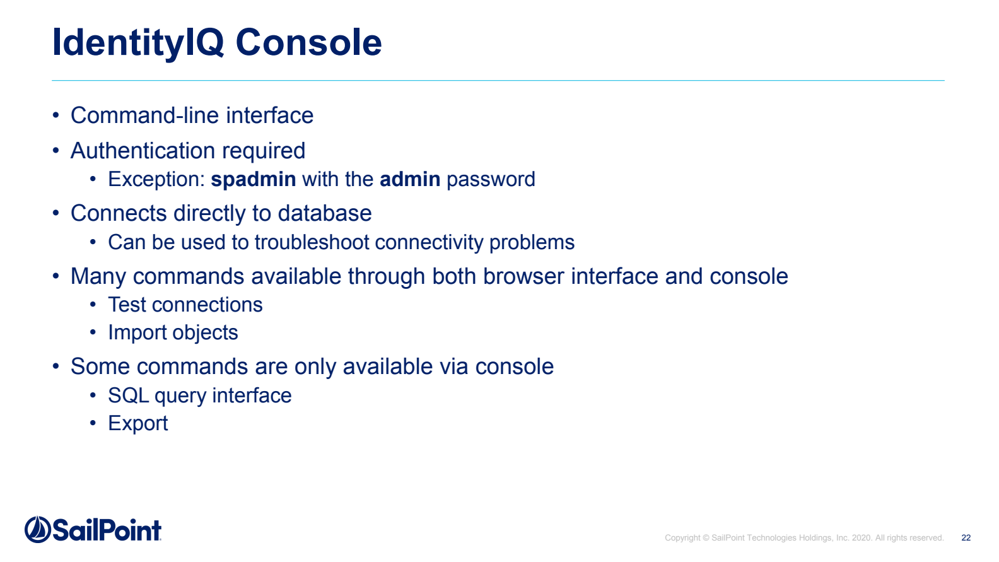

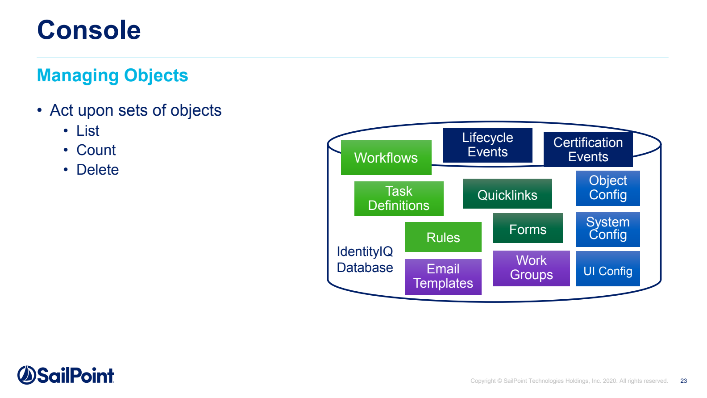

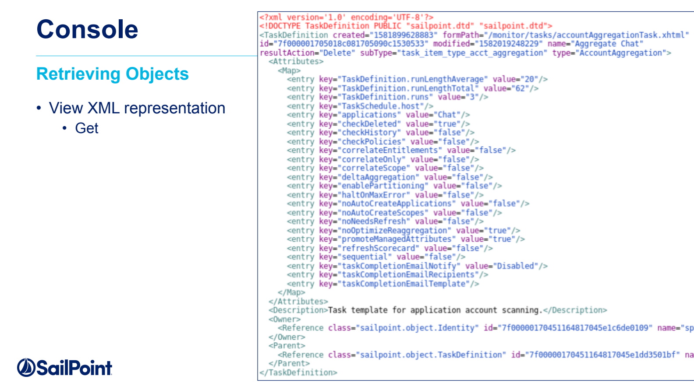

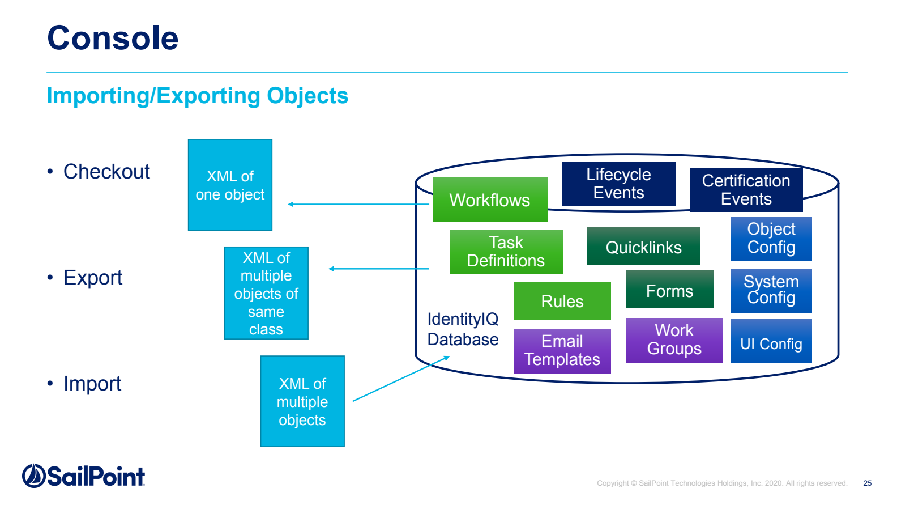

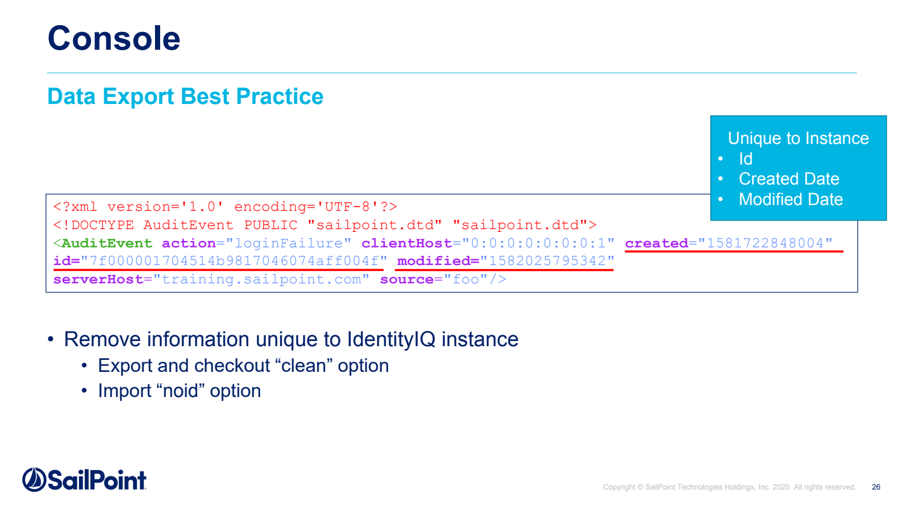

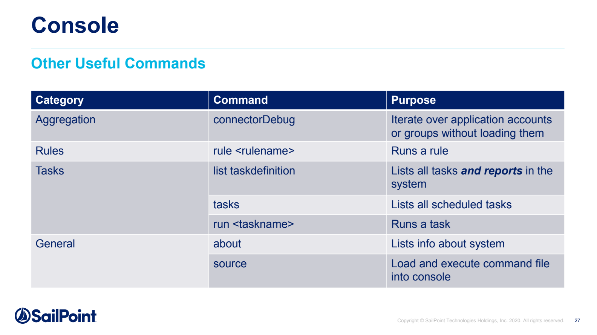

### Debug Pages

The course's administrator-only Debug Pages expose the object browser, system information, memory and threads, cache-related functions, call timings, logging reload and database-connection information. Object XML is powerful: a screen that can view an object may also allow a modification or deletion.

Exercise 3.3 examines these views, creates a separately named training rule from an existing definition, tests it, and explores Console help and object export/import. Its deletion demonstration first cancels a UI deletion before later using the Console exercise command. These instructions are preserved as study material; no object was modified, deleted or run on the user's systems.

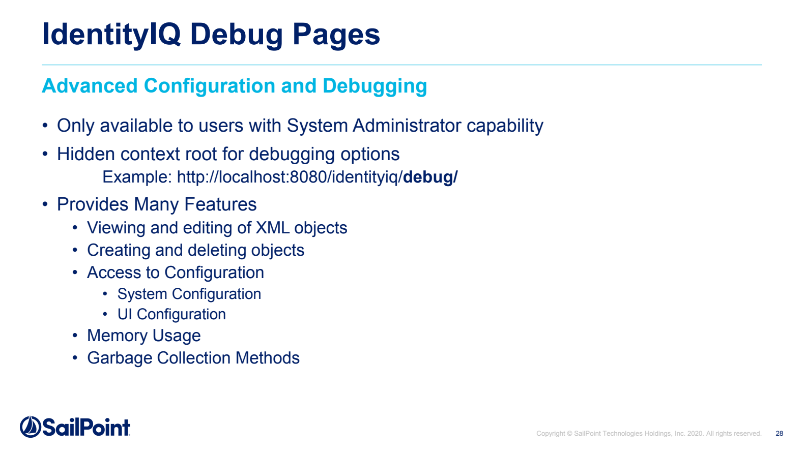

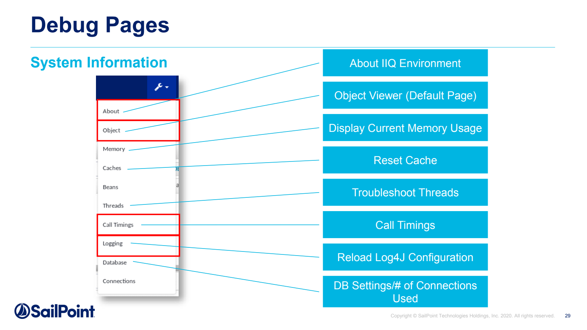

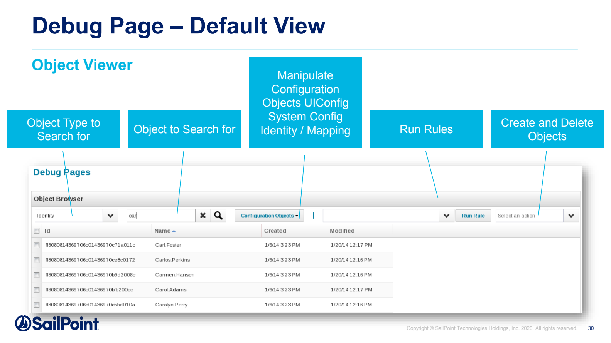

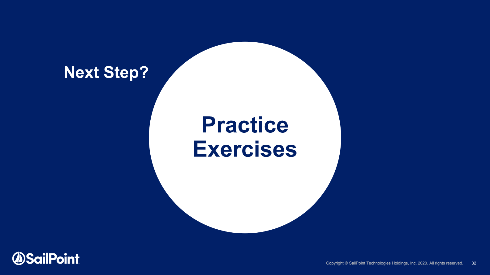

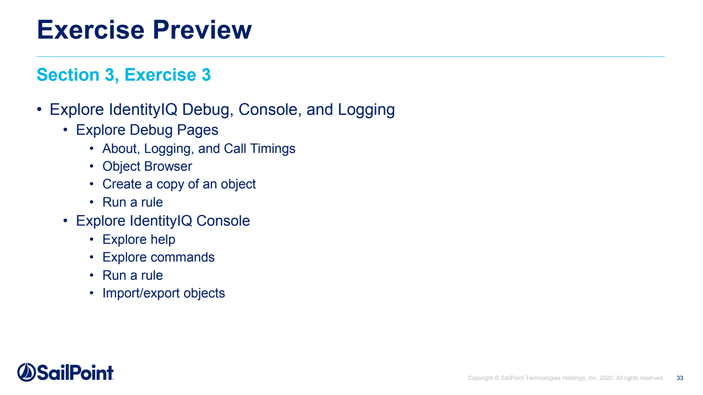

### Related practice and source pages

[Section Three — overview and contents](../practice-companion.html#practice-section-3) · [Exercise 3.3 — Debug and Console](../practice-companion.html#practice-3-3) · [Appendix — synonyms, Linux, installation and lab tools](../practice-companion.html#practice-appendix)

