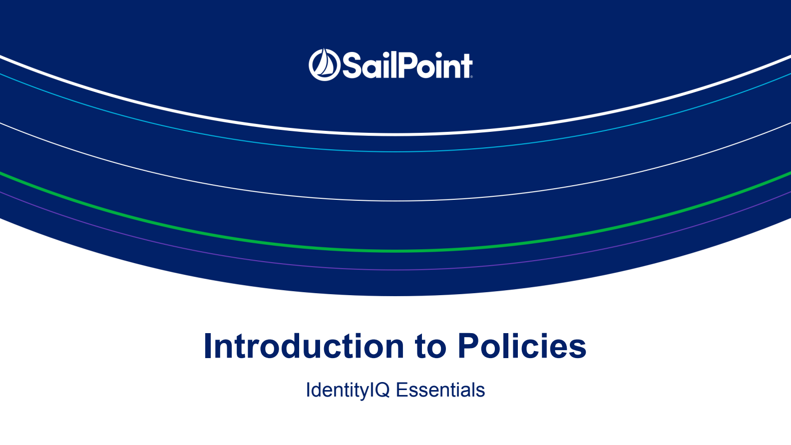
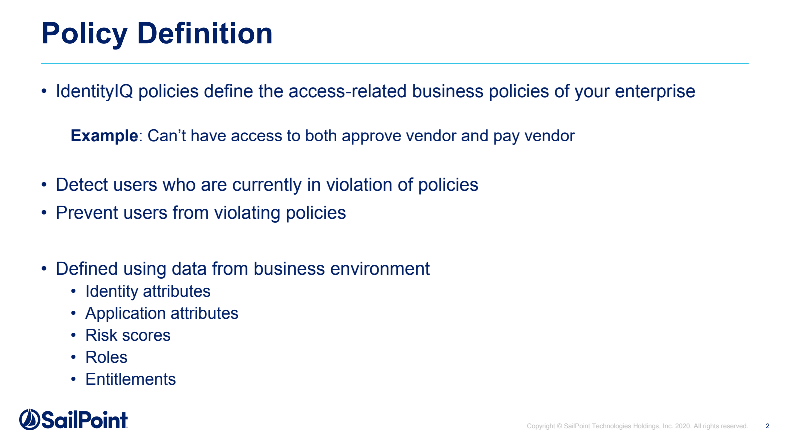
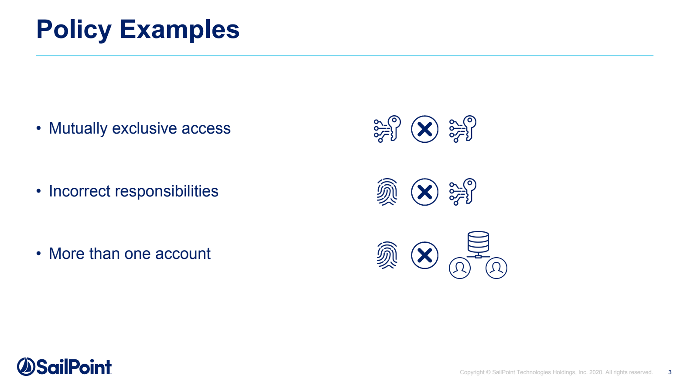
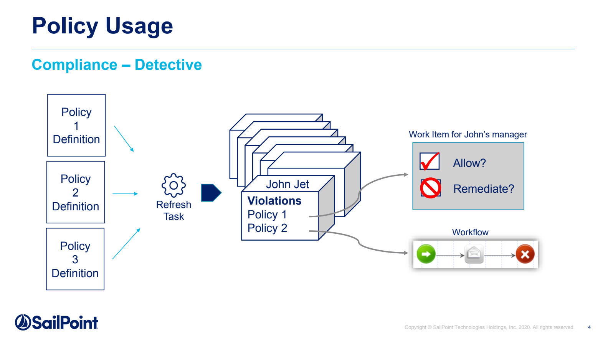
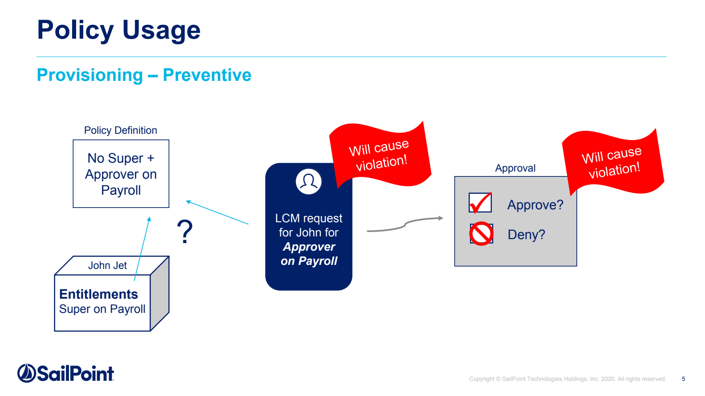
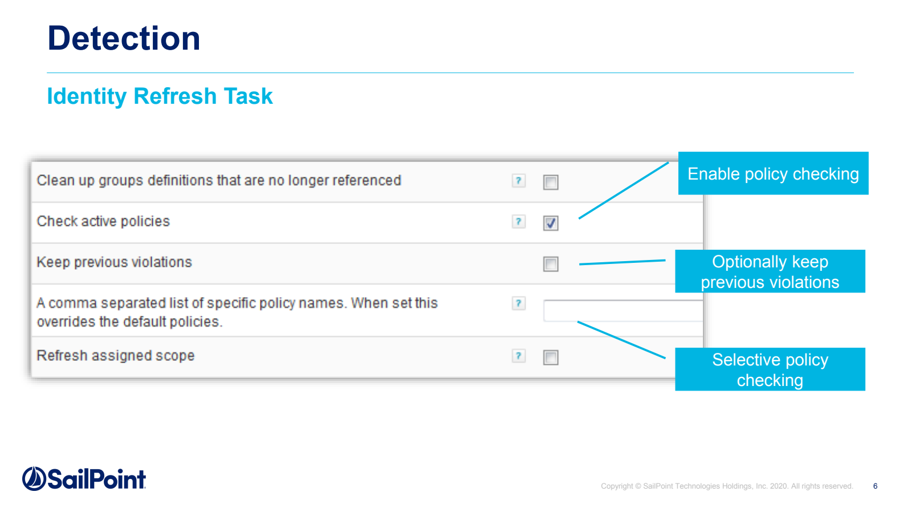
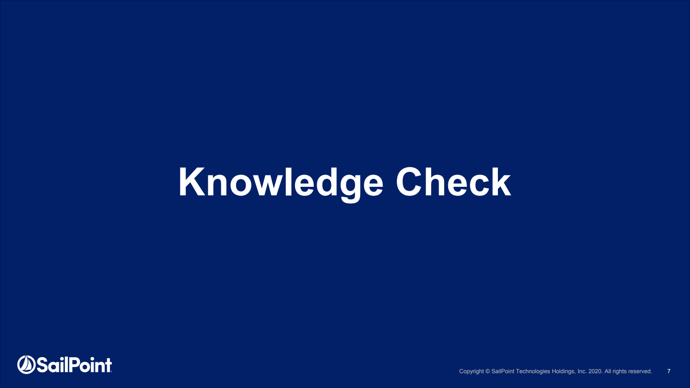
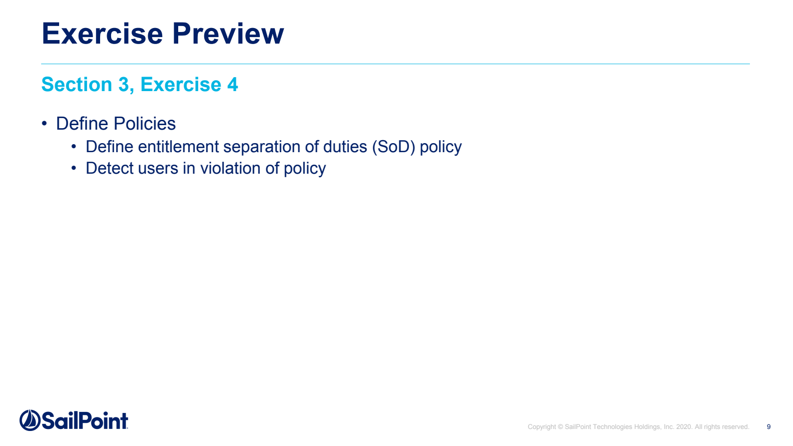

## 18. Introduction to Policies

### Express access-related business constraints

IdentityIQ policies describe combinations or conditions the business considers inappropriate. The example prohibits holding both vendor-approval and vendor-payment access. Other examples include conflicting responsibilities or an unexpected number of accounts. Policy conditions can use identity/application data, risk scores, roles and entitlements.

### Detective and preventive evaluation

Detective checking evaluates existing access. A configured identity refresh compares the identity's access picture to the active policy definitions and produces violations, which can be routed for allowance or remediation. The relevant refresh options control checking and whether earlier findings are retained.

Preventive evaluation examines the proposed access in a request process. The illustration considers a request for Approver while the identity already has Super on Payroll. Whether the process blocks, allows correction, requires approval or otherwise responds depends on its configured workflow behavior. Detecting a violation and deciding its treatment are separate steps.

### Exercise 3.4 study sequence

Define the Accounts Payable / Accounts Receivable entitlement SoD policy, configure its rule and recipients, and run a simulation before enabling the operational check. Review the simulation's Task Results, activate the intended policy/rule, run the appropriate refresh and inspect the violation, work item and notification evidence.

If the expected finding is absent, verify that both the policy and its rule are enabled, that the correct identity/access data exists and that the checking task ran with the intended options. The practice companion preserves the exact training policy settings; no policy or remediation was submitted here.

### Related practice and source pages

[Section Three — overview and contents](../practice-companion.html#practice-section-3) · [Exercise 3.4 — Define Policies](../practice-companion.html#practice-3-4)

