## 19. Introduction to Certification

### Campaign, access review and review detail

Access certification is a controlled review of identity access, role membership/composition or account-group membership/permissions. It supports business oversight and the organization's compliance obligations. The course distinguishes the technical team's responsibility for understanding the mechanism and extension rules from the compliance team's ongoing campaign operation.

A **certification campaign** defines the scope, timing and reviewers. It comprises one or more **access reviews**, each containing access data collected at generation and routed to its reviewer. Review details are the individual items on which decisions are made. A campaign is therefore not simply a live search that changes whenever a target account changes.

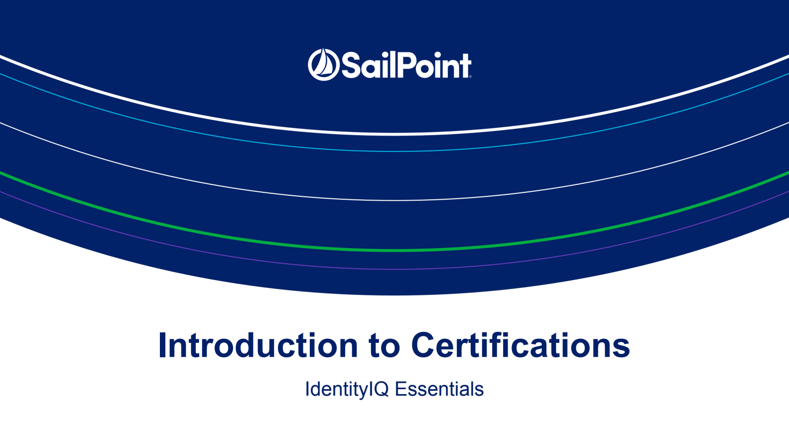

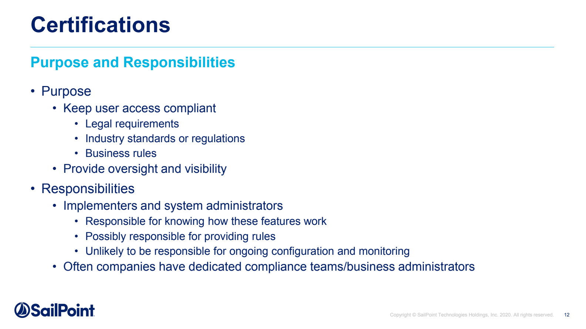

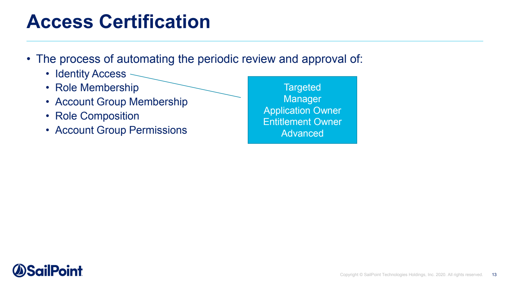

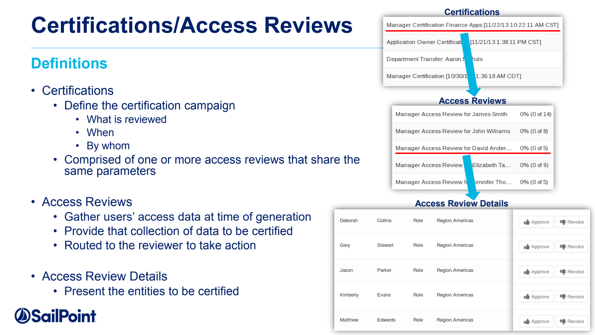

### Lifecycle and extension points

The timeline shows generation, optional staging, active review, any configured challenge period and revocation handling. Certifiers make decisions; revokers fulfill the removals. Configuration can provide exclusion, pre-delegation, sign-off, period-entry/closing and escalation rules. Certifications can start manually, on a recurring schedule or through a relevant data-change event.

The slides also show AI recommendation and demonstration screens. Their retained illustrations preserve what the handout contains; video-only decision commentary and changing screens have not been reconstructed for this edition.

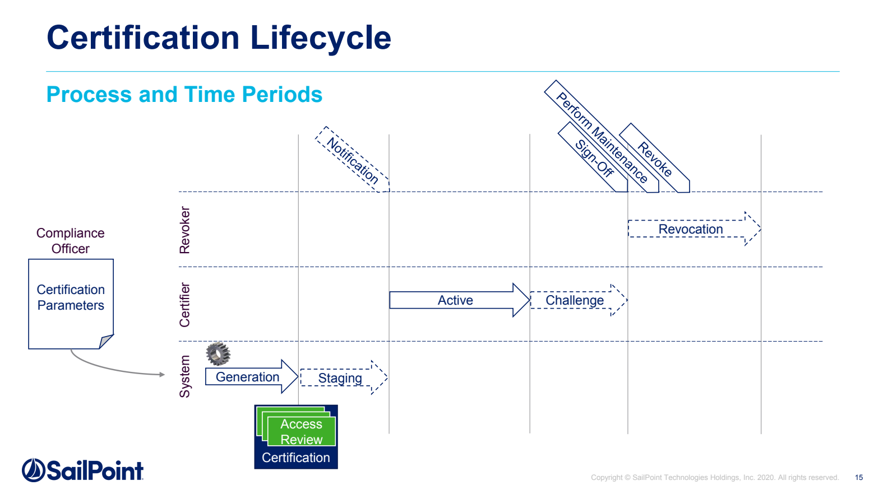

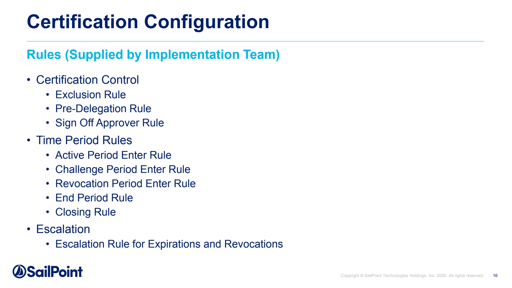

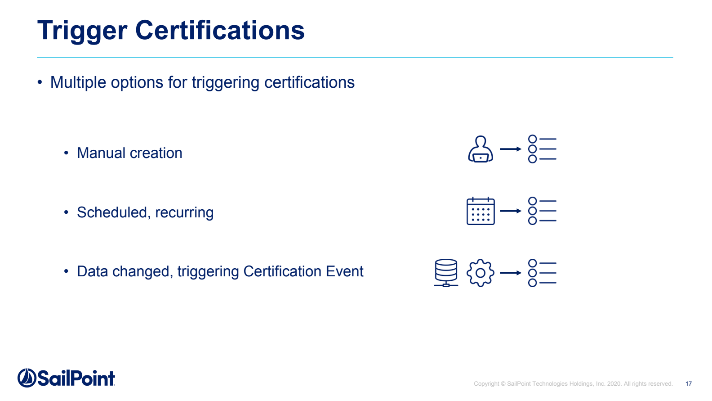

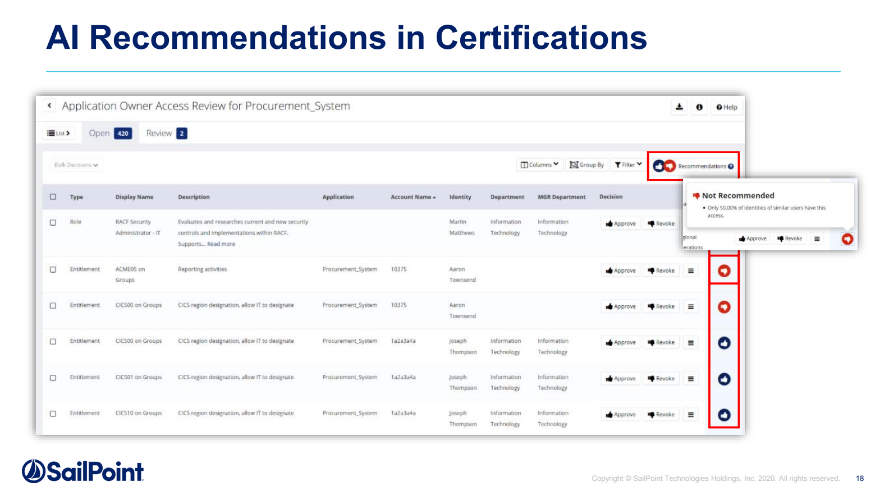

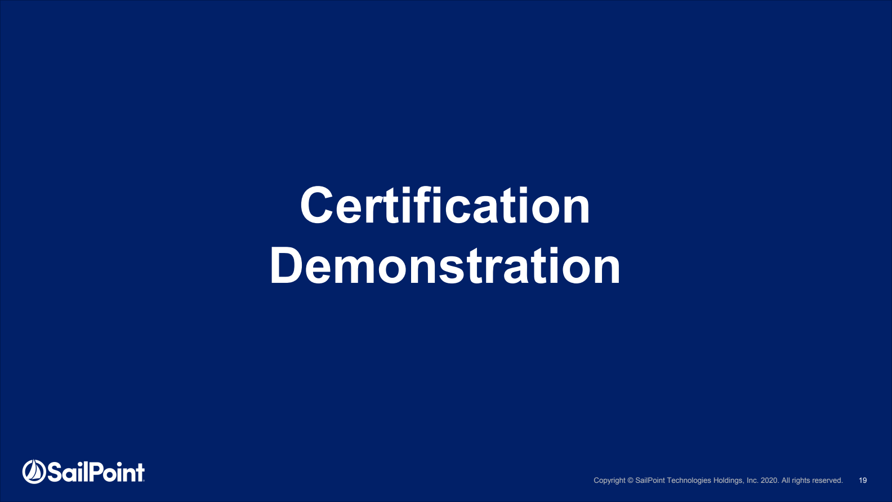

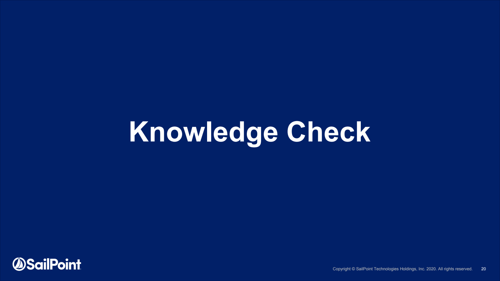

### Exercise 3.5 study sequence

Generate the targeted Finance certification in a staged state, inspect its scope and assignments, then activate it. Reviewers inspect account/entitlement details, save their decisions and complete sign-off. A shared workgroup review illustrates how another authorized member can continue the work and how self-review constraints affect decisions. Finally, observe maintenance-driven changes in review status.

These are learning instructions, not a completed access review or certification exam attempt. The original exercise pages retain their training scenarios and prompts; the study prose does not substitute an answer key.

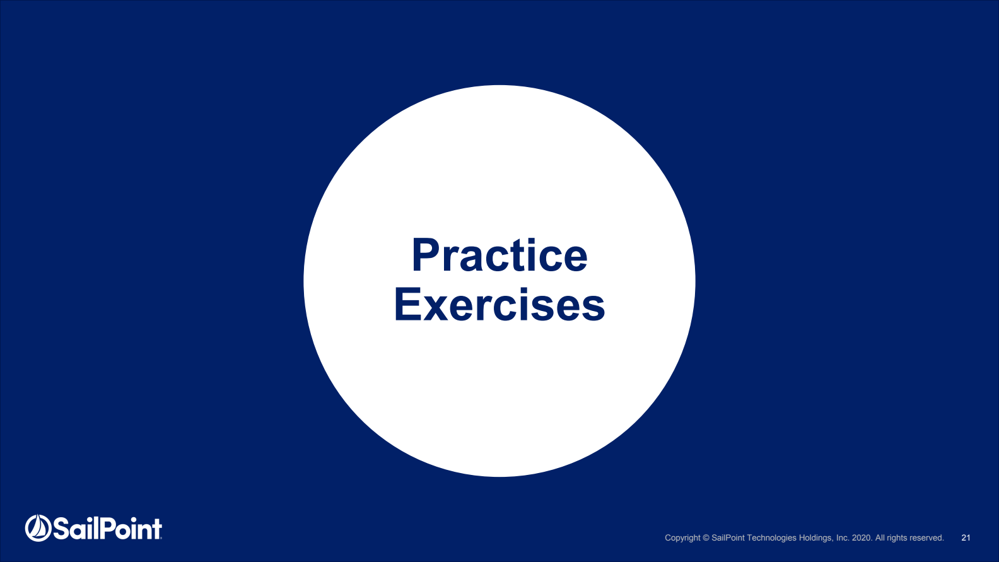

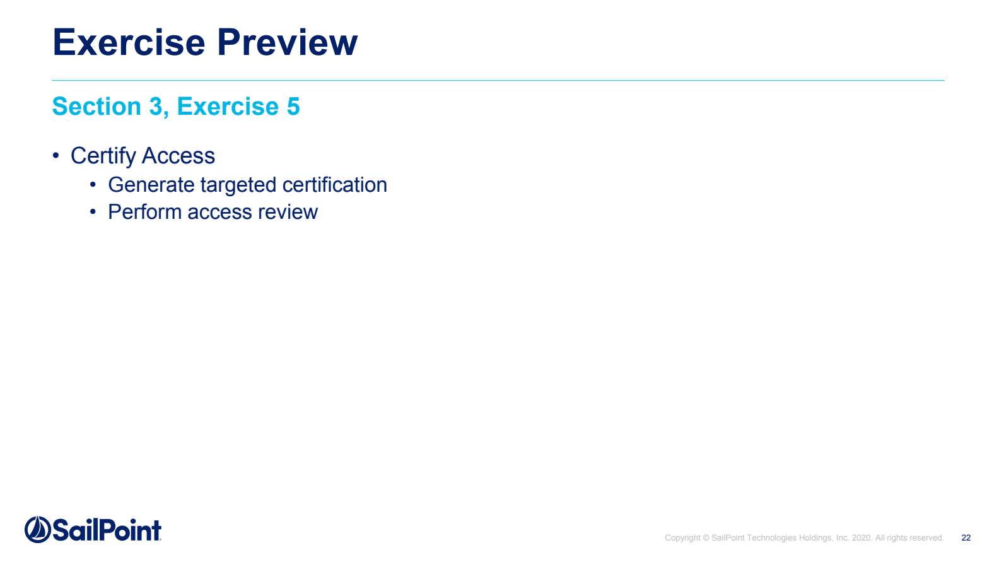

### Related practice and source pages

[Section Three — overview and contents](../practice-companion.html#practice-section-3) · [Exercise 3.5 — Certify Access](../practice-companion.html#practice-3-5)

