## 20. Introduction to Roles

### Model access at business and technical levels

A role groups access into a meaningful unit. The default two-tier model separates **business roles**, reflecting responsibilities and assignment/request choices, from **IT roles**, whose profiles describe entitlement sets detected on identities. The Finance/Treasury illustration shows business responsibilities sharing technical access components.

A required relationship means the associated IT access belongs with the business role. A permitted relationship makes an IT role an allowed additional choice that still must be requested; it is not automatically provisioned simply because it is permitted.

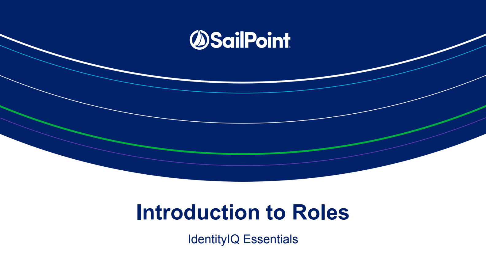

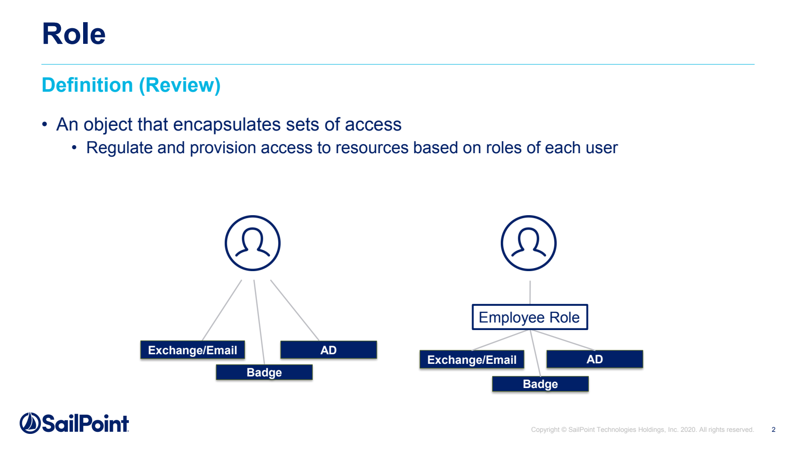

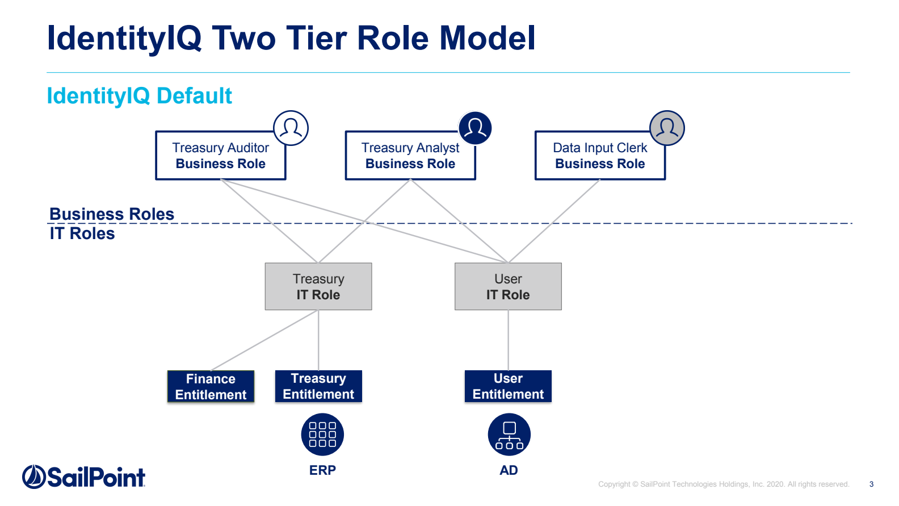

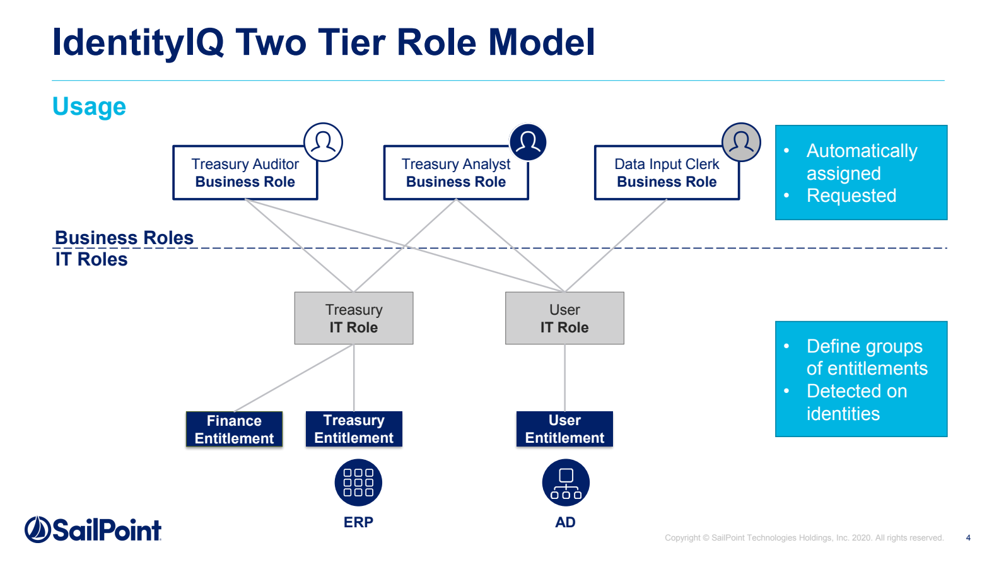

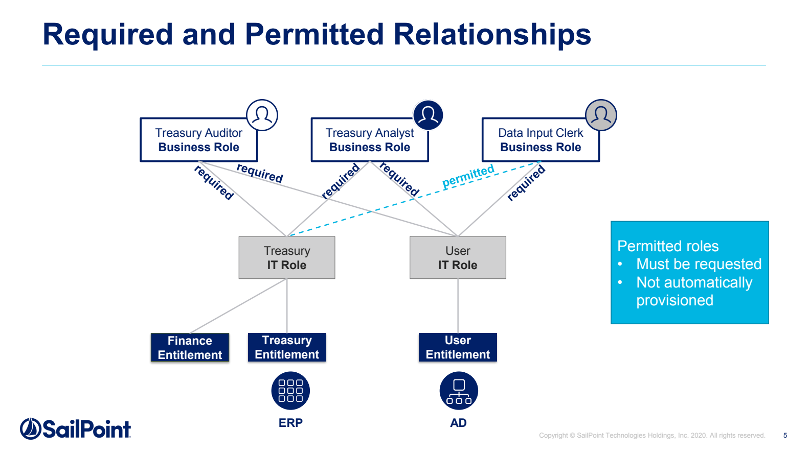

### Assignment, detection and provisioning

The identity-refresh option for assigned/detected roles evaluates business-role assignment logic and IT-role profiles. Provision assignments and deprovisioning controls determine additional effects. A role being detected from existing access is conceptually different from a business role being assigned and then causing access changes.

The automated example changes an HR attribute, refreshes the identity and provisions the business-role access. In the depicted assigned-role path, no request approval is required. That example should not be generalized to every custom role workflow.

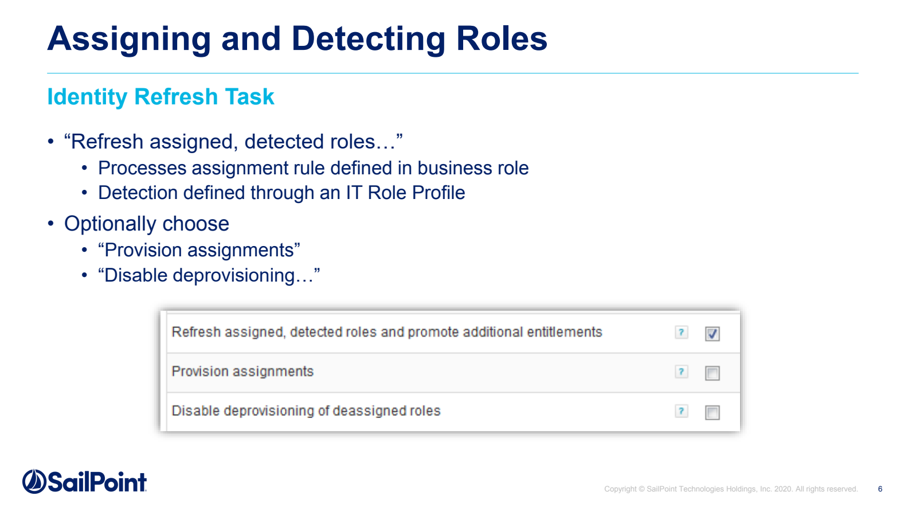

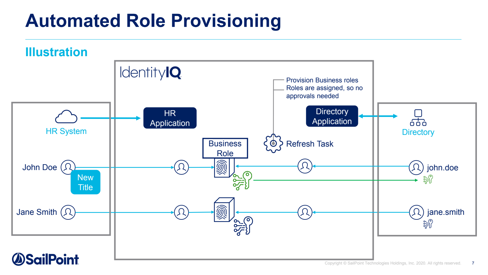

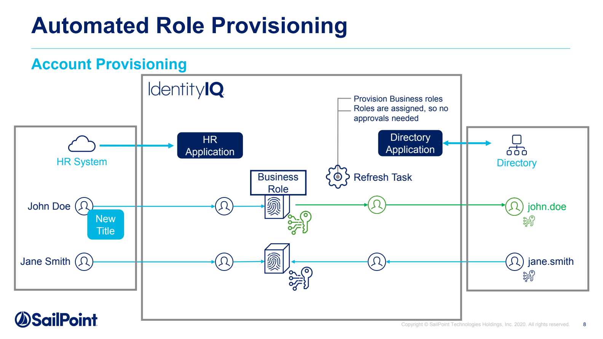

### Birthright roles

Rapid Setup birthright roles supply baseline access during joiner processing. The course describes them as a single-tier, non-requestable model assigned during the joiner event. Business roles, by contrast, can support continuing team/department/project needs, refresh-based assignment and the two-tier required/permitted relationships.

Exercise 3.6 imports and inspects business/IT roles, refreshes assignment/detection, checks provisioning evidence and the resulting cube, and defines birthright roles for later joiner exercises. It also distinguishes role definitions from the actual entitlements held on target accounts.

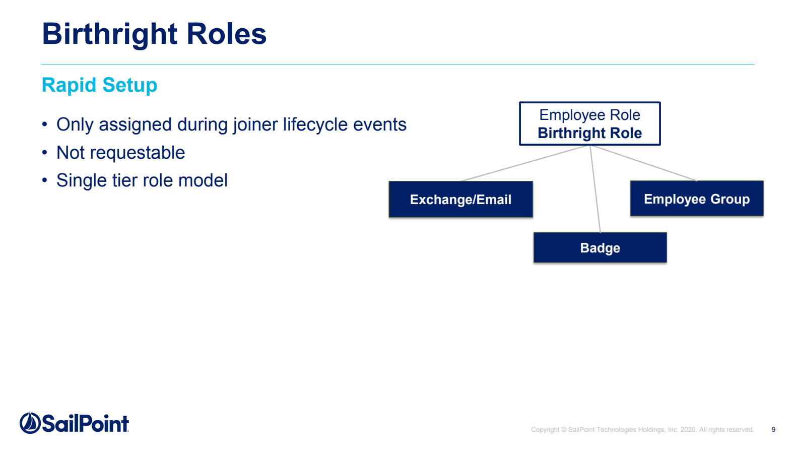

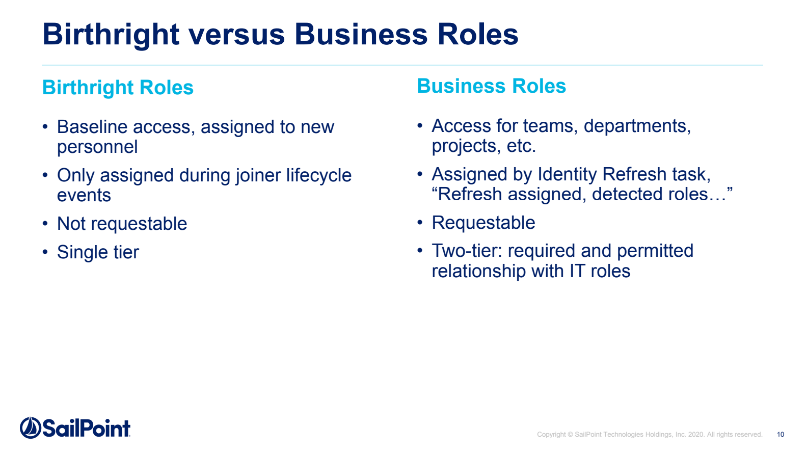

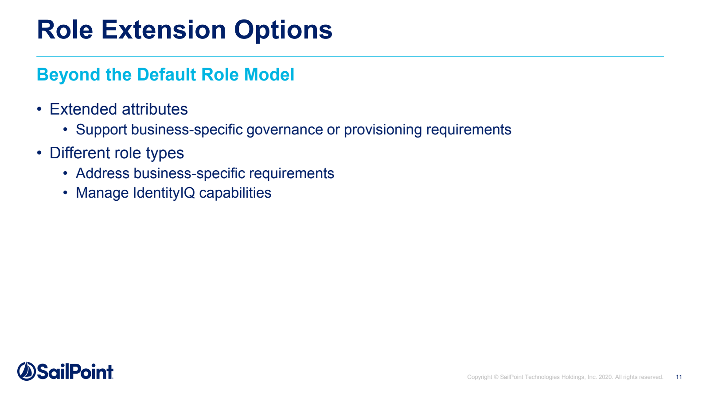

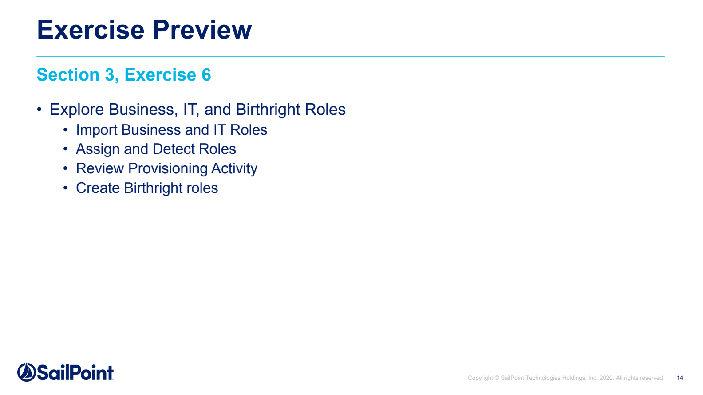

### Related practice and source pages

[Section Three — overview and contents](../practice-companion.html#practice-section-3) · [Exercise 3.6 — Business, IT and Birthright Roles](../practice-companion.html#practice-3-6)

