## 21. Provisioning Overview

### What triggers a change

Provisioning adds, modifies or removes identity/access data. Requests can originate from users, managers, help-desk operations, lifecycle changes, policy remediation or certification decisions. Those entry points should feed the intended business controls rather than each implementing an unrelated fulfillment path.

The course describes three channels: direct automated connector operations, integration with a third-party fulfillment system, and manual work items. An application can be configured for manual fulfillment even while account data is read through a connector; the JDBC example illustrates a case where write logic is not fully supplied.

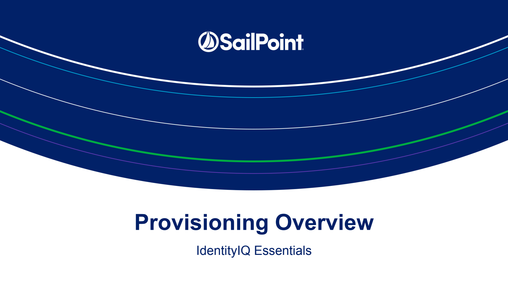

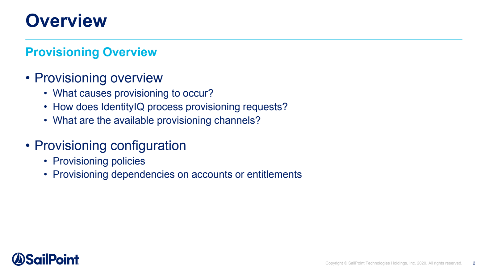

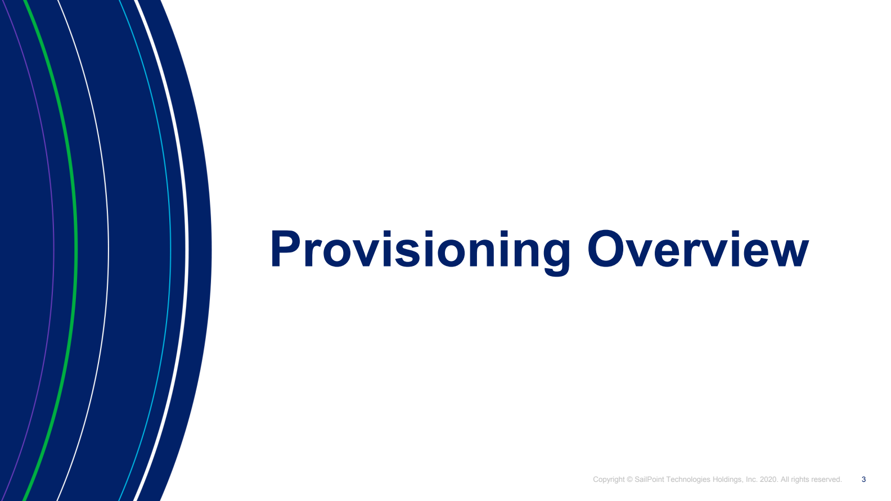

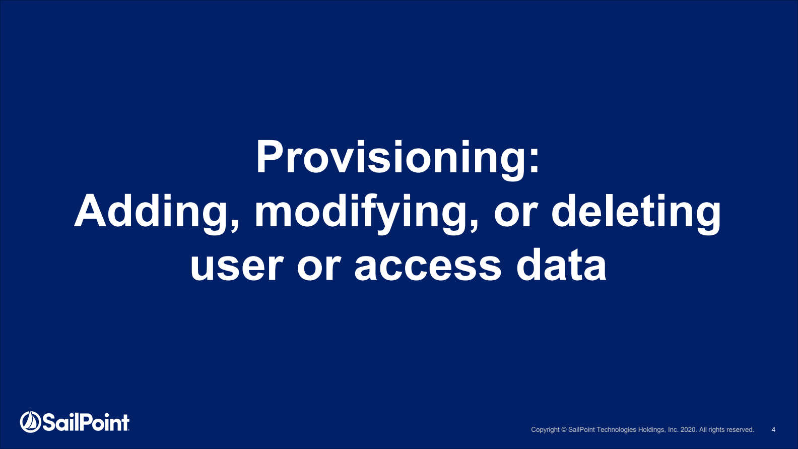

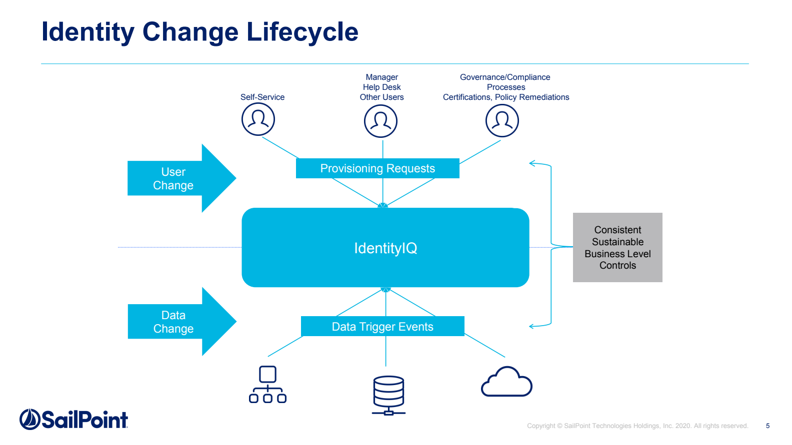

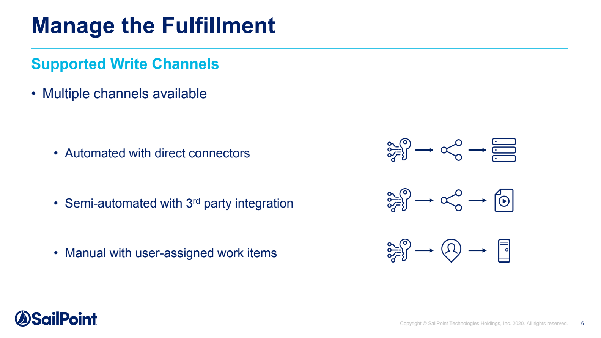

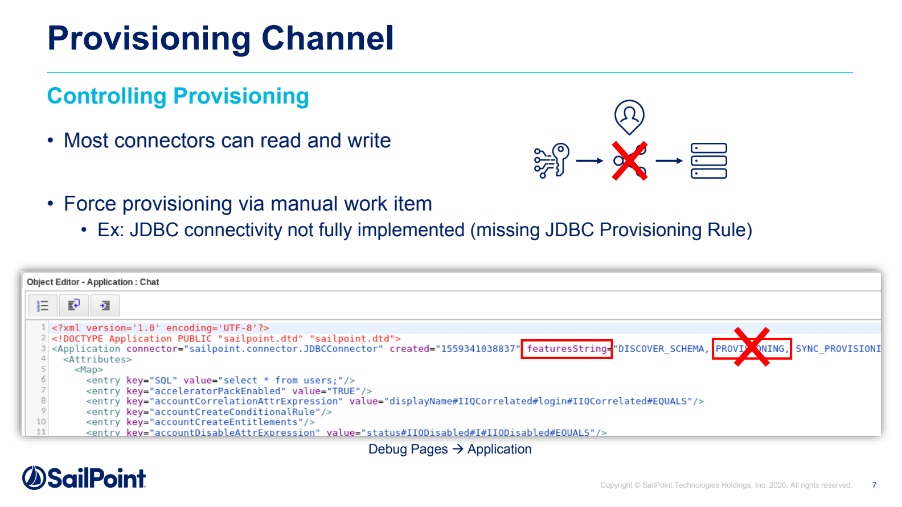

### Understand the plan before fulfillment

The provisioning engine expands the requested access into needed account/entitlement changes, filters against existing access and chooses an appropriate channel. A business-role request is therefore not always a one-line target-system operation. It may imply several entitlements or a new account before the requested permission can exist.

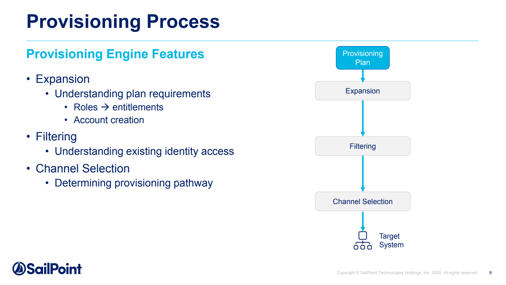

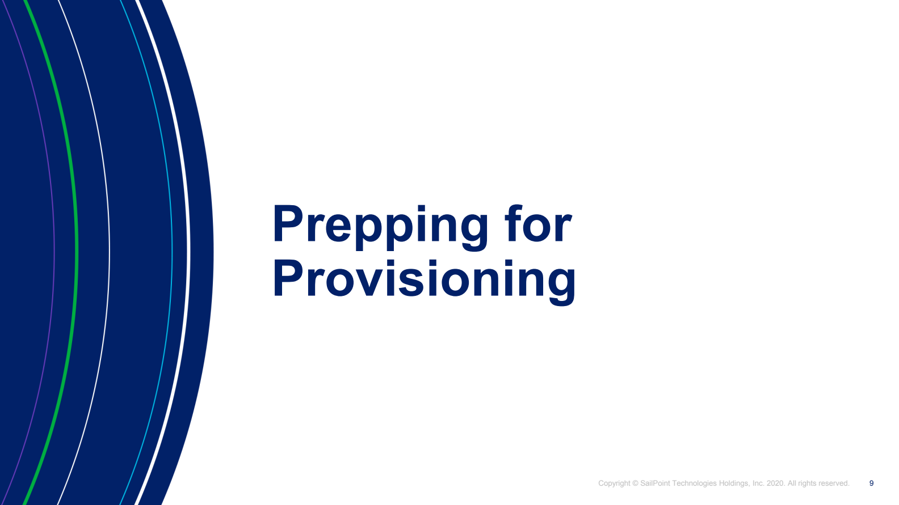

### Supply the required values

Provisioning policies define values for account create/update/delete and other supported operations. A field can be static, calculated from identity data or collected through a form. The Bug Tracking example derives first name, last name and login while supplying application-specific status values. Create-account policies are particularly important because missing required account data can prevent fulfillment.

JDBC provisioning additionally requires the actual provisioning rule; a populated form alone does not implement database writes. Account dependencies can sequence a prerequisite account and reuse relevant attributes from a master application, within the supported direct-connector path described in the course.

Exercise 4.1 reviews and updates LDAP's create-account policy, adds fields and value calculations, imports other policies, attaches the JDBC rules and studies dependencies. Its original form screenshots and training scripts remain beside the related practice instructions.

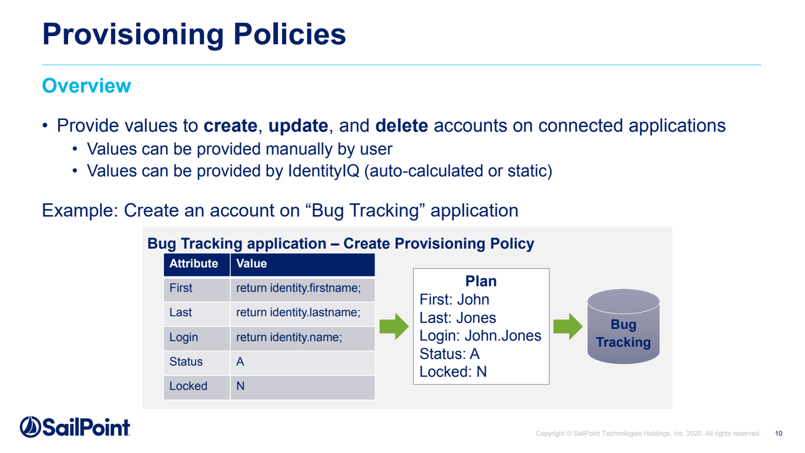

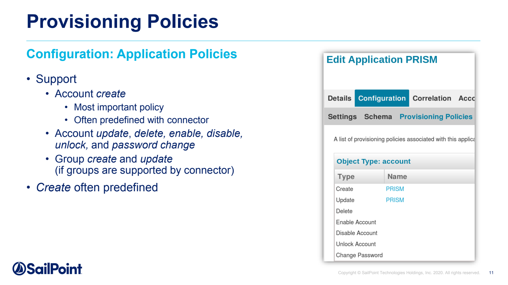

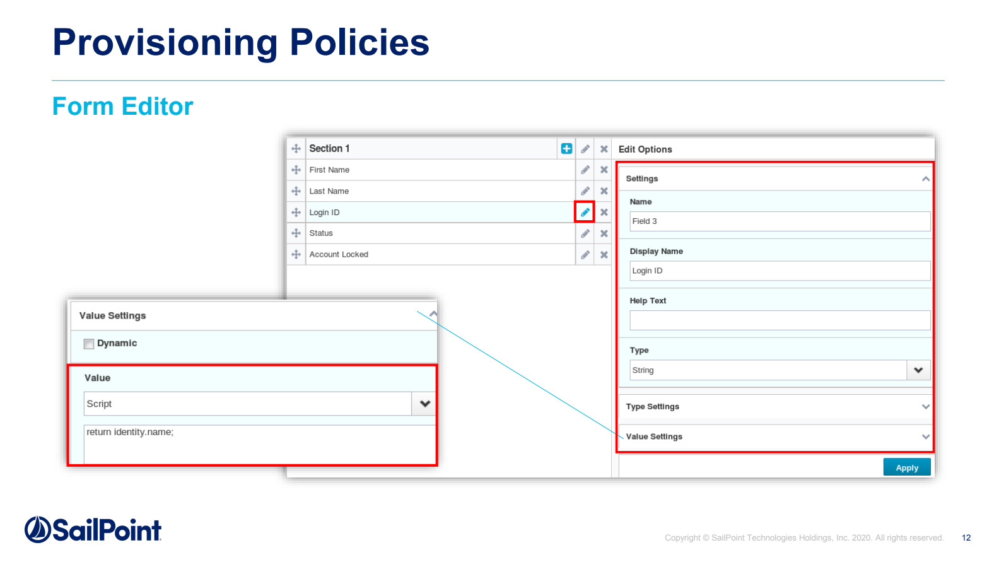

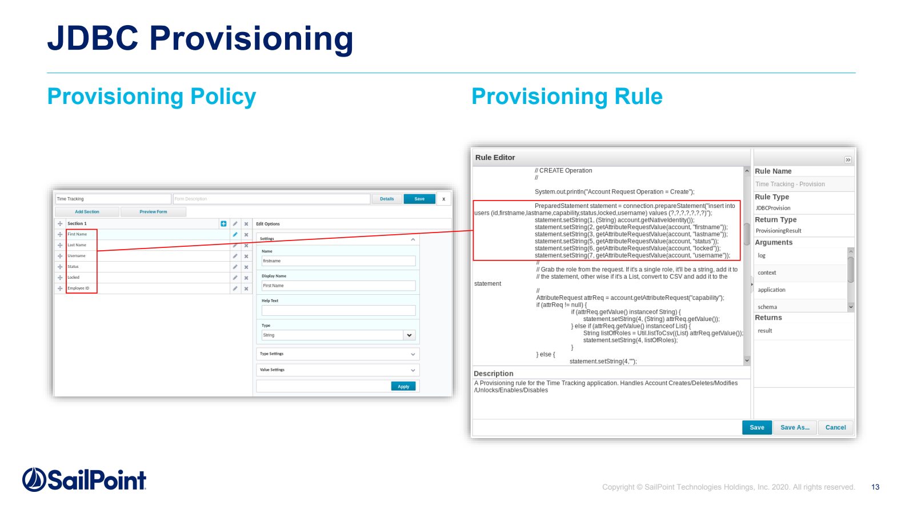

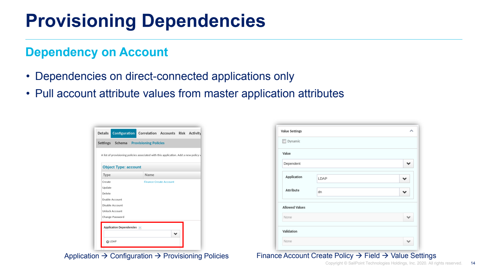

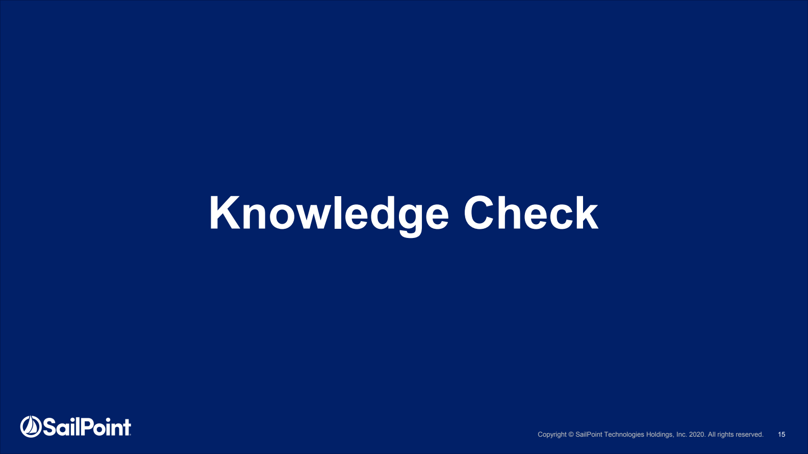

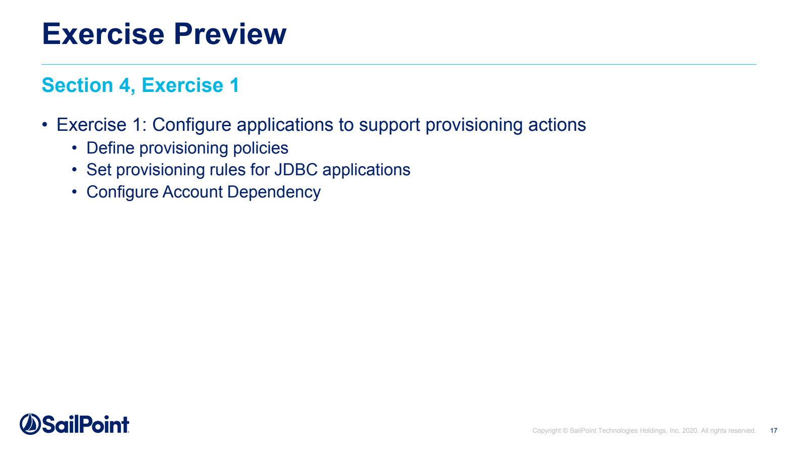

### Related practice and source pages

[Section Four — overview and contents](../practice-companion.html#practice-section-4) · [Exercise 4.1 — Prepare Applications for Provisioning](../practice-companion.html#practice-4-1)

