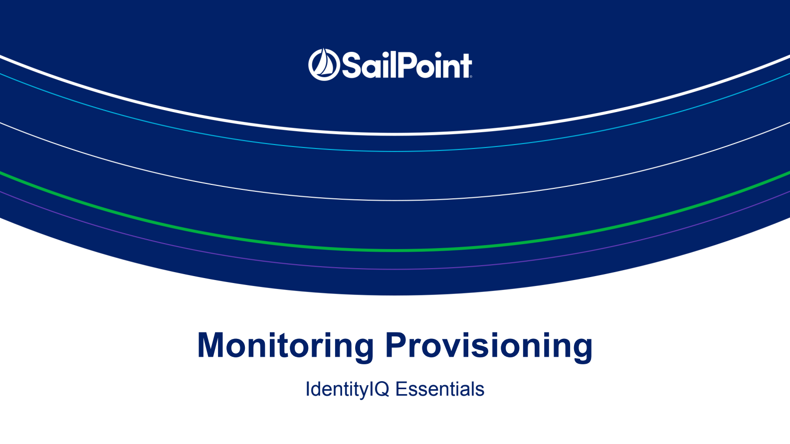
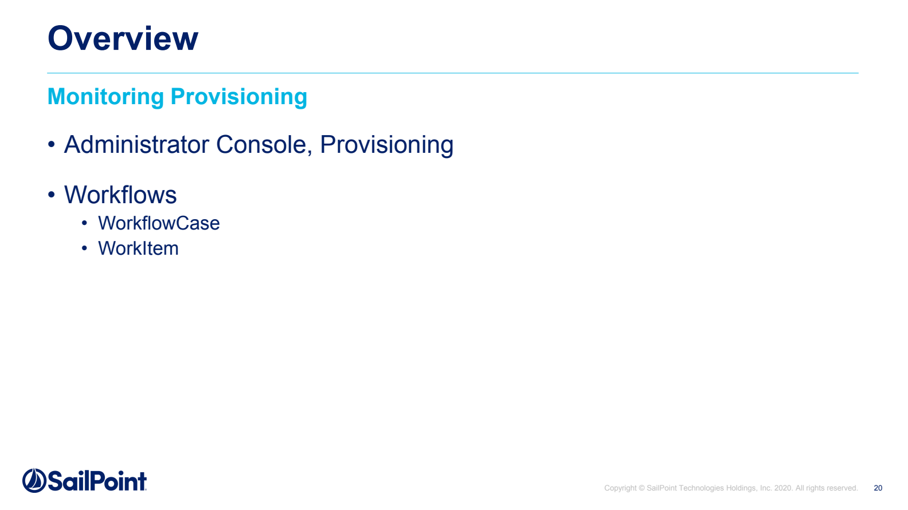
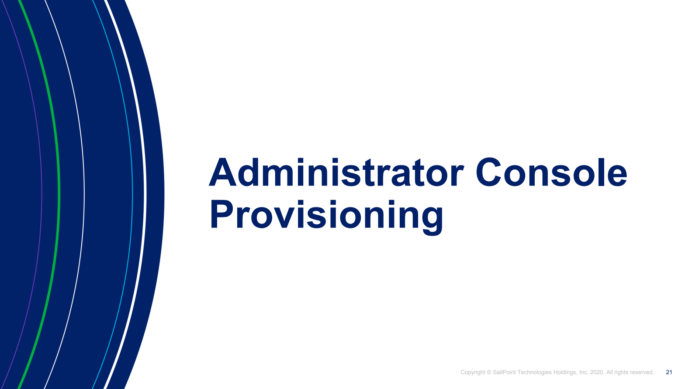
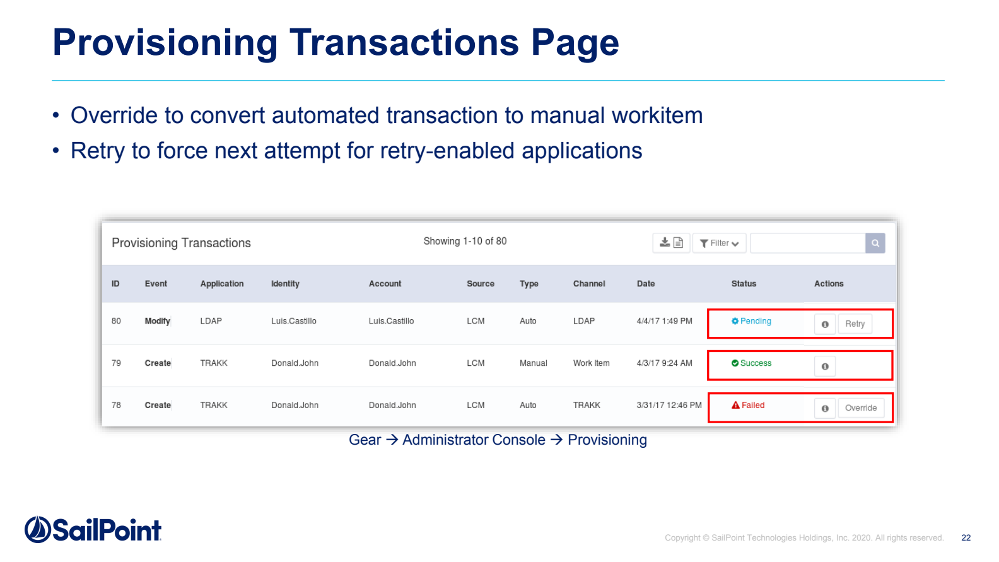
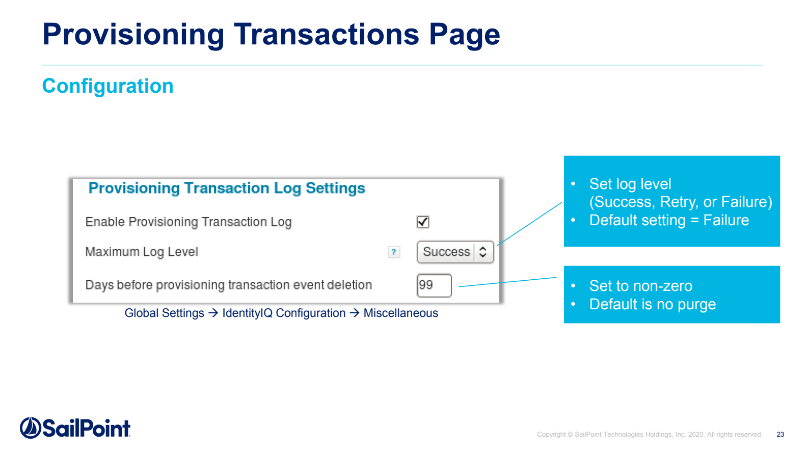
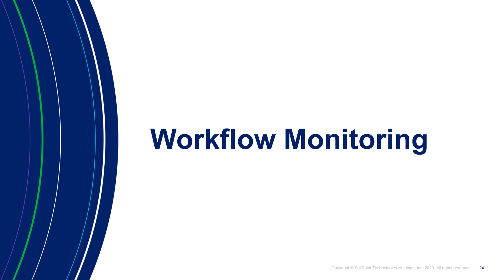
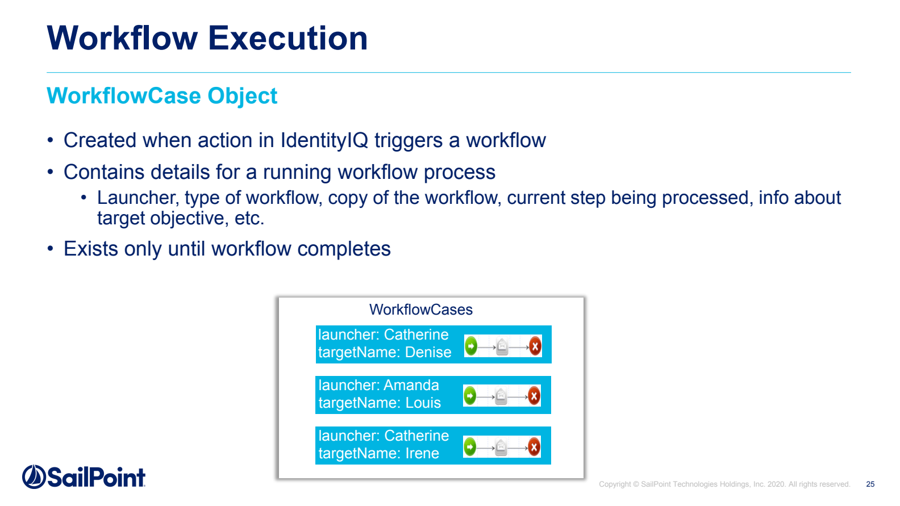
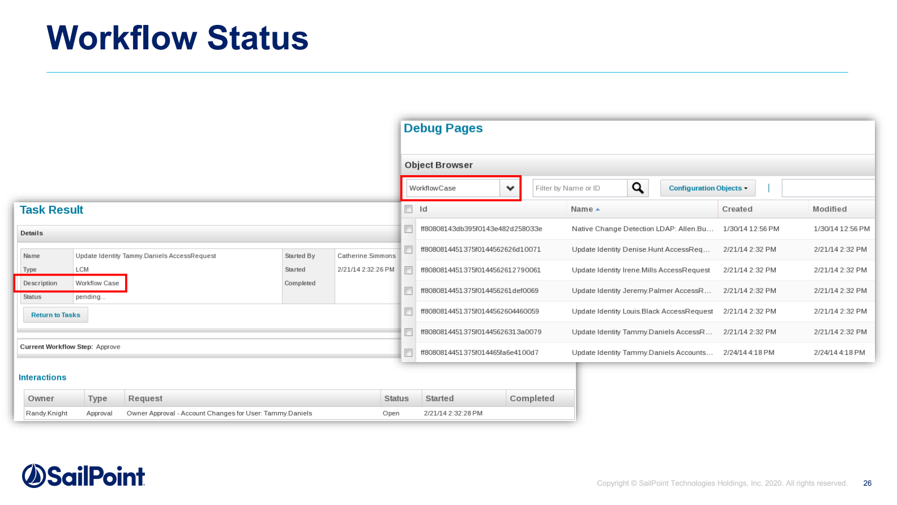
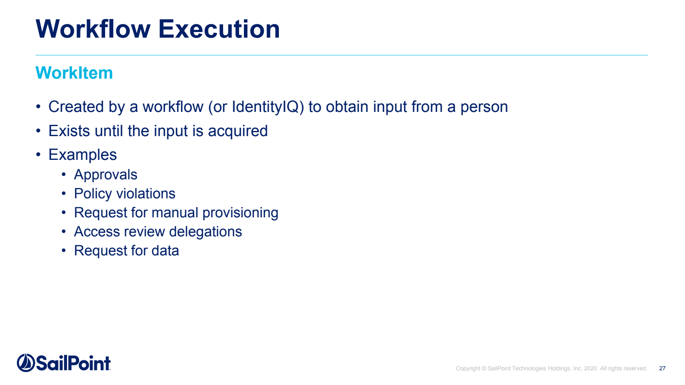

## 22. Monitoring Provisioning

### Transaction and workflow evidence

The Administrator Console's Provisioning view records target-operation results and, where configured, retryable failures. Its actions can force a retry or convert an automated transaction into a manual work item. A retry action and an override change the fulfillment process; they are not read-only status views and were not executed here.

Transaction logging has separate level and retention settings. The course shows Success, Retry and Failure levels and a default of Failure for its build. A missing success row can reflect logging configuration rather than proof that nothing occurred.

### WorkflowCase versus WorkItem

A **WorkflowCase** represents an executing workflow instance. It records context such as launcher, target, workflow copy and current step and exists until that workflow completes. A **WorkItem** represents input needed from a person, such as an approval, manual provisioning action, data request or delegated review; it exists until that input is resolved.

These objects answer different questions. A request can be waiting for an approval work item before any connector write is attempted. A completed approval does not establish that provisioning succeeded. A vanished completed WorkflowCase does not mean the long-term request/audit history must be absent.

Use Track My Requests, transaction evidence, work-item state and target-account verification together. Later access-request exercises intentionally cause an LDAP retry, restore the training service, retry the operation and inspect request maintenance. That exercise demonstrates the difference between approval, target fulfillment and final request status.

### Related practice and source pages

[Exercise 4.5 — Test Access Requests and Attachments](../practice-companion.html#practice-4-5)

