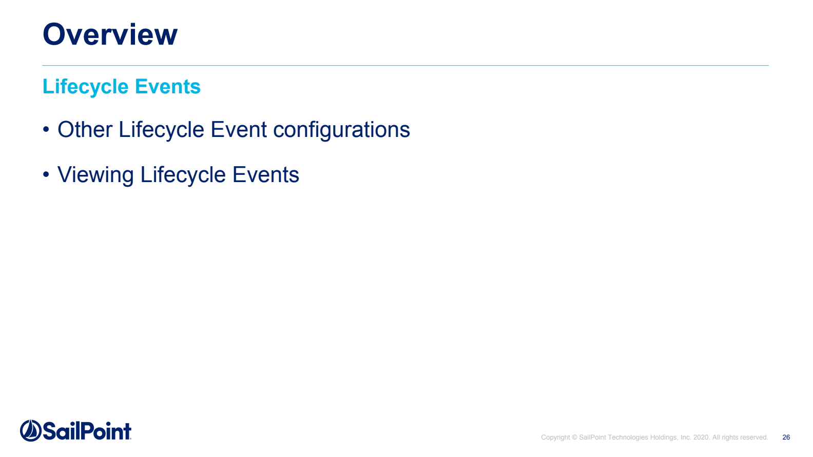
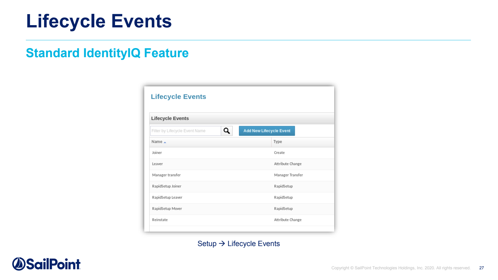
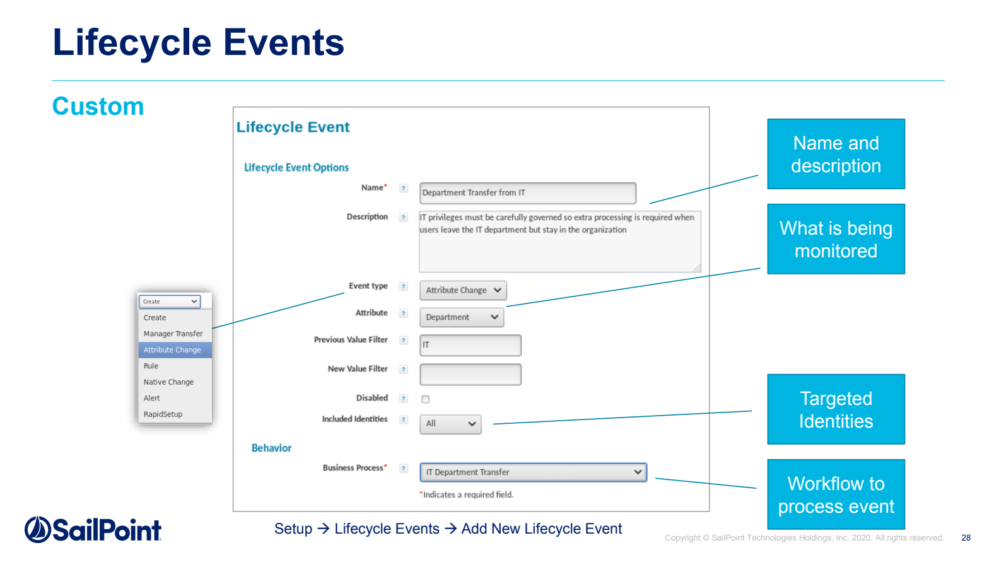
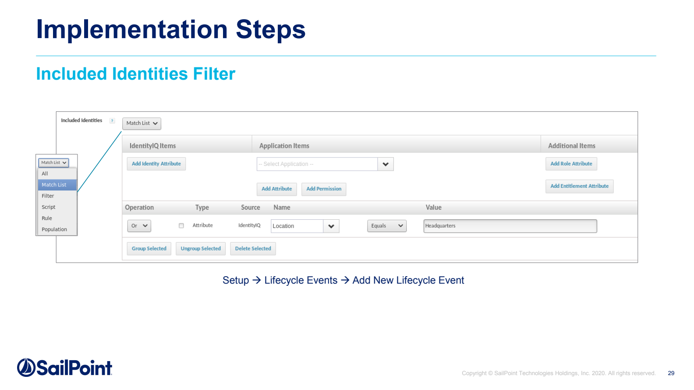
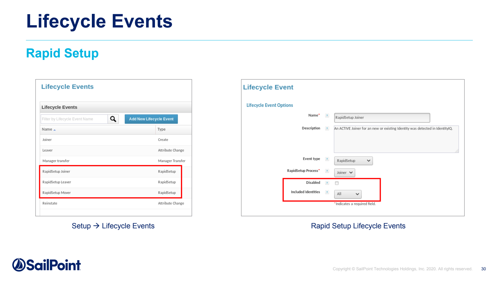
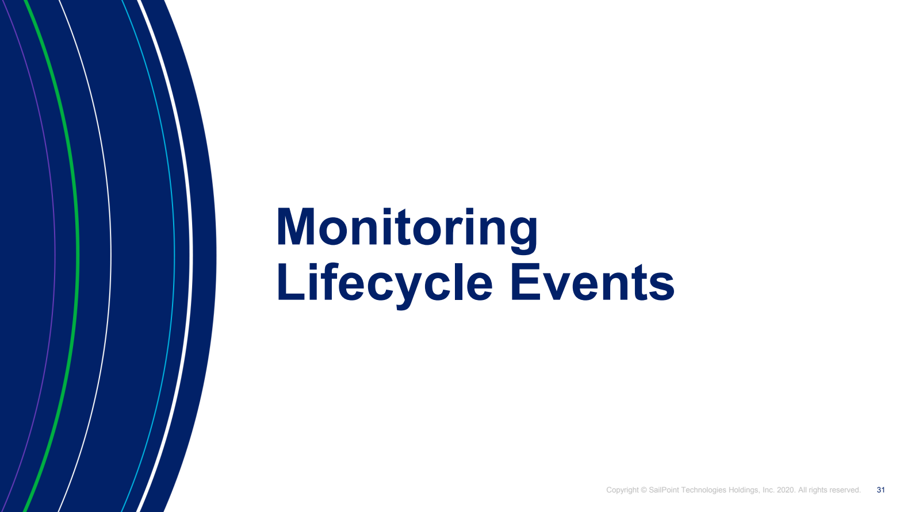
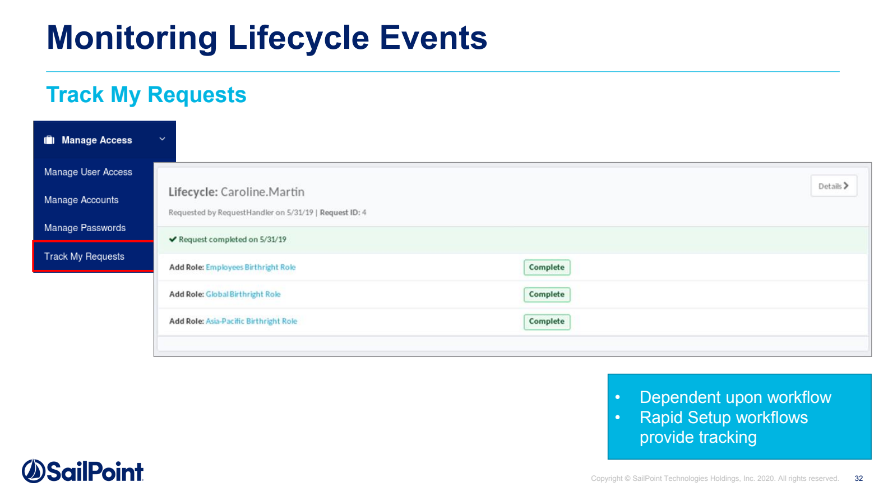
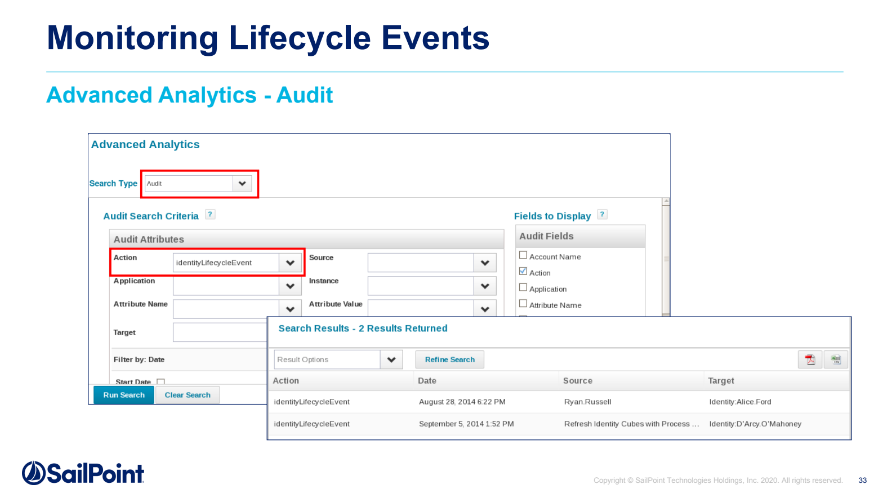
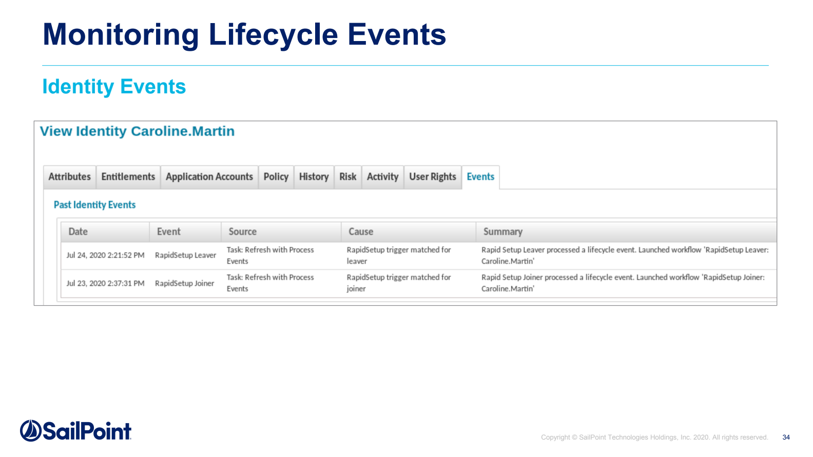

## 24. Lifecycle Event Configuration

### Standard and Rapid Setup definitions

Setup → Lifecycle Events provides the standard configuration view. A custom definition supplies its name, monitored change, processing workflow and included-identity criteria. The included-identities filter narrows the population; the event definition identifies the change within that intended population.

Rapid Setup events also appear in the lifecycle-event administration area. The simplified configuration framework does not remove the underlying event/workflow model. The original screens distinguish those generated definitions from an independently configured custom event.

### Observe the event through more than one view

Track My Requests can show lifecycle processing when the workflow supplies request tracking; the course says the Rapid Setup workflows do. Advanced Analytics Audit and the identity's event details provide additional evidence. Do not assume a custom workflow automatically writes the same tracking information as a supplied Rapid Setup workflow.

When verifying an example, establish the triggering source/UI change, whether refresh processed events, which workflow ran, whether approvals or manual work remain, and what the application finally contains. A matching trigger alone is not a completed joiner or leaver.

The joiner/mover/leaver practice sections demonstrate this verification pattern using the original training configurations. No event was triggered in the user's VM while preparing the book.

### Related practice and source pages

[Exercise 4.2 — Joiner Lifecycle Event](../practice-companion.html#practice-4-2) · [Exercise 4.3 — Mover Lifecycle Event](../practice-companion.html#practice-4-3)

