## 25. Lifecycle Manager Requests

### Separate requester, requestee and requested item

A request has three distinct subjects: the person submitting it, the identity whose access will change, and the access or operation requested. Configuration must answer **who can request what for whom**, then select the business process that will fulfill it.

The process diagram begins with requester/requestee filtering, then selection and submission, a provisioning plan and workflow, policy/approval/data collection, and the provisioning engine. The Quicklink menu and cards expose entry points for access, accounts, passwords and identity operations; visibility of a menu item is only one part of the authorization design.

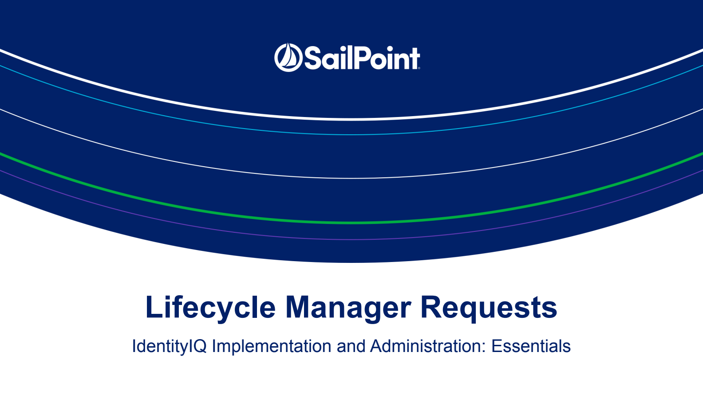

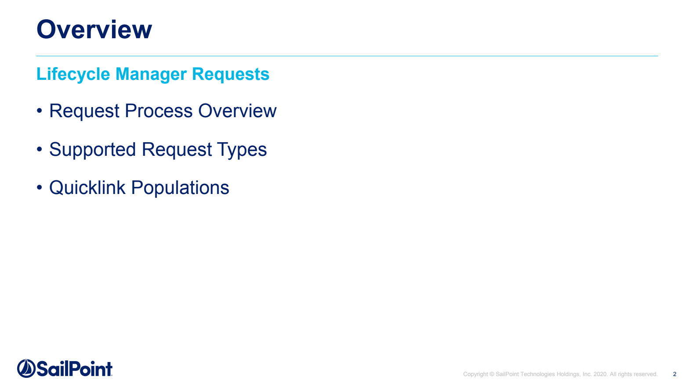

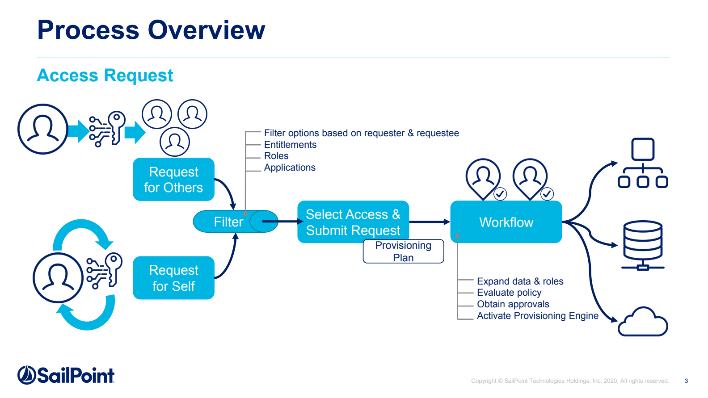

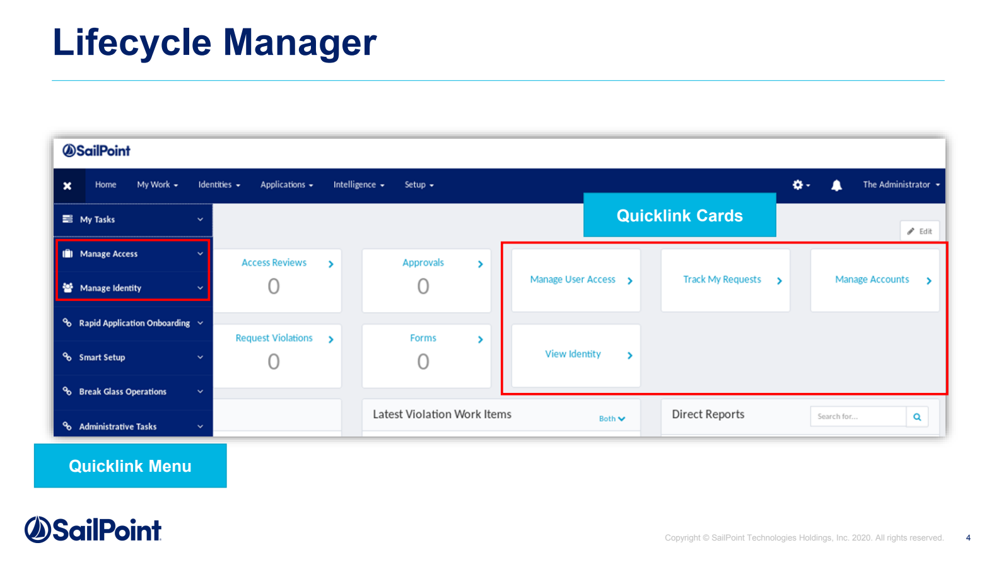

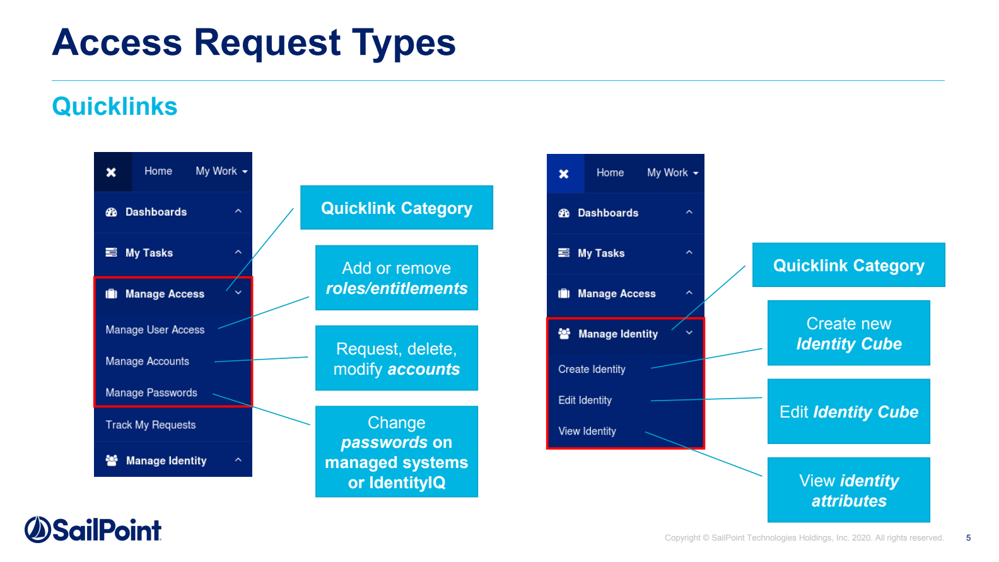

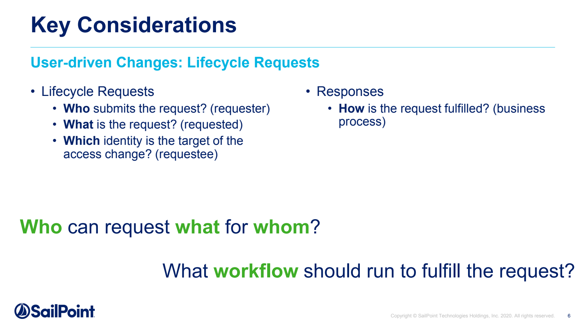

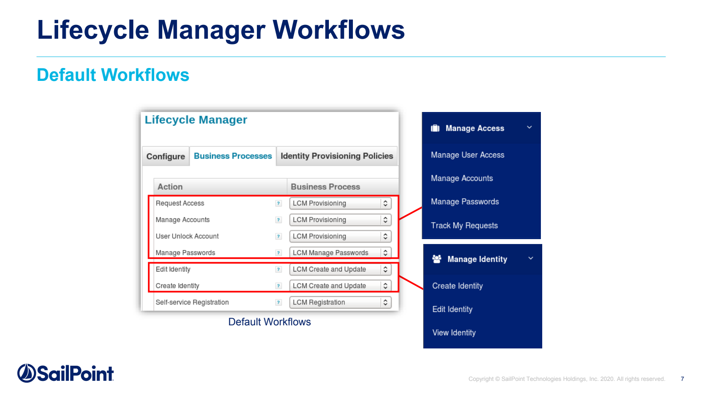

### Quicklink populations

A Quicklink Population defines eligible requesters, permitted target identities and enabled request actions. The course's examples distinguish help-desk personnel, managers acting for reports and self-service users acting for themselves. Custom membership can use attributes, capabilities, workgroups, account data, saved populations, scripts or rules. Access is cumulative across the populations that apply to a user.

A population's requestees can be everyone or a filtered set, including reporting relationships or shared attributes. The requester population and the target population are not interchangeable.

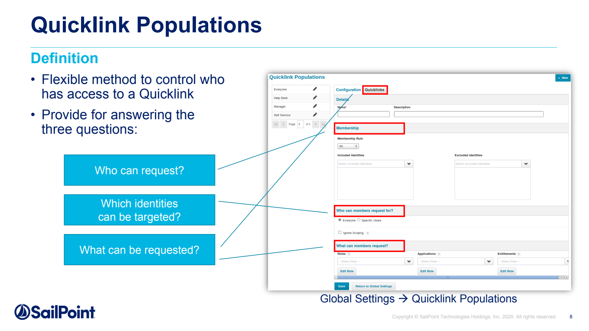

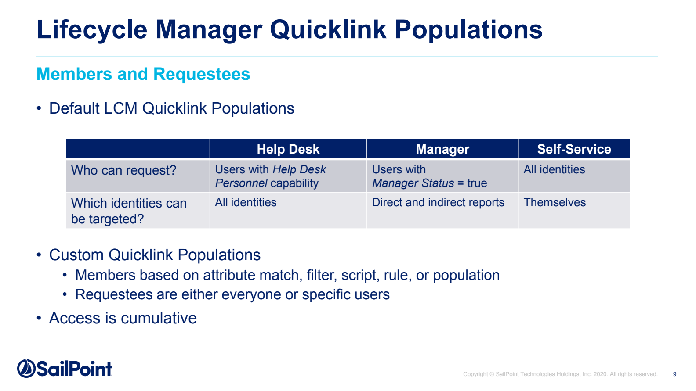

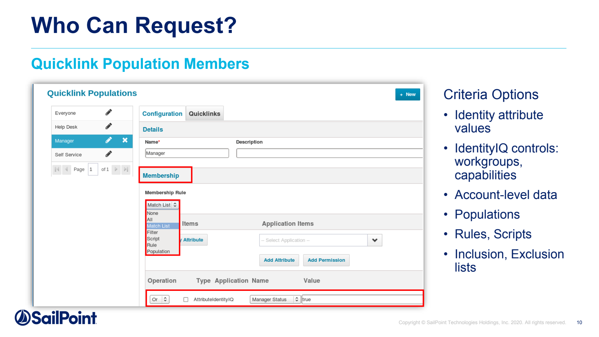

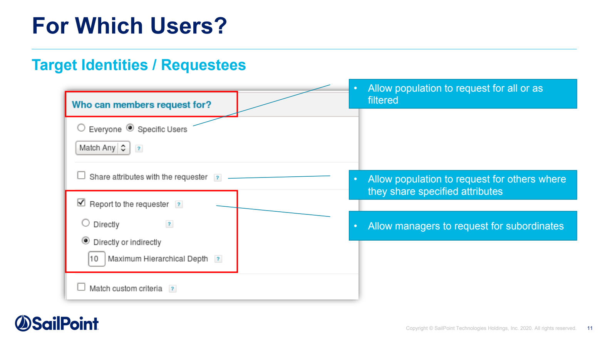

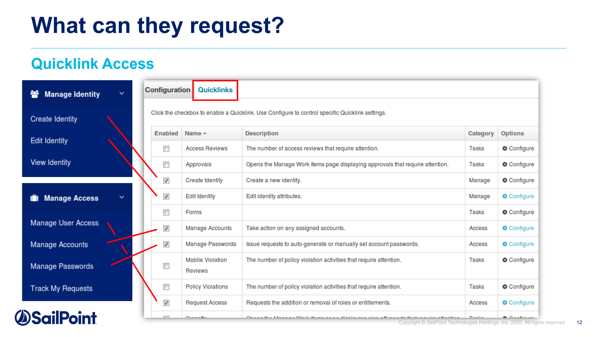

### Filter the particular access items

Object-filtering rules can constrain available roles, entitlements or applications using requester and requestee context. Revocation can have its own filters. The security-level example compares a requestee's level against each access item's required level, resulting in different choices for different target identities.

When testing these controls, change one dimension at a time: the requester, the target and then the access item. Otherwise a successful request does not reveal which policy actually allowed it. Exercise 4.4 applies these controls to the supplied populations and Quicklinks.

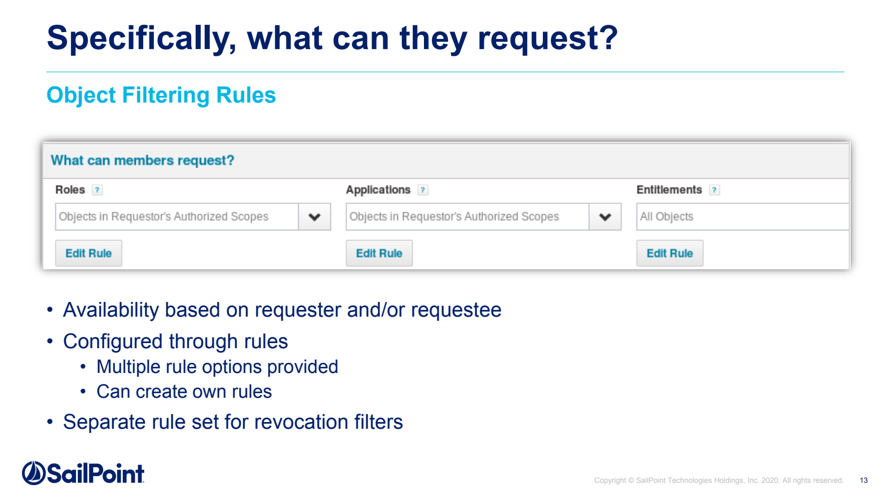

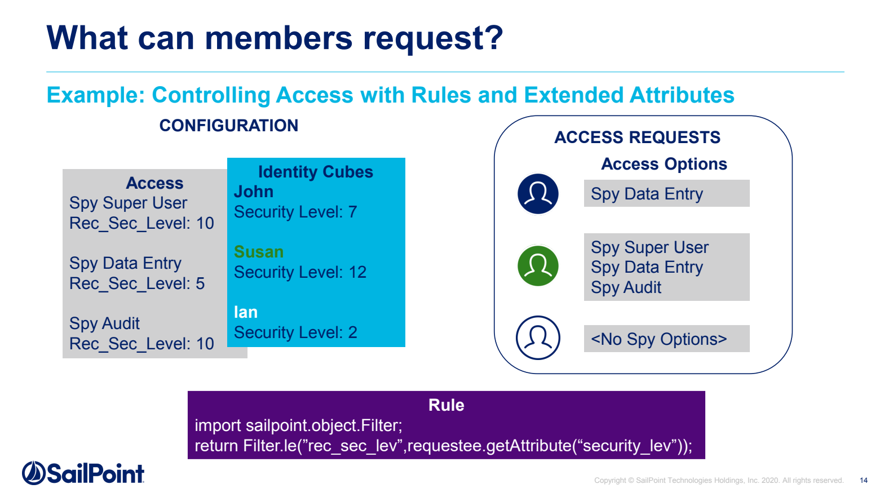

### Related practice and source pages

[Section Four — overview and contents](../practice-companion.html#practice-section-4) · [Exercise 4.4 — Configure Access Requests](../practice-companion.html#practice-4-4)

