## 26. Manage User Access

### Make access available intentionally

Manage User Access supports role and entitlement requests for the identities permitted by the relevant Quicklink configuration. The Entitlement Catalog's requestability indicator is one control. The course contrasts its standard default with Rapid Setup choices and rules that set values during promotion or group aggregation.

Role-type filtering is separate. The slide example allows different role types in self-service and requests for others. A role or entitlement existing in the catalog does not by itself establish that a particular requester can select it for a particular person.

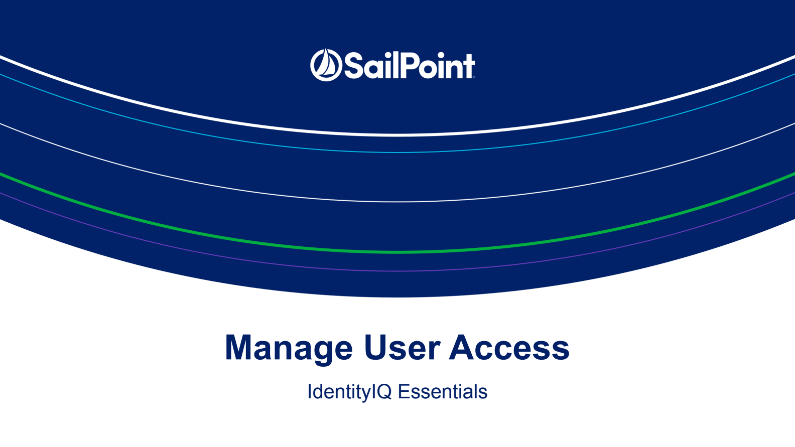

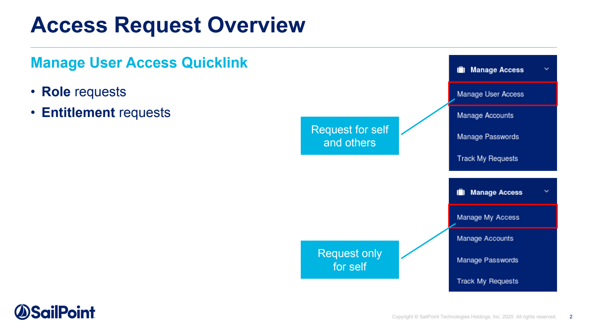

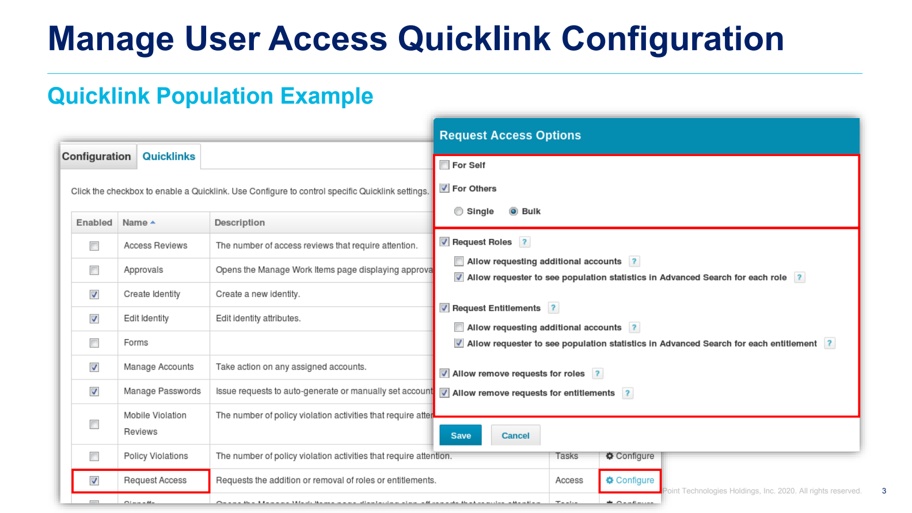

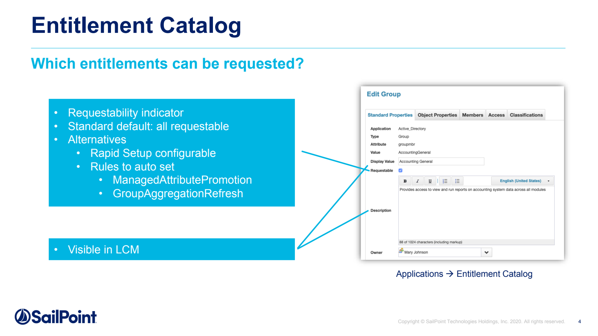

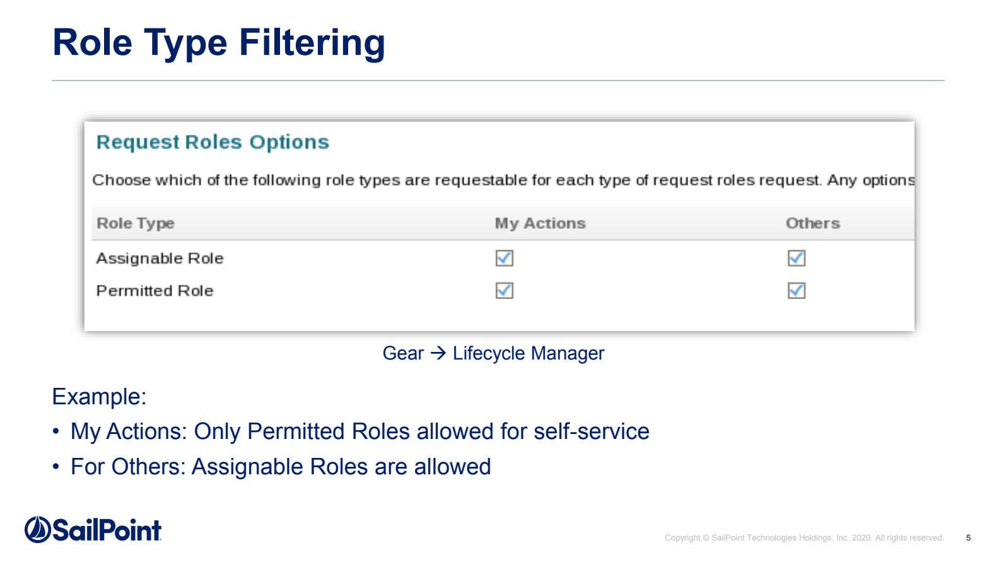

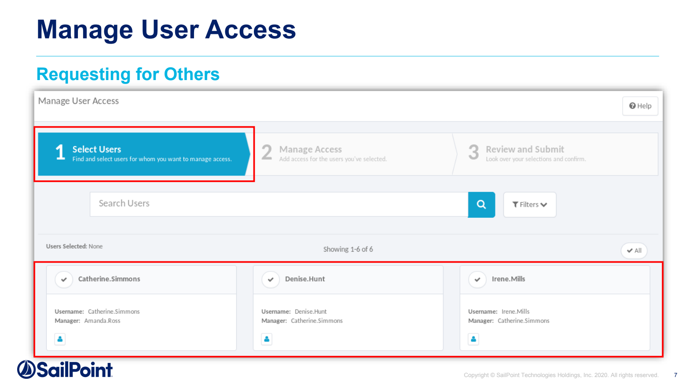

### Search, display and submit

UIConfig entries control columns on add/remove-access pages. The handout identifies role and entitlement column keys separately. Search can use full text, keyword filters and searchable extended attributes. Affinity search looks for access associated with matching identities/populations and is available in the course's requests-for-others path; its permitted identity search fields have a separate UIConfig entry.

After review and submission, the business process handles policy evaluation, approvals and information collection. The illustration of Catherine requesting for three employees shows a WorkflowCase per target identity, rather than one undifferentiated workflow for the whole group.

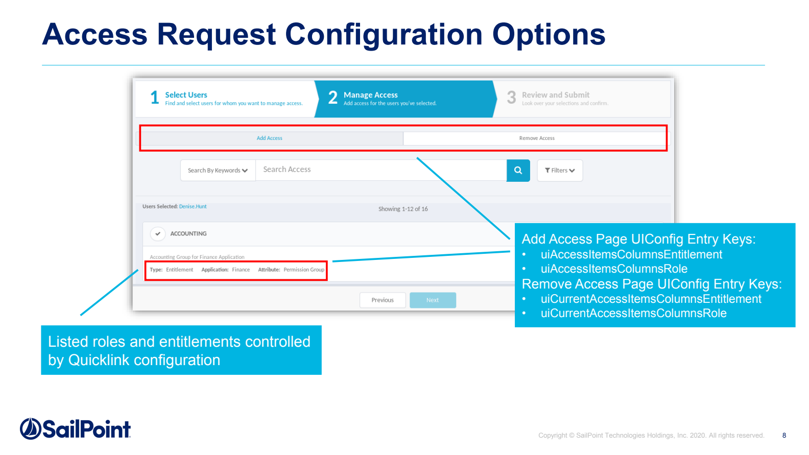

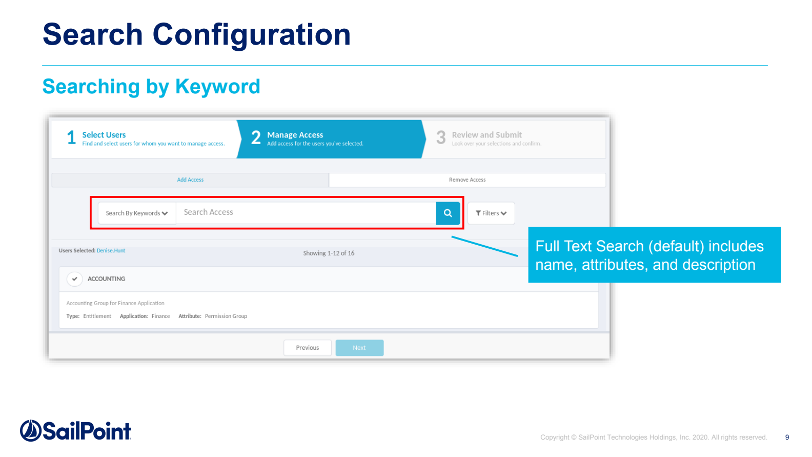

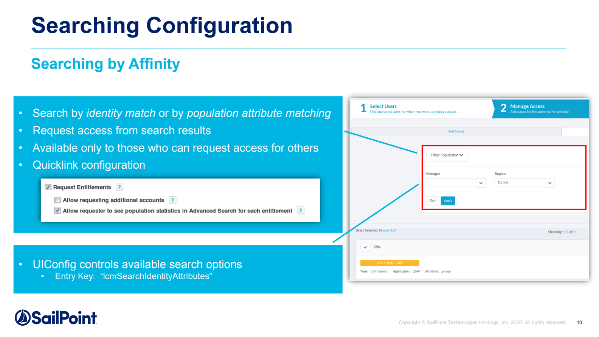

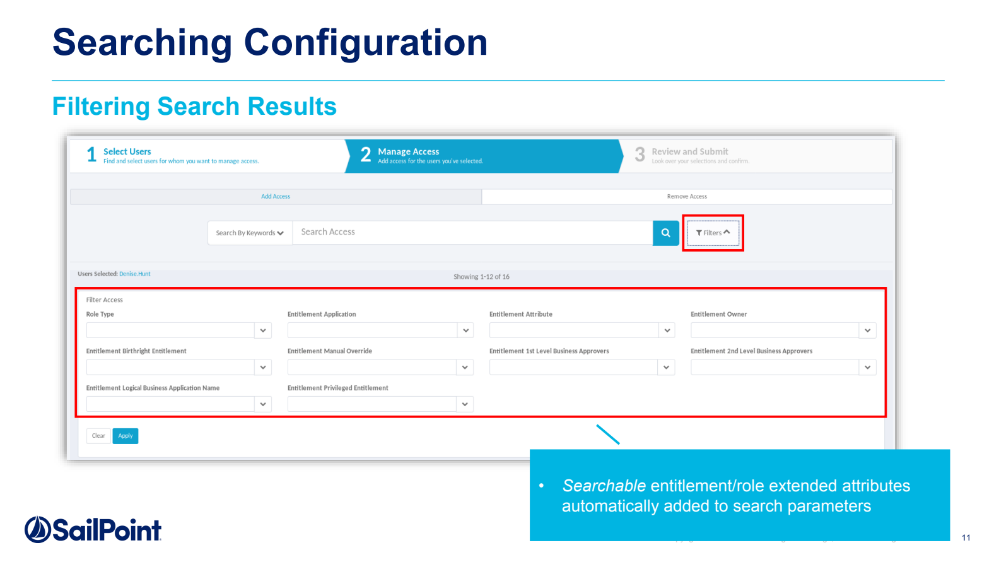

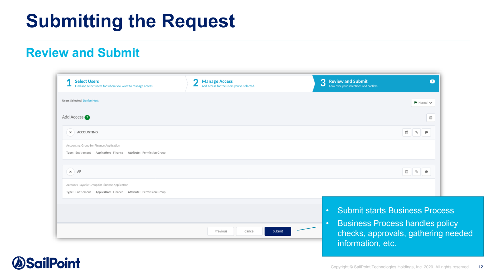

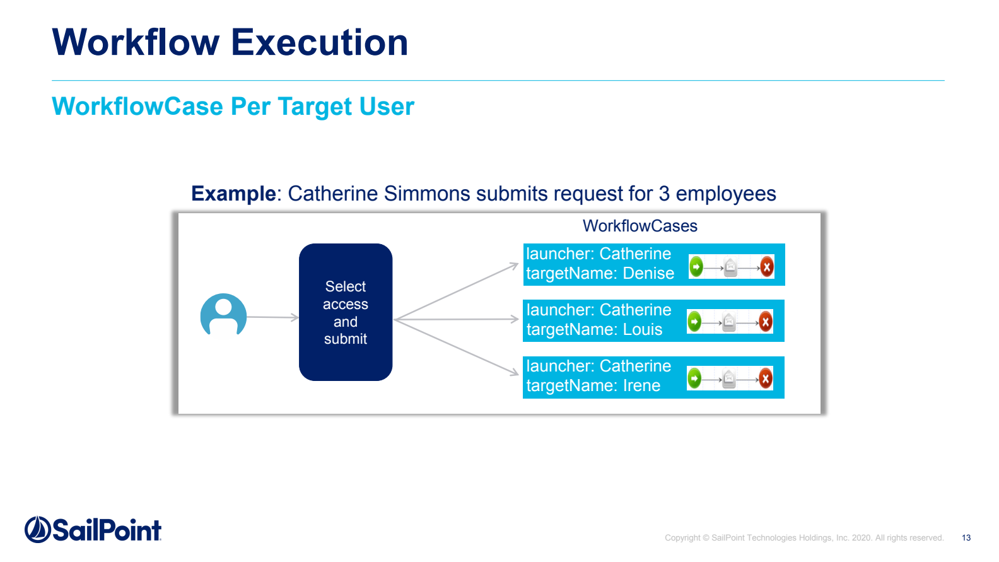

### Approval and completion evidence

The supplied LCM Provisioning workflow uses configured approval variables/rules; the slide identifies object-owner approval as its default example. A custom workflow's approvers depend on its design. Track My Requests shows approval, provisioning and error information for requests by or for the user; administrators can inspect a broader set.

Exercise 4.5 tests a VPN entitlement request, follows manager/owner approvals, verifies target LDAP membership and observes request maintenance. Its later tests cause a retryable outage and a preventive-policy conflict. These checks distinguish what was selected, what was approved, what was provisioned and what was confirmed.

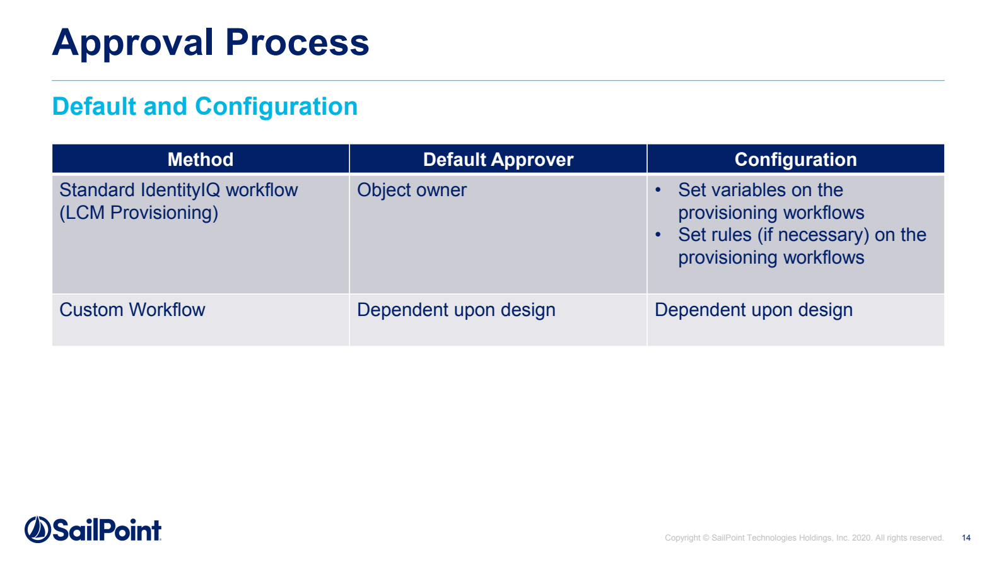

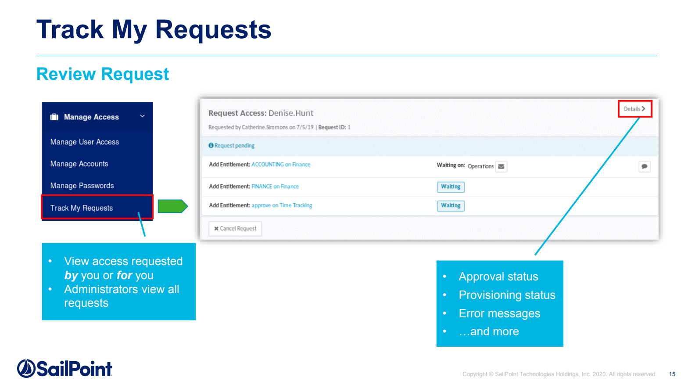

### Related practice and source pages

[Section Four — overview and contents](../practice-companion.html#practice-section-4) · [Exercise 4.4 — Configure Access Requests](../practice-companion.html#practice-4-4) · [Exercise 4.5 — Test Access Requests and Attachments](../practice-companion.html#practice-4-5)

