## 27. Additional Access Request Options

### Attach evidence to a request

Attachments let a request carry supporting material for the requester, requestee, approver and administrator. The course describes configurable file types and rules requiring evidence, with version-specific limits of 20 MB, ten attachments and a single-user request. Those limits are recorded as course context, not verified current product limits.

Enabling attachments and allowing particular file types is only configuration; testing must also establish that the intended approver can find and read the attachment in the request/approval view.

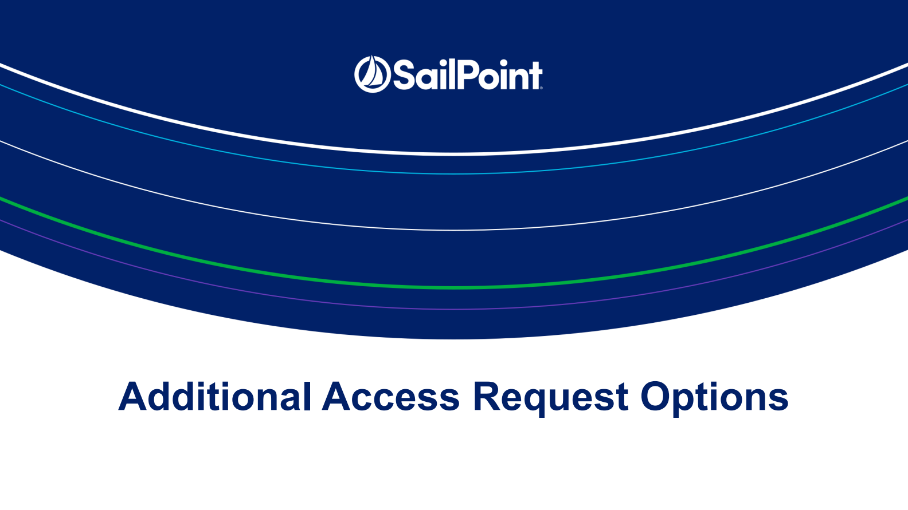

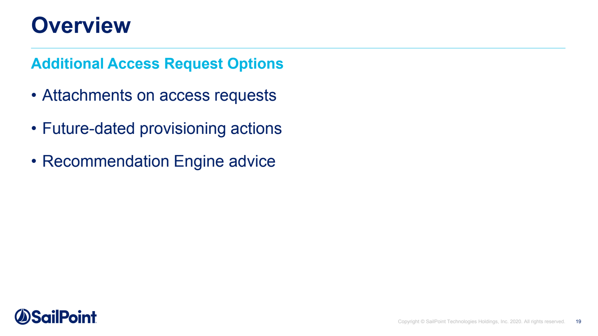

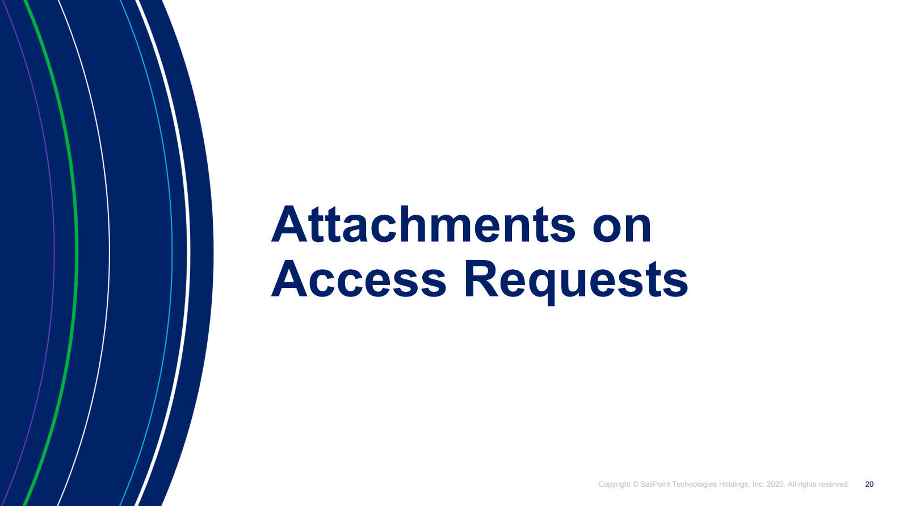

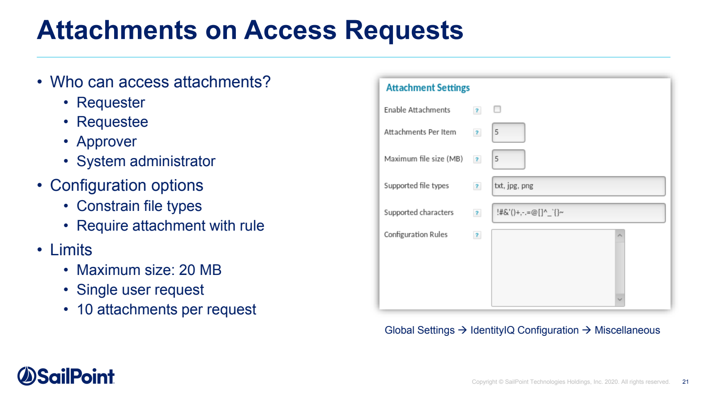

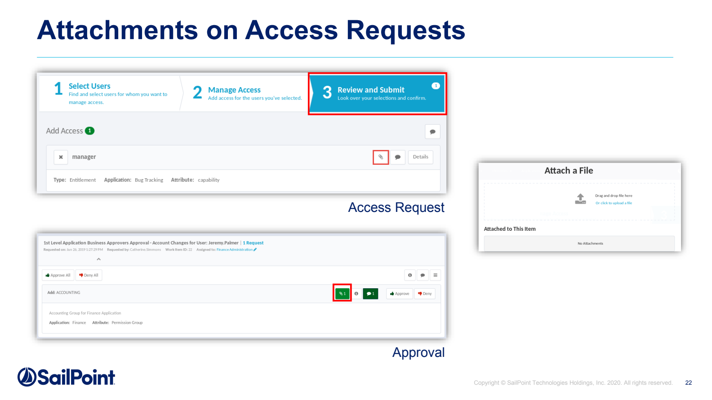

### Distinguish assignment dates from role availability

Sunrise/sunset on an assignment sets when that person's role or entitlement access should begin and end. The illustrated request stores the dates for later processing. Separately, scheduled role activation controls when a role itself is enabled or disabled. The warehouse-clerk illustration demonstrates this second concept.

The corresponding controls therefore operate at different levels. A future start date is not proof that access was already granted, and a role's availability schedule is not the same as every holder's assignment end date.

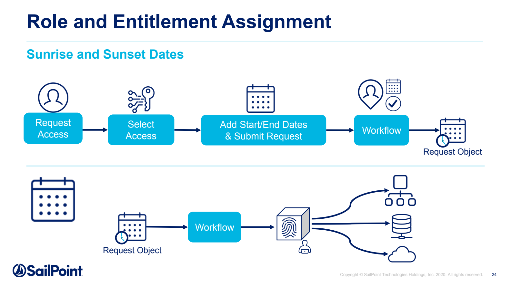

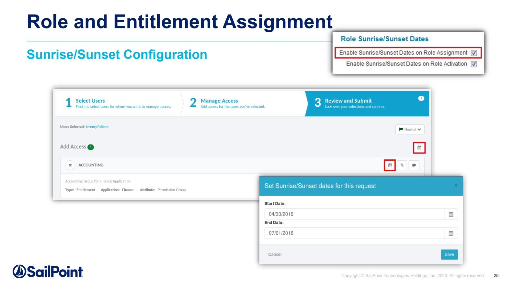

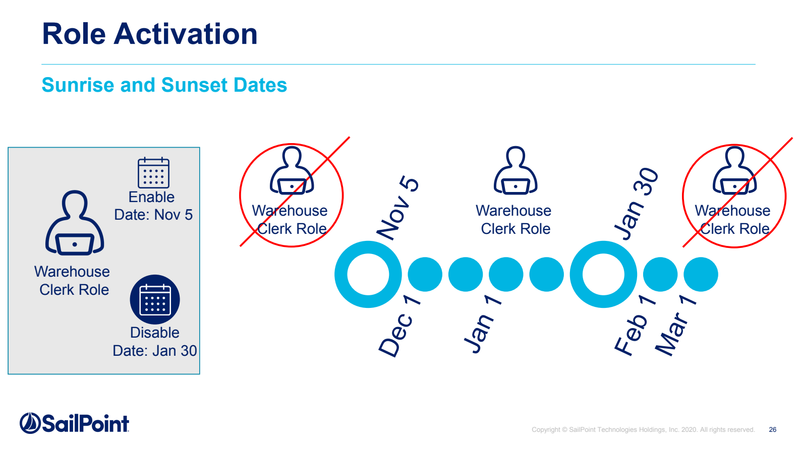

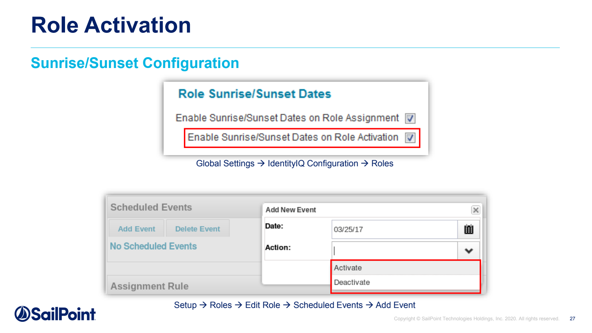

### Recommendations and practice

The handout shows IdentityAI guidance for an approver. Recommendation information supports a review decision; the actual approval path remains the configured business process. Video-only explanation for this demonstration has not been reconstructed.

The related exercises update entitlement descriptions/requestability, clone and configure the request workflow, adjust Quicklink access, test preventive policy checks and optional permitted IT roles, and enable PDF attachment evidence. Test the request and approver experiences separately. The practice companion preserves the exact original settings and screenshots.

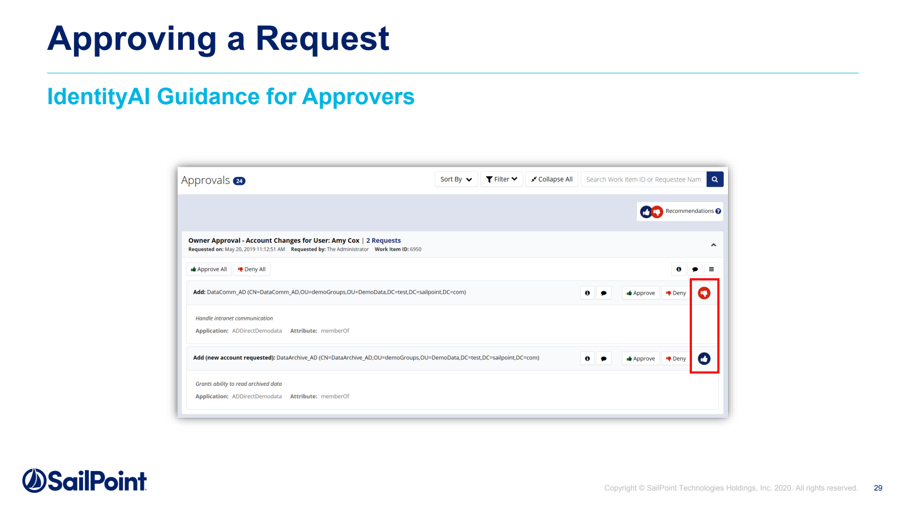

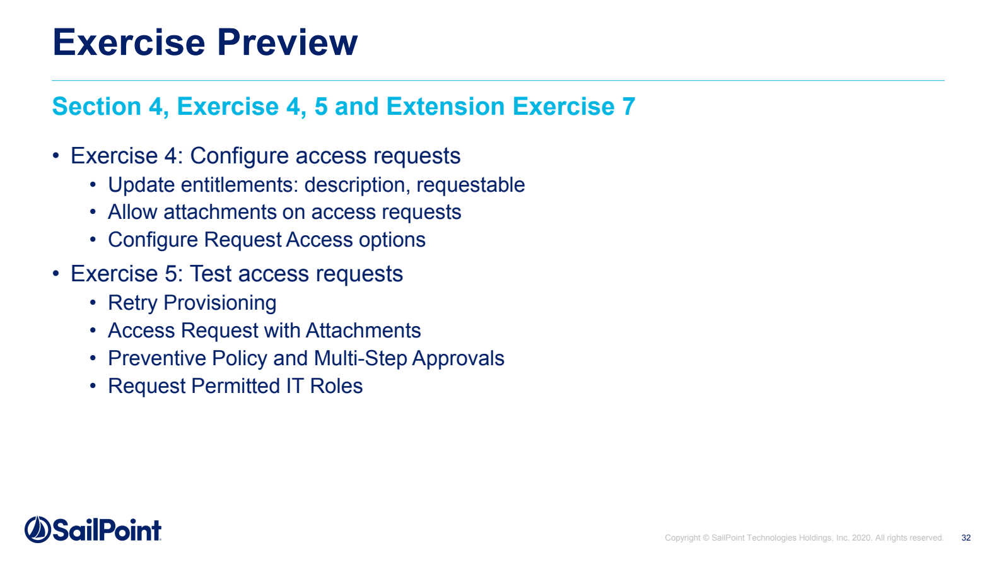

### Related practice and source pages

[Section Four — overview and contents](../practice-companion.html#practice-section-4) · [Exercise 4.4 — Configure Access Requests](../practice-companion.html#practice-4-4) · [Exercise 4.5 — Test Access Requests and Attachments](../practice-companion.html#practice-4-5)

