## 28. Other Lifecycle Manager Requests

### Account, password and identity operations

The remaining Quicklinks manage connected accounts/passwords or IdentityIQ identity records. The course says these request paths act on one requestee at a time. A requester allowed to perform an action sees eligible identity cards; the identity-details menu can expose related operations based on the applicable permissions.

The slide distinguishes Quicklink Population controls from additional rights/capabilities for certain menu functions. Do not infer that all links in an identity-details menu use the same authorization mechanism.

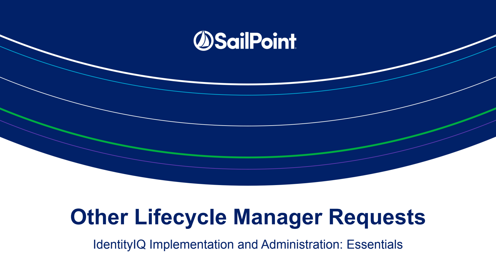

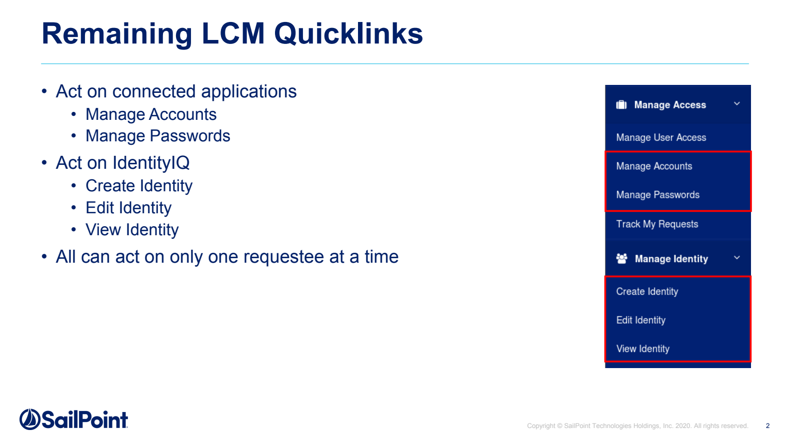

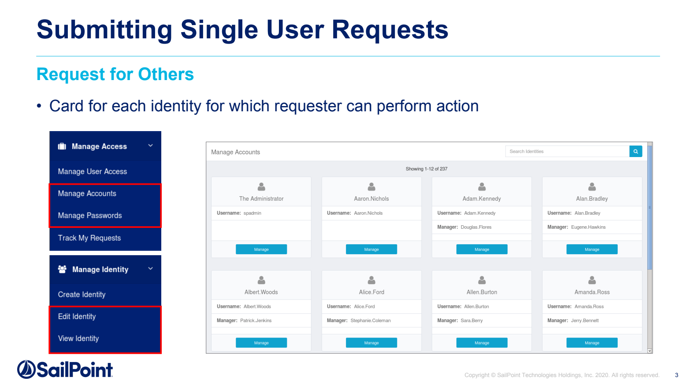

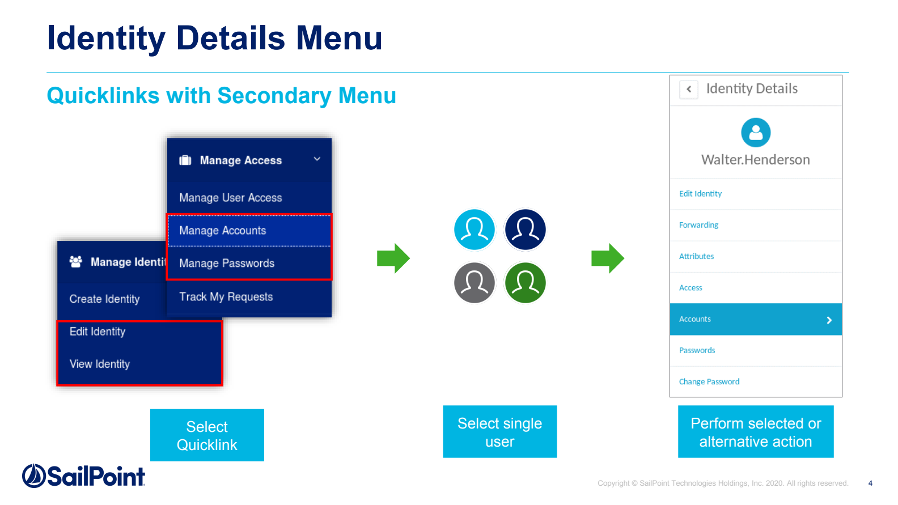

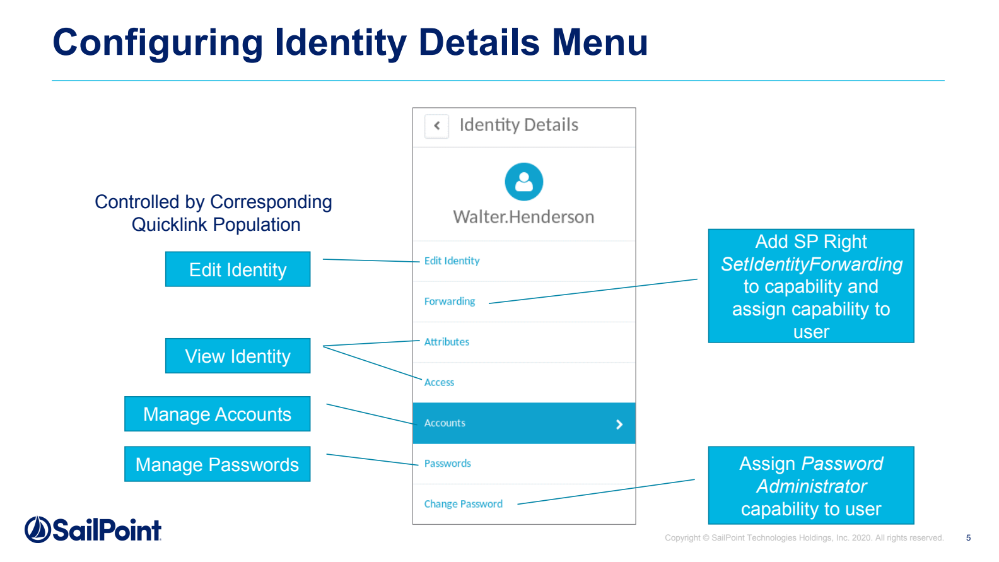

### Manage Accounts

Depending on application and Quicklink configuration, users can request a first or additional account, or enable, disable, unlock and delete an existing account. New-account permission, additional-account permission and management of existing accounts are separate choices. Connector and provisioning-policy support still determine whether the requested operation can be fulfilled.

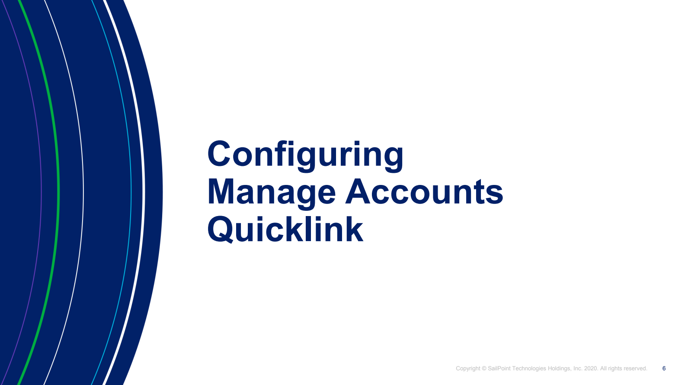

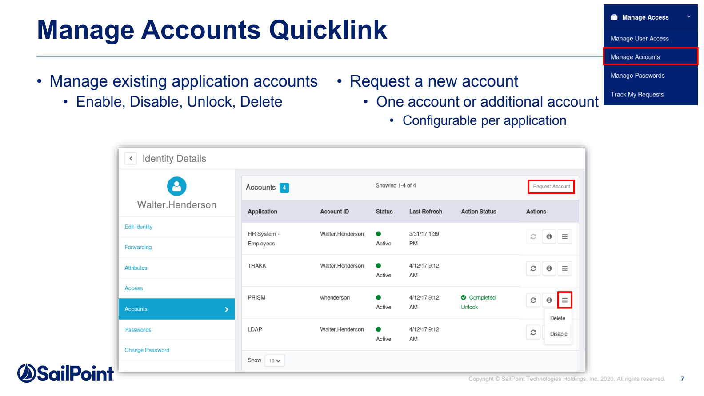

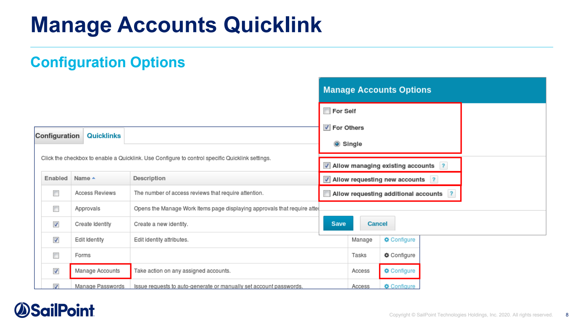

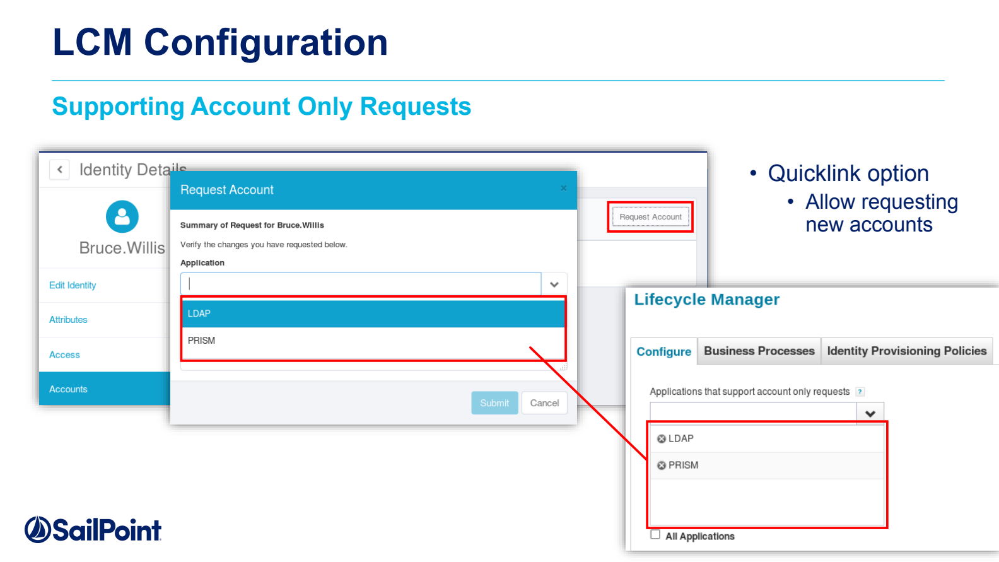

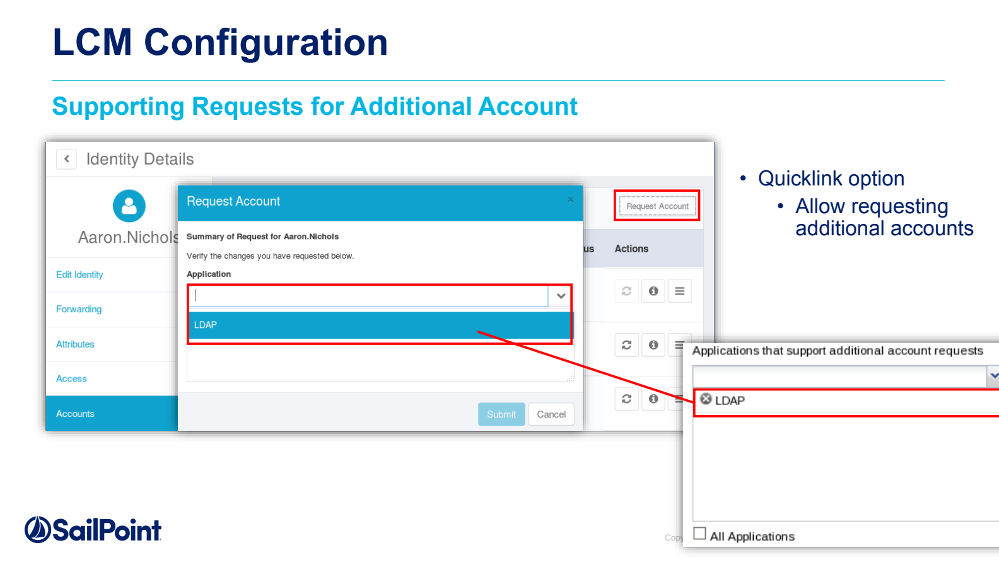

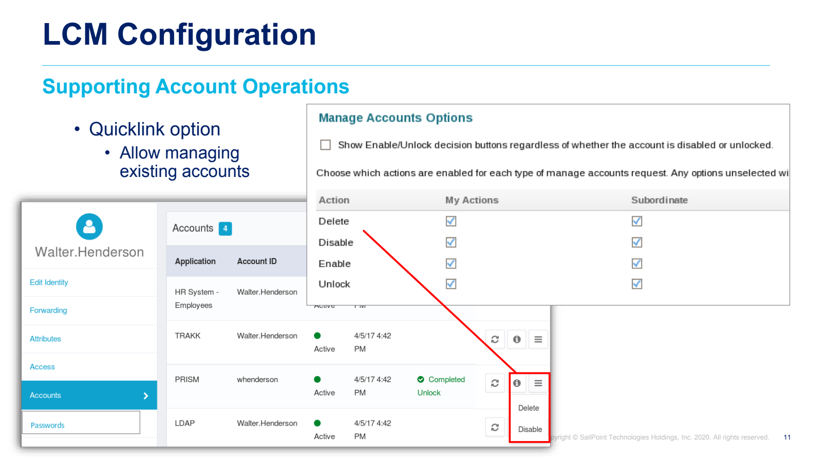

### Create, edit and view identities

Create Identity presents a form to an existing IdentityIQ requester. Self-service registration is a separate path for someone without an existing identity and is disabled by default in the course. A default or custom form supplies the data.

Edit Identity can expose read-only, temporary or permanent behavior as configured. View Identity's displayed fields are controlled through the indicated UIConfig entry. Identity provisioning policies define the create/edit form and value logic; they should not be confused with account provisioning policies on an external application.

The lesson's slide preview calls its practice “Section 4, Exercise 6,” while the supplied 8.2b guide numbers the Create Identity exercise **4.7**. This book preserves that discrepancy and links to the guide's actual PDF pages 220–225 rather than inventing a missing exercise number.

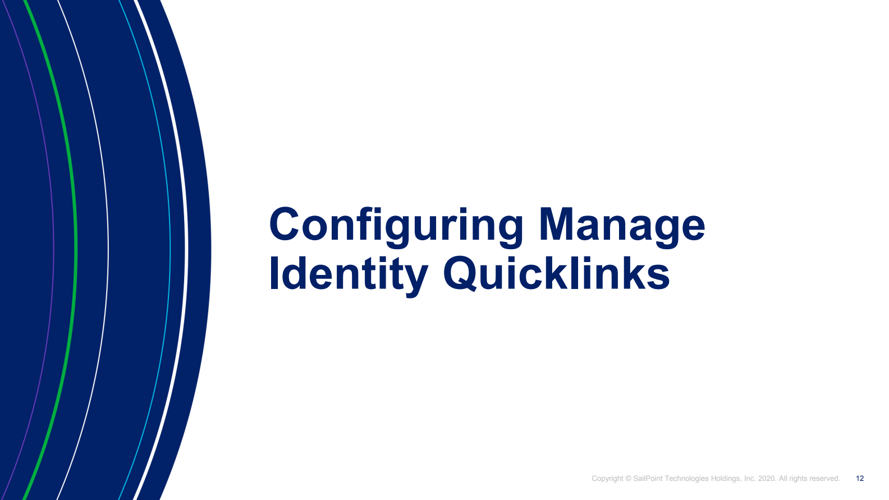

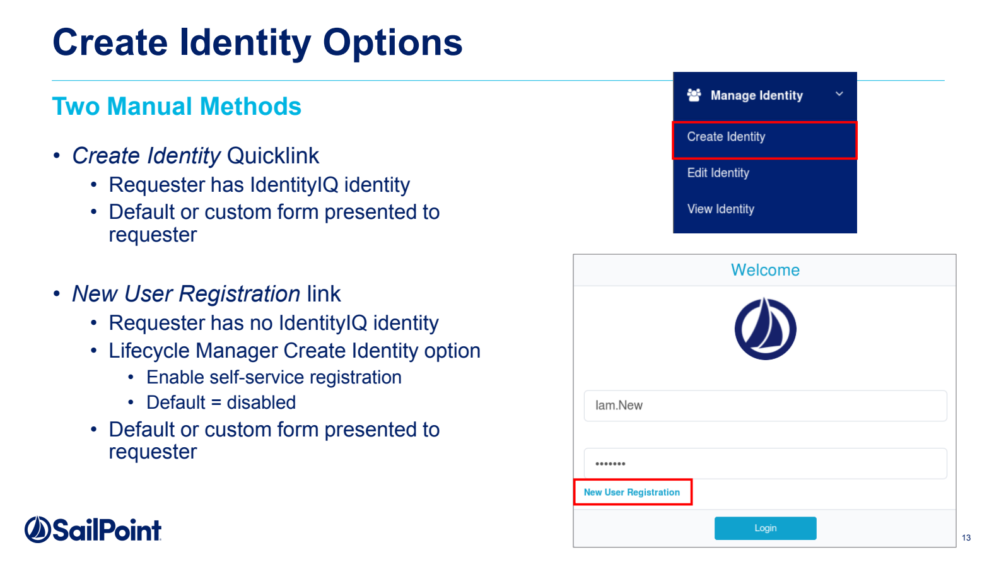

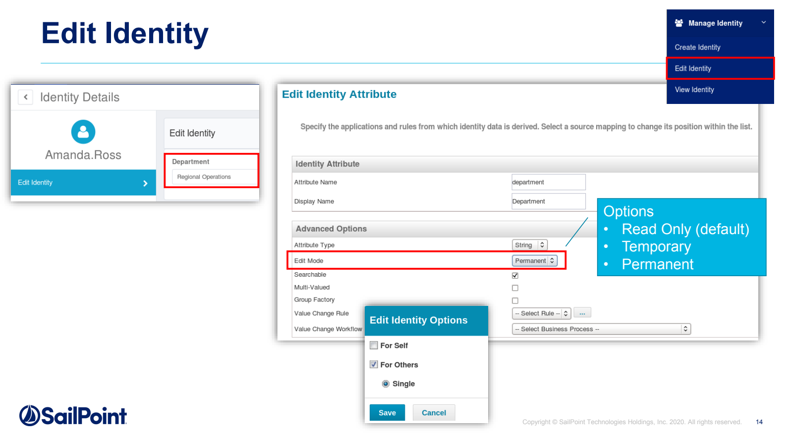

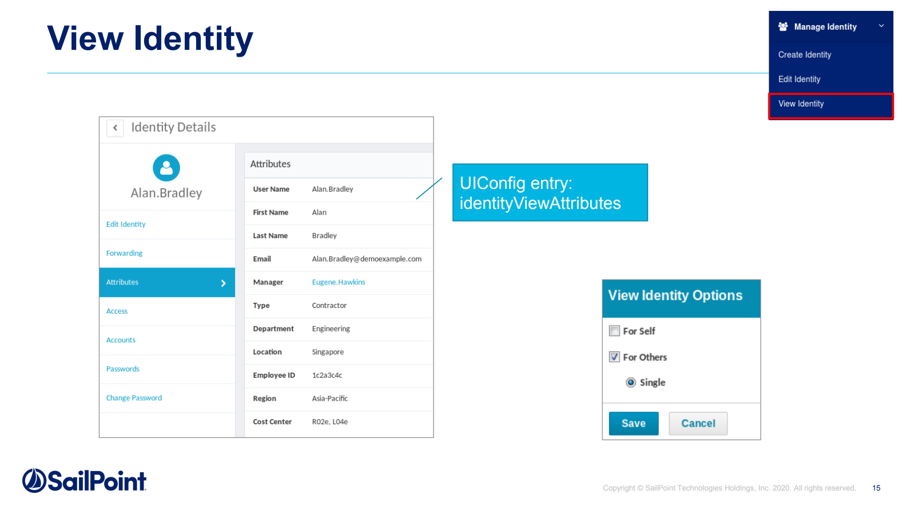

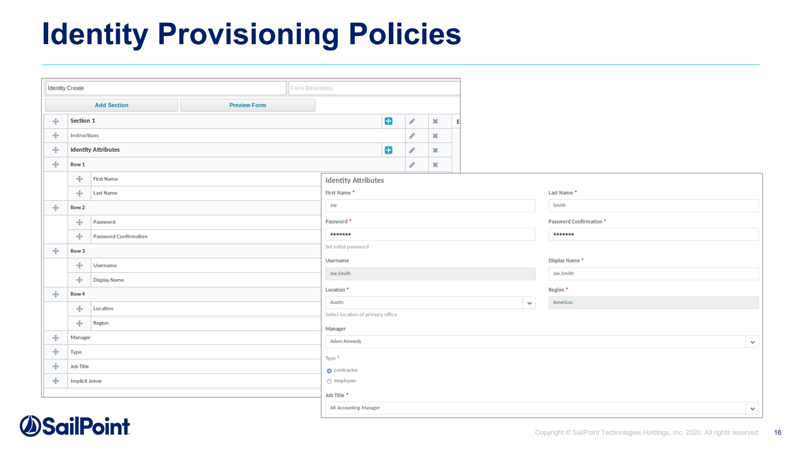

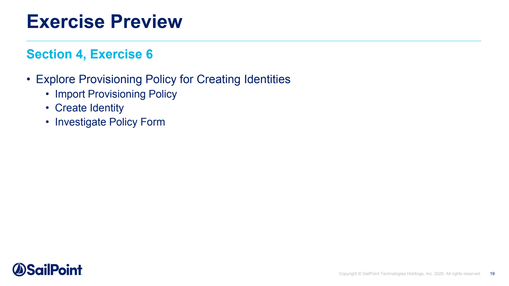

### Related practice and source pages

[Section Four — overview and contents](../practice-companion.html#practice-section-4) · [Exercise 4.7 — Create Identity Provisioning Policy](../practice-companion.html#practice-4-7)

