## 29. Automated Provisioning

### Attribute synchronization

Source mappings read data into an identity attribute; target mappings propagate an identity value to an application's account attribute. The phone/email examples show why these directions must be distinguished. A target mapping can specify a transformation rule and how to handle identities with multiple accounts.

The course describes two operating paths: an appropriate Edit Identity operation can invoke synchronization immediately, while an aggregated source change is followed by an Identity Refresh configured with Synchronize attributes. A changed cube value is therefore not sufficient evidence that target accounts have already changed.

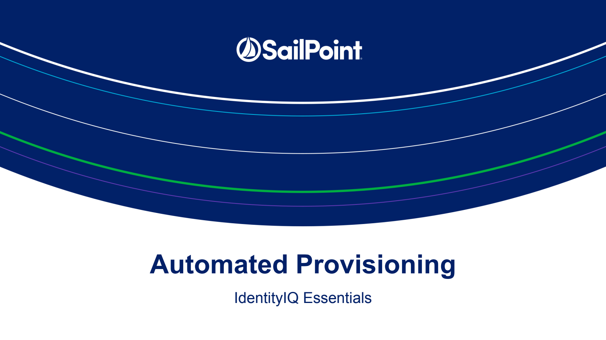

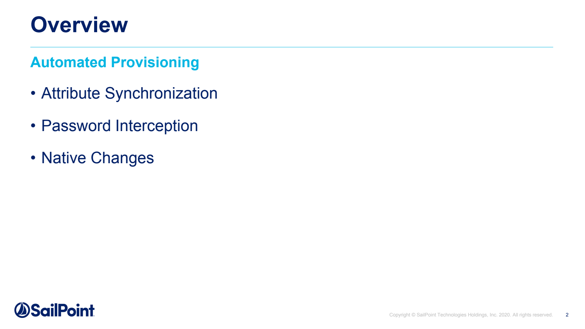

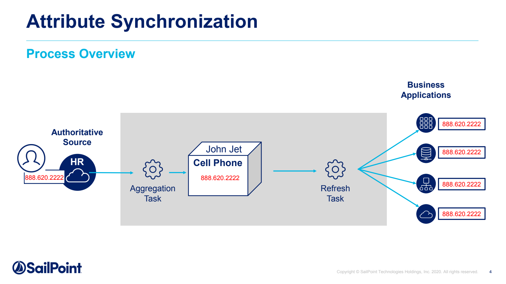

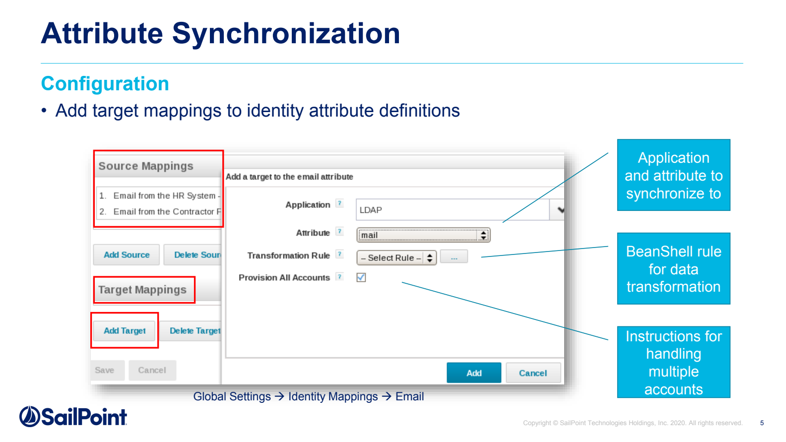

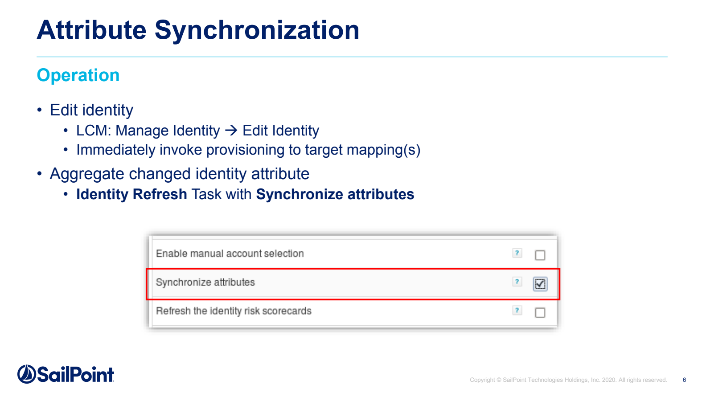

### Password interception

A password-interceptor client detects supported native password changes and forwards the event to IdentityIQ. A configured password-intercept workflow then updates selected supported applications. The course's Active Directory diagram calls for client deployment on every relevant domain controller; other supported systems are listed on its slide.

The client installation and password handling are distinct from merely enabling a Quicklink. The external Password Interceptor guide is referenced but not independently archived here, and no interceptor was installed.

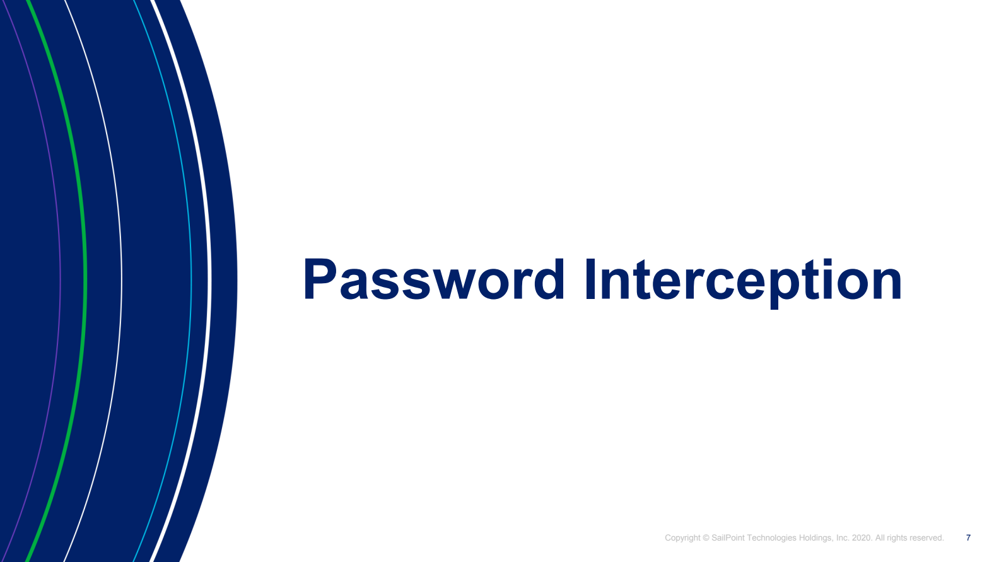

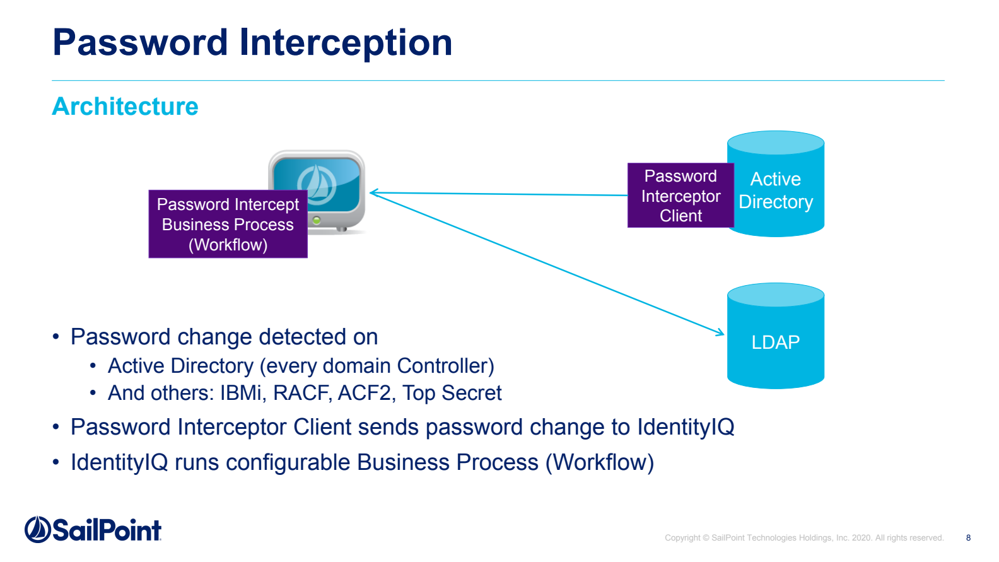

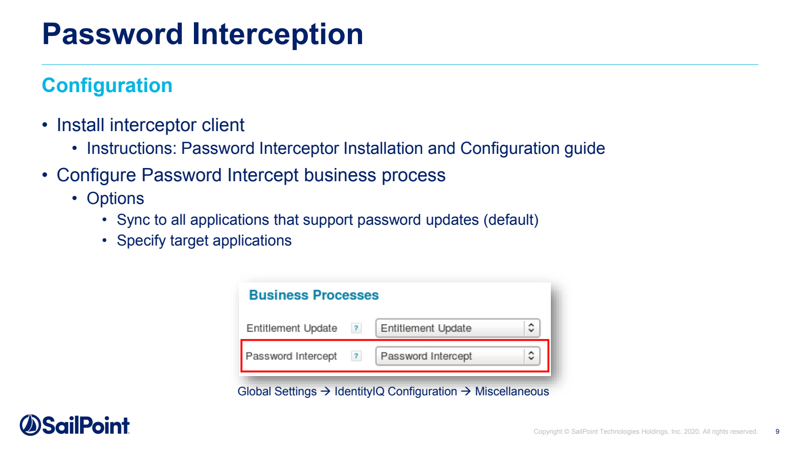

### Native change detection

A native change is discovered on an application's account during aggregation outside the expected IdentityIQ-managed process. Responses can include a certification event or a lifecycle workflow for notification/approval. Configure detection on the application and the corresponding lifecycle event, aggregate to mark changes, then refresh with Process Events to run the response.

The lesson advises establishing a baseline before enabling detection and processing changes regularly. It also cautions against using unexpected-change monitoring where native changes are normal. Otherwise ordinary activity can overwhelm the intended exception process.

Exercise 4.8 adds Email target mappings, examines the source and target account values, runs synchronization and checks the manual fulfillment work item for file-based sources. It demonstrates that synchronization can legitimately use a manual channel rather than a direct connector write.

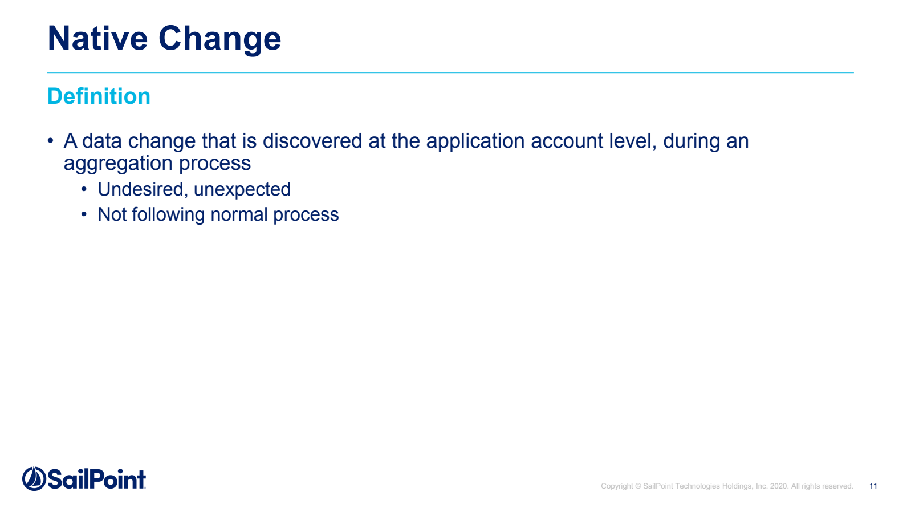

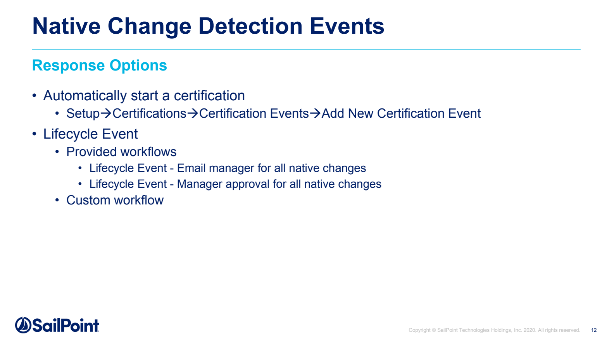

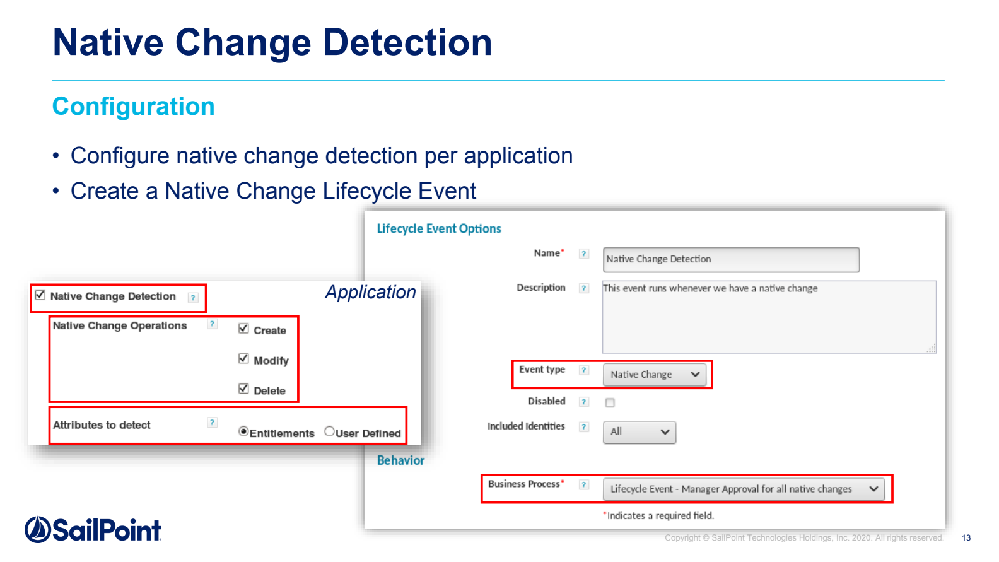

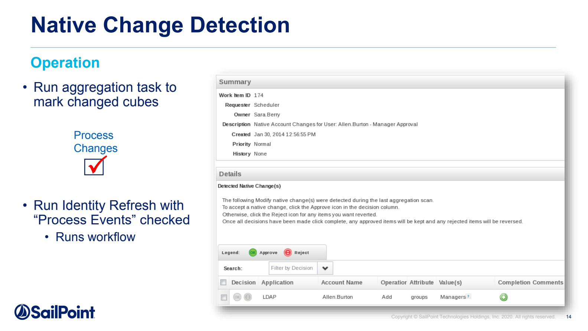

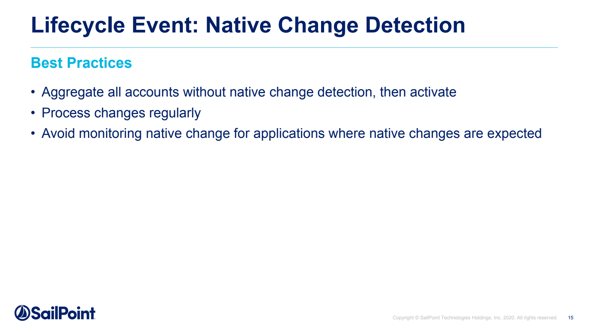

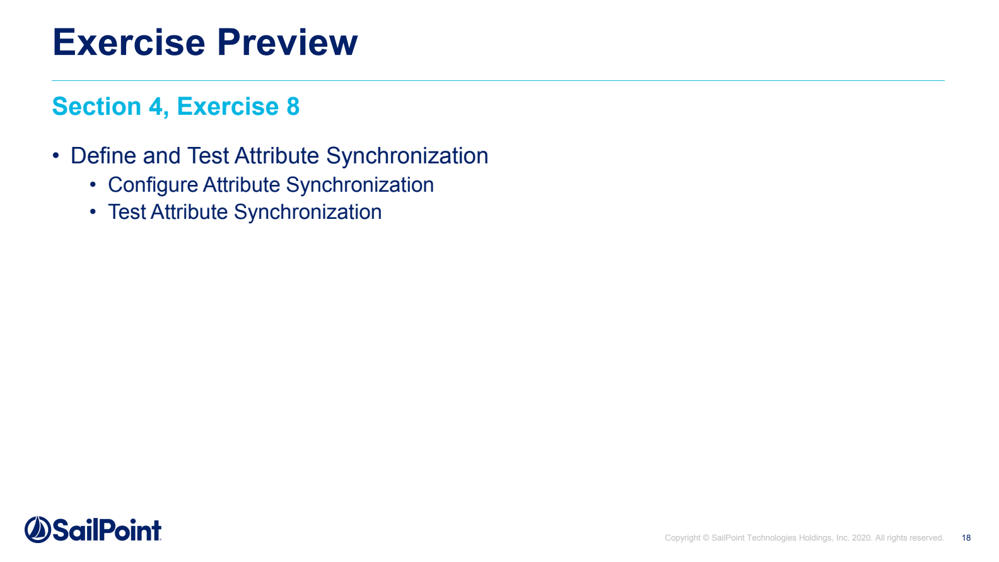

### Related practice and source pages

[Section Four — overview and contents](../practice-companion.html#practice-section-4) · [Exercise 4.8 — Attribute Synchronization](../practice-companion.html#practice-4-8)

