## 30. Other Provisioning Requests

### Govern account-group changes

Where supported, application-group provisioning creates groups or updates their definitions through configured create/update policies and a workflow. The example starts from the Entitlement Catalog and identifies an Application Administrator capability requirement. Creating a group is distinct from granting one user's membership in that group.

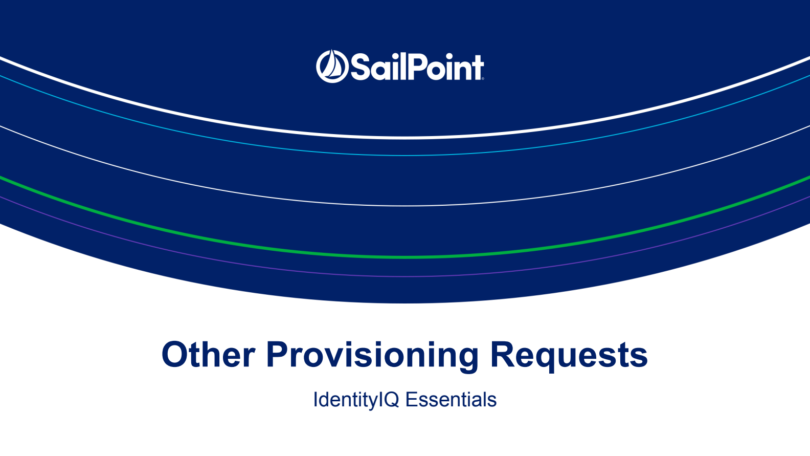

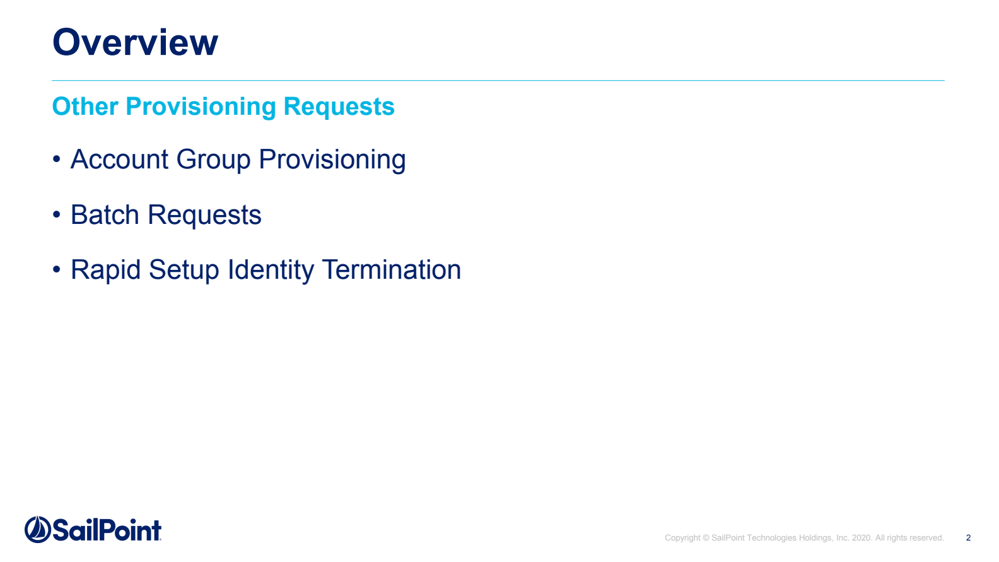

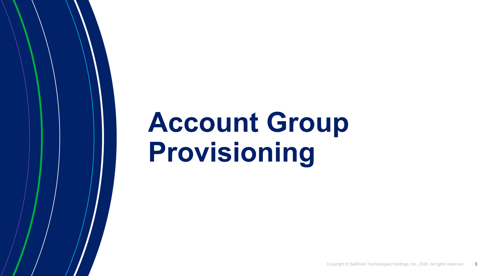

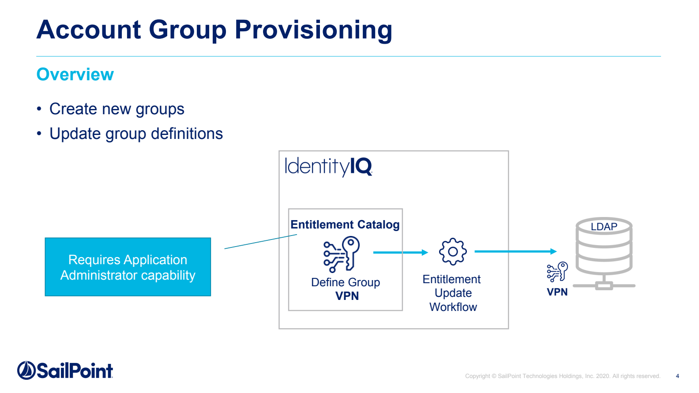

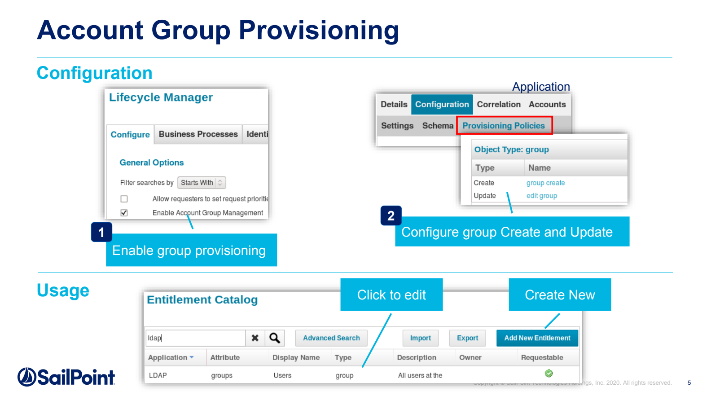

### Batch requests

Batch Requests support multiple identity/account/access changes through a delimited upload. Each row identifies an operation and its target data. The handout lists identity create/modify, account create/delete/enable/disable/unlock, role and entitlement add/remove, and password operations. It identifies the relevant administrator capabilities and the Setup → Batch Requests entry point for its release.

This is a request mechanism supplemental to aggregation, not an invitation to treat a bulk upload as a source-of-record replacement. Validate the operation names, target identities and field values against the documented format before a real execution. No file was uploaded to IdentityIQ for this book.

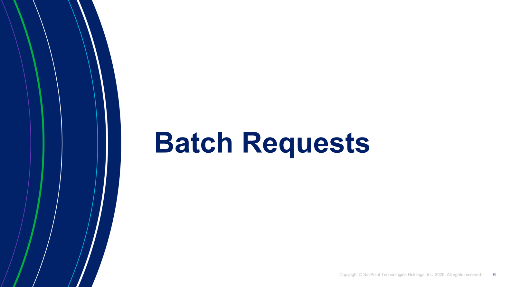

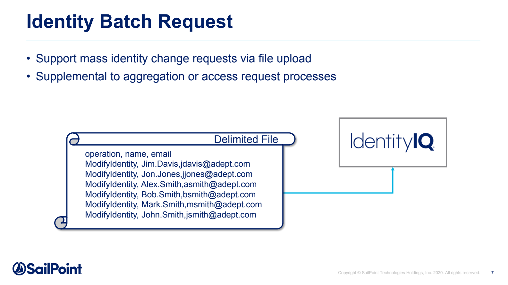

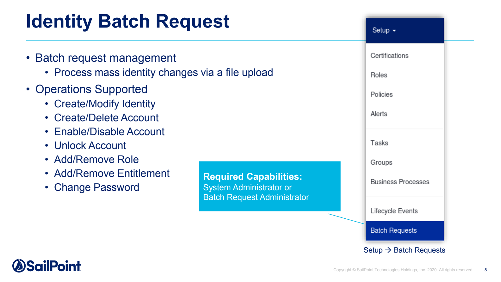

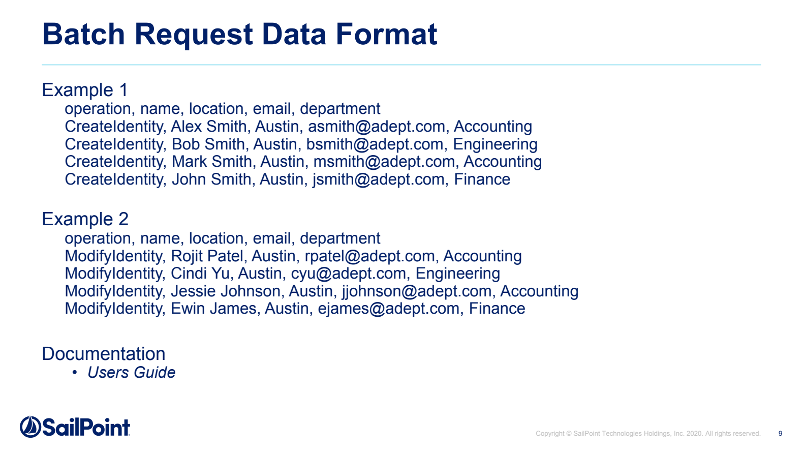

### Immediate identity termination

Rapid Setup Identity Operations can initiate termination independently of waiting for an HR-driven leaver transition. Global controls cover identity-internal reassignment, roles, approvals, notification and process logic. Per-application controls cover disabling/deleting accounts, password scrambling, entitlement removal and supported directory moves, with immediate or delayed timing.

The lesson identifies specific capabilities for these operations. Exercise 4.9 separately configures and tests the normal leaver path and immediate termination. Its study validation compares pre-change accounts/roles to resulting requests, transactions, audits, emails and target state. This book records the procedure but does not terminate any identity or remove any access.

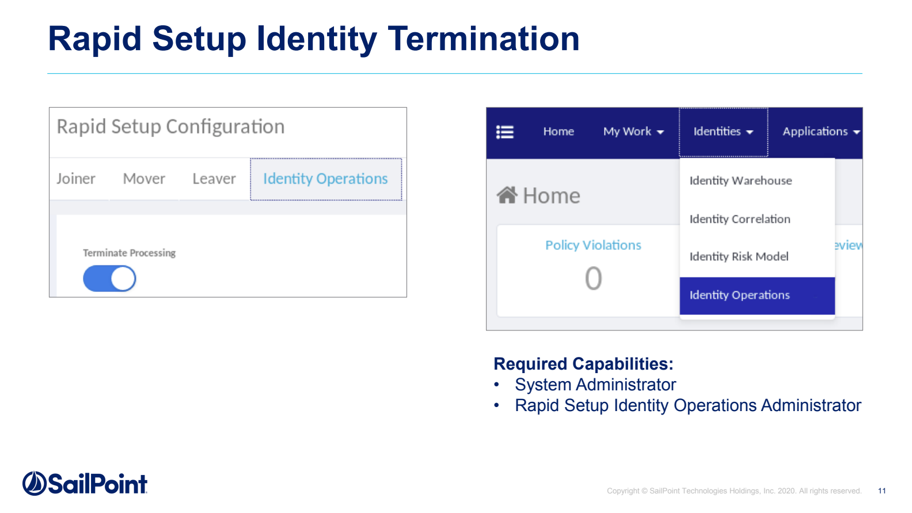

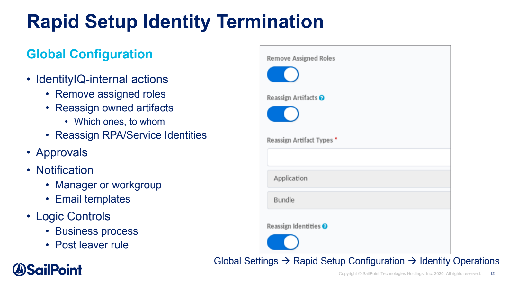

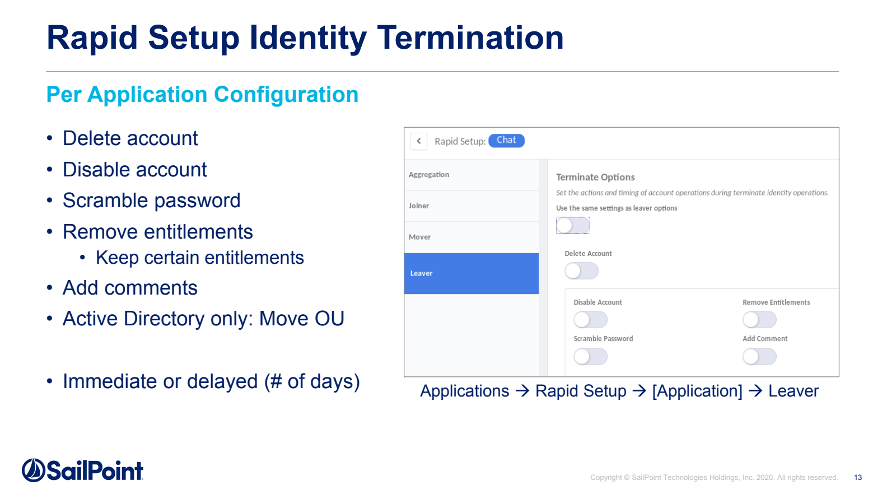

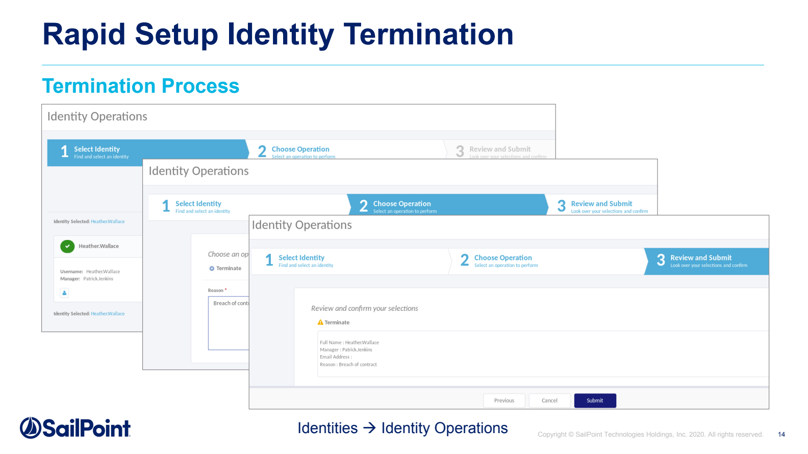

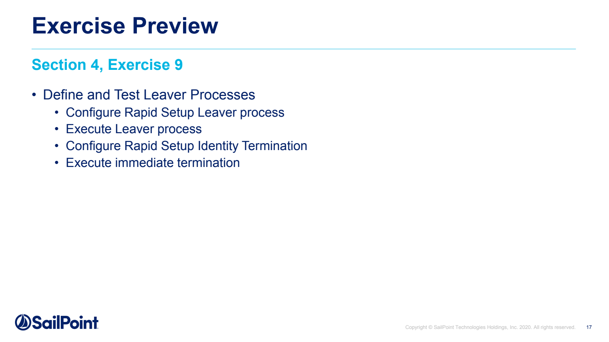

### Related practice and source pages

[Section Four — overview and contents](../practice-companion.html#practice-section-4) · [Exercise 4.9 — Leaver and Immediate Termination](../practice-companion.html#practice-4-9)

