## 31. System Architecture and Deployment

### Progress from a lab to a resilient topology

The simplest illustration puts application and database components on one host. The next separates application execution from database storage. A larger design uses several application servers, a load balancer with session affinity, and dedicated batch processing alongside interactive UI hosts.

Host roles come from how traffic and background services are assigned, not simply a server's name. The course shows task/request service host assignments for batch work and load-balancer routing for UI work. Tasks, reports, workflows and certification generation compete differently with interactive requests and reviews.

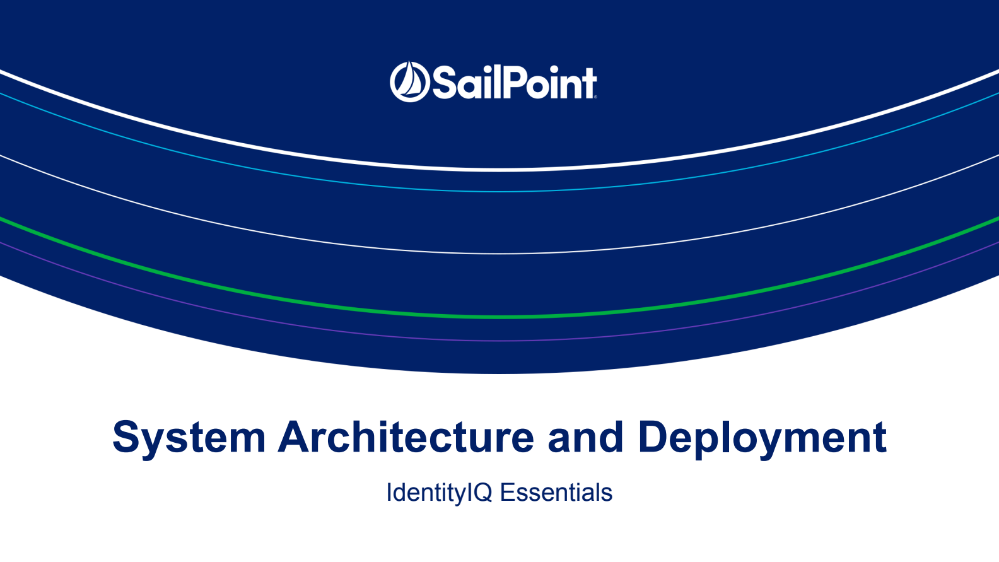

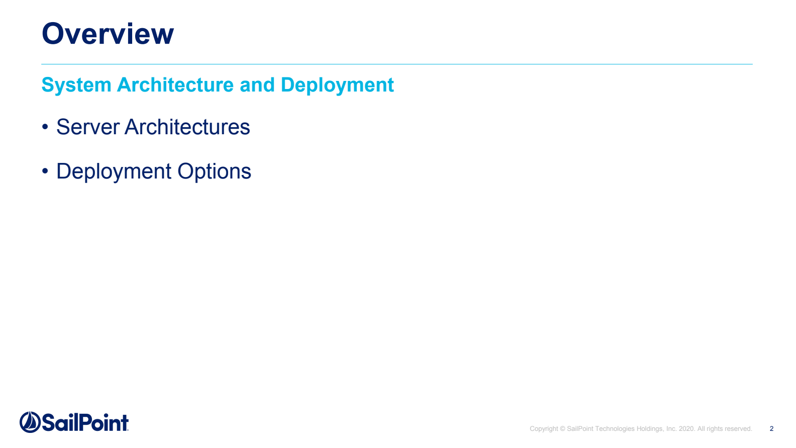

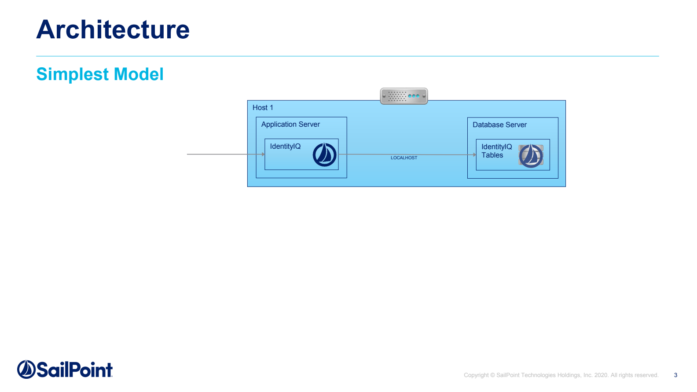

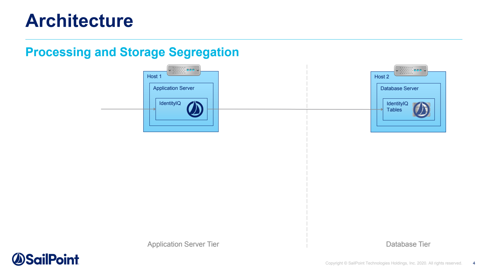

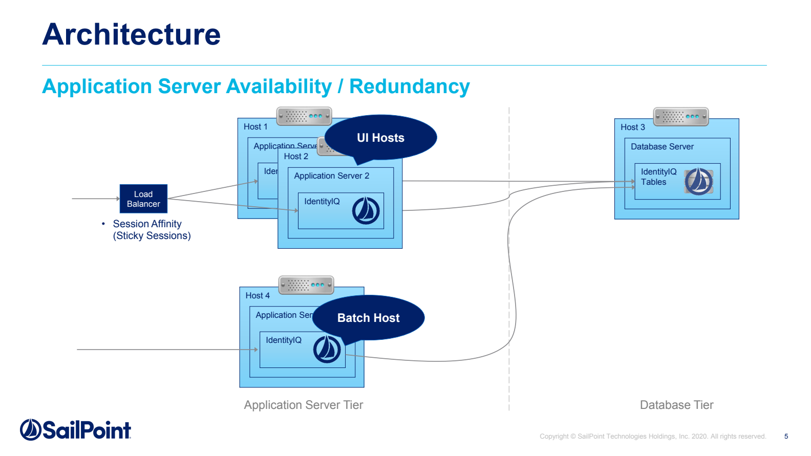

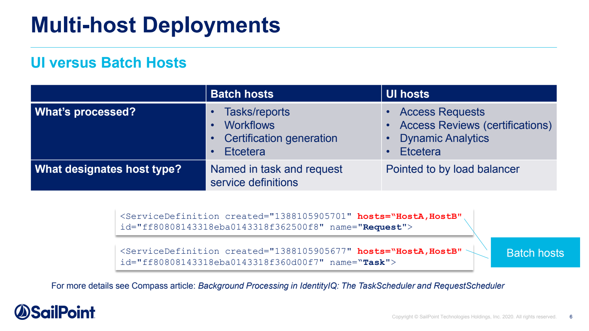

### Availability and locality

Further diagrams show disaster-recovery replication and database clustering as architectural options. Redundant application servers and database resilience address different failure modes.

The application-to-database connection is performance-critical. The slide gives very low round-trip latency targets and argues for close data-center placement rather than a WAN-separated database. Those numbers belong to the source course version; the general lesson is that a fast user-facing network cannot compensate for a slow database path.

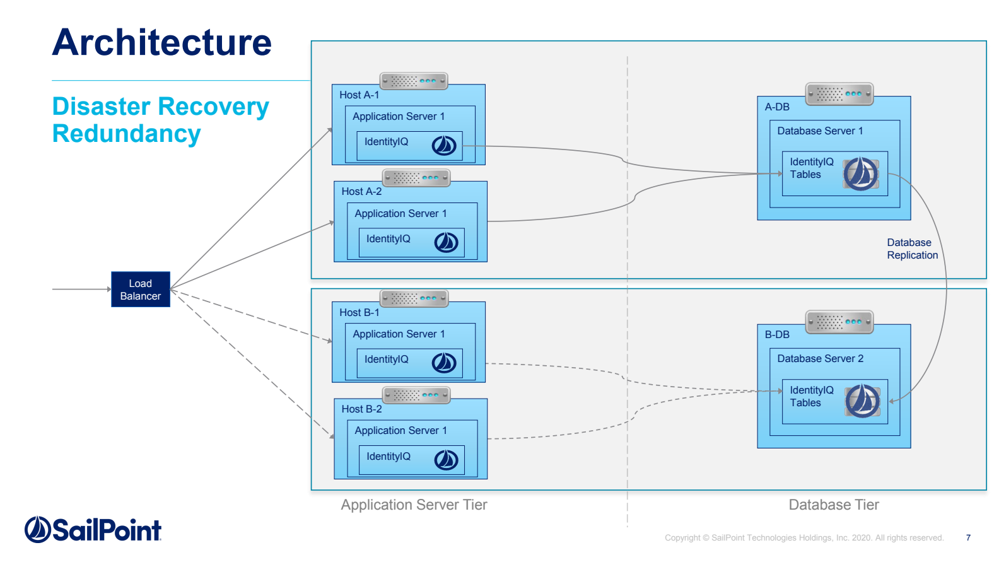

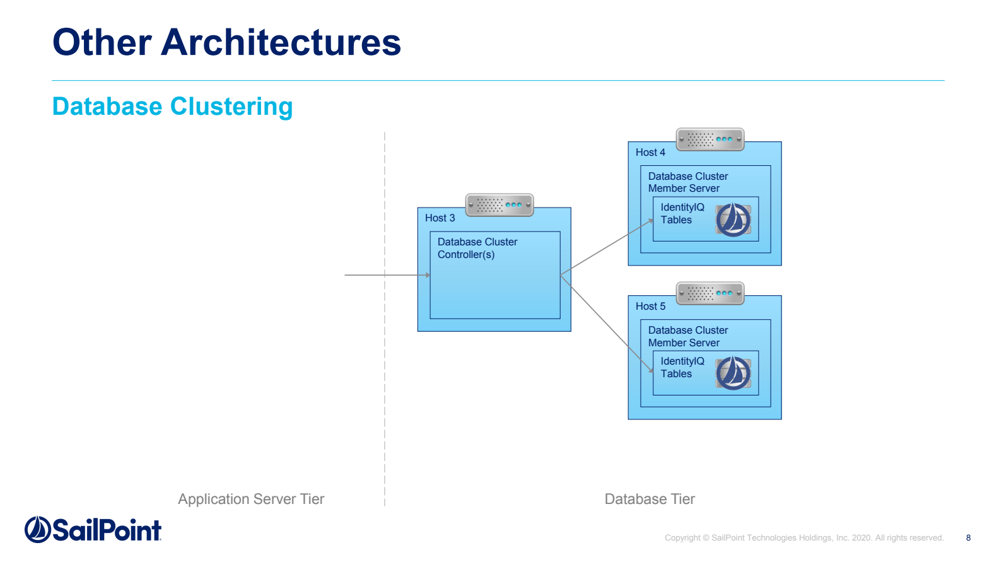

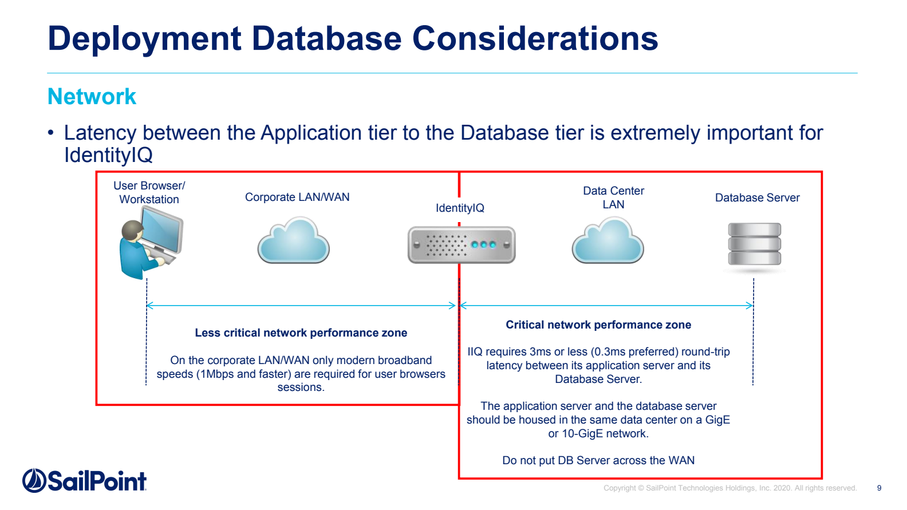

### Hosting and operating responsibility

The course distinguishes an organization-managed data center, an organization-managed public-cloud deployment and a provider-managed cloud service. Its managed-service slide lists examples such as IdentityIQ upgrades/patches and infrastructure monitoring. Actual service responsibilities depend on the contracted offering; the course diagram does not establish the user's current entitlements.

No new environment was deployed. Use these diagrams to identify which team owns each runtime, database, network path and recovery process before taking the lab design into production.

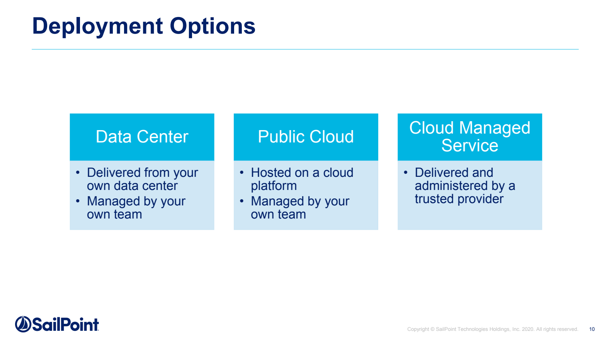

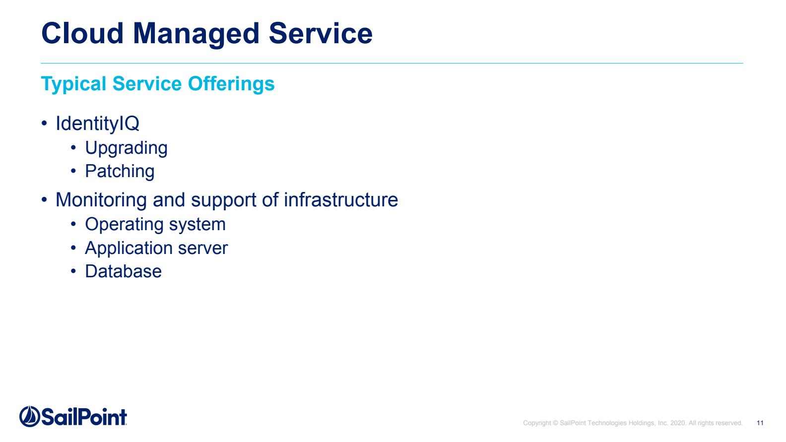

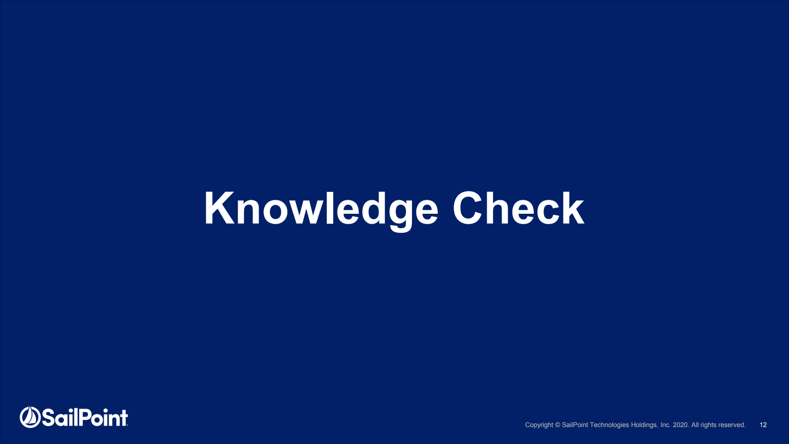

### Related practice and source pages

[Appendix — synonyms, Linux, installation and lab tools](../practice-companion.html#practice-appendix)

