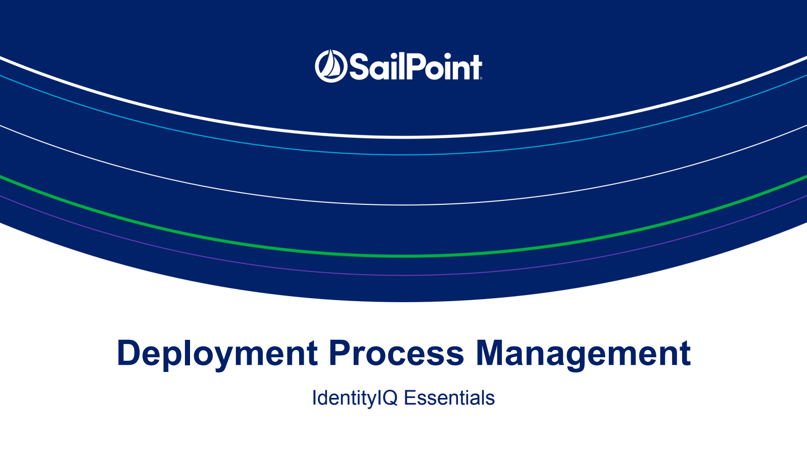
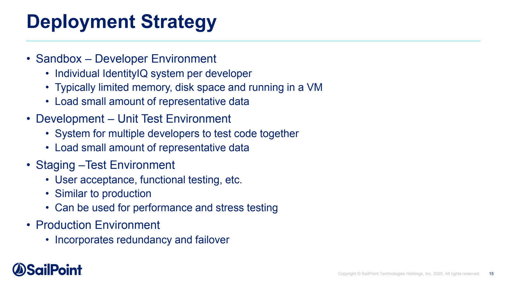
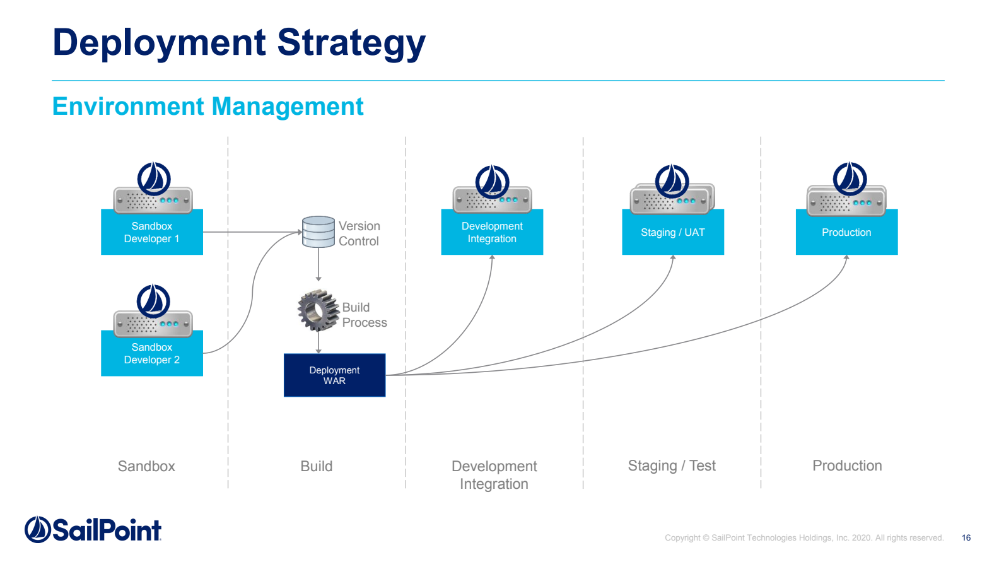
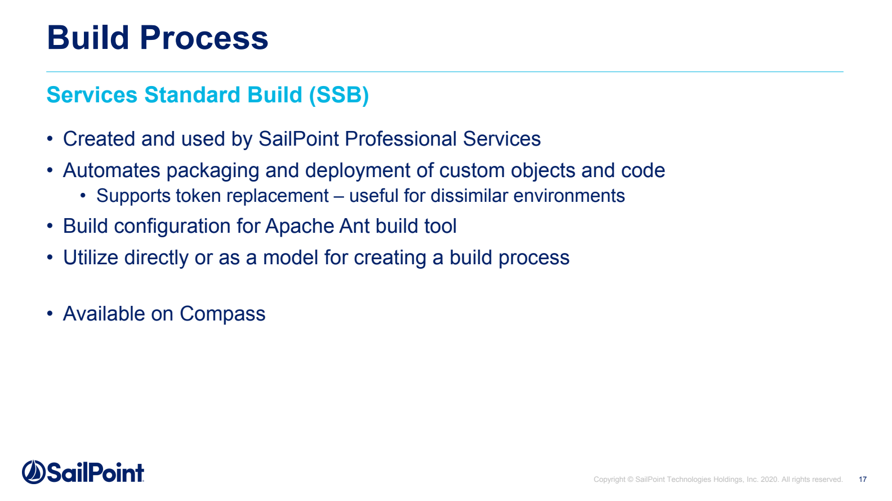
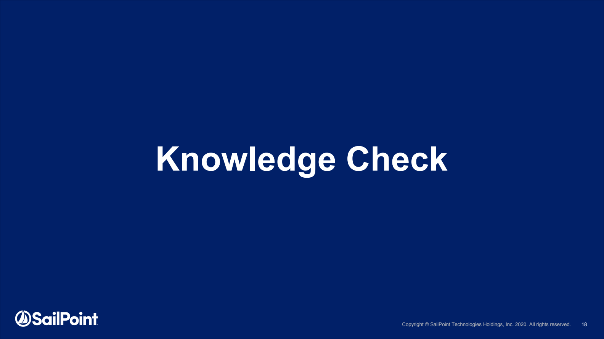

## 32. Deployment Process Management

### Separate development, validation and production

A developer sandbox supports isolated work with a small representative data set. A shared development environment tests integrated changes. Staging/UAT resembles production and supports functional, acceptance and performance validation. Production adds its availability and failover requirements.

The environment-management illustration places version control and a repeatable build between individual development and deployment. Moving directly from a manually edited sandbox to production skips the opportunity to reproduce, review and validate the same configuration.

### Package configuration repeatably

The course introduces Services Standard Build, an Ant-based approach used to package custom objects and code and replace environment-specific tokens. It can be used directly or as a model for a controlled build process. This is a reference to the course's tooling, not a claim that a current release of that external package has been downloaded or tested.

A useful deployment record ties an exact source version to its built artifact, target environment, configuration values, validation results and rollback approach. This is a study application of the slide's version-control/build/deploy model. No production configuration or repository deployment pipeline was changed while preparing the book.

### Related practice and source pages

[Appendix — synonyms, Linux, installation and lab tools](../practice-companion.html#practice-appendix)

