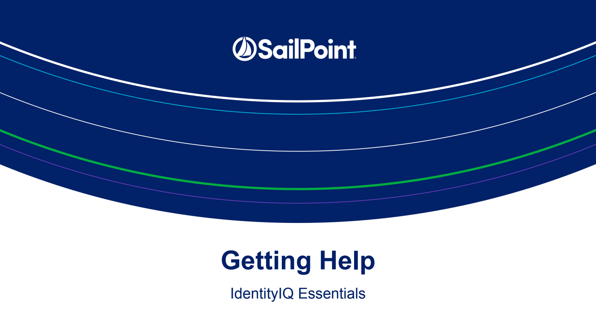
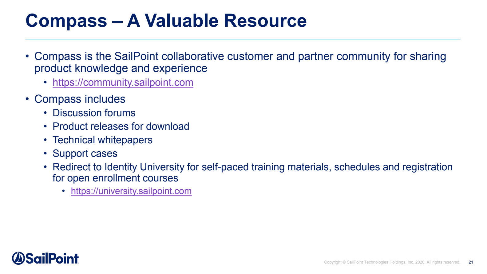
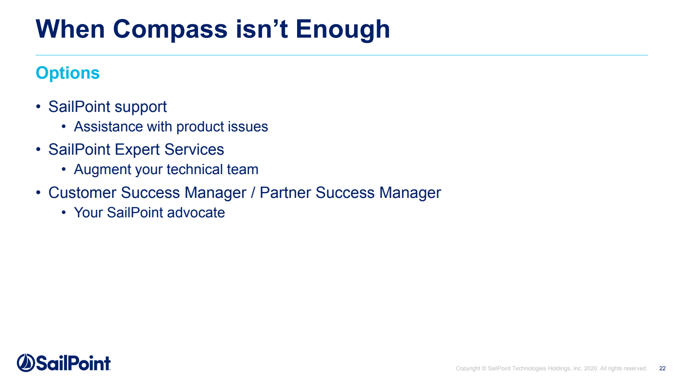
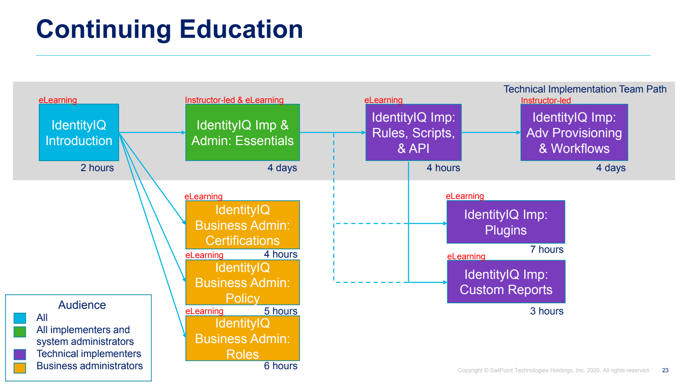
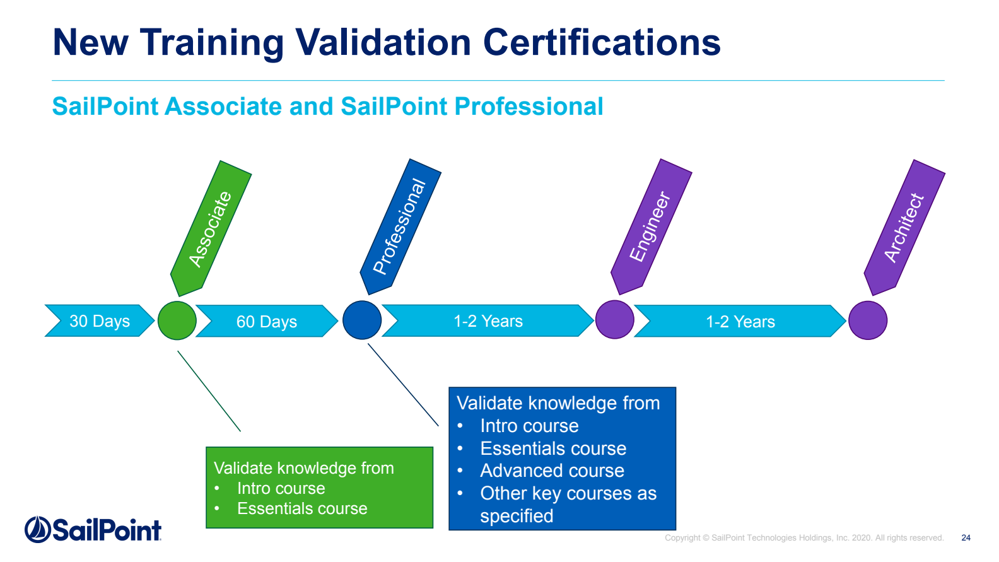

## 33. Getting Help

### Match the question to the resource

The lesson describes Compass as the customer/partner community for discussions, downloads, whitepapers and product knowledge, with Identity University providing training. These original names and links are retained as course context. The actual contents of linked sites and present-day program availability have not been independently archived by these notes.

For an unresolved product issue, the course identifies SailPoint Support. For additional implementation expertise it identifies Expert Services, and for coordination/advocacy it names the customer or partner success manager. A well-prepared question includes the release, affected feature, expected/actual behavior, a minimal reproduction and relevant diagnostic evidence from the operations modules.

### Continue from the foundation

The course's education map shows further study in Rules/Scripts/API, advanced provisioning/workflows, plugins, business administration and custom reports. It separately illustrates training-validation certifications. The chart's names, timings and certification model are historical course material; they do not establish current exam prerequisites, pricing or purchasing requirements.

Essentials study coverage now spans all 33 numbered modules, but reading this book does not complete the LMS, practical exercises or a certification exam. The broader Engineer path still has separate courses whose notes remain to be prepared.

### Related practice and source pages

[Appendix — synonyms, Linux, installation and lab tools](../practice-companion.html#practice-appendix)
