# IdentityIQ Essentials

English study notes for **all 33 numbered teaching modules**, in course order. The original 461-page presentation PDF and 257-page exercise guide have been retained. The notes use 429 nonblank original slide-page illustrations; a linked practice companion contains all 257 original guide-page illustrations beside the corresponding exercise summaries.

**Source depth:** Modules 1–7 incorporate accessible video caption-search explanations. Modules 8–33 are based on their official presentation slides and related exercise-guide material; their full video narration has not been reviewed. This is complete numbered-module note coverage, not a complete audiovisual archive or LMS completion.

**Version context:** the exercise guide is IdentityIQ 8.2b / 2021. Presentation examples include 2020 notices and 8.1 settings. Original version-specific platform lists, limits and example values are historical course material, not a verified current support matrix.

[Practice companion with all exercise pages](practice-companion.html) · [Practice Markdown](practice-companion.md) · [Original slides](handouts/presentations.pdf) · [Original exercise guide](handouts/exercise-guide.pdf) · [Exact source and gap report](coverage.json)

## 1. Course Overview

### Purpose and audience

Essentials prepares technical implementers, customer and partner teams, and system administrators to participate in IdentityIQ implementations and ongoing administration. It builds on IdentityIQ Introduction, moving from feature awareness into application configuration, data loading, governance, provisioning and diagnosis.

By the end of the course, learners are expected to define applications that read enterprise data and send changes back to connected systems; configure schemas and custom attributes; load identities, accounts and entitlements; and link accounts to the appropriate owners. They also learn to configure lifecycle automation and user access requests and to monitor their results.

The course introduces several tools with different purposes: the browser-based Administrator Console, Advanced Analytics, the command-line IdentityIQ Console, Debug pages, task results and logs. Knowing where a problem is occurring matters as much as knowing which configuration to change.

### Why this sequence matters

The lesson sequence follows an implementation dependency chain. Establish the platform, bring in authoritative identity information, organize identities, add other application accounts, and validate data. Governance and provisioning then operate on that foundation. Automating decisions before confirming the underlying identity and access data would automate the same data errors.

The simulated project has three broad stages:

1. **Build the identity and access picture.** Configure authoritative applications, aggregate data, map identity attributes and run refreshes. Organize identities by responsibility, grant the appropriate IdentityIQ capabilities, onboard additional applications and correlate their accounts.
2. **Improve control of the information.** Inspect data quality, oversee system operation, configure policies and certifications, and model access using roles.
3. **Manage changes.** Prepare applications for provisioning, configure joiner/mover/leaver behavior, allow appropriate user requests, and test both automated and request-driven changes.

System administration runs throughout these stages. Task scheduling, errors, audit events, log output and retention settings continue to matter after implementation.

### Learning environment and supporting material

The course supplies slides, exercise instructions and a Linux virtual machine. The guide's appendix includes a vocabulary cross-reference between business-facing names and internal object names, Linux command references, manual installation and patch instructions, and a Lab Reset tool reference.

The VM already has IdentityIQ installed. Manual installation is presented for understanding and optional later practice. Lab Reset can replace exercise state, return to a clean starting point or remove the training database; the notes record its purpose, but no reset or VM operation was performed during preparation.

**Source coverage:** the 6:39 Course Overview video's caption-search results were read. Its narration has been incorporated here. This module has no matching section in the provided presentation handout, which starts with Technical Overview. Video footage and original on-screen frames for Module 1 were not saved.

### Related practice and source pages

[Training environment and course reference](practice-companion.html#practice-reference)

## 2. IdentityIQ Technical Overview

### The identity and application model

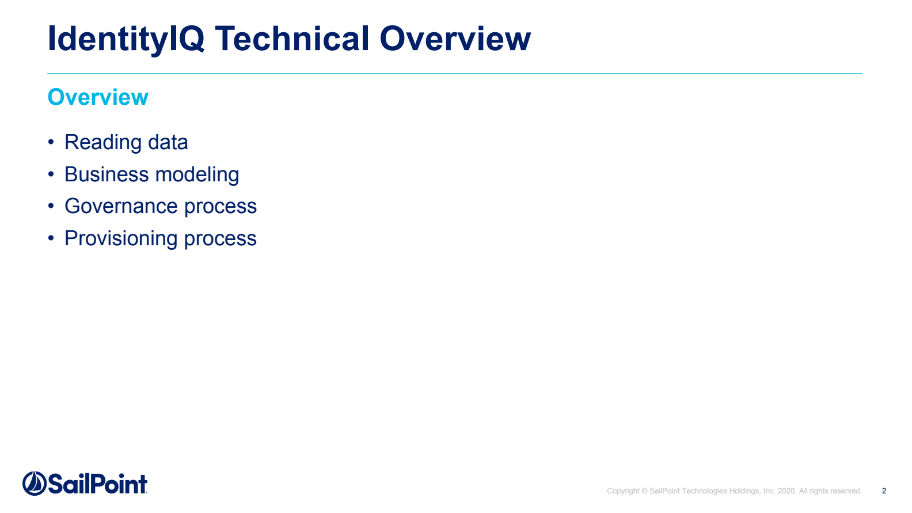

An **Identity Cube** represents a managed person. Reading information into IdentityIQ is **aggregation**, and a connected source is represented by an **Application** object. An authoritative application, or system of record, supplies the identities that IdentityIQ should manage. This might be HR, Active Directory or another appropriate source, depending on the organization's design.

An Identity Cube brings together two different kinds of information. **Identity attributes** describe the person, such as an identifier, name or email address. **Account attributes** describe that person's account on a particular application and follow that application's schema. An entitlement describes a right available through an account, such as permission to approve purchase orders.

As applications are aggregated, account and entitlement information is associated with the relevant Identity Cubes. Available access rights are also represented in the **Entitlement Catalog**, organized by application. The catalog describes the access that exists; an individual's Cube describes the access associated with that person.

### Business modeling

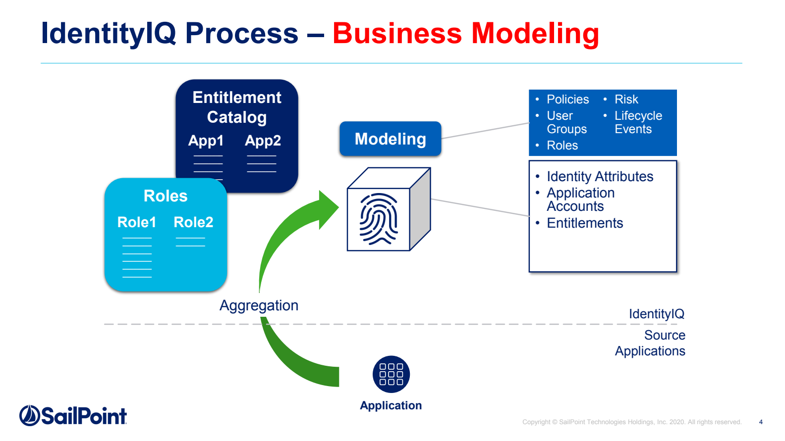

The data becomes useful for governance when the business defines what appropriate access looks like. Policies might prohibit a person from both approving and paying a vendor, or identify accounts unused for 180 days. These are examples from the course, rather than universal policy settings.

People can be grouped by their IdentityIQ responsibilities or enterprise access needs. A technical implementer and a business analyst may require different rights within IdentityIQ. Enterprise roles model responsibilities such as bank teller and group the permissions required for that job.

A risk model assigns numerical values to relevant access and other factors, producing a score that helps prioritize attention. Lifecycle-event definitions describe what counts as a joiner, mover or leaver and what should happen when such a change is detected.

### Aggregation, refresh and certification

**Aggregation reads external information; refresh computes information about identities.** A refresh can evaluate policy violations, calculate risk, detect or assign roles, and process lifecycle events, according to its configuration. Aggregation and refresh are related operations with distinct responsibilities.

Certification asks an accountable reviewer, often a manager, whether a person's access is appropriate. The reviewer approves access that should remain or requests revocation. Policy remediation and certification decisions can lead to manual work items or automatic removal where the application's integration supports it and is configured accordingly.

### Request-driven provisioning

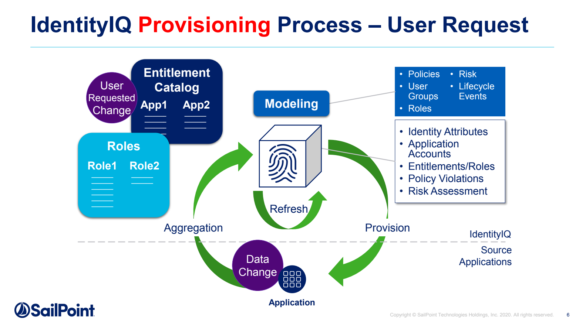

The narration's example is a request for the **Time Sheet Approver** entitlement. The user searches the access items they are allowed to request and submits the selection. A workflow handles the request, potentially collecting approvals and identifying policy violations before fulfillment.

If the request proceeds, IdentityIQ changes the target application through the configured provisioning path. Some integrations can execute the change automatically; others send a work item for a person to perform it. The desired access change and its actual implementation are separate facts.

IdentityIQ subsequently aggregates to confirm the target state. Depending on the connector, this can be a targeted read for the affected account or must wait for a later bulk aggregation. A refresh then recalculates the identity's picture using the newly observed information.

### Event-driven provisioning

Requests are not the only trigger. When an employee is added to HR, aggregation can bring that person into IdentityIQ. The configured joiner-processing path can then provision the baseline, or **birthright**, accounts and entitlements that the employee needs. The business defines both the event criteria and the resulting access.

A useful study sequence is: **read → correlate and model → calculate → decide → change → confirm**. This is a reading aid summarizing the processes above, not an additional named product feature.

The handout ends this section with a Knowledge Check title slide. No assessment questions or answers are included here.

## 3. IdentityIQ Functional Elements

### Objects and the components that act on them

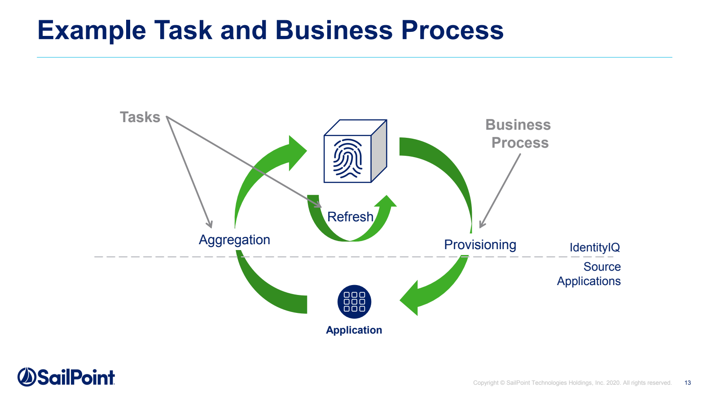

IdentityIQ uses an object-oriented model. Identities, roles, applications, certifications, tasks and workflows are represented as objects persisted in the database. The course emphasizes using object methods when writing code against IdentityIQ, rather than treating customization as direct manipulation of database tables.

Objects hold configuration or state. **Tasks** and **business processes** perform work against those objects. For example, an Application object describes how a source is configured; an aggregation task uses that definition to read the source. A provisioning business process coordinates the work required when a user requests access.

### Tasks

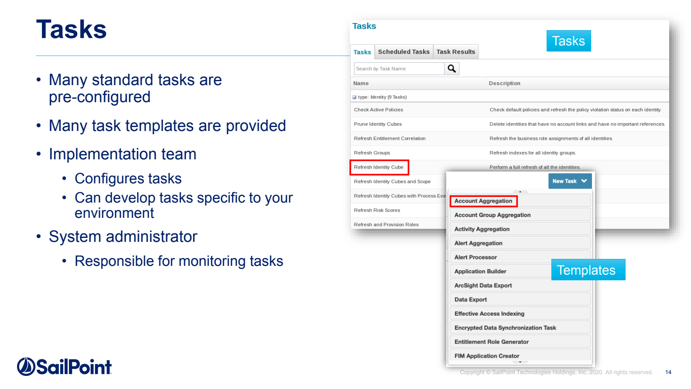

A task is a background or batch operation that runs without an interactive conversation with a user. A person can launch it manually or configure a schedule. Aggregation and identity refresh are typical examples.

IdentityIQ includes predefined tasks and task templates. The implementation team decides which tasks are required, configures existing definitions or creates additional ones, and selects appropriate schedules. The administrator checks that the tasks run when expected and investigates failures and errors. A configured schedule alone is not evidence of a successful run.

### Business processes and workflows

**Business process** and **workflow** refer to the same underlying concept. Business-facing screens generally use the former wording; implementation tools and object definitions often use the latter.

A workflow is an executable sequence of steps triggered by an event or request. Unlike a batch task, it often interacts with people to collect data or obtain approvals. In the illustrated provisioning example, the process obtains approval, provisions access, updates associated tickets and refreshes the identity.

Implementers commonly configure supplied workflows by setting variables and approver choices. Where necessary, they can change individual steps or replace a process with a custom workflow. This distinction matters when deciding whether a requirement needs configuration, workflow modification or another extension.

### Rules

Rules insert organization-specific behavior at supported extension points. The course describes them as BeanShell code with Java-like syntax. Examples include changing certification inclusion, transforming aggregation data, implementing a policy condition or supplying application provisioning logic.

The narration illustrates a certification exclusion rule that omits executives. A rule is stored as its own reusable object, so appropriate certifications can reference the same logic. Rule-selection controls associate an existing rule with a supported hook, while the editor allows its logic to be defined.

Rules are optional: not every configuration requires custom code. The course's statement that there are more than 80 rule locations is a claim about its course version, not a verified current count.

### Compare the three elements

| Element | How it starts | Typical interaction | Course example |
| --- | --- | --- | --- |
| Task | Manual launch or schedule | Runs in the background | Aggregate accounts or refresh identities |
| Business process / workflow | System activity or user request | May collect information or approvals | Approve and fulfill an access request |
| Rule | Called at a configured extension point | Supplies custom logic to its caller | Exclude a category of identities from a certification |

## 4. IdentityIQ Implementation Overview

### Plan phased delivery and clean data

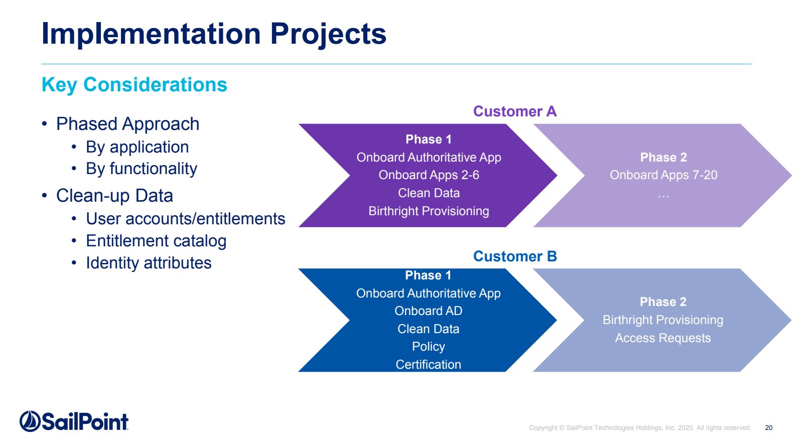

Two foundations apply across implementation projects: break the work into practical phases, and make the identity and access data reliable. An initial phase must include the authoritative information used to create identities, but the number of additional applications and features can be deliberately limited.

The course compares two rollout patterns. One customer starts with an authoritative application plus five business-critical applications and delivers birthright provisioning, then adds more applications in later phases. Another starts with authoritative data and Active Directory, establishes policy and certification controls, and adds provisioning afterward. These are illustrations of phased delivery, not prescribed project sizes.

Data quality affects both governance and automation. Incorrect entitlement data distorts policy findings, risk assessments and role analysis. Incorrect identity attributes can assign access to the wrong people: an employee inaccurately classified as Finance could receive a Finance role through automated logic.

### Configuration approaches

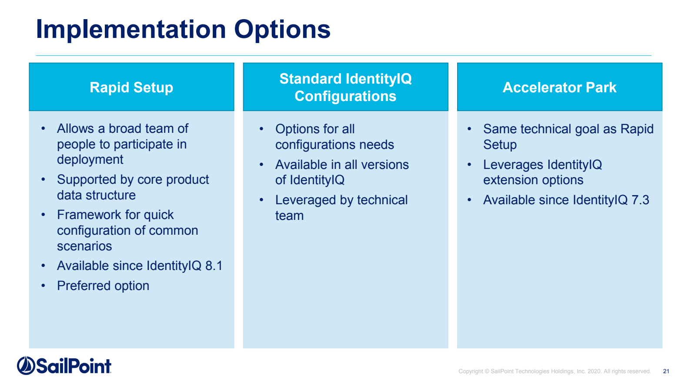

**Rapid Setup** groups common configuration choices into focused menus and supports scenarios such as onboarding and lifecycle handling. Its targeted permissions can let business analysts and data owners participate alongside technical staff. The course describes it as a core-product feature introduced in 8.1 and the preferred framework for the common scenarios it covers.

**Standard IdentityIQ configuration** provides the broader, more flexible settings used when the Rapid Setup options do not cover a requirement. It remains part of the implementation toolbox rather than a separate replacement product.

**Accelerator Pack** is the name used in the narration for an earlier extensibility-based approach to similar scenarios. It uses extended attributes and rule hooks and may therefore interact with an organization's other customizations. The supplied slide spells the name “Accelerator Park”; the notes retain the narration's wording while leaving the original illustration untouched. The course says existing implementations can continue using their framework; this is historical course context, not a current migration recommendation.

### The class implementation project

Phase 1 creates the identity foundation, organizes people and their IdentityIQ capabilities, loads other account and entitlement data, and checks its quality. The exercises use different implementer and analyst personas to demonstrate shared responsibilities.

Phase 2 introduces compliance functions and roles. Learners detect policy violations, configure a targeted access review and establish an access model that later supports provisioning.

Phase 3 prepares the applications for provisioning and tests both data-driven and user-requested changes. Request configuration includes which access items are requestable, who may request for whom, and which approvals must occur. The results need to be tested rather than inferred from saved settings.

### Preparation for Exercise 1

IdentityIQ is already installed in the training environment. Exercise 1 confirms that installation and applies development-oriented global settings: email redirection, work-item archiving, object retention and audit choices. Manual installation practice is a later optional appendix exercise, not a prerequisite operation that was run while creating these notes.

The expanded Exercise 1 study instructions and original pages are in the linked practice companion, keeping the numbered module sequence intact.

### Related practice and source pages

[Training environment and course reference](practice-companion.html#practice-reference) · [Exercise 1.1 — Configure IdentityIQ](practice-companion.html#practice-1-1)

## 5. Product Architecture

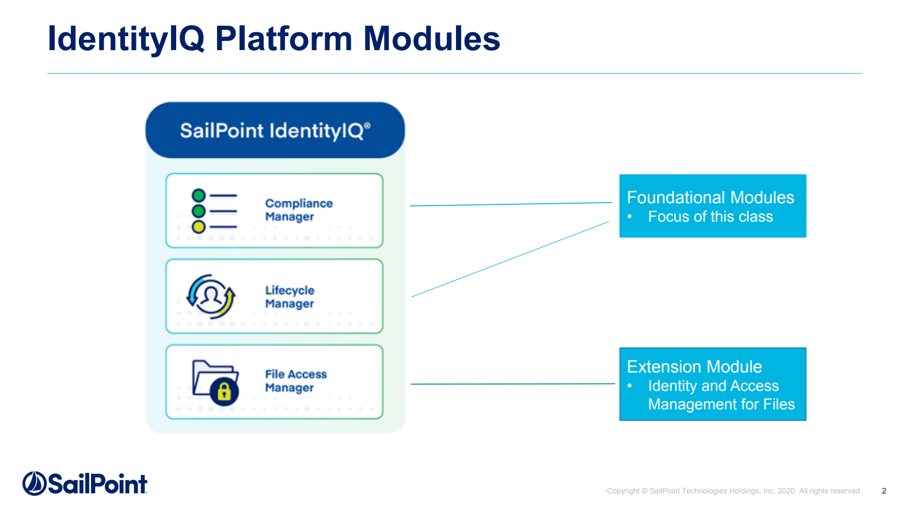

### Platform layers and foundational modules

The architecture lesson focuses on Compliance Manager and Lifecycle Manager as foundational application-governance and access-management modules. File Access Manager extends governance into file data. Other introductory material groups the platform differently; these notes retain this lesson's specific framing rather than forcing a single module count across differently scoped presentations.

IdentityIQ is a Java web application running inside an application server with a Java runtime. A relational database persists its objects. An email service provides notifications through SMTP. The architecture separates the application's execution environment from the database and the enterprise applications it manages.

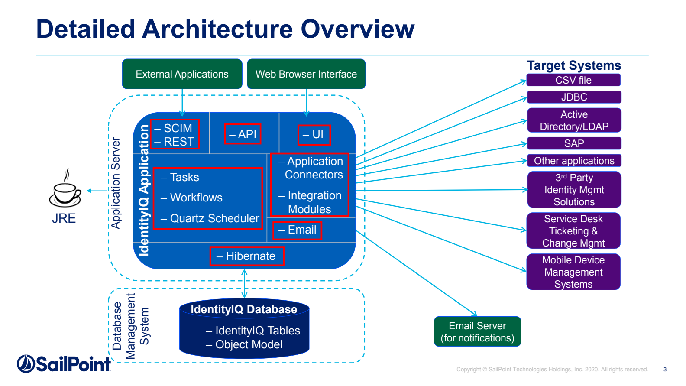

### Reading the architecture diagram

Inside the application server, tasks and workflows execute the business logic. **Quartz** schedules recurring work. **Hibernate** maps the Java object model to the relational database and handles the database-specific persistence layer.

Connectors and integration modules reach managed systems such as directories, databases, SAP, service-desk products and other applications. Their network access and credentials are dependencies of the operation they perform; having the IdentityIQ website available does not by itself prove those integrations can connect.

The diagram also separates several interfaces:

- **Browser UI:** the normal interactive experience for administrators and business users.
- **External REST interfaces:** allow other systems to interact with IdentityIQ, for example to initiate an appropriate process.
- **SCIM REST interface:** supplies standardized identity-management operations for integrations using that model.
- **Internal Java API:** provides broader access to IdentityIQ objects and is used by custom rules and implementation code.

The course mentions more than 100 connector types in its narration. That number is preserved as a course-version statement, not a verified count of currently offered connectors.

### Platform selection

The slide lists the application servers, databases, Java platforms, cloud-hosting options and browsers associated with the course version. Its general architectural lesson is to select a supported stack the organization can operate and maintain competently. The displayed list includes older products, so it should be read as historical course material rather than a present-day support matrix.

A practical way to review the diagram is to identify the dependency for each operation: browser-to-application access, application-to-database persistence, application-to-target connectivity, and notification delivery. These are different paths and can fail independently.

### Related practice and source pages

[Exercise 1.1 — Configure IdentityIQ](practice-companion.html#practice-1-1)

## 6. IdentityIQ Installation

### Installation sequence and its dependencies

The example assumes the application server and database server already exist. It then shows seven stages:

1. Unpack the distribution and deploy its WAR into the application-server environment.
2. Define the required implementation-specific extended attributes in the relevant Hibernate mapping files.
3. Generate database schema DDL that includes those customizations.
4. Create the IdentityIQ database using the appropriate generated script.
5. Configure the database connection in `WEB-INF/classes/iiq.properties`.
6. Initialize the supplied system objects, plus Lifecycle Manager objects when applicable.
7. Apply the appropriate patch following the version-specific installation instructions.

This sequence explains dependencies: the schema must describe the desired columns before the database is created, and the console needs working database connectivity before it can import objects. The lesson describes patches as cumulative for its example release. No software was installed or patched during the preparation of these notes.

### Extended attributes and internal object names

Applications, roles, certification items, identities, accounts and entitlements can have extended attributes. The narration highlights identities as a common example and connects three user-facing terms to internal names: **role → Bundle**, **account → Link**, and **entitlement → ManagedAttribute**.

A non-searchable extended attribute is stored within the object's attribute data, described here as a CLOB, or character large object. Multiple attribute values can share that storage. A searchable attribute has its own database column, making it suitable for efficient filtering, correlation and repeatedly accessed report or rule criteria.

The narration explains that selecting **Searchable** affects storage and availability in features such as Advanced Analytics. Accessing data in a CLOB remains possible, but it may be inefficient for repeated searches. Searchability is therefore both a functional and a database-design consideration.

### Standard, named and placeholder columns

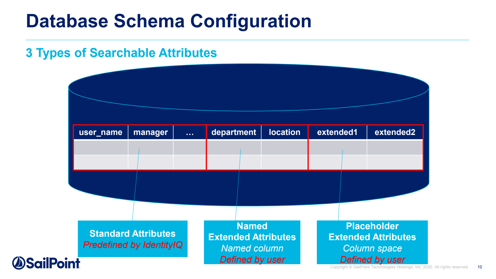

Standard columns are supplied by IdentityIQ. **Named extended columns** are added for requirements whose attribute names are known, such as department or location. **Placeholder columns**, such as `extended1`, reserve space for later searchable attributes whose names were not known when the database was designed.

The course describes a limit of 20 placeholder columns per object for its version. Named columns are still constrained by the database and implementation design; they are not literally unlimited. Indexes can improve searches while adding work to updates, so indexing is a deliberate design choice.

Relevant Hibernate mapping files, such as `IdentityExtended.hbm.xml`, define the additional columns and optional indexes. Adding an attribute through a screen does not eliminate the need for appropriate storage in the database schema.

### Generating and applying the schema

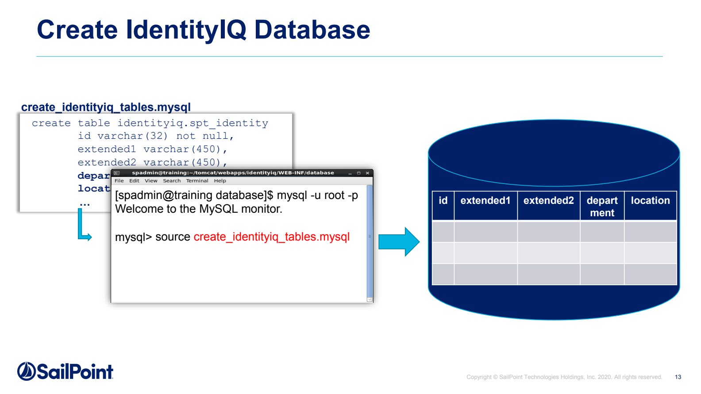

The lesson uses `WEB-INF/bin/iiq schema` to generate DDL scripts in `WEB-INF/database`. The generated scripts cover the supported database types of that release; choose the one for the actual database engine.

The narration distinguishes the generated customized creation script from the similarly named default script distributed with the product. Using the wrong one can omit the extended columns. In its MySQL example, the database administrator runs the selected DDL through the database console to create the database structures.

### How a searchable attribute gets a column

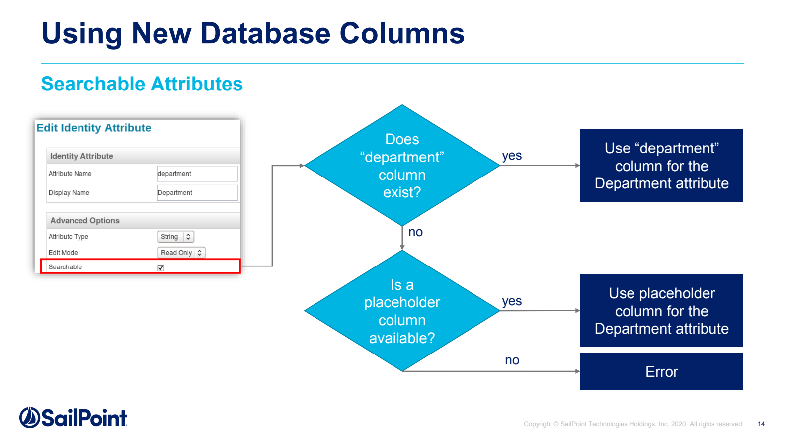

When a searchable attribute is configured, IdentityIQ first looks for a matching named column. If one exists, it uses that column. Otherwise, it assigns an available placeholder and records that association. If neither is available, configuration fails and the schema needs to be extended before another searchable attribute can be added.

A useful example is Department. A named `department` column supplies dedicated storage; without that column, an unused placeholder can hold its values. Merely choosing Searchable cannot create limitless additional storage.

### Extending an existing database

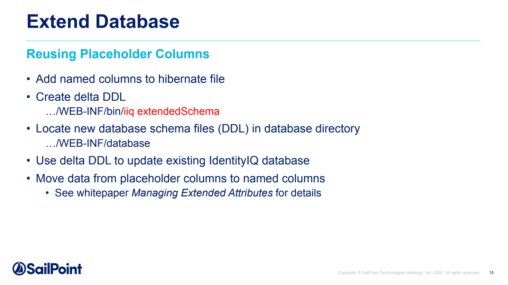

The course describes reclaiming placeholder capacity by defining named columns for known attributes, generating delta DDL with `iiq extendedSchema`, applying the schema changes, and moving the existing data into its intended columns. This is different from rerunning a full create-database script.

The narration points to a separate Managing Extended Attributes reference for the detailed migration procedure. That external document has not been captured or verified in this batch. The notes explain the process, but do not supply an unverified production migration recipe.

### Properties and initial objects

`iiq.properties` identifies the database endpoint, username, password, driver and dialect. The lesson's example shows an encrypted password generated through the IdentityIQ encryption utility and explains enabling the block for the chosen database type while disabling irrelevant examples. Connection strings and example settings on the original slide are historical training material.

The IdentityIQ Console imports `init.xml` to create the standard objects, including the initial administrative identity and default configurations, tasks, rules, reports and workflows. If Lifecycle Manager is included, `init-lcm.xml` adds its objects. XML imports are also a mechanism for bringing in implementation-specific object definitions.

The console does **not** require the web application server to be running, but it **does** require its database connection to work. A successful console startup therefore provides an early connectivity check. Browser access additionally requires the application server and deployed web application to be available.

**Player-label discrepancy:** Module 6's embedded player displayed “Product Architecture” as its heading, while its navigation title and caption text describe IdentityIQ Installation. The notes follow the verified module navigation and actual narration.

### Related practice and source pages

[Training environment and course reference](practice-companion.html#practice-reference) · [Exercise 1.1 — Configure IdentityIQ](practice-companion.html#practice-1-1) · [Appendix — synonyms, Linux, installation and lab tools](practice-companion.html#practice-appendix)

## 7. Creating Identity Cubes

### What the cube represents

An Identity Cube is the collected view of one person or other entity that holds access. It includes identity attributes, application accounts, entitlements and roles, risk information, policy findings and rights within IdentityIQ. It is more than an account record from a single application.

The narration distinguishes four ways information reaches this view: aggregation **discovers** data; a request initiates a change; an assignment establishes access through business logic; and calculations produce results such as risk scores or policy violations. These mechanisms explain why two fields visible on a cube can have different origins and update paths.

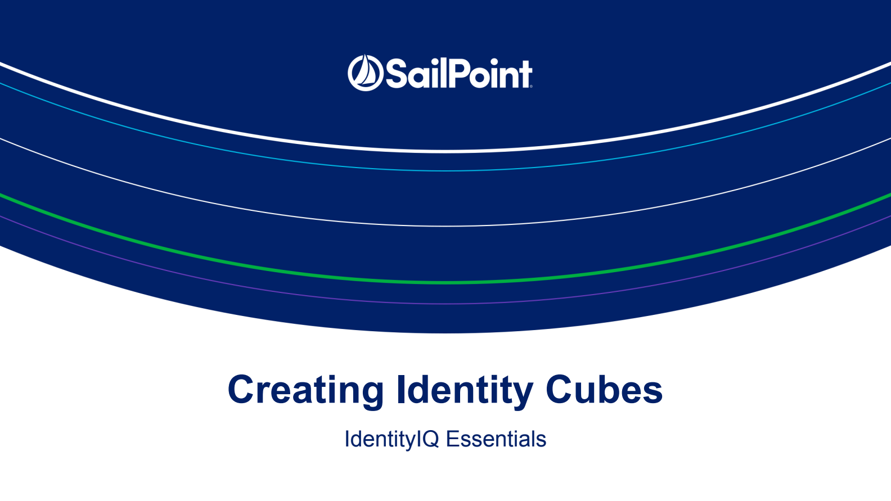

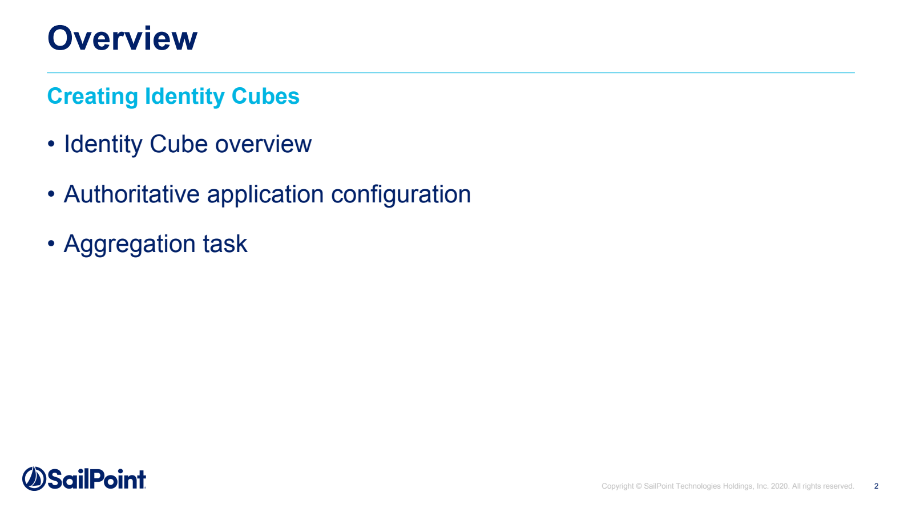

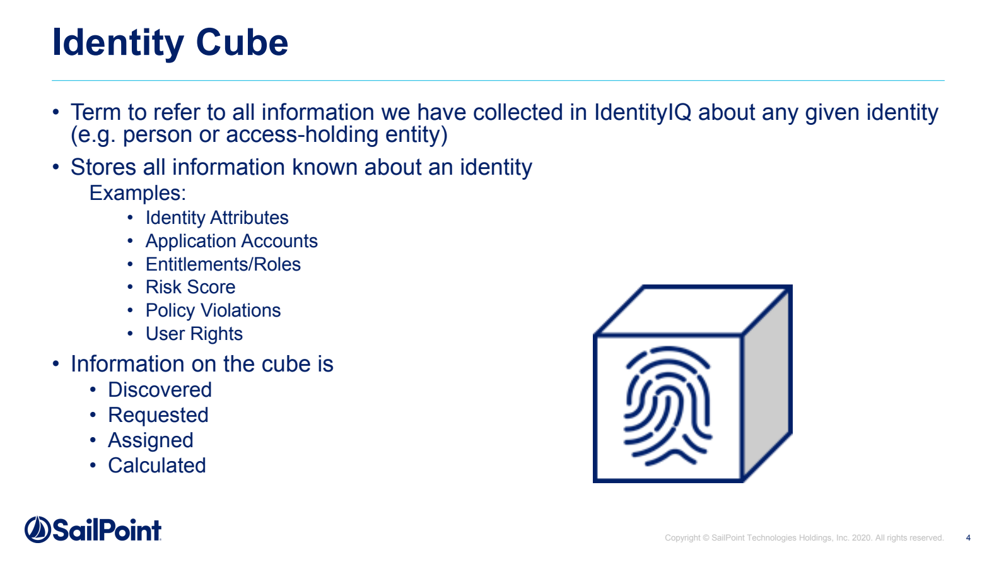

### Configure the authoritative source

An authoritative application supplies the population from which authoritative identities are created. Account aggregation is the normal creation path; the Create Identity Quicklink is a separate manual path through Lifecycle Manager.

For an application definition, set its name and owner, select the connector type, and provide the connectivity details required by that connector. Mark the source authoritative only when it is intended to supply those identity records. The lesson recommends workgroup ownership once the implementation's responsibility model is established.

The account schema defines which fields to read and how to identify and display accounts. The narration's example excludes an unnecessary social-security-number field: a source can contain more data than identity management needs. Some connectors supply a useful initial schema; open-ended sources such as files and JDBC require more definition.

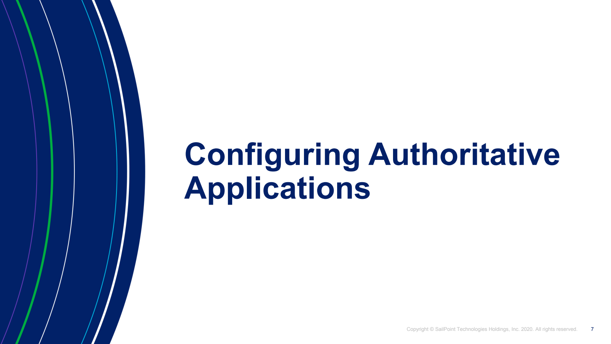

### Interpret and aggregate the data

After connectivity and schema configuration, Rapid Setup defines account and manager correlation and any needed account-state or identity-type classification. Account correlation links an account to an identity; manager correlation links one identity to another. Locked and disabled are account states, while service and bot classifications describe identity types. Available controls vary with what the connector already knows and manages.

Create an Account Aggregation task for the chosen application. The task reads the application definition, invokes the connector and configured rules, and creates or updates the corresponding identity/account representation. Detect Deleted Accounts helps reconcile a complete source read with accounts that no longer exist; later delta-processing lessons explain why a partial input cannot safely be treated as the complete account population.

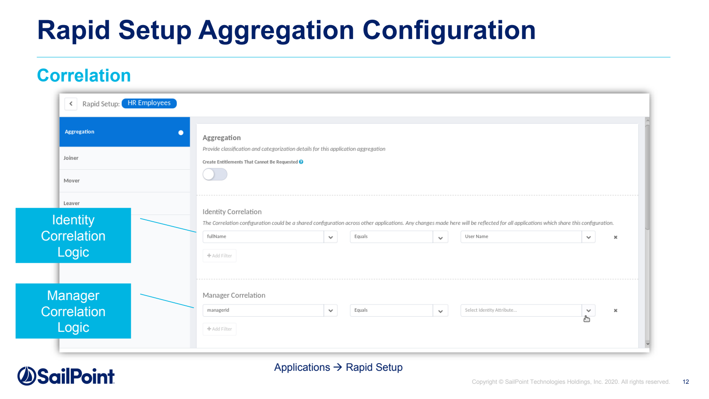

### Exercise 1.2 study sequence

Define HR Employees and HR Contractors from the provided delimited files. Discover and review the schemas, select the identifier and display fields, mark cost center multi-valued, and configure filtering and any required row merging. Test connections and preview the data before aggregation. Apply the supplied training creation rule, configure Rapid Setup classification, then execute each aggregation and inspect its task results and resulting cubes.

The important verification is not just that a task completed: account identifiers, multi-valued data and account status must mean what the source owners intended. The original exercise pages, including their exact training settings, appear in the practice companion linked below.

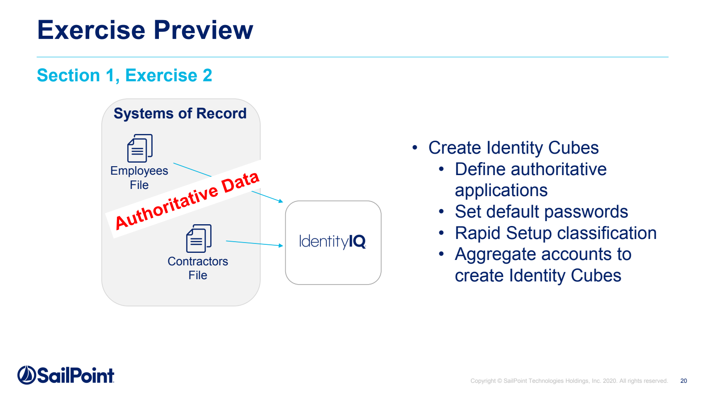

### Related practice and source pages

[Exercise 1.2 — Create Identity Cubes](practice-companion.html#practice-1-2)

## 8. Identity Attributes and Mappings

### Turn account data into identity data

Identity attributes drive searches, role assignment, reporting and lifecycle decisions. Standard attributes support the base product; extended attributes express installation-specific requirements. Standard attributes are searchable by default in the course model, while searchable extensions depend on the database capacity introduced in Module 6.

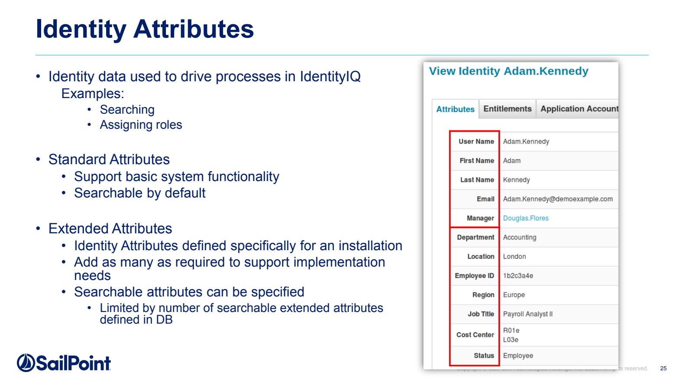

An identity mapping supplies a property name, display label, data type, edit behavior and source mappings. A source can be an application account attribute or a rule. The same identity attribute can have sources for different authoritative populations, such as employees and contractors. Account data must exist before those mappings can populate a useful identity-level value.

Searchable attributes support correlation and query criteria. Multi-valued attributes can represent several cost centers. A Group Factory setting makes an attribute eligible for dynamically defined groups, such as a group for each region. An Identity-typed attribute stores a relationship to another identity rather than merely an unrelated text label; the course discusses a version-specific limit on certain extended identity relationships.

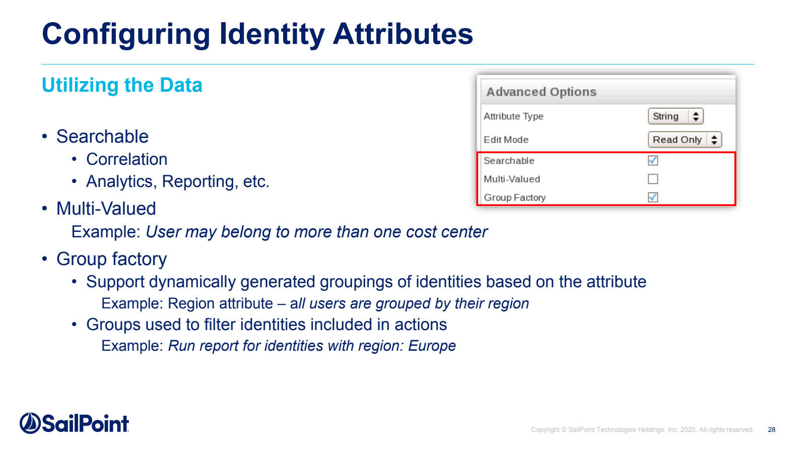

### Connect managers and run refresh

Manager correlation maps a source account's manager identifier to an attribute on the manager's Identity Cube. It can be configured in the application definition, Rapid Setup or a rule. A manager's name merely appearing in a source field does not prove that this relationship has resolved correctly.

Refresh performs the configured calculations: promoting account data into identity attributes, marking manager status, preparing entitlement information for certification, evaluating roles, checking policies and processing events. Select the actions the implementation actually needs rather than enabling every available calculation indiscriminately.

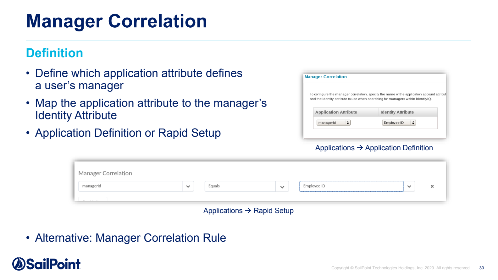

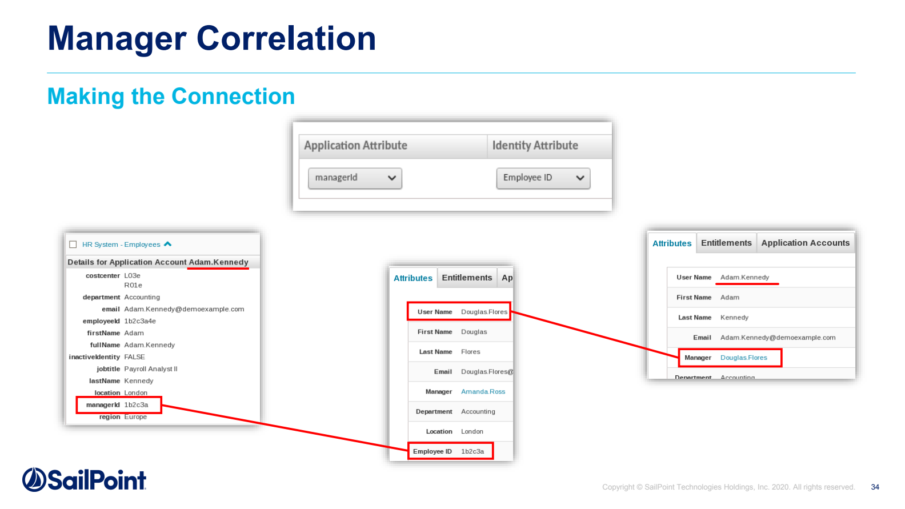

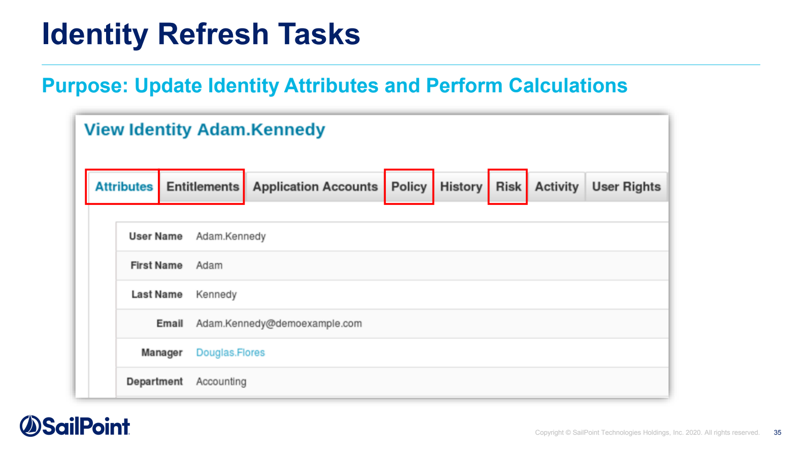

### Schedule and verify

Aggregation frequency depends on the business use case and source importance. Certification preparation and operational provisioning can need different schedules. Refresh timing should follow the data it depends on and run its heavier calculations only as often as required.

Exercise 1.3 configures sources for standard and extended attributes, defines employee/contractor account and manager correlations, and runs a focused refresh. It then updates the UI attribute list and uses Advanced Analytics to investigate inactive identities and missing managers. Compare the source account, identity attribute and displayed field separately when diagnosing a missing value.

### Related practice and source pages

[Exercise 1.3 — Populate Identity Cubes](practice-companion.html#practice-1-3)

## 9. Authentication and Authorization

### Proving identity versus granting rights

Authentication establishes who is signing in. The course lists native IdentityIQ authentication, directory pass-through, SSO mechanisms and MFA integrations available in its version. These slides are historical training material, not a current support matrix or a recommendation to select any particular legacy provider.

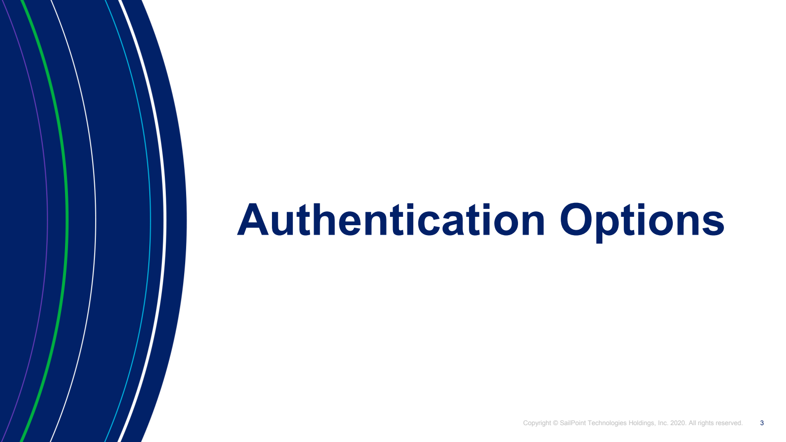

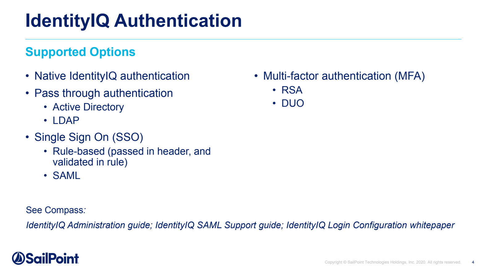

Authorization determines what an authenticated identity can do and see. **Capabilities** add functional rights and control available operations and menus. **Scopes**, when configured, divide the managed data into logical areas and restrict which objects a person can see or act upon. The regional illustration shows that permission to use a feature and permission to see a particular region's objects are distinct.

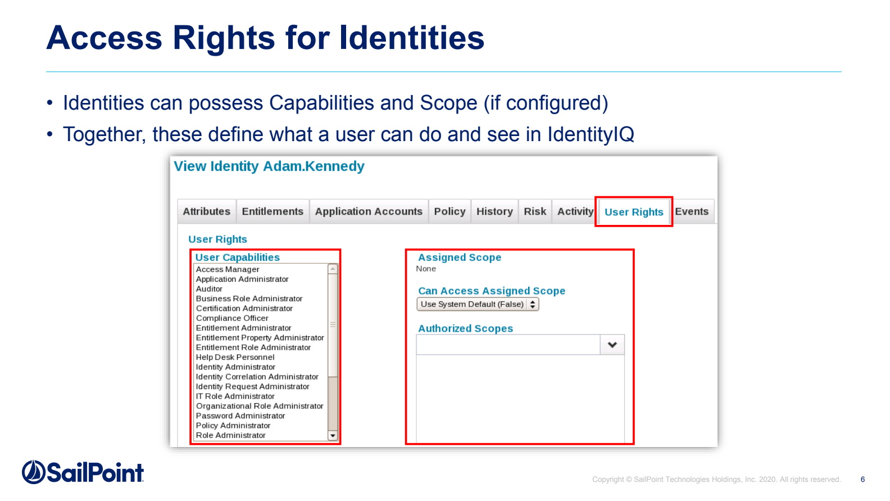

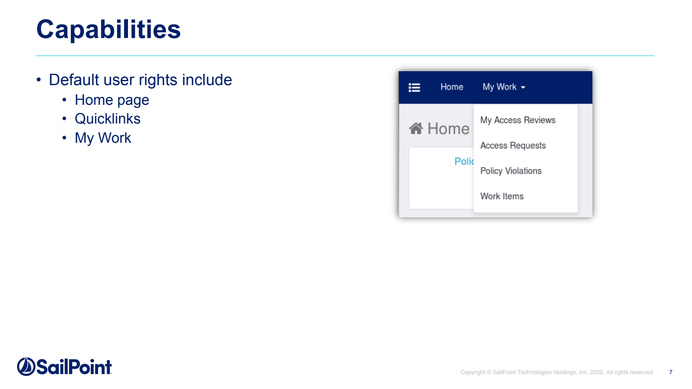

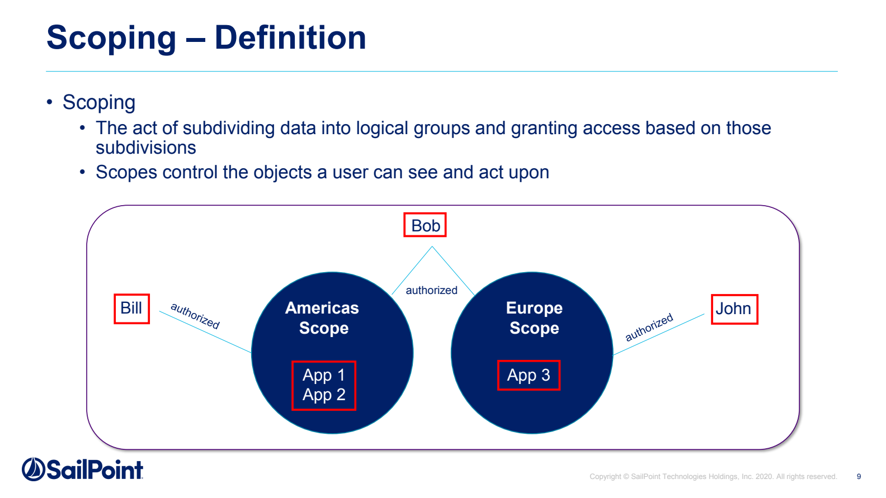

### Share responsibility through workgroups

A workgroup is a set of identities treated as a shared IdentityIQ identity for appropriate operations. It can own applications, roles, certifications or entitlements; receive shared work items; and convey capabilities and scopes to members. An Active Directory owner workgroup avoids making a single person's account the only operational owner.

Do not confuse a workgroup with an account group on a target application, a saved population or an attribute-generated group. Their names may sound similar, but their operational purposes differ.

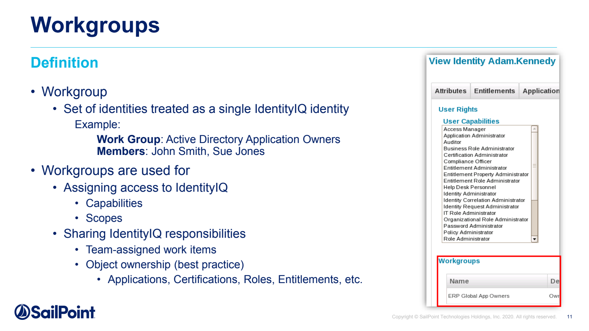

Exercise 1.6 configures LDAP pass-through and the account attributes used for login, then tests the intended sign-in path in the training VM. Its additional password-reset exercise enables the feature, configures challenge answers and tests the resulting flow. These are recorded study steps; no authentication settings or user credentials were changed while creating this book.

### Related practice and source pages

[Exercise 1.4 — Organize Identities](practice-companion.html#practice-1-4) · [Exercise 1.6 — Enable Pass-Through Authentication](practice-companion.html#practice-1-6)

## 10. Organizing Identities

### Populations are reusable identity queries

A population stores search criteria that identify a set of identities. It can combine several conditions, such as active contractors in a region. Saving it preserves the query rather than a permanently frozen list of people. Tasks, certifications and reports can use that population to define their target identities.

Create a population from an identity search in Advanced Analytics. Use Setup → Groups to inspect its name, owner, description, enabled state, visibility and current matching identities. Public/private here concerns the population definition's availability in IdentityIQ, not a change to GitHub repository visibility.

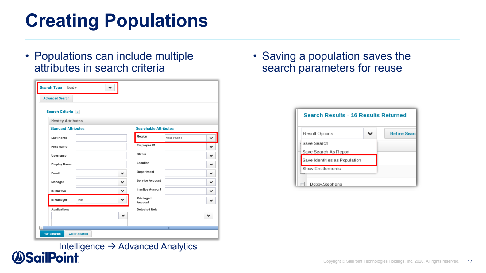

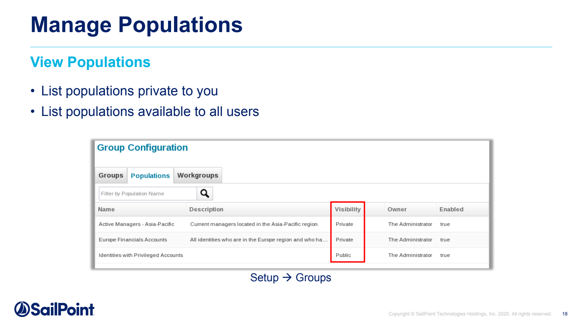

### Group factories organize one attribute at a time

An attribute-based group factory creates a subgroup for each value of one identity attribute, such as Location. Mark the identity attribute appropriately, define the group factory, and run Refresh Groups. The example generates Austin, London, Paris, Tokyo and Sydney groups.

There are two different freshness questions. The set of subgroup definitions is updated by Refresh Groups, so a newly introduced location may need that task before its subgroup exists. Membership is evaluated against the current identity criteria when the group is used. Refreshing group definitions and resolving current members are therefore related but distinct.

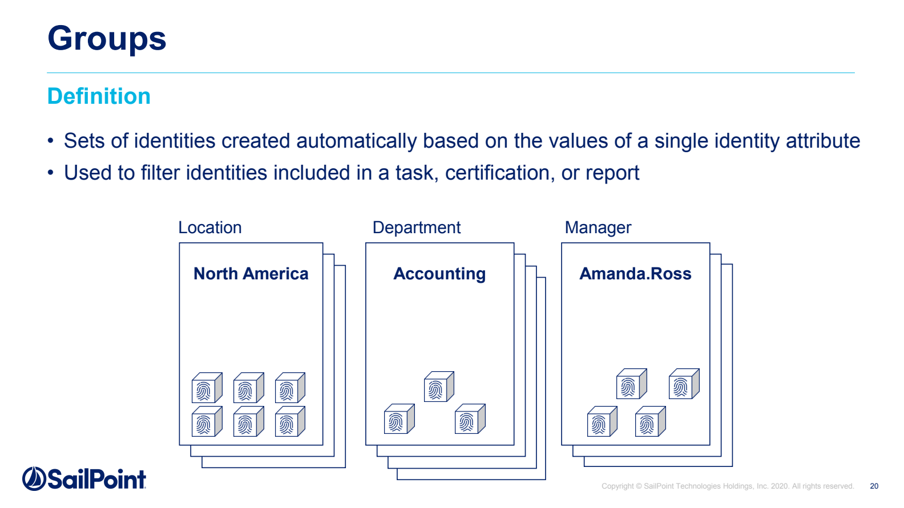

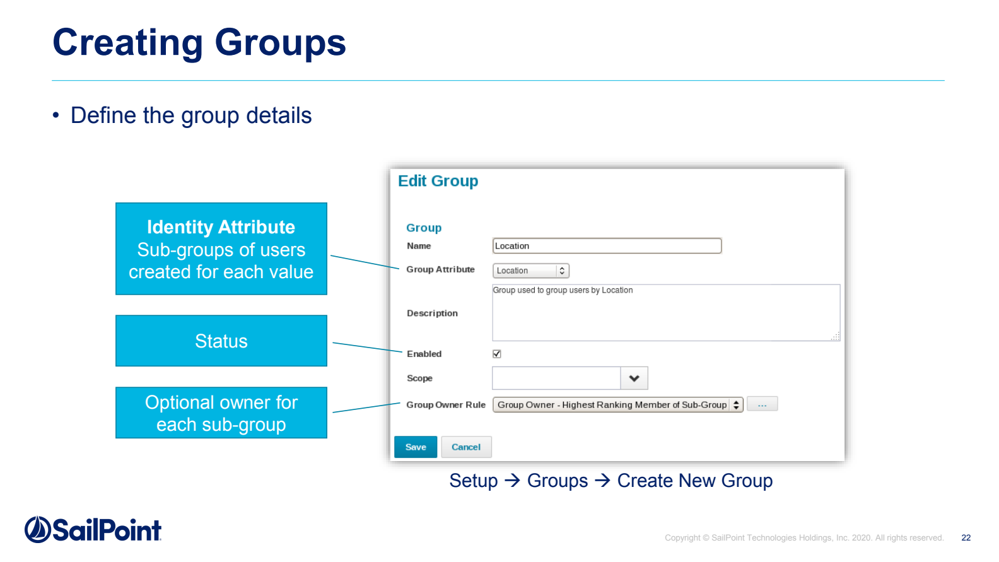

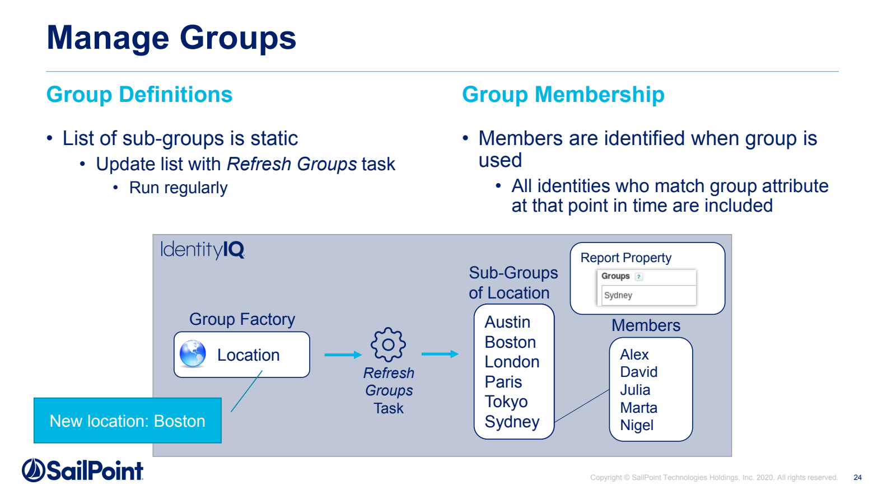

### Choose the appropriate grouping tool

Populations support flexible, multi-condition criteria and are created individually. Group factories generate single-attribute groups in bulk. Both store membership criteria and query dynamically at use time. The slide also distinguishes their applicability in task filters and identity selectors; do not assume every grouping control accepts both interchangeably.

Exercise 1.4 creates active-employee, active-contractor and authoritative-identity populations; generates groups; and establishes Admins, Business Analysts and Operations workgroups. It verifies capabilities through a report and an identity's User Rights view, configures Rapid Setup notifications and transitions away from reliance on the initial administrator. The provided training instructions, rather than these notes, contain the exact exercise accounts and settings.

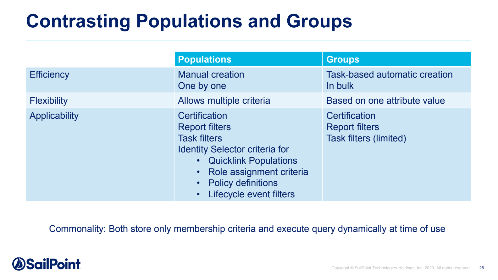

### Related practice and source pages

[Exercise 1.4 — Organize Identities](practice-companion.html#practice-1-4)

## 11. Onboarding Additional Applications

### Plan the application and its access model

After authoritative identities exist, additional systems supply the accounts and access to govern. Plan onboarding in phases. Establish connectivity, account identifiers and useful account attributes, and decide which values represent entitlements or native account groups. A group on a target system can imply a set of permissions; its membership is access data, not membership in an IdentityIQ workgroup.

The course points to connector documentation and deployment questionnaires covering staffing, application requirements and migration/rollback planning. Those references are listed in the original slides; their current external contents are not archived here.

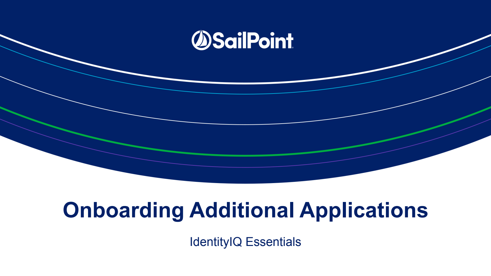

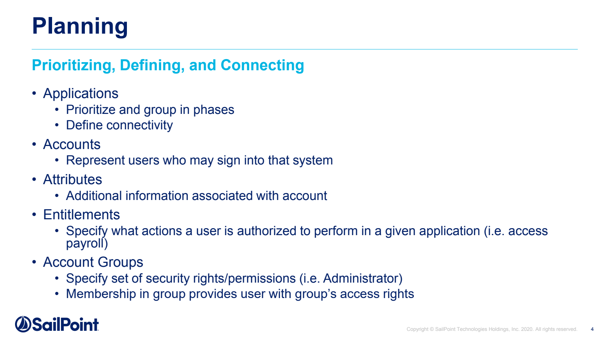

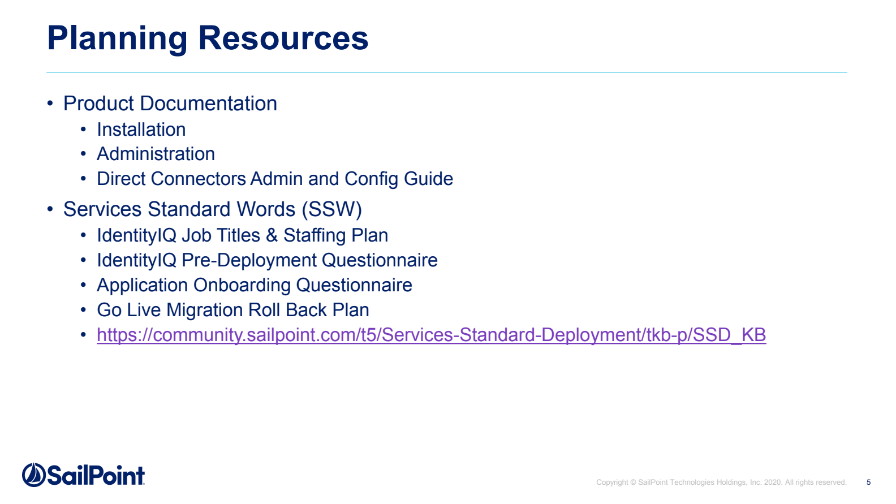

### Configure schema, groups and interpretation

A non-authoritative application still requires an account schema. Identify the unique account attribute and display attribute. Mark the relevant access-bearing fields **Entitlement** so they participate in the identity's access picture, and **Managed** when their values should become governed Entitlement Catalog objects with descriptions, owners and request-related metadata.

Group schemas represent native account-group objects. Their definitions explain what membership means and can provide group descriptions and indirect permissions. The account schema's group-object reference connects an account's membership field, such as `memberOf`, to the appropriate group schema.

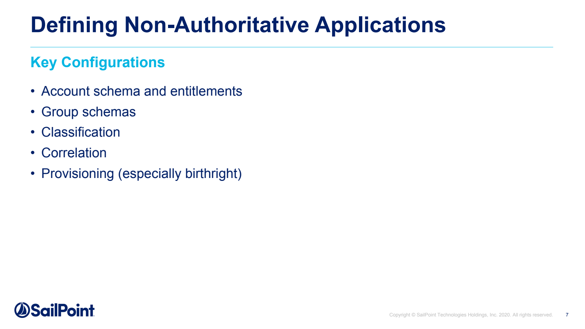

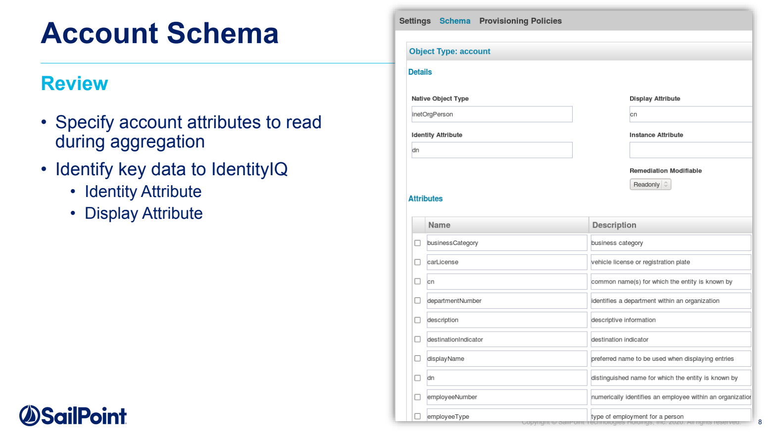

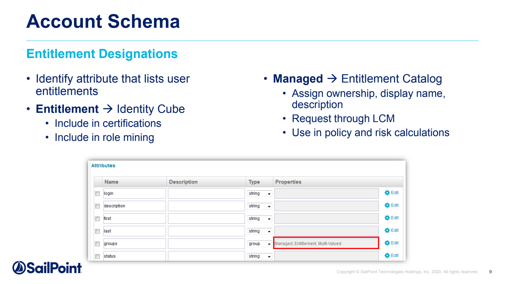

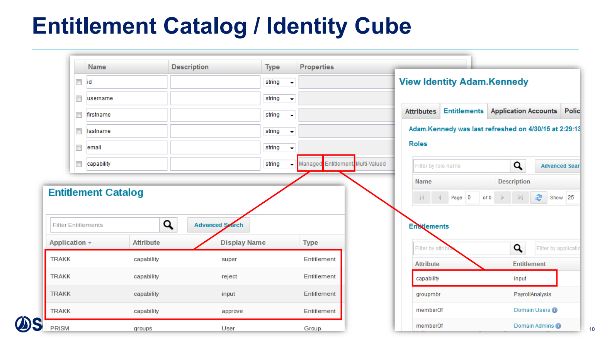

### Make requestability a deliberate decision

The course contrasts infrastructure systems with large, technically named entitlement sets and business applications with access items users can understand. It recommends different requestability defaults for these scenarios in its Rapid Setup example. This is a design pattern to evaluate, not evidence that every entitlement in a real deployment should share the same setting.

Also configure correlation, locked/disabled classification and service/bot interpretation as needed, and anticipate provisioning requirements. The final comparison slide separates account groups, workgroups, populations and group factories.

The LDAP and business-application exercises apply this process: configure connection and search settings, inspect provided schemas, preview accounts and groups, define correlation and classification, then aggregate and inspect the resulting identities and catalog entries.

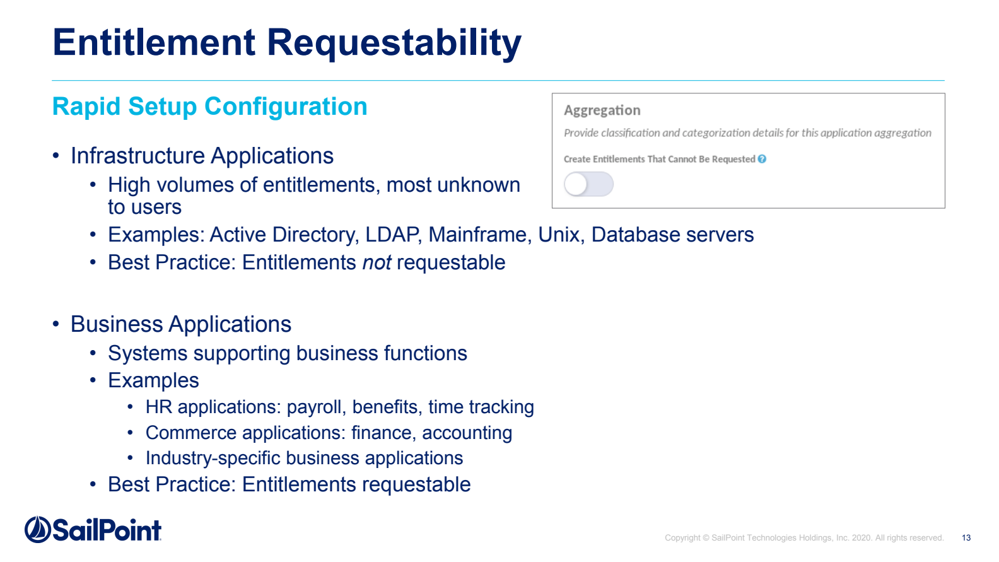

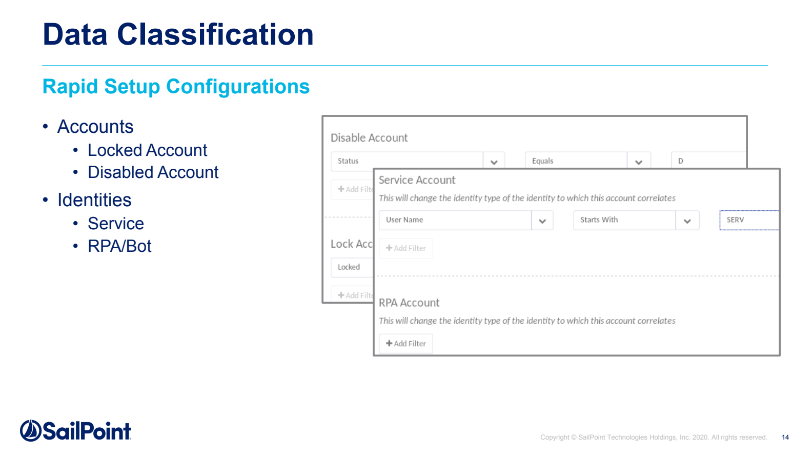

### Related practice and source pages

[Exercise 1.5 — Define LDAP Application](practice-companion.html#practice-1-5) · [Section Two — overview and contents](practice-companion.html#practice-section-2) · [Exercise 2.1 — Define Business Applications](practice-companion.html#practice-2-1)

## 12. Account Correlation

### Attach accounts to the correct identity

Correlation matches an application account to its authoritative Identity Cube. Success adds the account to the intended existing cube. Unsuccessful correlation can create a non-authoritative, uncorrelated cube, which needs investigation rather than being assumed to represent a new employee.

The supplied precedence is **correlation rule → configured correlation logic → default logic**. Rapid Setup provides a straightforward account-attribute-to-identity-attribute match. The correlation wizard supports ordered conditions in a reusable definition. A rule handles cases beyond simple matching but runs for each account during each aggregation, so its correctness and cost matter.

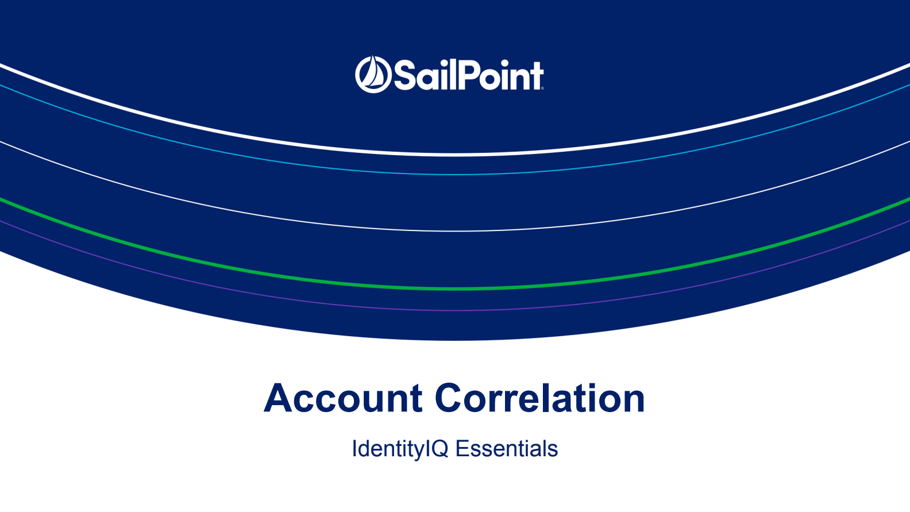

### Understand the processing pipeline

The connector reads native data and performs any supported filtering, merging and connector-level manipulation. Application customization can normalize the resulting resource object before correlation and creation/update. A wrong source value, schema choice or transformation can therefore produce a correlation problem even when the matching expression looks reasonable.

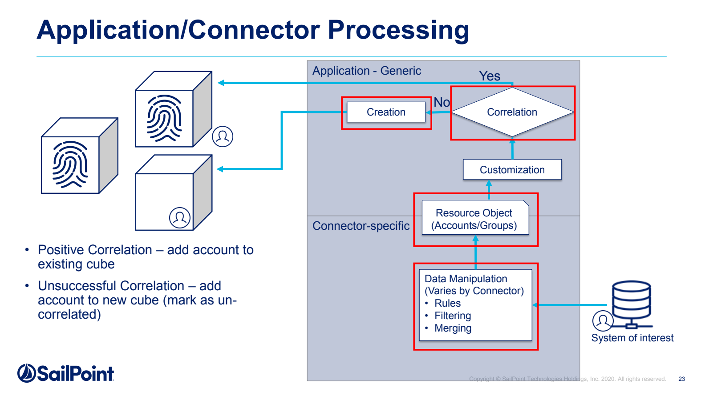

### Repair exceptions and confirm the outcome

Identity Correlation allows investigated accounts to be manually assigned to identities; the course says this relationship is retained. Moving an account from the wrong Cube is a separate repair. Correct systemic logic as well, so later aggregations do not keep producing equivalent exceptions.

After resolving ownership, inspect and prune truly empty non-authoritative cubes using the intended maintenance task. Pruning is cleanup after a verified repair, not a substitute for investigating ownership. Refresh then promotes the relevant access information into the certification-ready identity picture.

The related exercises inspect LDAP correlation, update the Email identity source, enable pass-through, and later use an Uncorrelated Accounts report to investigate and repair exceptional accounts. Their exact training data and verification screens are preserved in the practice companion.

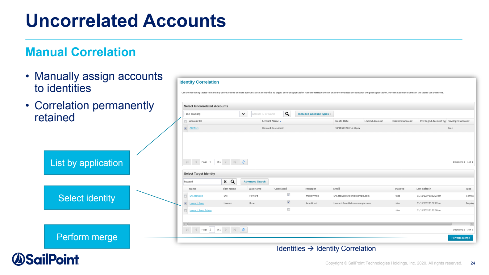

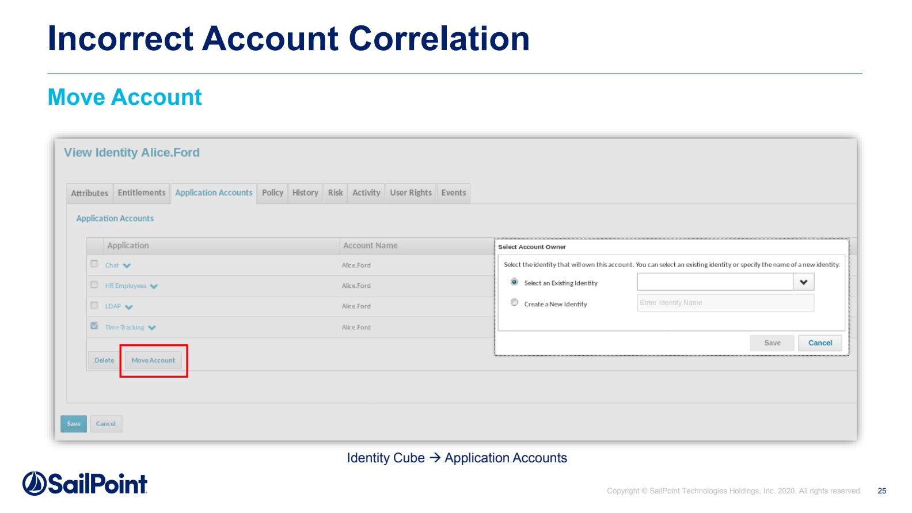

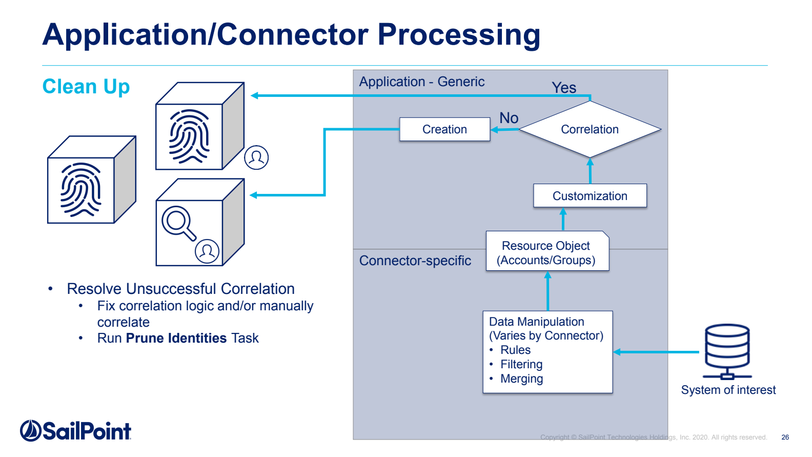

### Related practice and source pages

[Exercise 1.5 — Define LDAP Application](practice-companion.html#practice-1-5) · [Exercise 2.3 — Uncorrelated Accounts and Data Maintenance](practice-companion.html#practice-2-3)

## 13. IdentityIQ Connectors

### Connector code and application configuration

A connector is the software component that reads or writes a resource and presents normalized resource objects. An Application is the configured representation of a particular resource: its connector selection, connection details, schemas and other settings. Two applications can use the same connector with different configurations.

Schemas, resource-object concepts and application-level rule locations are broadly consistent. Connection properties, connector-level rule opportunities and support for one or several group types vary. Read capability does not automatically prove that every provisioning operation is implemented.

### Common connector patterns

The Delimited File example reads accounts and entitlements from a defined file and schema, with optional filtering, merging and rules. JDBC reads database information using connection details and SQL queries; its write behavior in the course requires a JDBC provisioning rule.

LDAP supplies a directory schema and needs connection credentials and search DNs. The Active Directory example adds its version-specific IQService requirement for provisioning. Web Services connects through target URLs and supported operations. These details describe the course's implementations; consult the exact connector documentation before applying them to another release.

The IdentityIQ Loopback Connector treats identities as accounts and workgroups/capabilities as entitlements, allowing governance concepts to apply to IdentityIQ's own access model. SQL Loader presents delimited data through a database-style table model. Neither should be confused with a generic claim that every connector behaves identically.

### Exercise connection

Section 2 onboards Time Tracking, Chat, Finance and other business applications. It then builds a Sequential Task Launcher for ordered aggregation and refresh work, schedules the sequence, compares task results and constrains a refresh to selected identities. This demonstrates the dependency between reading accounts and calculating their identity-level effects.

### Related practice and source pages

[Exercise 1.5 — Define LDAP Application](practice-companion.html#practice-1-5) · [Section Two — overview and contents](practice-companion.html#practice-section-2) · [Exercise 2.1 — Define Business Applications](practice-companion.html#practice-2-1) · [Exercise 2.2 — Aggregation and Refresh Tasks](practice-companion.html#practice-2-2)

## 14. Data Oversight

### Verify data before and after loading

Use schema Preview to inspect account and group data before a full aggregation. The Console's connectorDebug commands test connectivity, iterate native accounts or groups and, where supported, test pass-through authentication. Iteration is a diagnostic read; it is not the same as loading all those objects into IdentityIQ.

After aggregation, inspect the application, Entitlement Catalog and Identity Cube. Check the account's actual ownership and access fields rather than relying only on a successful task status.

### Make catalog data useful

Entitlement governance depends on meaningful metadata. The lesson highlights display names, descriptions, optional translations, owners, requestability and extended attributes. The UI supports individual edits; export/edit/import supports controlled bulk updates. Preserve the identity of each catalog object when editing its metadata.

Advanced Analytics provides identity, account and entitlement queries. Results can be viewed, exported or reused as reports. The report catalog includes application statistics/configuration, identity data, roles, compliance, administration and request-process reporting. Choose the view that answers the actual question: a person's accounts, the definition of an entitlement, and the number of uncorrelated accounts are different questions.

### Exercise 2.3 study sequence

Run the Uncorrelated Accounts report, inspect the exceptions and compare them to authoritative identity data. Manually correlate only after establishing the intended owner. Run the prune task to remove the resulting empty cubes, then verify the Identity Warehouse again.

For catalog maintenance, export the Finance entitlements, update the intended display names and owners, import the result, and verify the UI. The original practice pages preserve the exact fields and example records; no catalog changes were performed while building these notes.

### Related practice and source pages

[Section Two — overview and contents](practice-companion.html#practice-section-2) · [Exercise 2.3 — Uncorrelated Accounts and Data Maintenance](practice-companion.html#practice-2-3)

## 15. System Oversight

### Keep background operations healthy

Tasks aggregate data, refresh identities, run rules, move certifications through their lifecycle, check remediations and prune or archive old objects. A Sequential Task Launcher coordinates ordered tasks. Reliable recurring execution is part of system health, not merely an installation-time concern.

### Distinguish optimization strategies

Ordinary IdentityIQ aggregation optimization still reads every account but avoids processing unchanged ones. Disabling that optimization processes every read account. Connector-based delta aggregation reads only changes after a connector-specific benchmark and is not universally available. A custom changed-record file is another pattern; because it omits unchanged accounts, it must not be interpreted as the entire source for deletion detection.

Partitioning divides suitable aggregation work. The slide gives version-specific guidance about connector support, partition limits and loss limits; the retained diagram is the reference for those course values.

### Tune refresh around its purpose

Separate frequent attribute/role/provisioning calculations from less-frequent policy and risk work when appropriate. Delta refresh processes identities marked as changed; other filters or timestamps can target the work. Multi-threading uses multiple threads on one server, while partitioning can distribute work across servers.

The maintenance slide lists scheduled jobs for core maintenance, expired mitigations, sunset notifications, expired work items and identity-request completion. These are distinct responsibilities: a finished connector action does not by itself prove that a request's maintenance-driven status has advanced.

### Observe tasks and the environment

The Administrator Console provides active, scheduled and completed task views, execution statistics and environment information. The course identifies System Administrator or FullAccessAdminConsole capability for its full console access. Environment views help separate application status, host configuration and installed-module information.

Exercise 3.1 tests delta refresh, runs a rule through a task, inspects the maintenance schedule, configures failure notification and observes task/maintenance-window behavior. It intentionally stops a training service for testing; those disruptive VM actions are documented only, not performed here.

### Related practice and source pages

[Exercise 2.2 — Aggregation and Refresh Tasks](practice-companion.html#practice-2-2) · [Section Three — overview and contents](practice-companion.html#practice-section-3) · [Exercise 3.1 — Task Management Options](practice-companion.html#practice-3-1)

## 16. Logging

### Choose the record that answers the question

The course distinguishes application logging, standard output, redirected email, audit events and Syslog incidents. They capture different evidence. A missing notification, an access-request audit event and a Java exception should not all be investigated through the same screen.

Standard-output print statements can help a quick training test, but the course discourages them for production diagnostics because they print without the structured logger controls. Application logging instead uses named loggers and severity levels.

### Configure application logging deliberately

The course's Log4j configuration is in `WEB-INF/classes/log4j2.properties`. It illustrates root and class-specific loggers, output-file settings and levels such as ERROR, WARN, INFO, DEBUG and TRACE. More detailed levels produce more output; enable a relevant class while investigating rather than treating maximum verbosity as a permanent operating state.

The reload example shows periodic configuration checking and a Debug Pages control to force a reload. These are observations about the course build, not guaranteed timing for another deployment.

### Email, audit and incident information

Development email redirection sends notifications to a file or a designated recipient so their content can be inspected. Audit Configuration selects the business/system actions recorded; Advanced Analytics searches those audit entries. When the UI gives an incident code, Syslog Search can retrieve its details. Syslog retention is configured separately from the application log file.

Exercise 3.2 changes trace/debug settings for the refresh executor, runs the same task and compares the output. It also examines Rapid Setup loggers. The learning objective is to connect an operation, its relevant logger and the resulting evidence, then return to suitable logging levels. No logger configuration was changed in a live tenant while preparing this material.

### Related practice and source pages

[Section Three — overview and contents](practice-companion.html#practice-section-3) · [Exercise 3.2 — Explore Log4j](practice-companion.html#practice-3-2)

## 17. Troubleshooting

### Work methodically across the environment

The lesson emphasizes detailed observations, product familiarity, repeatable tests and changing one variable at a time. The database, Java runtime, application server, network and connected systems all participate in IdentityIQ behavior. A failed operation is not automatically a defect in IdentityIQ code.

Record the expected result, actual result, affected object and time. Reproduce the smallest useful example, inspect the relevant evidence and validate a single change. This study sequence synthesizes the troubleshooting principles on the original slide.

### Console and XML objects

The IdentityIQ Console connects to the database independently of the browser UI. Its commands can list/count objects, retrieve their XML, run rules or tasks, test connectors and export/import definitions. The lesson presents authentication behavior specific to its training build; the notes do not recommend relying on an initial default administrator credential.

Checkout/export/import operate on object definitions. When moving definitions between instances, the course highlights clean exports and the import `noid` option to avoid carrying instance-specific identifiers and timestamps as though they were portable business configuration. Use the appropriate command syntax from the guide rather than guessing from an abbreviated example.

### Debug Pages

The course's administrator-only Debug Pages expose the object browser, system information, memory and threads, cache-related functions, call timings, logging reload and database-connection information. Object XML is powerful: a screen that can view an object may also allow a modification or deletion.

Exercise 3.3 examines these views, creates a separately named training rule from an existing definition, tests it, and explores Console help and object export/import. Its deletion demonstration first cancels a UI deletion before later using the Console exercise command. These instructions are preserved as study material; no object was modified, deleted or run on the user's systems.

### Related practice and source pages

[Section Three — overview and contents](practice-companion.html#practice-section-3) · [Exercise 3.3 — Debug and Console](practice-companion.html#practice-3-3) · [Appendix — synonyms, Linux, installation and lab tools](practice-companion.html#practice-appendix)

## 18. Introduction to Policies

### Express access-related business constraints

IdentityIQ policies describe combinations or conditions the business considers inappropriate. The example prohibits holding both vendor-approval and vendor-payment access. Other examples include conflicting responsibilities or an unexpected number of accounts. Policy conditions can use identity/application data, risk scores, roles and entitlements.

### Detective and preventive evaluation

Detective checking evaluates existing access. A configured identity refresh compares the identity's access picture to the active policy definitions and produces violations, which can be routed for allowance or remediation. The relevant refresh options control checking and whether earlier findings are retained.

Preventive evaluation examines the proposed access in a request process. The illustration considers a request for Approver while the identity already has Super on Payroll. Whether the process blocks, allows correction, requires approval or otherwise responds depends on its configured workflow behavior. Detecting a violation and deciding its treatment are separate steps.

### Exercise 3.4 study sequence

Define the Accounts Payable / Accounts Receivable entitlement SoD policy, configure its rule and recipients, and run a simulation before enabling the operational check. Review the simulation's Task Results, activate the intended policy/rule, run the appropriate refresh and inspect the violation, work item and notification evidence.

If the expected finding is absent, verify that both the policy and its rule are enabled, that the correct identity/access data exists and that the checking task ran with the intended options. The practice companion preserves the exact training policy settings; no policy or remediation was submitted here.

### Related practice and source pages

[Section Three — overview and contents](practice-companion.html#practice-section-3) · [Exercise 3.4 — Define Policies](practice-companion.html#practice-3-4)

## 19. Introduction to Certification

### Campaign, access review and review detail

Access certification is a controlled review of identity access, role membership/composition or account-group membership/permissions. It supports business oversight and the organization's compliance obligations. The course distinguishes the technical team's responsibility for understanding the mechanism and extension rules from the compliance team's ongoing campaign operation.

A **certification campaign** defines the scope, timing and reviewers. It comprises one or more **access reviews**, each containing access data collected at generation and routed to its reviewer. Review details are the individual items on which decisions are made. A campaign is therefore not simply a live search that changes whenever a target account changes.

### Lifecycle and extension points

The timeline shows generation, optional staging, active review, any configured challenge period and revocation handling. Certifiers make decisions; revokers fulfill the removals. Configuration can provide exclusion, pre-delegation, sign-off, period-entry/closing and escalation rules. Certifications can start manually, on a recurring schedule or through a relevant data-change event.

The slides also show AI recommendation and demonstration screens. Their retained illustrations preserve what the handout contains; video-only decision commentary and changing screens have not been reconstructed for this edition.

### Exercise 3.5 study sequence

Generate the targeted Finance certification in a staged state, inspect its scope and assignments, then activate it. Reviewers inspect account/entitlement details, save their decisions and complete sign-off. A shared workgroup review illustrates how another authorized member can continue the work and how self-review constraints affect decisions. Finally, observe maintenance-driven changes in review status.

These are learning instructions, not a completed access review or certification exam attempt. The original exercise pages retain their training scenarios and prompts; the study prose does not substitute an answer key.

### Related practice and source pages

[Section Three — overview and contents](practice-companion.html#practice-section-3) · [Exercise 3.5 — Certify Access](practice-companion.html#practice-3-5)

## 20. Introduction to Roles

### Model access at business and technical levels

A role groups access into a meaningful unit. The default two-tier model separates **business roles**, reflecting responsibilities and assignment/request choices, from **IT roles**, whose profiles describe entitlement sets detected on identities. The Finance/Treasury illustration shows business responsibilities sharing technical access components.

A required relationship means the associated IT access belongs with the business role. A permitted relationship makes an IT role an allowed additional choice that still must be requested; it is not automatically provisioned simply because it is permitted.

### Assignment, detection and provisioning

The identity-refresh option for assigned/detected roles evaluates business-role assignment logic and IT-role profiles. Provision assignments and deprovisioning controls determine additional effects. A role being detected from existing access is conceptually different from a business role being assigned and then causing access changes.

The automated example changes an HR attribute, refreshes the identity and provisions the business-role access. In the depicted assigned-role path, no request approval is required. That example should not be generalized to every custom role workflow.

### Birthright roles

Rapid Setup birthright roles supply baseline access during joiner processing. The course describes them as a single-tier, non-requestable model assigned during the joiner event. Business roles, by contrast, can support continuing team/department/project needs, refresh-based assignment and the two-tier required/permitted relationships.

Exercise 3.6 imports and inspects business/IT roles, refreshes assignment/detection, checks provisioning evidence and the resulting cube, and defines birthright roles for later joiner exercises. It also distinguishes role definitions from the actual entitlements held on target accounts.

### Related practice and source pages

[Section Three — overview and contents](practice-companion.html#practice-section-3) · [Exercise 3.6 — Business, IT and Birthright Roles](practice-companion.html#practice-3-6)

## 21. Provisioning Overview

### What triggers a change

Provisioning adds, modifies or removes identity/access data. Requests can originate from users, managers, help-desk operations, lifecycle changes, policy remediation or certification decisions. Those entry points should feed the intended business controls rather than each implementing an unrelated fulfillment path.

The course describes three channels: direct automated connector operations, integration with a third-party fulfillment system, and manual work items. An application can be configured for manual fulfillment even while account data is read through a connector; the JDBC example illustrates a case where write logic is not fully supplied.

### Understand the plan before fulfillment

The provisioning engine expands the requested access into needed account/entitlement changes, filters against existing access and chooses an appropriate channel. A business-role request is therefore not always a one-line target-system operation. It may imply several entitlements or a new account before the requested permission can exist.

### Supply the required values

Provisioning policies define values for account create/update/delete and other supported operations. A field can be static, calculated from identity data or collected through a form. The Bug Tracking example derives first name, last name and login while supplying application-specific status values. Create-account policies are particularly important because missing required account data can prevent fulfillment.

JDBC provisioning additionally requires the actual provisioning rule; a populated form alone does not implement database writes. Account dependencies can sequence a prerequisite account and reuse relevant attributes from a master application, within the supported direct-connector path described in the course.

Exercise 4.1 reviews and updates LDAP's create-account policy, adds fields and value calculations, imports other policies, attaches the JDBC rules and studies dependencies. Its original form screenshots and training scripts remain beside the related practice instructions.

### Related practice and source pages

[Section Four — overview and contents](practice-companion.html#practice-section-4) · [Exercise 4.1 — Prepare Applications for Provisioning](practice-companion.html#practice-4-1)

## 22. Monitoring Provisioning

### Transaction and workflow evidence

The Administrator Console's Provisioning view records target-operation results and, where configured, retryable failures. Its actions can force a retry or convert an automated transaction into a manual work item. A retry action and an override change the fulfillment process; they are not read-only status views and were not executed here.

Transaction logging has separate level and retention settings. The course shows Success, Retry and Failure levels and a default of Failure for its build. A missing success row can reflect logging configuration rather than proof that nothing occurred.

### WorkflowCase versus WorkItem

A **WorkflowCase** represents an executing workflow instance. It records context such as launcher, target, workflow copy and current step and exists until that workflow completes. A **WorkItem** represents input needed from a person, such as an approval, manual provisioning action, data request or delegated review; it exists until that input is resolved.

These objects answer different questions. A request can be waiting for an approval work item before any connector write is attempted. A completed approval does not establish that provisioning succeeded. A vanished completed WorkflowCase does not mean the long-term request/audit history must be absent.

Use Track My Requests, transaction evidence, work-item state and target-account verification together. Later access-request exercises intentionally cause an LDAP retry, restore the training service, retry the operation and inspect request maintenance. That exercise demonstrates the difference between approval, target fulfillment and final request status.

### Related practice and source pages

[Exercise 4.5 — Test Access Requests and Attachments](practice-companion.html#practice-4-5)

## 23. Rapid Setup Lifecycle Events

### Detect a business transition and select its response

Joiners enter the organization, movers change responsibilities or reporting context, and leavers leave. The diagram connects aggregated source changes and refresh event processing with lifecycle workflows; UI-created/edited identities can also enter configured event paths.

Prepare the supporting roles, populations, workgroups and email templates, then define application-specific actions and global triggers/behavior. A trigger without the intended actions is incomplete, and actions without correctly limited eligibility can affect the wrong identities.

### Joiner

Configure eligible identity sources, normally authoritative applications. Joiner processing can assign birthright roles or create application accounts without a role-based entitlement request. Per-application instructions and password-related notification content complement global approval, workflow, recipient and template settings.

Trigger filters further constrain eligible identities. The course also shows controls for IdentityIQ-created identities and uncorrelated identities. Their scope matters when the system contains records that should not be treated as ordinary new employees.

### Mover

Mover criteria can monitor manager, department or job-title changes, a designated flag, or a targeted combination such as region plus a job change. Responses include generating a manager access review and reprocessing selected joiner logic. Certification staging, owner, backup certifier and previous-manager participation are separate controls; per-application settings decide which access appears in that review.

### Leaver

Leaver criteria can detect inactive changing from false to true or another defined flag. Global actions include removing assigned roles, reassigning owned artifacts and service/bot identities, approval and notifications. Application actions can disable/delete accounts, remove selected entitlements, scramble passwords or perform supported directory moves. Some actions can be delayed.

Password scrambling must produce values the target application's password policy accepts. Disabling an account, removing entitlements and deleting an account have different consequences; the course presents them as configurable operations rather than synonyms.

Exercises 4.2 and 4.3 configure joiner/mover behavior, introduce sample changes and verify requests, transactions, identities, certifications, audits and email output. Exercise 4.9 later tests the leaver path.

### Related practice and source pages

[Section Four — overview and contents](practice-companion.html#practice-section-4) · [Exercise 4.2 — Joiner Lifecycle Event](practice-companion.html#practice-4-2) · [Exercise 4.3 — Mover Lifecycle Event](practice-companion.html#practice-4-3) · [Exercise 4.9 — Leaver and Immediate Termination](practice-companion.html#practice-4-9)

## 24. Lifecycle Event Configuration

### Standard and Rapid Setup definitions

Setup → Lifecycle Events provides the standard configuration view. A custom definition supplies its name, monitored change, processing workflow and included-identity criteria. The included-identities filter narrows the population; the event definition identifies the change within that intended population.

Rapid Setup events also appear in the lifecycle-event administration area. The simplified configuration framework does not remove the underlying event/workflow model. The original screens distinguish those generated definitions from an independently configured custom event.

### Observe the event through more than one view

Track My Requests can show lifecycle processing when the workflow supplies request tracking; the course says the Rapid Setup workflows do. Advanced Analytics Audit and the identity's event details provide additional evidence. Do not assume a custom workflow automatically writes the same tracking information as a supplied Rapid Setup workflow.

When verifying an example, establish the triggering source/UI change, whether refresh processed events, which workflow ran, whether approvals or manual work remain, and what the application finally contains. A matching trigger alone is not a completed joiner or leaver.

The joiner/mover/leaver practice sections demonstrate this verification pattern using the original training configurations. No event was triggered in the user's VM while preparing the book.

### Related practice and source pages

[Exercise 4.2 — Joiner Lifecycle Event](practice-companion.html#practice-4-2) · [Exercise 4.3 — Mover Lifecycle Event](practice-companion.html#practice-4-3)

## 25. Lifecycle Manager Requests

### Separate requester, requestee and requested item

A request has three distinct subjects: the person submitting it, the identity whose access will change, and the access or operation requested. Configuration must answer **who can request what for whom**, then select the business process that will fulfill it.

The process diagram begins with requester/requestee filtering, then selection and submission, a provisioning plan and workflow, policy/approval/data collection, and the provisioning engine. The Quicklink menu and cards expose entry points for access, accounts, passwords and identity operations; visibility of a menu item is only one part of the authorization design.

### Quicklink populations

A Quicklink Population defines eligible requesters, permitted target identities and enabled request actions. The course's examples distinguish help-desk personnel, managers acting for reports and self-service users acting for themselves. Custom membership can use attributes, capabilities, workgroups, account data, saved populations, scripts or rules. Access is cumulative across the populations that apply to a user.

A population's requestees can be everyone or a filtered set, including reporting relationships or shared attributes. The requester population and the target population are not interchangeable.

### Filter the particular access items

Object-filtering rules can constrain available roles, entitlements or applications using requester and requestee context. Revocation can have its own filters. The security-level example compares a requestee's level against each access item's required level, resulting in different choices for different target identities.

When testing these controls, change one dimension at a time: the requester, the target and then the access item. Otherwise a successful request does not reveal which policy actually allowed it. Exercise 4.4 applies these controls to the supplied populations and Quicklinks.

### Related practice and source pages

[Section Four — overview and contents](practice-companion.html#practice-section-4) · [Exercise 4.4 — Configure Access Requests](practice-companion.html#practice-4-4)

## 26. Manage User Access

### Make access available intentionally

Manage User Access supports role and entitlement requests for the identities permitted by the relevant Quicklink configuration. The Entitlement Catalog's requestability indicator is one control. The course contrasts its standard default with Rapid Setup choices and rules that set values during promotion or group aggregation.

Role-type filtering is separate. The slide example allows different role types in self-service and requests for others. A role or entitlement existing in the catalog does not by itself establish that a particular requester can select it for a particular person.

### Search, display and submit

UIConfig entries control columns on add/remove-access pages. The handout identifies role and entitlement column keys separately. Search can use full text, keyword filters and searchable extended attributes. Affinity search looks for access associated with matching identities/populations and is available in the course's requests-for-others path; its permitted identity search fields have a separate UIConfig entry.

After review and submission, the business process handles policy evaluation, approvals and information collection. The illustration of Catherine requesting for three employees shows a WorkflowCase per target identity, rather than one undifferentiated workflow for the whole group.

### Approval and completion evidence

The supplied LCM Provisioning workflow uses configured approval variables/rules; the slide identifies object-owner approval as its default example. A custom workflow's approvers depend on its design. Track My Requests shows approval, provisioning and error information for requests by or for the user; administrators can inspect a broader set.

Exercise 4.5 tests a VPN entitlement request, follows manager/owner approvals, verifies target LDAP membership and observes request maintenance. Its later tests cause a retryable outage and a preventive-policy conflict. These checks distinguish what was selected, what was approved, what was provisioned and what was confirmed.

### Related practice and source pages

[Section Four — overview and contents](practice-companion.html#practice-section-4) · [Exercise 4.4 — Configure Access Requests](practice-companion.html#practice-4-4) · [Exercise 4.5 — Test Access Requests and Attachments](practice-companion.html#practice-4-5)

## 27. Additional Access Request Options

### Attach evidence to a request

Attachments let a request carry supporting material for the requester, requestee, approver and administrator. The course describes configurable file types and rules requiring evidence, with version-specific limits of 20 MB, ten attachments and a single-user request. Those limits are recorded as course context, not verified current product limits.

Enabling attachments and allowing particular file types is only configuration; testing must also establish that the intended approver can find and read the attachment in the request/approval view.

### Distinguish assignment dates from role availability

Sunrise/sunset on an assignment sets when that person's role or entitlement access should begin and end. The illustrated request stores the dates for later processing. Separately, scheduled role activation controls when a role itself is enabled or disabled. The warehouse-clerk illustration demonstrates this second concept.

The corresponding controls therefore operate at different levels. A future start date is not proof that access was already granted, and a role's availability schedule is not the same as every holder's assignment end date.

### Recommendations and practice

The handout shows IdentityAI guidance for an approver. Recommendation information supports a review decision; the actual approval path remains the configured business process. Video-only explanation for this demonstration has not been reconstructed.

The related exercises update entitlement descriptions/requestability, clone and configure the request workflow, adjust Quicklink access, test preventive policy checks and optional permitted IT roles, and enable PDF attachment evidence. Test the request and approver experiences separately. The practice companion preserves the exact original settings and screenshots.

### Related practice and source pages

[Section Four — overview and contents](practice-companion.html#practice-section-4) · [Exercise 4.4 — Configure Access Requests](practice-companion.html#practice-4-4) · [Exercise 4.5 — Test Access Requests and Attachments](practice-companion.html#practice-4-5)

## 28. Other Lifecycle Manager Requests

### Account, password and identity operations

The remaining Quicklinks manage connected accounts/passwords or IdentityIQ identity records. The course says these request paths act on one requestee at a time. A requester allowed to perform an action sees eligible identity cards; the identity-details menu can expose related operations based on the applicable permissions.

The slide distinguishes Quicklink Population controls from additional rights/capabilities for certain menu functions. Do not infer that all links in an identity-details menu use the same authorization mechanism.

### Manage Accounts

Depending on application and Quicklink configuration, users can request a first or additional account, or enable, disable, unlock and delete an existing account. New-account permission, additional-account permission and management of existing accounts are separate choices. Connector and provisioning-policy support still determine whether the requested operation can be fulfilled.

### Create, edit and view identities

Create Identity presents a form to an existing IdentityIQ requester. Self-service registration is a separate path for someone without an existing identity and is disabled by default in the course. A default or custom form supplies the data.

Edit Identity can expose read-only, temporary or permanent behavior as configured. View Identity's displayed fields are controlled through the indicated UIConfig entry. Identity provisioning policies define the create/edit form and value logic; they should not be confused with account provisioning policies on an external application.

The lesson's slide preview calls its practice “Section 4, Exercise 6,” while the supplied 8.2b guide numbers the Create Identity exercise **4.7**. This book preserves that discrepancy and links to the guide's actual PDF pages 220–225 rather than inventing a missing exercise number.

### Related practice and source pages

[Section Four — overview and contents](practice-companion.html#practice-section-4) · [Exercise 4.7 — Create Identity Provisioning Policy](practice-companion.html#practice-4-7)

## 29. Automated Provisioning

### Attribute synchronization

Source mappings read data into an identity attribute; target mappings propagate an identity value to an application's account attribute. The phone/email examples show why these directions must be distinguished. A target mapping can specify a transformation rule and how to handle identities with multiple accounts.

The course describes two operating paths: an appropriate Edit Identity operation can invoke synchronization immediately, while an aggregated source change is followed by an Identity Refresh configured with Synchronize attributes. A changed cube value is therefore not sufficient evidence that target accounts have already changed.

### Password interception

A password-interceptor client detects supported native password changes and forwards the event to IdentityIQ. A configured password-intercept workflow then updates selected supported applications. The course's Active Directory diagram calls for client deployment on every relevant domain controller; other supported systems are listed on its slide.

The client installation and password handling are distinct from merely enabling a Quicklink. The external Password Interceptor guide is referenced but not independently archived here, and no interceptor was installed.

### Native change detection

A native change is discovered on an application's account during aggregation outside the expected IdentityIQ-managed process. Responses can include a certification event or a lifecycle workflow for notification/approval. Configure detection on the application and the corresponding lifecycle event, aggregate to mark changes, then refresh with Process Events to run the response.

The lesson advises establishing a baseline before enabling detection and processing changes regularly. It also cautions against using unexpected-change monitoring where native changes are normal. Otherwise ordinary activity can overwhelm the intended exception process.

Exercise 4.8 adds Email target mappings, examines the source and target account values, runs synchronization and checks the manual fulfillment work item for file-based sources. It demonstrates that synchronization can legitimately use a manual channel rather than a direct connector write.

### Related practice and source pages

[Section Four — overview and contents](practice-companion.html#practice-section-4) · [Exercise 4.8 — Attribute Synchronization](practice-companion.html#practice-4-8)

## 30. Other Provisioning Requests

### Govern account-group changes

Where supported, application-group provisioning creates groups or updates their definitions through configured create/update policies and a workflow. The example starts from the Entitlement Catalog and identifies an Application Administrator capability requirement. Creating a group is distinct from granting one user's membership in that group.

### Batch requests

Batch Requests support multiple identity/account/access changes through a delimited upload. Each row identifies an operation and its target data. The handout lists identity create/modify, account create/delete/enable/disable/unlock, role and entitlement add/remove, and password operations. It identifies the relevant administrator capabilities and the Setup → Batch Requests entry point for its release.

This is a request mechanism supplemental to aggregation, not an invitation to treat a bulk upload as a source-of-record replacement. Validate the operation names, target identities and field values against the documented format before a real execution. No file was uploaded to IdentityIQ for this book.

### Immediate identity termination

Rapid Setup Identity Operations can initiate termination independently of waiting for an HR-driven leaver transition. Global controls cover identity-internal reassignment, roles, approvals, notification and process logic. Per-application controls cover disabling/deleting accounts, password scrambling, entitlement removal and supported directory moves, with immediate or delayed timing.

The lesson identifies specific capabilities for these operations. Exercise 4.9 separately configures and tests the normal leaver path and immediate termination. Its study validation compares pre-change accounts/roles to resulting requests, transactions, audits, emails and target state. This book records the procedure but does not terminate any identity or remove any access.

### Related practice and source pages

[Section Four — overview and contents](practice-companion.html#practice-section-4) · [Exercise 4.9 — Leaver and Immediate Termination](practice-companion.html#practice-4-9)

## 31. System Architecture and Deployment

### Progress from a lab to a resilient topology

The simplest illustration puts application and database components on one host. The next separates application execution from database storage. A larger design uses several application servers, a load balancer with session affinity, and dedicated batch processing alongside interactive UI hosts.

Host roles come from how traffic and background services are assigned, not simply a server's name. The course shows task/request service host assignments for batch work and load-balancer routing for UI work. Tasks, reports, workflows and certification generation compete differently with interactive requests and reviews.

### Availability and locality

Further diagrams show disaster-recovery replication and database clustering as architectural options. Redundant application servers and database resilience address different failure modes.

The application-to-database connection is performance-critical. The slide gives very low round-trip latency targets and argues for close data-center placement rather than a WAN-separated database. Those numbers belong to the source course version; the general lesson is that a fast user-facing network cannot compensate for a slow database path.

### Hosting and operating responsibility

The course distinguishes an organization-managed data center, an organization-managed public-cloud deployment and a provider-managed cloud service. Its managed-service slide lists examples such as IdentityIQ upgrades/patches and infrastructure monitoring. Actual service responsibilities depend on the contracted offering; the course diagram does not establish the user's current entitlements.

No new environment was deployed. Use these diagrams to identify which team owns each runtime, database, network path and recovery process before taking the lab design into production.

### Related practice and source pages

[Appendix — synonyms, Linux, installation and lab tools](practice-companion.html#practice-appendix)

## 32. Deployment Process Management

### Separate development, validation and production

A developer sandbox supports isolated work with a small representative data set. A shared development environment tests integrated changes. Staging/UAT resembles production and supports functional, acceptance and performance validation. Production adds its availability and failover requirements.

The environment-management illustration places version control and a repeatable build between individual development and deployment. Moving directly from a manually edited sandbox to production skips the opportunity to reproduce, review and validate the same configuration.

### Package configuration repeatably

The course introduces Services Standard Build, an Ant-based approach used to package custom objects and code and replace environment-specific tokens. It can be used directly or as a model for a controlled build process. This is a reference to the course's tooling, not a claim that a current release of that external package has been downloaded or tested.

A useful deployment record ties an exact source version to its built artifact, target environment, configuration values, validation results and rollback approach. This is a study application of the slide's version-control/build/deploy model. No production configuration or repository deployment pipeline was changed while preparing the book.

### Related practice and source pages

[Appendix — synonyms, Linux, installation and lab tools](practice-companion.html#practice-appendix)

## 33. Getting Help

### Match the question to the resource

The lesson describes Compass as the customer/partner community for discussions, downloads, whitepapers and product knowledge, with Identity University providing training. These original names and links are retained as course context. The actual contents of linked sites and present-day program availability have not been independently archived by these notes.

For an unresolved product issue, the course identifies SailPoint Support. For additional implementation expertise it identifies Expert Services, and for coordination/advocacy it names the customer or partner success manager. A well-prepared question includes the release, affected feature, expected/actual behavior, a minimal reproduction and relevant diagnostic evidence from the operations modules.

### Continue from the foundation

The course's education map shows further study in Rules/Scripts/API, advanced provisioning/workflows, plugins, business administration and custom reports. It separately illustrates training-validation certifications. The chart's names, timings and certification model are historical course material; they do not establish current exam prerequisites, pricing or purchasing requirements.

Essentials study coverage now spans all 33 numbered modules, but reading this book does not complete the LMS, practical exercises or a certification exam. The broader Engineer path still has separate courses whose notes remain to be prepared.

### Related practice and source pages

[Appendix — synonyms, Linux, installation and lab tools](practice-companion.html#practice-appendix)
