# IdentityIQ Essentials

English study notes in the verified course order. This first Essentials batch covers **Modules 1–6 of 33**, followed by the related Exercise 1 preparation and configuration steps. Modules 7–33 are pending. The explanations below combine the accessible player caption-search text with the course's provided slides and the relevant exercise-guide pages. They are paraphrased for study, rather than a verbatim transcript.

**Version context:** the downloadable exercise guide identifies IdentityIQ 8.2, version 8.2b, copyright 2021. Presentation slides carry 2020 copyright notices and some installation examples refer to 8.1. These are the versions shown in the supplied course material, not a statement about today's supported products or deployment requirements. Original English slides and guide pages are retained as illustrations; the accompanying notes explain their meaning.

**Materials:** [original presentation handout](handouts/presentations.pdf), [original exercise guide](handouts/exercise-guide.pdf), and [precise coverage record](coverage.json). The complete handouts have been saved; only the pages relevant to this first batch have been incorporated into the notes. Saving a handout does not mean all its later modules have been studied or rewritten.

## 1. Course Overview

### Purpose and audience

Essentials prepares technical implementers, customer and partner teams, and system administrators to participate in IdentityIQ implementations and ongoing administration. It builds on IdentityIQ Introduction, moving from feature awareness into application configuration, data loading, governance, provisioning and diagnosis.

By the end of the course, learners are expected to define applications that read enterprise data and send changes back to connected systems; configure schemas and custom attributes; load identities, accounts and entitlements; and link accounts to the appropriate owners. They also learn to configure lifecycle automation and user access requests and to monitor their results.

The course introduces several tools with different purposes: the browser-based Administrator Console, Advanced Analytics, the command-line IdentityIQ Console, Debug pages, task results and logs. Knowing where a problem is occurring matters as much as knowing which configuration to change.

### Why this sequence matters

The lesson sequence follows an implementation dependency chain. Establish the platform, bring in authoritative identity information, organize identities, add other application accounts, and validate data. Governance and provisioning then operate on that foundation. Automating decisions before confirming the underlying identity and access data would automate the same data errors.

The simulated project has three broad stages:

1. **Build the identity and access picture.** Configure authoritative applications, aggregate data, map identity attributes and run refreshes. Organize identities by responsibility, grant the appropriate IdentityIQ capabilities, onboard additional applications and correlate their accounts.
2. **Improve control of the information.** Inspect data quality, oversee system operation, configure policies and certifications, and model access using roles.
3. **Manage changes.** Prepare applications for provisioning, configure joiner/mover/leaver behavior, allow appropriate user requests, and test both automated and request-driven changes.

System administration runs throughout these stages. Task scheduling, errors, audit events, log output and retention settings continue to matter after implementation.

### Learning environment and supporting material

The course supplies slides, exercise instructions and a Linux virtual machine. The guide's appendix includes a vocabulary cross-reference between business-facing names and internal object names, Linux command references, manual installation and patch instructions, and a Lab Reset tool reference.

The VM already has IdentityIQ installed. Manual installation is presented for understanding and optional later practice. Lab Reset can replace exercise state, return to a clean starting point or remove the training database; the notes record its purpose, but no reset or VM operation was performed during preparation.

**Source coverage:** the 6:39 Course Overview video's caption-search results were read. Its narration has been incorporated here. This module has no matching section in the provided presentation handout, which starts with Technical Overview. Video footage and original on-screen frames for Module 1 were not saved.

## 2. IdentityIQ Technical Overview

### The identity and application model

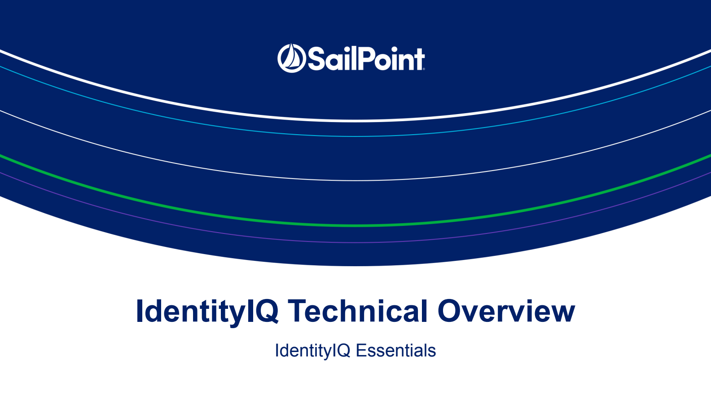

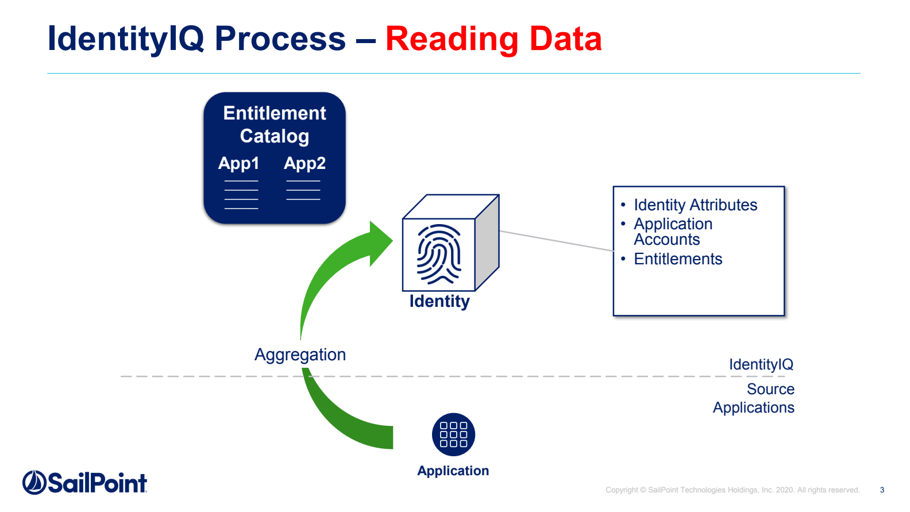

An **Identity Cube** represents a managed person. Reading information into IdentityIQ is **aggregation**, and a connected source is represented by an **Application** object. An authoritative application, or system of record, supplies the identities that IdentityIQ should manage. This might be HR, Active Directory or another appropriate source, depending on the organization's design.

An Identity Cube brings together two different kinds of information. **Identity attributes** describe the person, such as an identifier, name or email address. **Account attributes** describe that person's account on a particular application and follow that application's schema. An entitlement describes a right available through an account, such as permission to approve purchase orders.

As applications are aggregated, account and entitlement information is associated with the relevant Identity Cubes. Available access rights are also represented in the **Entitlement Catalog**, organized by application. The catalog describes the access that exists; an individual's Cube describes the access associated with that person.

### Business modeling

The data becomes useful for governance when the business defines what appropriate access looks like. Policies might prohibit a person from both approving and paying a vendor, or identify accounts unused for 180 days. These are examples from the course, rather than universal policy settings.

People can be grouped by their IdentityIQ responsibilities or enterprise access needs. A technical implementer and a business analyst may require different rights within IdentityIQ. Enterprise roles model responsibilities such as bank teller and group the permissions required for that job.

A risk model assigns numerical values to relevant access and other factors, producing a score that helps prioritize attention. Lifecycle-event definitions describe what counts as a joiner, mover or leaver and what should happen when such a change is detected.

### Aggregation, refresh and certification

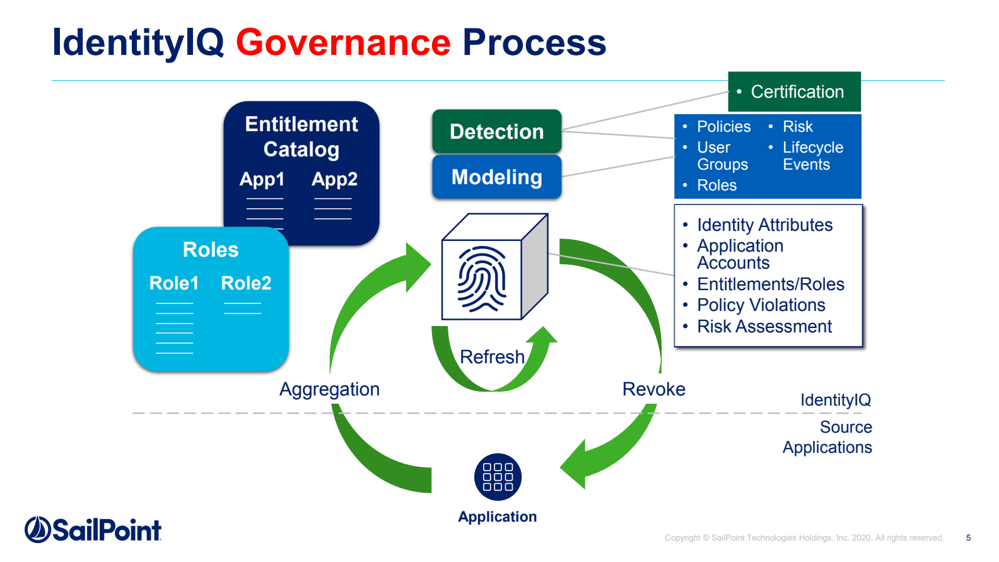

**Aggregation reads external information; refresh computes information about identities.** A refresh can evaluate policy violations, calculate risk, detect or assign roles, and process lifecycle events, according to its configuration. Aggregation and refresh are related operations with distinct responsibilities.

Certification asks an accountable reviewer, often a manager, whether a person's access is appropriate. The reviewer approves access that should remain or requests revocation. Policy remediation and certification decisions can lead to manual work items or automatic removal where the application's integration supports it and is configured accordingly.

### Request-driven provisioning

The narration's example is a request for the **Time Sheet Approver** entitlement. The user searches the access items they are allowed to request and submits the selection. A workflow handles the request, potentially collecting approvals and identifying policy violations before fulfillment.

If the request proceeds, IdentityIQ changes the target application through the configured provisioning path. Some integrations can execute the change automatically; others send a work item for a person to perform it. The desired access change and its actual implementation are separate facts.

IdentityIQ subsequently aggregates to confirm the target state. Depending on the connector, this can be a targeted read for the affected account or must wait for a later bulk aggregation. A refresh then recalculates the identity's picture using the newly observed information.

### Event-driven provisioning

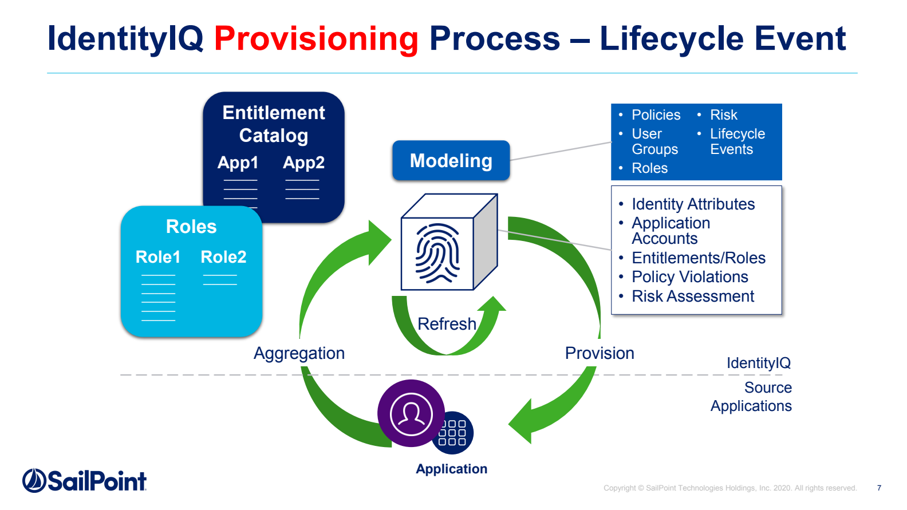

Requests are not the only trigger. When an employee is added to HR, aggregation can bring that person into IdentityIQ. The configured joiner-processing path can then provision the baseline, or **birthright**, accounts and entitlements that the employee needs. The business defines both the event criteria and the resulting access.

A useful study sequence is: **read → correlate and model → calculate → decide → change → confirm**. This is a reading aid summarizing the processes above, not an additional named product feature.

The handout ends this section with a Knowledge Check title slide. No assessment questions or answers are included here.

## 3. IdentityIQ Functional Elements

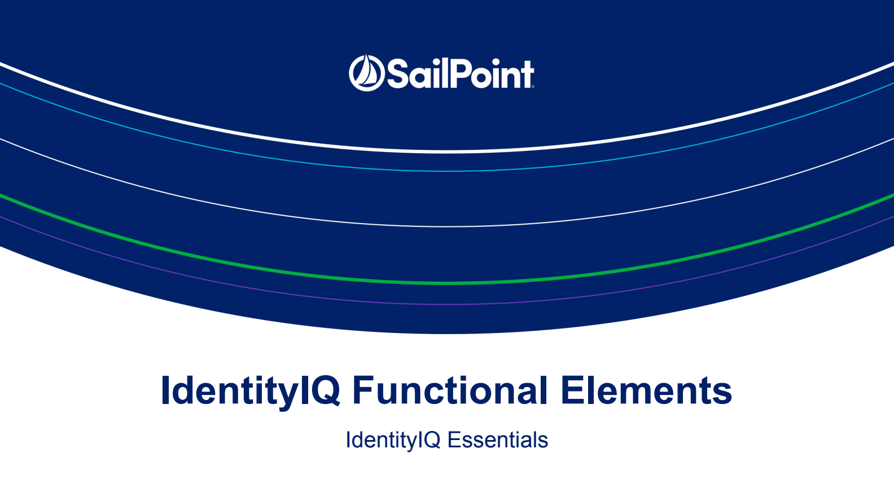

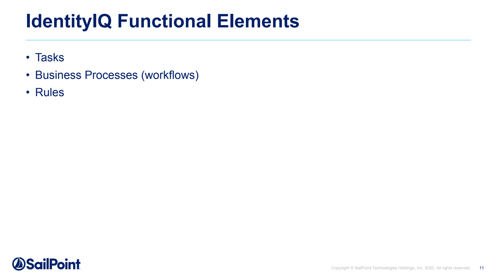

### Objects and the components that act on them

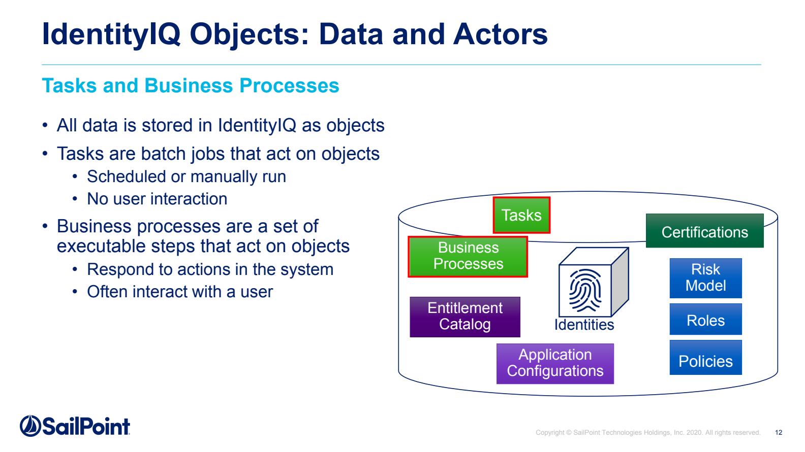

IdentityIQ uses an object-oriented model. Identities, roles, applications, certifications, tasks and workflows are represented as objects persisted in the database. The course emphasizes using object methods when writing code against IdentityIQ, rather than treating customization as direct manipulation of database tables.

Objects hold configuration or state. **Tasks** and **business processes** perform work against those objects. For example, an Application object describes how a source is configured; an aggregation task uses that definition to read the source. A provisioning business process coordinates the work required when a user requests access.

### Tasks

A task is a background or batch operation that runs without an interactive conversation with a user. A person can launch it manually or configure a schedule. Aggregation and identity refresh are typical examples.

IdentityIQ includes predefined tasks and task templates. The implementation team decides which tasks are required, configures existing definitions or creates additional ones, and selects appropriate schedules. The administrator checks that the tasks run when expected and investigates failures and errors. A configured schedule alone is not evidence of a successful run.

### Business processes and workflows

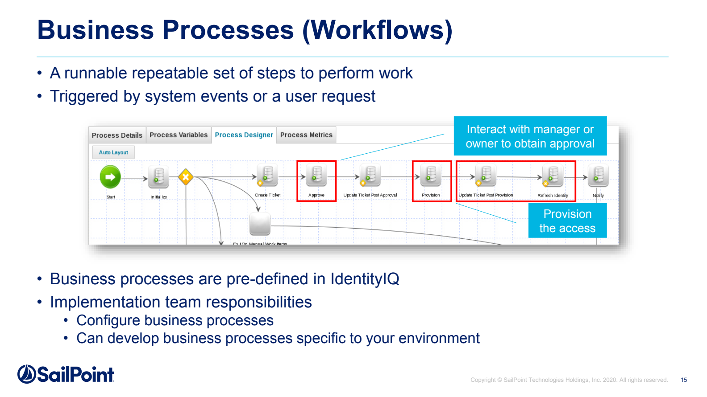

**Business process** and **workflow** refer to the same underlying concept. Business-facing screens generally use the former wording; implementation tools and object definitions often use the latter.

A workflow is an executable sequence of steps triggered by an event or request. Unlike a batch task, it often interacts with people to collect data or obtain approvals. In the illustrated provisioning example, the process obtains approval, provisions access, updates associated tickets and refreshes the identity.

Implementers commonly configure supplied workflows by setting variables and approver choices. Where necessary, they can change individual steps or replace a process with a custom workflow. This distinction matters when deciding whether a requirement needs configuration, workflow modification or another extension.

### Rules

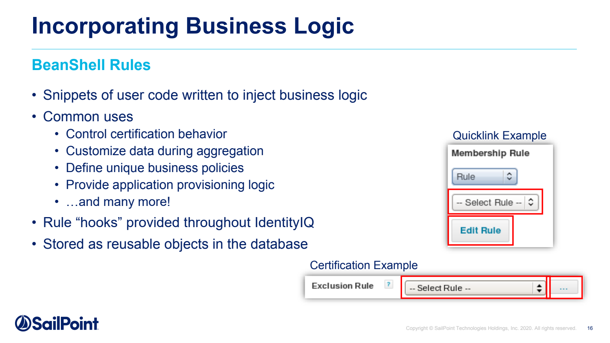

Rules insert organization-specific behavior at supported extension points. The course describes them as BeanShell code with Java-like syntax. Examples include changing certification inclusion, transforming aggregation data, implementing a policy condition or supplying application provisioning logic.

The narration illustrates a certification exclusion rule that omits executives. A rule is stored as its own reusable object, so appropriate certifications can reference the same logic. Rule-selection controls associate an existing rule with a supported hook, while the editor allows its logic to be defined.

Rules are optional: not every configuration requires custom code. The course's statement that there are more than 80 rule locations is a claim about its course version, not a verified current count.

### Compare the three elements

| Element | How it starts | Typical interaction | Course example |
| --- | --- | --- | --- |
| Task | Manual launch or schedule | Runs in the background | Aggregate accounts or refresh identities |
| Business process / workflow | System activity or user request | May collect information or approvals | Approve and fulfill an access request |
| Rule | Called at a configured extension point | Supplies custom logic to its caller | Exclude a category of identities from a certification |

## 4. IdentityIQ Implementation Overview

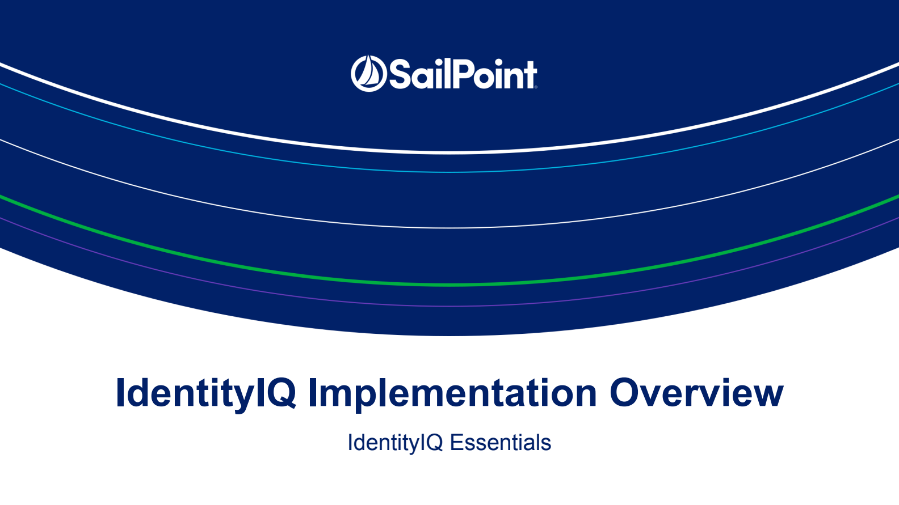

### Plan phased delivery and clean data

Two foundations apply across implementation projects: break the work into practical phases, and make the identity and access data reliable. An initial phase must include the authoritative information used to create identities, but the number of additional applications and features can be deliberately limited.

The course compares two rollout patterns. One customer starts with an authoritative application plus five business-critical applications and delivers birthright provisioning, then adds more applications in later phases. Another starts with authoritative data and Active Directory, establishes policy and certification controls, and adds provisioning afterward. These are illustrations of phased delivery, not prescribed project sizes.

Data quality affects both governance and automation. Incorrect entitlement data distorts policy findings, risk assessments and role analysis. Incorrect identity attributes can assign access to the wrong people: an employee inaccurately classified as Finance could receive a Finance role through automated logic.

### Configuration approaches

**Rapid Setup** groups common configuration choices into focused menus and supports scenarios such as onboarding and lifecycle handling. Its targeted permissions can let business analysts and data owners participate alongside technical staff. The course describes it as a core-product feature introduced in 8.1 and the preferred framework for the common scenarios it covers.

**Standard IdentityIQ configuration** provides the broader, more flexible settings used when the Rapid Setup options do not cover a requirement. It remains part of the implementation toolbox rather than a separate replacement product.

**Accelerator Pack** is the name used in the narration for an earlier extensibility-based approach to similar scenarios. It uses extended attributes and rule hooks and may therefore interact with an organization's other customizations. The supplied slide spells the name “Accelerator Park”; the notes retain the narration's wording while leaving the original illustration untouched. The course says existing implementations can continue using their framework; this is historical course context, not a current migration recommendation.

### The class implementation project

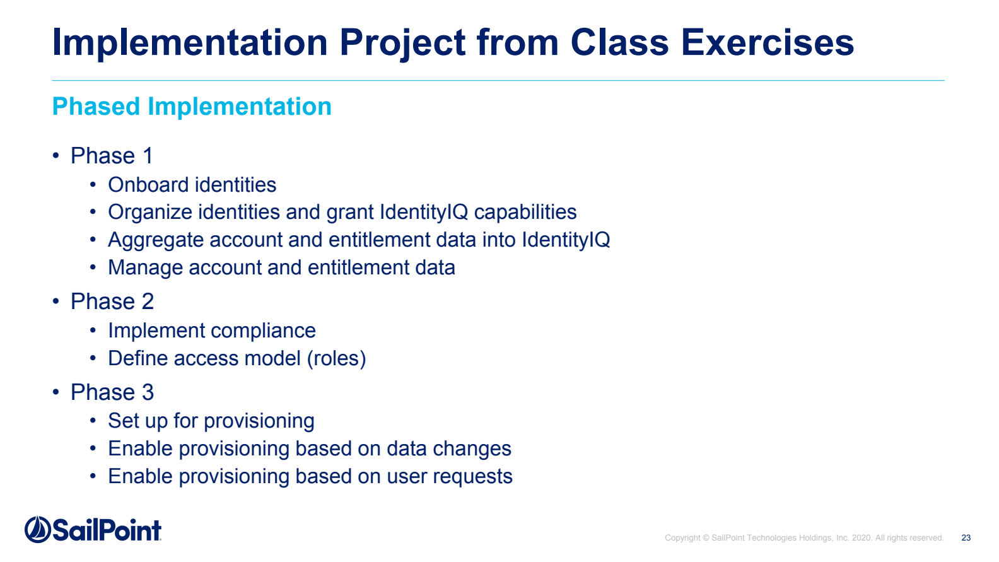

Phase 1 creates the identity foundation, organizes people and their IdentityIQ capabilities, loads other account and entitlement data, and checks its quality. The exercises use different implementer and analyst personas to demonstrate shared responsibilities.

Phase 2 introduces compliance functions and roles. Learners detect policy violations, configure a targeted access review and establish an access model that later supports provisioning.

Phase 3 prepares the applications for provisioning and tests both data-driven and user-requested changes. Request configuration includes which access items are requestable, who may request for whom, and which approvals must occur. The results need to be tested rather than inferred from saved settings.

### Preparation for Exercise 1

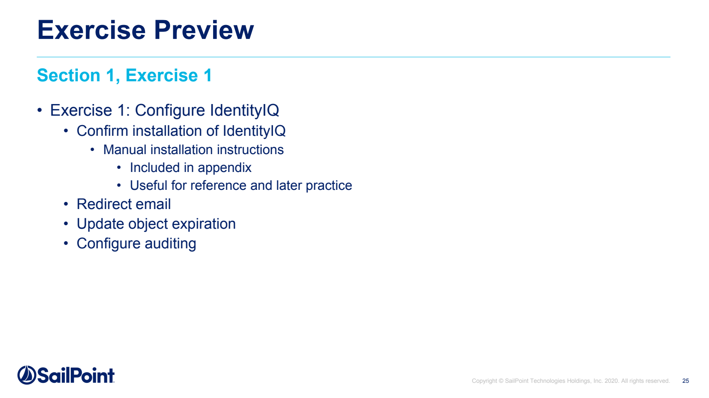

IdentityIQ is already installed in the training environment. Exercise 1 confirms that installation and applies development-oriented global settings: email redirection, work-item archiving, object retention and audit choices. Manual installation practice is a later optional appendix exercise, not a prerequisite operation that was run while creating these notes.

The expanded Exercise 1 study instructions appear after Module 6 below, so the numbered module sequence remains intact.

## 5. Product Architecture

### Platform layers and foundational modules

The architecture lesson focuses on Compliance Manager and Lifecycle Manager as foundational application-governance and access-management modules. File Access Manager extends governance into file data. Other introductory material groups the platform differently; these notes retain this lesson's specific framing rather than forcing a single module count across differently scoped presentations.

IdentityIQ is a Java web application running inside an application server with a Java runtime. A relational database persists its objects. An email service provides notifications through SMTP. The architecture separates the application's execution environment from the database and the enterprise applications it manages.

### Reading the architecture diagram

Inside the application server, tasks and workflows execute the business logic. **Quartz** schedules recurring work. **Hibernate** maps the Java object model to the relational database and handles the database-specific persistence layer.

Connectors and integration modules reach managed systems such as directories, databases, SAP, service-desk products and other applications. Their network access and credentials are dependencies of the operation they perform; having the IdentityIQ website available does not by itself prove those integrations can connect.

The diagram also separates several interfaces:

- **Browser UI:** the normal interactive experience for administrators and business users.
- **External REST interfaces:** allow other systems to interact with IdentityIQ, for example to initiate an appropriate process.
- **SCIM REST interface:** supplies standardized identity-management operations for integrations using that model.
- **Internal Java API:** provides broader access to IdentityIQ objects and is used by custom rules and implementation code.

The course mentions more than 100 connector types in its narration. That number is preserved as a course-version statement, not a verified count of currently offered connectors.

### Platform selection

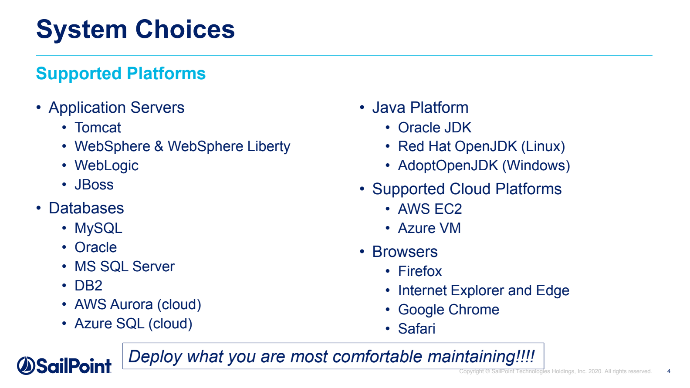

The slide lists the application servers, databases, Java platforms, cloud-hosting options and browsers associated with the course version. Its general architectural lesson is to select a supported stack the organization can operate and maintain competently. The displayed list includes older products, so it should be read as historical course material rather than a present-day support matrix.

A practical way to review the diagram is to identify the dependency for each operation: browser-to-application access, application-to-database persistence, application-to-target connectivity, and notification delivery. These are different paths and can fail independently.

## 6. IdentityIQ Installation

### Installation sequence and its dependencies

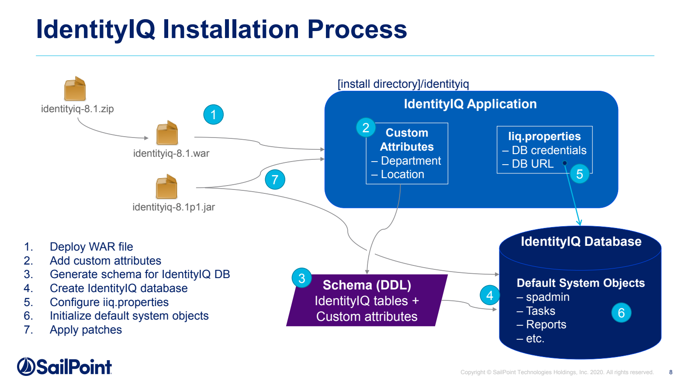

The example assumes the application server and database server already exist. It then shows seven stages:

1. Unpack the distribution and deploy its WAR into the application-server environment.
2. Define the required implementation-specific extended attributes in the relevant Hibernate mapping files.
3. Generate database schema DDL that includes those customizations.
4. Create the IdentityIQ database using the appropriate generated script.
5. Configure the database connection in `WEB-INF/classes/iiq.properties`.
6. Initialize the supplied system objects, plus Lifecycle Manager objects when applicable.
7. Apply the appropriate patch following the version-specific installation instructions.

This sequence explains dependencies: the schema must describe the desired columns before the database is created, and the console needs working database connectivity before it can import objects. The lesson describes patches as cumulative for its example release. No software was installed or patched during the preparation of these notes.

### Extended attributes and internal object names

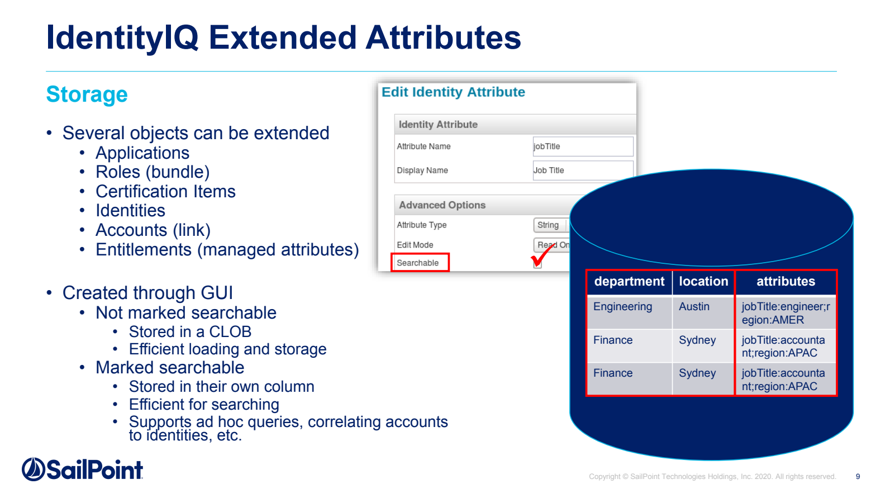

Applications, roles, certification items, identities, accounts and entitlements can have extended attributes. The narration highlights identities as a common example and connects three user-facing terms to internal names: **role → Bundle**, **account → Link**, and **entitlement → ManagedAttribute**.

A non-searchable extended attribute is stored within the object's attribute data, described here as a CLOB, or character large object. Multiple attribute values can share that storage. A searchable attribute has its own database column, making it suitable for efficient filtering, correlation and repeatedly accessed report or rule criteria.

The narration explains that selecting **Searchable** affects storage and availability in features such as Advanced Analytics. Accessing data in a CLOB remains possible, but it may be inefficient for repeated searches. Searchability is therefore both a functional and a database-design consideration.

### Standard, named and placeholder columns

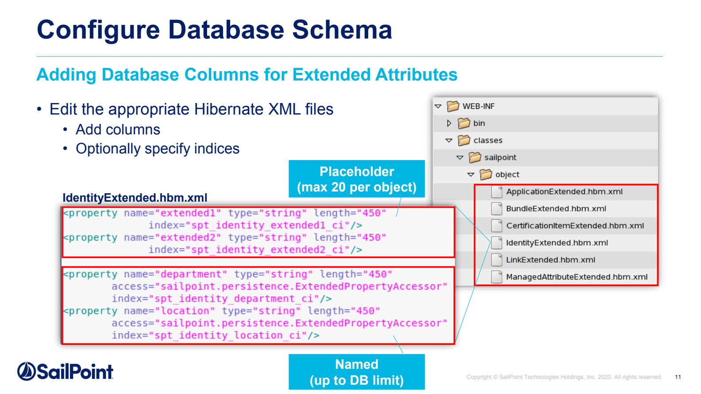

Standard columns are supplied by IdentityIQ. **Named extended columns** are added for requirements whose attribute names are known, such as department or location. **Placeholder columns**, such as `extended1`, reserve space for later searchable attributes whose names were not known when the database was designed.

The course describes a limit of 20 placeholder columns per object for its version. Named columns are still constrained by the database and implementation design; they are not literally unlimited. Indexes can improve searches while adding work to updates, so indexing is a deliberate design choice.

Relevant Hibernate mapping files, such as `IdentityExtended.hbm.xml`, define the additional columns and optional indexes. Adding an attribute through a screen does not eliminate the need for appropriate storage in the database schema.

### Generating and applying the schema

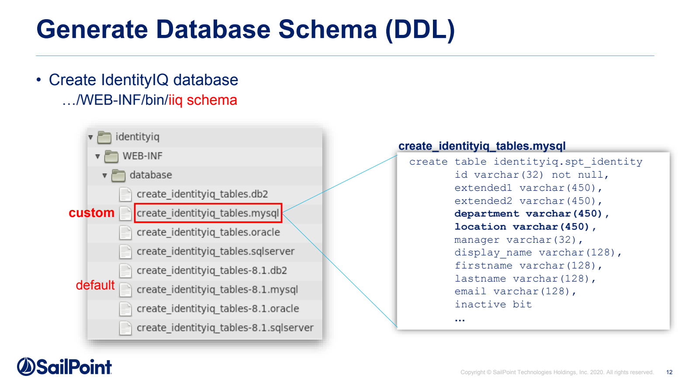

The lesson uses `WEB-INF/bin/iiq schema` to generate DDL scripts in `WEB-INF/database`. The generated scripts cover the supported database types of that release; choose the one for the actual database engine.

The narration distinguishes the generated customized creation script from the similarly named default script distributed with the product. Using the wrong one can omit the extended columns. In its MySQL example, the database administrator runs the selected DDL through the database console to create the database structures.

### How a searchable attribute gets a column

When a searchable attribute is configured, IdentityIQ first looks for a matching named column. If one exists, it uses that column. Otherwise, it assigns an available placeholder and records that association. If neither is available, configuration fails and the schema needs to be extended before another searchable attribute can be added.

A useful example is Department. A named `department` column supplies dedicated storage; without that column, an unused placeholder can hold its values. Merely choosing Searchable cannot create limitless additional storage.

### Extending an existing database

The course describes reclaiming placeholder capacity by defining named columns for known attributes, generating delta DDL with `iiq extendedSchema`, applying the schema changes, and moving the existing data into its intended columns. This is different from rerunning a full create-database script.

The narration points to a separate Managing Extended Attributes reference for the detailed migration procedure. That external document has not been captured or verified in this batch. The notes explain the process, but do not supply an unverified production migration recipe.

### Properties and initial objects

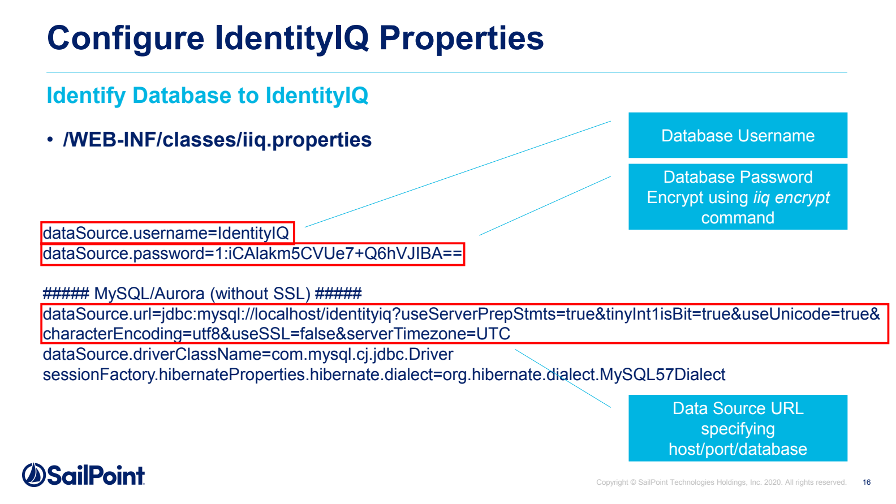

`iiq.properties` identifies the database endpoint, username, password, driver and dialect. The lesson's example shows an encrypted password generated through the IdentityIQ encryption utility and explains enabling the block for the chosen database type while disabling irrelevant examples. Connection strings and example settings on the original slide are historical training material.

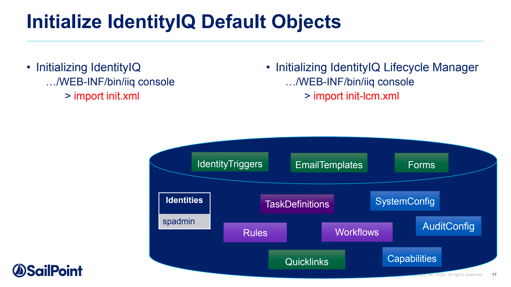

The IdentityIQ Console imports `init.xml` to create the standard objects, including the initial administrative identity and default configurations, tasks, rules, reports and workflows. If Lifecycle Manager is included, `init-lcm.xml` adds its objects. XML imports are also a mechanism for bringing in implementation-specific object definitions.

The console does **not** require the web application server to be running, but it **does** require its database connection to work. A successful console startup therefore provides an early connectivity check. Browser access additionally requires the application server and deployed web application to be available.

**Player-label discrepancy:** Module 6's embedded player displayed “Product Architecture” as its heading, while its navigation title and caption text describe IdentityIQ Installation. The notes follow the verified module navigation and actual narration.

## Related Exercise 1.1: Configure IdentityIQ

This section rewrites the relevant instructions from exercise-guide PDF pages 9–17. These are **study instructions for the supplied training VM**, not actions performed on a live IdentityIQ deployment. The original pages are included for their screenshots and precise training context.

### 1. Confirm the installed version

Open the VM's IIQ Console shortcut, or open a terminal in the training installation's `WEB-INF/bin` directory and run `./iiq console -j`. The guide says `-j` enables command-history navigation. At the prompt, use `about` to inspect the version, patch and build, then `quit` to exit.

The exercise starts from the preinstalled environment. It does not require deleting the database or performing a manual installation first.

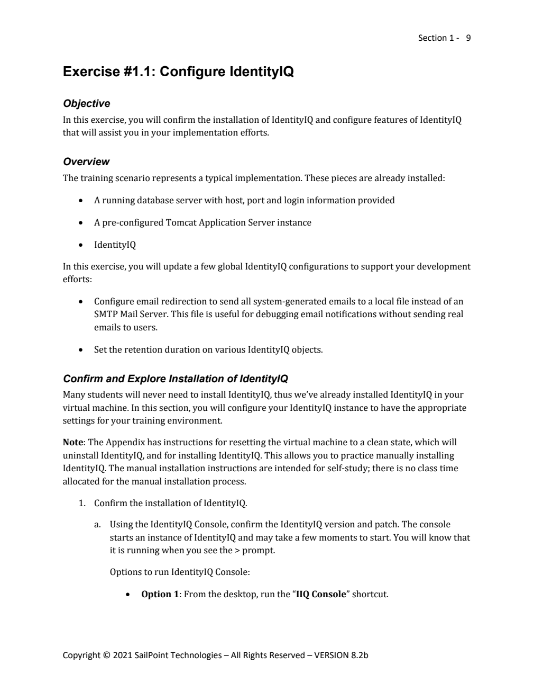

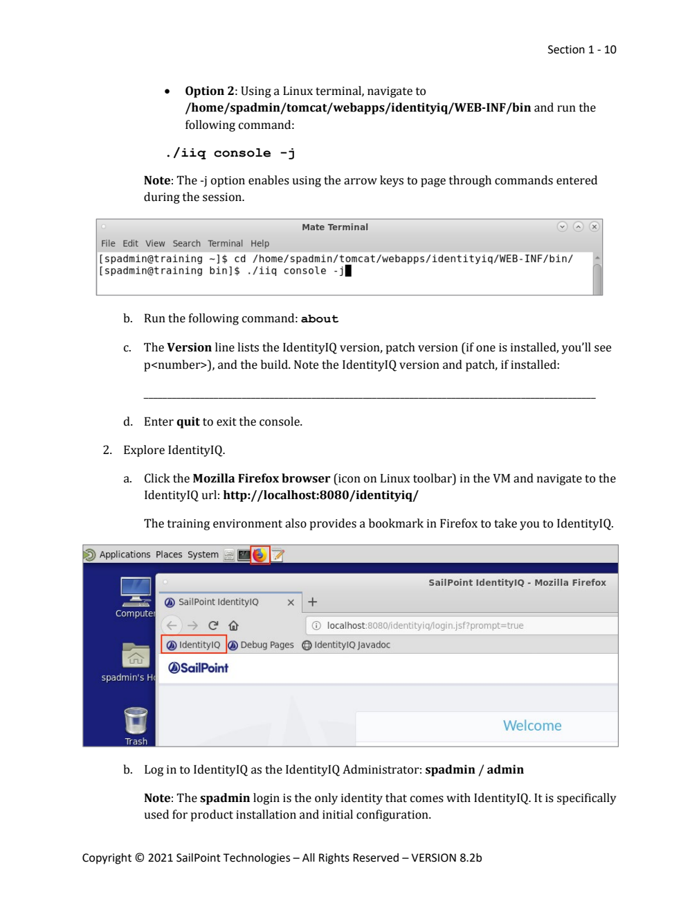

### 2. Explore the browser interface

Use the VM's IdentityIQ bookmark or the training URL and the credentials provided for that training environment. Explore the administrator's menus, Quicklink cards and dashboard widgets. The exercise asks the learner to identify the available menus and identity sections; these notes leave those checks for the learner rather than supplying an answer key.

Review the Quicklink categories for assigned work, access management and identity management. Open **Identities → Identity Warehouse**, then inspect the initial administrator's Identity Cube and its Application Accounts section. The gear menu provides product settings, help opens documentation, the notification indicator leads to assigned work, and the user menu includes preferences and logout.

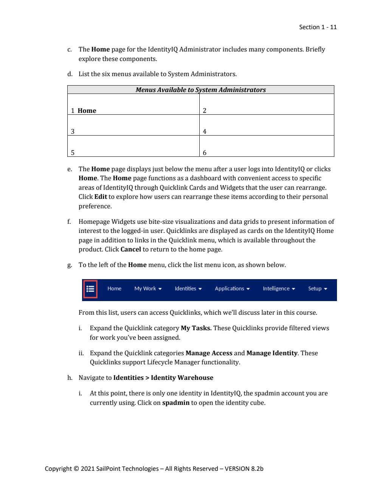

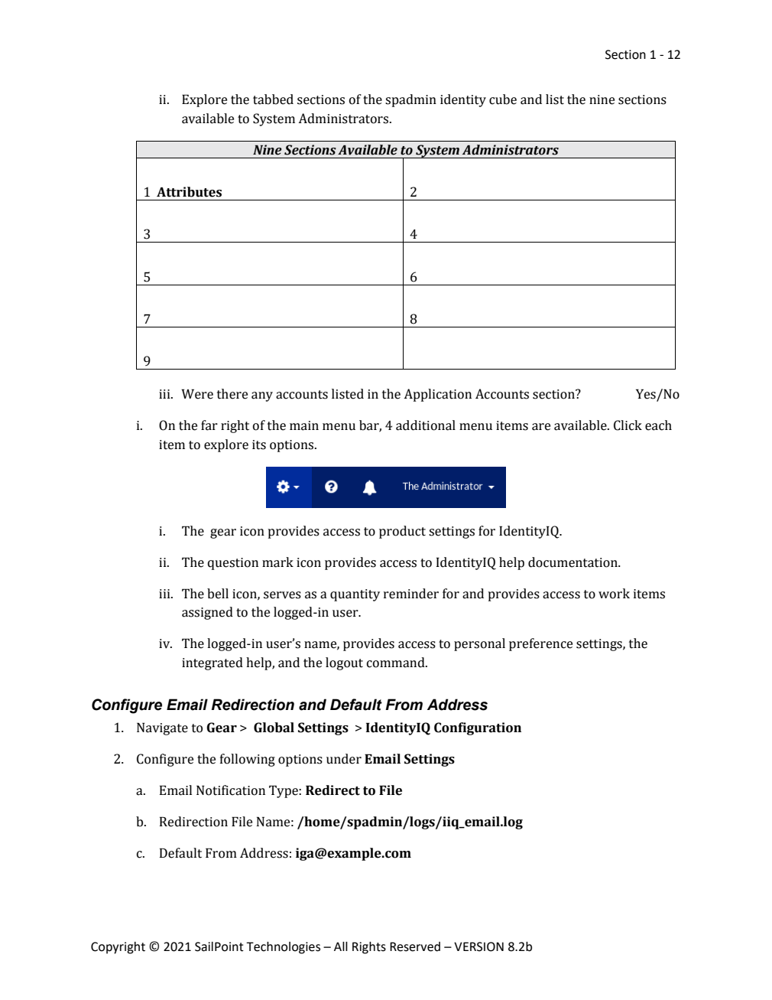

### 3. Redirect training emails to a file

In **Gear → Global Settings → IdentityIQ Configuration → Email Settings**, the guide uses **Redirect to File**, with `/home/spadmin/logs/iiq_email.log` as the file and `iga@example.com` as the default sender. The purpose is to inspect generated notifications during development without delivering messages to real users. The same configuration area also contains email-template and SMTP-related settings.

### 4. Archive completed work items

Under **Work Items**, the exercise selects Approval, Form and Manual Action as work-item types to archive. A work item is an assigned unit of work; archiving preserves a historical representation after completion. The guide notes that multi-selection can depend on keyboard behavior in the hosted VM.

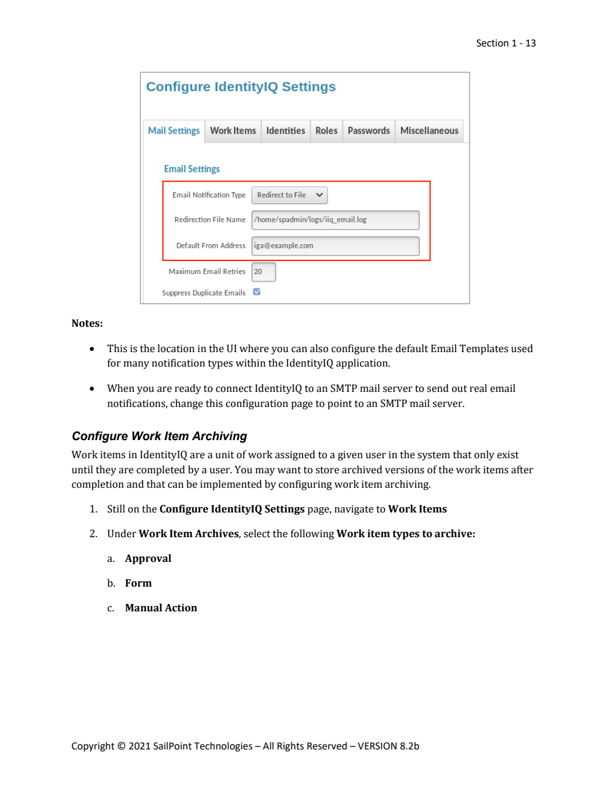

### 5. Configure training retention and transaction logging

Under **Miscellaneous**, the guide uses the following values for its exercise:

| Training configuration | Value |
| --- | --- |
| Snapshot deletion | 365 days |
| Task-result deletion | 90 days |
| Certification archiving | 720 days |
| Certification archive deletion | 1080 days |
| Syslog-event deletion | 30 days |
| Provisioning transaction maximum log level | Success |
| Provisioning transaction-event deletion | 90 days |

These are exercise values, not general retention recommendations. The guide specifically says Success is selected for training and mentions Retry or Failure as typical production logging choices in its context. Retention needs to reflect the deployment's own history and operational requirements. Save the configuration after reviewing the complete page.

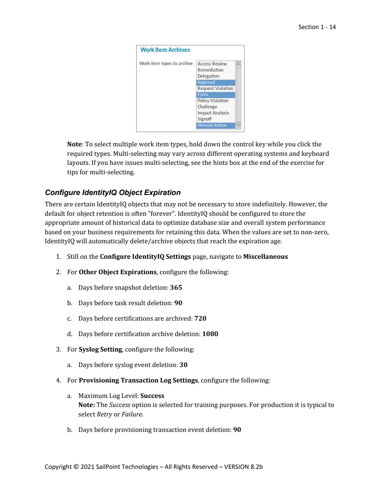

### 6. Review and test audit configuration

Navigate to **Gear → Global Settings → Audit Configuration**. The guide reviews default actions such as lifecycle events, incorrect challenge-question answers and the start of an access request. It then has the learner enable Login Failure, Import File and Email Sent auditing, review the other available tabs and save.

The validation sequence is to sign out, make a deliberately unsuccessful login in the training VM, sign back in correctly, and search **Intelligence → Advanced Analytics → Audit**. Sorting by newest date should let the learner locate the failed-login event. This links configuration to observable evidence rather than treating the checkbox as the entire test.

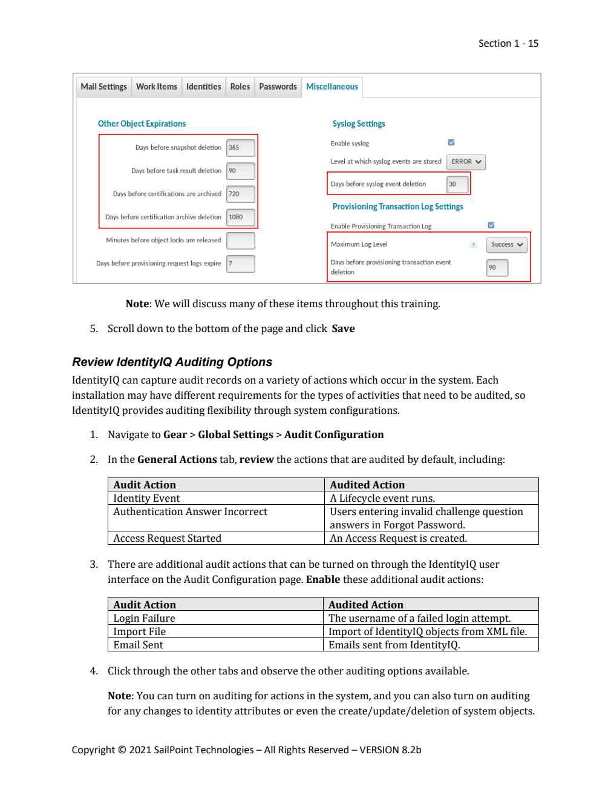

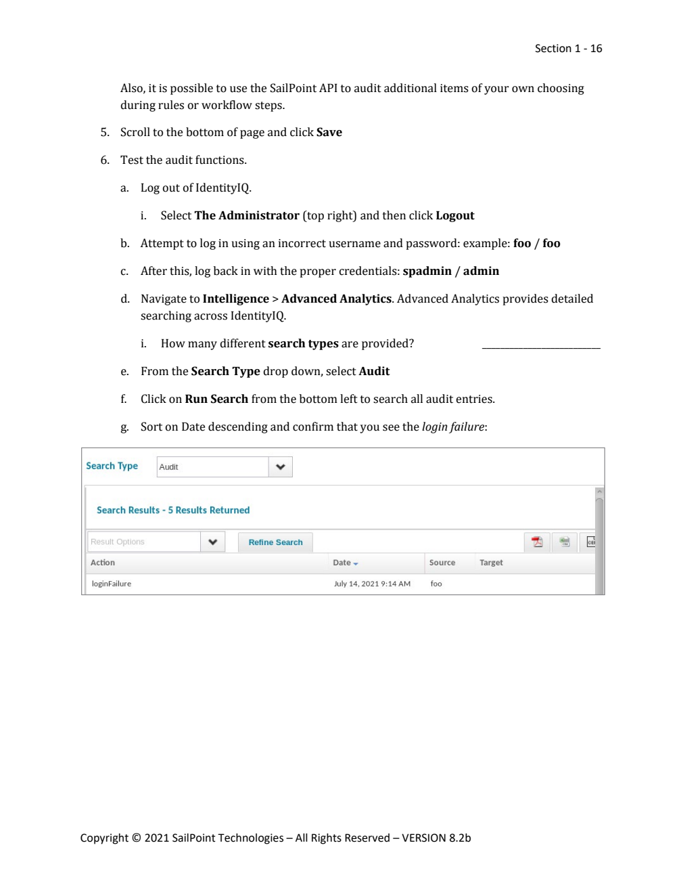

For hosted-VM multi-selection difficulties, the guide describes using the VM's on-screen keyboard to hold Ctrl, making the selections, then releasing Ctrl and closing the keyboard.

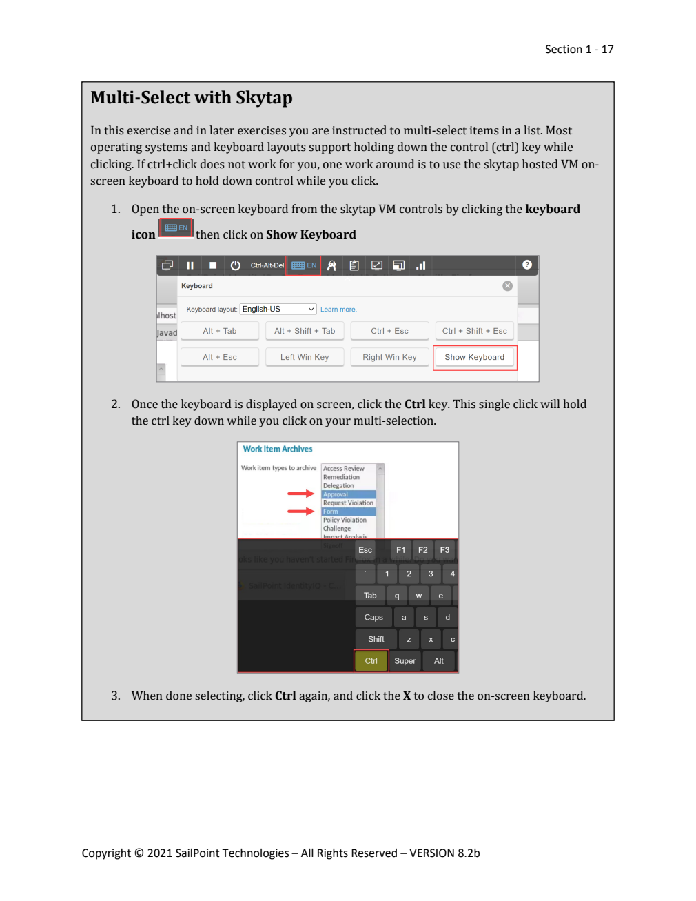

## Coverage and remaining work

Modules 1–6 have substantive paraphrased notes based on caption-search results, with original handout illustrations for Modules 2–6. The illustrations are rendered PDF pages, not extracted video frames; they preserve the English labels, diagrams, screen examples and icons present on those pages. Forty nonblank presentation pages and nine exercise-guide pages are included in the reading flow. Five blank presentation separator pages are omitted from that flow but remain in the saved original PDF.

The available caption-search text contains some duplicate lines and RTF markers; those artifacts were removed when rewriting. Search results do not prove word-perfect completeness of a video transcript, and captions may omit animation-only or uncaptained content. Full video files, embedded knowledge-check interactions and every changing video frame have not been archived. No assessment answers were submitted, and the Answer Key handout was not used.

**Modules 7–33 remain pending:** Creating Identity Cubes; Identity Attributes and Mappings; Authentication and Authorization; Organizing Identities; Onboarding Additional Applications; Account Correlation; IdentityIQ Connectors; Data Oversight; System Oversight; Logging; Troubleshooting; Introduction to Policies; Introduction to Certification; Introduction to Roles; Provisioning Overview; Monitoring Provisioning; Rapid Setup Lifecycle Events; Lifecycle Event Configuration; Lifecycle Manager Requests; Manage User Access; Additional Access Request Options; Other Lifecycle Manager Requests; Automated Provisioning; Other Provisioning Requests; System Architecture and Deployment; Deployment Process Management; Getting Help.

The separate Accessing the Virtual Machine PDF, My lab interface, remaining exercise instructions and appendix procedures have not yet been incorporated into the notes. Start Here contained a heading and an empty content paragraph in the inspected state. Visiting it caused the LMS to show a completed status; that automatic reading status does not mean its videos, exercises or the whole course were completed. The platform's assessment, rating form and closing page are not represented as completed study modules.
