# IdentityIQ Rules, Scripts, and API

English study notes following the eight verified course topics. The original course labels its instructional lessons 1–7 after Course Overview; the reader numbers the eight topics consecutively. The explanations are rewritten, while saved illustrations and demonstrations retain their original English.

**Included:** all eight topic bodies, all four workflow-carousel panels, all three performance tabs, 42 original inline images, nine original videos, the 37-page exercise guide and the original supplied artifact ZIP. The videos are available for offline playback but have **not** been fully transcribed or reviewed frame by frame. The Object Model topic relies heavily on its four videos, so its notes are a conceptual companion, not a substitute for those demonstrations.

[Exercise companion](practice-companion.html) · [Exercise guide](handouts/exercise-guide.pdf) · [Original course artifacts](handouts/course-artifacts.zip) · [Coverage and limitations](coverage.json)

## 1. Course Overview

### Purpose and prerequisites

This course develops the extension skills used by IdentityIQ implementers: writing BeanShell rules and scripts, navigating the SailPoint object model, using SailPointContext, and choosing the right hook for a business requirement. Java familiarity helps because IdentityIQ is a Java application and BeanShell follows Java-like syntax. The course assumes programming fundamentals rather than teaching Java from the beginning.


IdentityIQ Essentials is the foundation for the course. The overview also places this training before advanced provisioning/workflows in its suggested learning sequence. That educational relationship is distinct from any registration gate the platform enforces for a particular account.

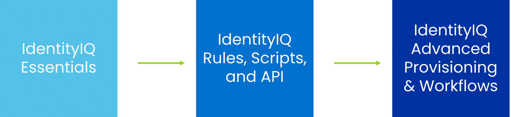

The sequence moves from rule structure and execution into API navigation, object retrieval, the data model, common extension patterns and operational quality. The exercises build on earlier artifacts: the region-code lookup created in Exercise 4 is reused by the aggregation customization in Exercise 5.

### Learning resources and navigation

The supplied guide explains the Linux/Skytap training environment and the browser, terminal and editor tools used in the labs. Starter XML lives in the VM's `APITraining/config` directory; a separate solutions directory contains completed practice artifacts. The archived ZIP retains both directories unchanged, but the solutions and separate Answer Key PDF were not used to generate these notes.

The course overview describes a 90-day VM enrollment window for its offering. This is a source-course statement, not a verified expiry date for the current account. The separate VM-access lesson and My lab interface have not been captured in this pass, and no VM was launched or reset.

The player provides expandable images, video demonstrations and unscored knowledge checks. These notes replace the carousel/tabs with expanded sections and retain original media locally. They do not reproduce LMS progress tracking or submit knowledge-check answers.

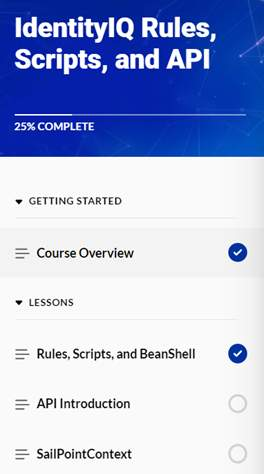


## 2. Rules, Scripts, and BeanShell

### Choose the hook and understand its contract

Rules and scripts are small programmatic extensions that influence a defined process. Common uses include provisioning-field values, workflow-step behavior, certification content, aggregation transformations and provisioning requests. First decide which process should own the business behavior; writing code before choosing the hook can leave correct logic running at the wrong time.

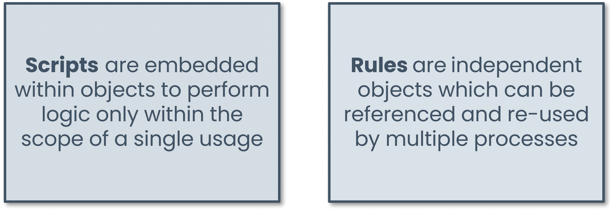

A standalone **Rule** is a reusable object. An inline **Script** is embedded within another definition, such as a form or workflow. The Rule Editor and script controls expose these extension points in the UI. The course notes that, from IdentityIQ 8.3, editing inline scripts requires System Administrator or the EditScripts SPRight; treat this as version-specific course context.

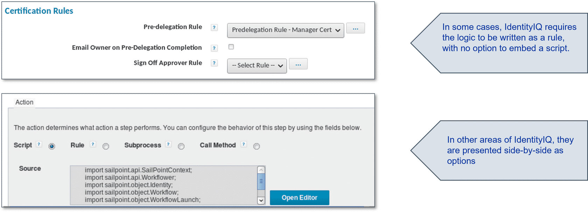

BeanShell is interpreted and Java-like, with conveniences such as loose typing and implicit imports. A rule's input arguments and expected return value are part of its contract. The course identifies `context` as the SailPointContext entry point and `log` as the logger provided to rule/script hooks. Additional arguments depend on the hook: never assume that an argument available in one rule type exists in another.

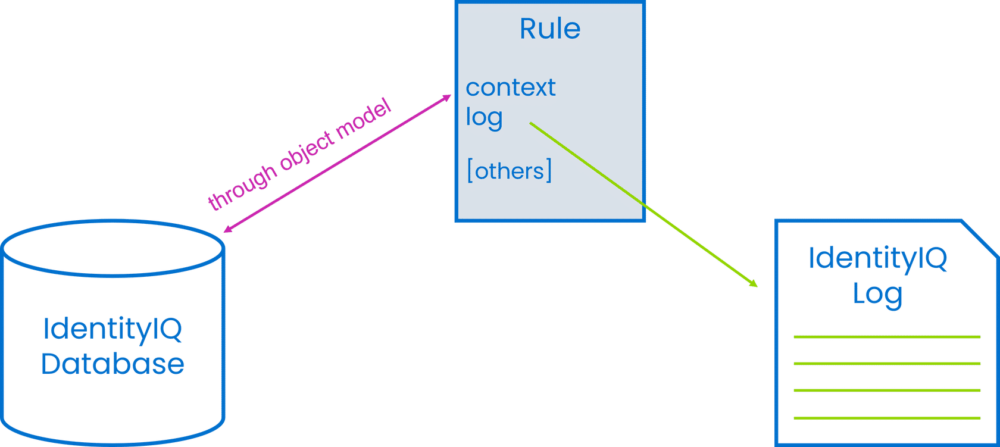

Return types can be a String, Identity, Map or another object, with some hooks accepting documented alternatives. An owner-selection rule, for example, needs the owner representation its caller expects. Other hooks act by changing an argument rather than returning a value. Custom side effects do not remove the obligation to return the correct type.

### UI and XML representations

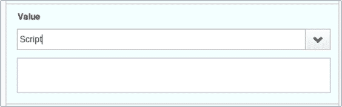

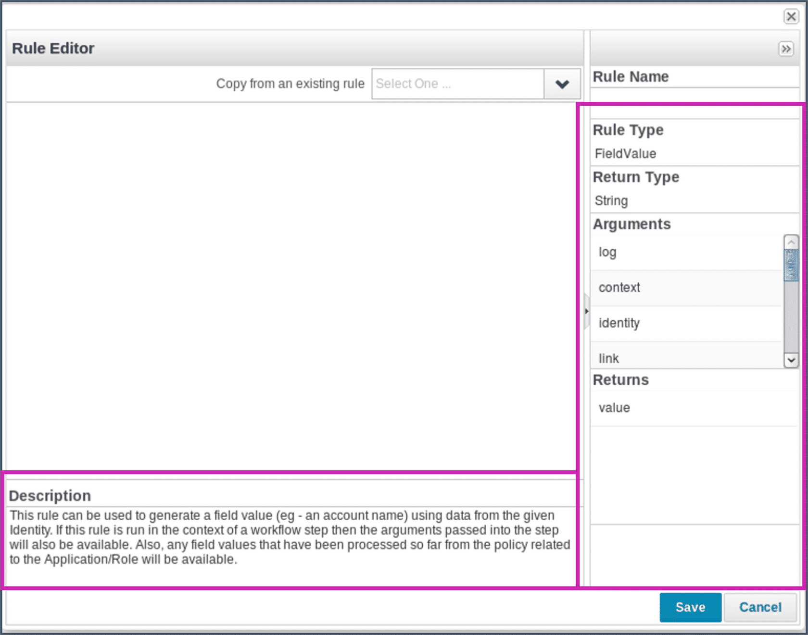

A Rule XML definition wraps its BeanShell source and can include a name, type, description and signature. An embedded script instead sits inside the XML of its containing object. Importing XML creates/updates an object; merely saving an external text file does not deploy it.

For study, an illustrative rule-library reference has this shape:

```xml
<ReferencedRules>
  <Reference class="Rule" name="Project Utilities"/>
</ReferencedRules>
```

The library itself contains named methods in its Rule source. Referencing rules can call those methods after the library relationship is declared. This centralizes reusable logic and makes later maintenance less repetitive. Group methods by responsibility instead of building an unrelated collection of utilities in one library. The exercise guide notes that `ReferencedRules` is object metadata and cannot be added simply by typing it into the BeanShell source editor.

### Learn inputs before writing transformations

A useful development sequence is to inspect the signature and descriptions, examine the actual argument data, establish the required output and then find the API methods connecting them. The course shows namespace inspection as a temporary way to discover defined variables and values. Such diagnostic dumps belong in controlled development: they can expose sensitive values and are not suitable as permanent production logging.

Rule examples, shipped sample rules, JavaDoc and the referenced BeanShell documentation help establish the right method and signature. Those external documents are references, not additional files archived in this edition.

### Execute rules in the appropriate setting


[Video: Executing Rules in Debug Page or Console](videos/01.mp4)

Ad-hoc execution is useful for controlled testing or maintenance. The course's saved demonstration covers Debug Pages and the Console. The exercise guide imports an identity-lookup rule, inspects its XML and invokes it with an arguments file. The Console can take an argument map; a rule designed for the Run Rule task may expect those values nested under `config`.

The Run Rule task provides a scheduled execution path: create the task, select the rule and supply its configuration. Inspect both the result record and the log output, which are different channels. The exercise's result-display adjustment is a template-specific teaching detail, not a reason to modify all task definitions.

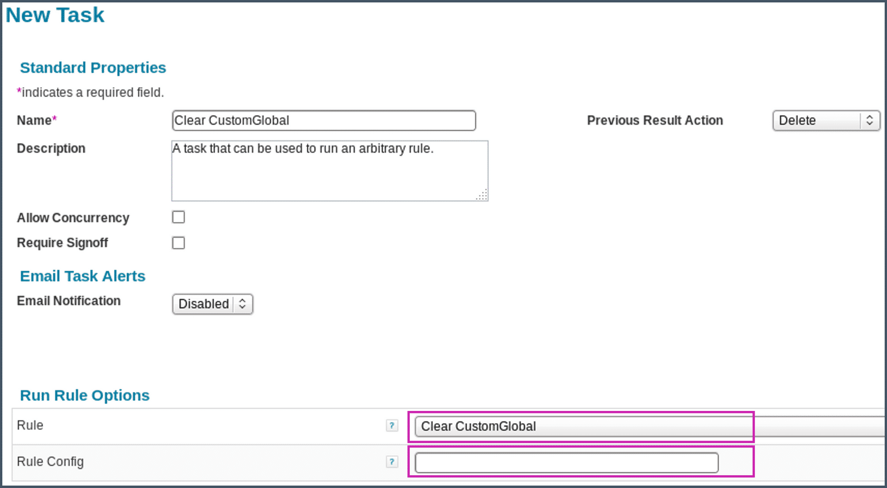

Related practice: [Exercise 1 — rule editor, reusable logic, Console and scheduled task](practice-companion.html#practice-1).

## 3. API Introduction

### Work through the object model

IdentityIQ exposes identities, applications, roles, accounts and certification/provisioning structures as objects. Rules should retrieve and operate on those objects through the API, allowing Hibernate to manage persistence. Direct SQL changes to the **IdentityIQ repository** bypass that model and are not the extension pattern taught here.

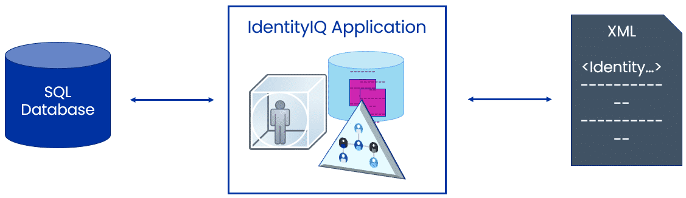

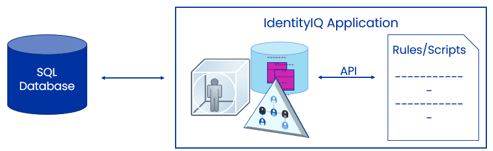

That restriction does not mean the training cannot query an external application database. Exercise 4 reads an external lookup table through supplied JDBC logic, and the PRISM test can inspect its target database. Those are separate systems and should not be confused with directly changing IdentityIQ's own internal tables.

### SailPointObject and extended data

Many persistent top-level classes derive from SailPointObject. This supplies common identity/ownership information, timestamps, extension support, object flags, cloning and XML serialization/persistence behavior. Inherited methods may appear in JavaDoc under the parent rather than the selected subclass.

Extended attributes let implementations store additional information. The course describes CLOB storage and, for a supported subset of object types, searchable named/placeholder columns. Its discussion of up to 20 placeholders is about this course's model. Actual column counts and schema changes remain constrained by the deployed release and database.

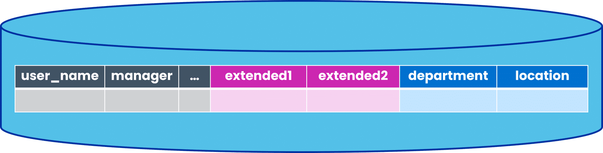

Standard properties have specific getters/setters, while implementation-defined extensions use attribute access by name. For example, a custom application field does not automatically create a new Java method named after that field. Avoid binding business logic to a numbered placeholder column when an attribute name expresses the intended data more clearly.

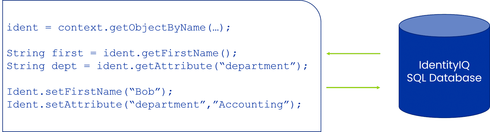

`toXml()` is useful for inspecting the structure of supported objects during development. Some non-SailPointObject structures, including provisioning objects derived from AbstractXmlObject, also support it. Producing XML and logging that XML are separate actions; do not assume calling the serializer alone writes a log message.

### Navigate the documentation

Each installation supplies public-API JavaDoc at its base URL plus `/doc/javadoc`. Use the documentation for the actual deployed version. Navigate by package or All Classes, then inspect inheritance, overloads, argument types and return values before writing a call.

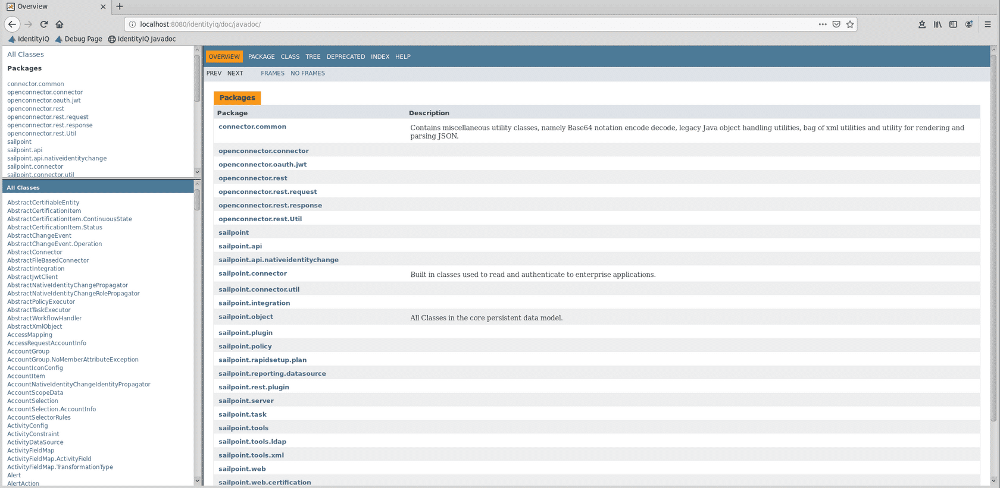

| Package or area | Course use |
| --- | --- |
| `sailpoint.api` | Context and process/helper entry points |
| Connector package | Built-in connectors and connector extension classes |
| `sailpoint.object` | Core data objects and their methods |
| Task package | Task-executor extension support |
| `sailpoint.tools` | General utilities for values, collections and formatting |

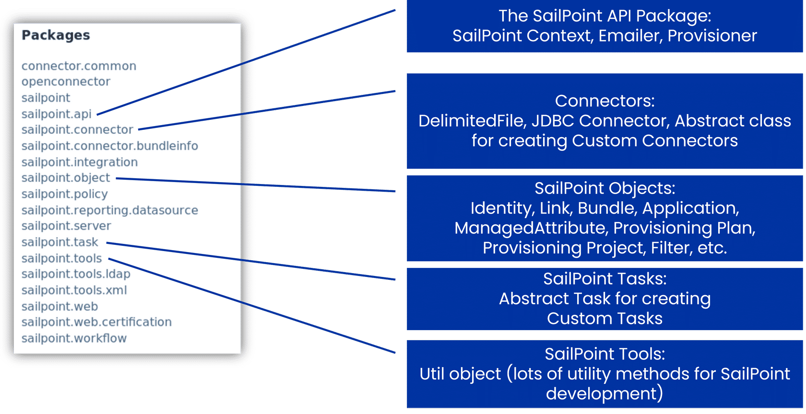

The Object Model and Usage whitepaper is a second reference for relationships and object properties. Its illustration is retained, but the separately linked whitepaper was not downloaded in this pass.

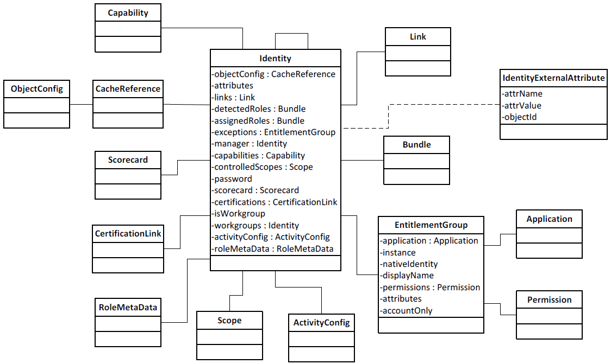

Exercise 2 retrieves an application's owner and the owner's email, sets the application's extended ownerContact field and persists the change. It also explores a Creation rule's ResourceObject argument and a training-only capability assignment. No administrative capability was granted while preparing this book.

Related practice: [Exercise 2 — API getters, setters and arguments](practice-companion.html#practice-2).

## 4. SailPointContext

### Entry point and retrieval choices

The `context` argument exposes object access, system information and persistence/transaction functions. QueryOptions and Filter describe which objects to retrieve and how to constrain the operation.

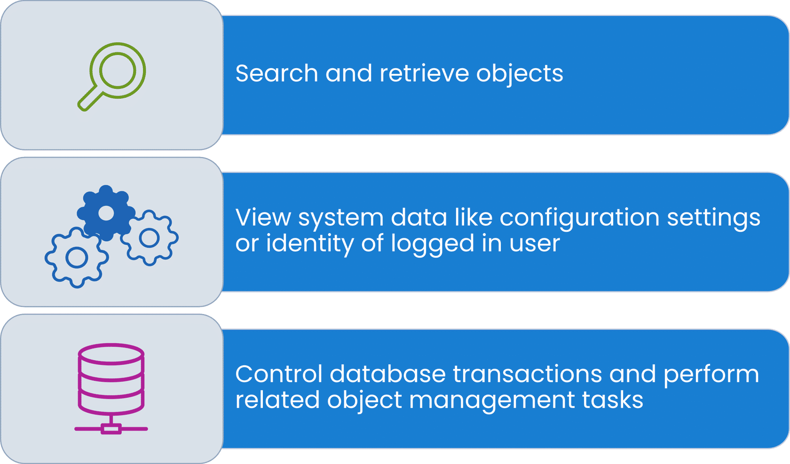

`getObjects` returns object collections for appropriate queries. `search` supports iteration and projection, where only chosen properties are initially returned. Single-object methods retrieve by name or GUID. The course examples pass a Java class token such as `Identity.class`; its nearby prose saying the class is a string is inconsistent with those examples, so these notes follow the demonstrated class-token form.

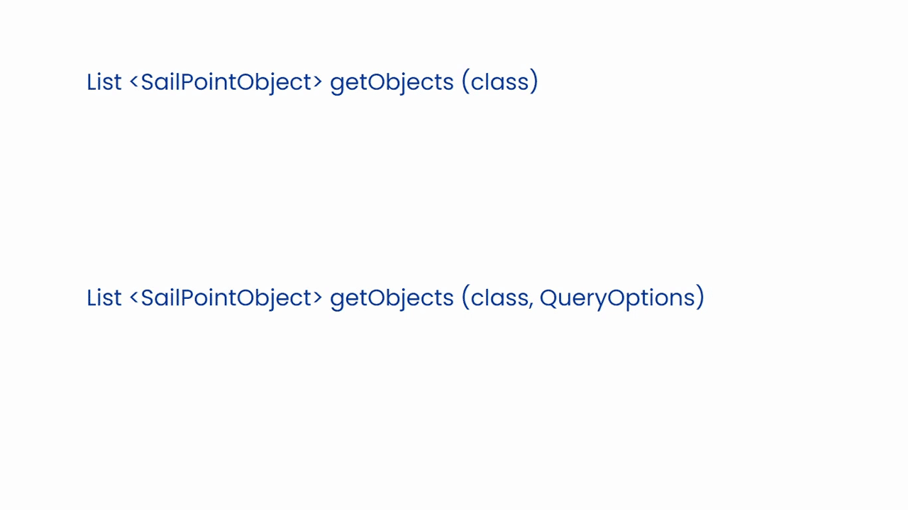

[Video: getObjects](videos/02.mp4)

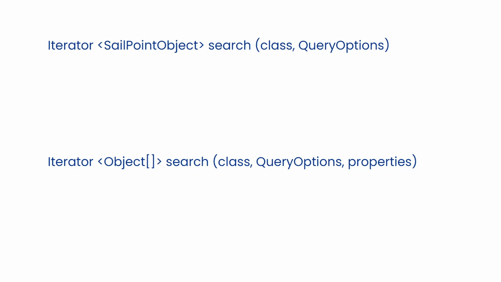

[Video: Search and projection queries](videos/03.mp4)

### Query only the data you need

For bulk operations, the course recommends projecting identifiers and loading full objects just when needed. This avoids loading every large identity into memory at once. It is also possible to project the required values directly when the operation needs no complete object.

Here is a rewritten, read-only study example based on the lesson's search and cleanup patterns:

```java
import sailpoint.object.Identity;
import sailpoint.object.Filter;
import sailpoint.object.QueryOptions;
import sailpoint.tools.Util;
import java.util.Iterator;

QueryOptions qo = new QueryOptions();
qo.addFilter(Filter.eq("department", "Accounting"));
Iterator rows = null;
try {
    rows = context.search(Identity.class, qo, "id");
    while (rows != null && rows.hasNext()) {
        Object[] row = (Object[]) rows.next();
        Identity person = context.getObjectById(Identity.class, (String) row[0]);
        // Inspect person only after checking that the lookup succeeded.
    }
} finally {
    if (rows != null) {
        Util.flushIterator(rows);
    }
}
```

This is explanatory code, not an executed or deployment-tested script. The appropriate overload, class imports and runtime behavior must be checked against the target installation's JavaDoc. The example performs no saves or commits.

`countObjects` answers a count question without loading every matching object. Use it when the logic needs to distinguish no match, one match and several matches before deciding the next action.

### Filters and QueryOptions

A Filter expresses comparisons such as equal, greater-than, prefix matching, multi-valued membership or null checks. `and` requires both conditions; `or` accepts either. Nested combinations need explicit grouping so a department-and-manager clause is not accidentally widened by a surname condition.

Adding separate filters to a QueryOptions combines their criteria as AND in the course example. It is not an implicit OR. QueryOptions also offers ordering, result limits, pagination, grouping and distinct-query controls.

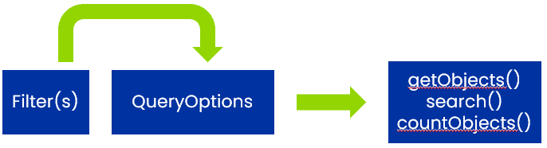


[Video: Filtering](videos/04.mp4)

The exercise selects Accounting identities in London, projects their IDs, retrieves each identity and changes the location in the lab. The guide explicitly adds `qo.setCloneResults(true)` and notes that its supplied solution file omitted that line. The book preserves that correction in the exercise summary rather than presenting the solution as automatically authoritative.

### System information and transaction responsibilities

`context.getConfiguration()` retrieves the system configuration; a named setting such as `serverRootPath` can support a correctly based work-item link. `getUser()` returns the current identity, while `getUserName()` returns the name. Check for absent values before dereferencing either result.

Context functions also support saving, transaction commit/rollback, object locking and cache management. The fact that a method exists does not mean every rule should call it: the surrounding process may already own those responsibilities. Topic 7 explains those boundaries.

Related practice: [Exercise 3 — targeted search, compound filters and one-at-a-time retrieval](practice-companion.html#practice-3).

## 5. Object Model

### Core objects and relationships

The written lesson identifies the object families below. Its four saved demonstrations provide the fuller visual walkthrough; they are retained in the same order and remain the source for video-only details.

| Business concept | API object or family | Relationship to keep in mind |
| --- | --- | --- |
| Managed person | Identity | Collects identity attributes and associations to access/accounts |
| Managed system | Application | Defines the resource and its integration configuration |
| User account | Link | Represents an account associated with an identity/application |
| Managed entitlement definition | ManagedAttribute | Represents catalog-level access metadata |
| Role | Bundle | Models grouped access/responsibility |
| Access review | Certification-related objects | Represents review content and decisions |
| Requested target change | ProvisioningPlan and requests | Describes the requested operations |
| Fulfillment outcome | ProvisioningResult | Records the result of a provisioning operation |

These relationships are reinforced by Essentials and the exercise guide. This table does not claim to enumerate every class or field shown inside the videos.

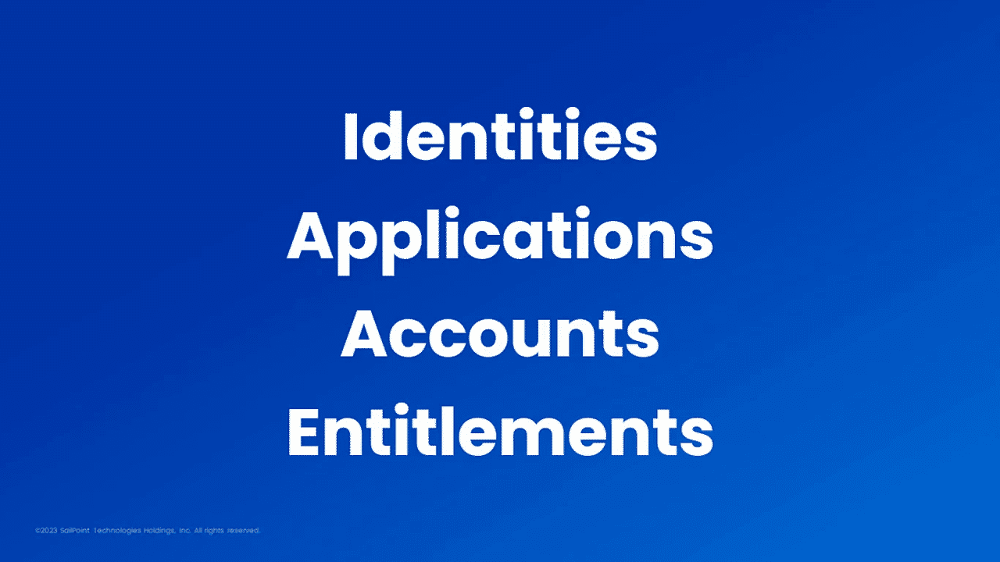

[Video: Identities, applications, accounts and entitlements](videos/05.mp4)


[Video: Roles](videos/06.mp4)


[Video: Certifications](videos/07.mp4)

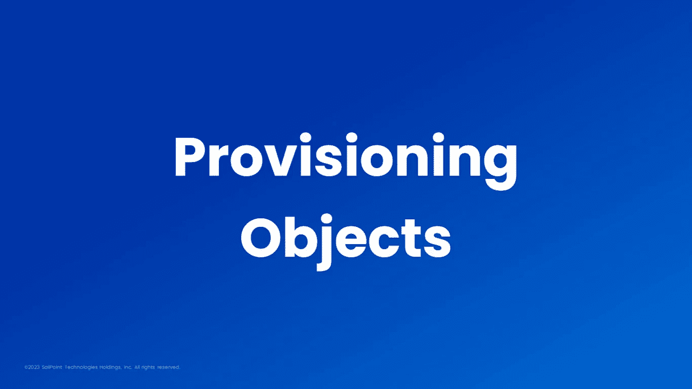

[Video: Provisioning objects](videos/08.mp4)

### Custom data belongs in Custom objects

A Custom object wraps an Attributes map of implementation-specific name/value data. Typical uses include reference tables, code-to-description lookups, allowed-value lists and approval configuration. Bringing repeatedly used reference information into a local Custom object can reduce repeated remote lookups inside iterative processes.

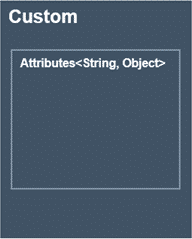

Configuration objects also wrap attribute data but are used by the product's own configuration model. The lesson recommends Custom for customer-defined stores so their namespace and purpose remain distinct from core Configuration objects.

### Inspect provisioning results at the right level

Exercise 4 builds a named `regionCodes` Custom object from an external table. It then attaches an After Provisioning rule that examines success/failure and selects notification behavior. The guide notes that a connector may supply the result as a direct argument or attach it to the plan; some can also supply it at AccountRequest level, which the simplified exercise does not fully handle.

An After Provisioning notification failure is not necessarily a failed provisioning action: the rule runs after the target operation. Conversely, sending a success-looking notification is not an independent target-state check. Keep requested change, connector result and post-processing outcome separate.

Related practice: [Exercise 4 — Custom lookup data and provisioning outcomes](practice-companion.html#practice-4).

## 6. Common API Uses

### Aggregation extensions

Aggregation hooks transform or interpret incoming application data. Some apply across applications, while others belong to a particular connector's processing model. Choose the hook based on whether the logic concerns raw connector records, normalized resource objects, correlation or later identity behavior.

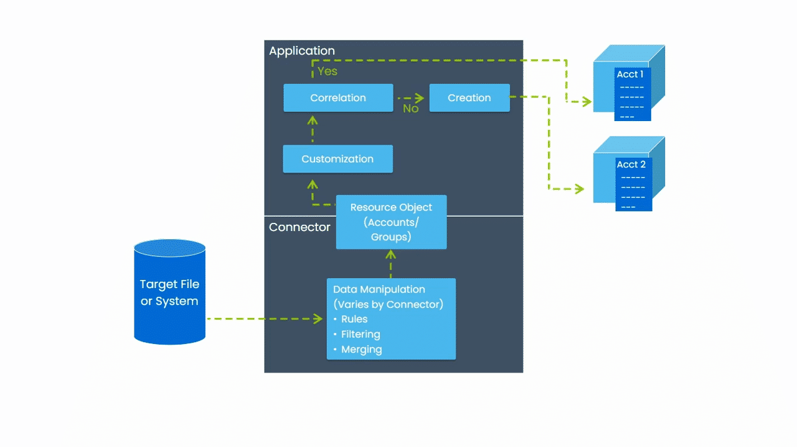

[Video: Aggregation rules and common API uses](videos/09.mp4)

The saved video contains the fuller aggregation-rule walkthrough. The written exercise uses a ResourceObject customization to derive regionCode from local reference data, then maps the resulting account attribute into an identity attribute.

### Certification content and behavior

Exclusion rules remove identities/items from an otherwise eligible campaign. A schedule entity selector starts with the narrower included population instead. Those are different ways to establish scope and should not be confused with reviewer assignment.

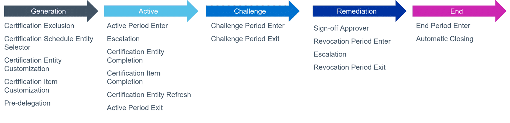

Pre-delegation can redirect review work during generation. Escalation can reassign overdue work. Sign-off approver rules add another review of decisions. Phase enter/exit rules implement behavior at lifecycle boundaries, such as beginning a challenge period after a custom action.

Exercise 5 excludes contractors and identities with PRISM accounts from a manager campaign. Its all-or-nothing example moves that identity's access items to the exclusion list; excluding only particular PRISM entitlements would need different logic. The lesson preview refers to the lookup as coming from Exercise 3, but the guide actually creates the Custom object in Exercise 4.

### Workflow carousel, expanded

**Panel 1 — process structure:** workflows coordinate multi-step business processes such as access requests and lifecycle events. Their definitions provide rule/script hooks for different purposes.

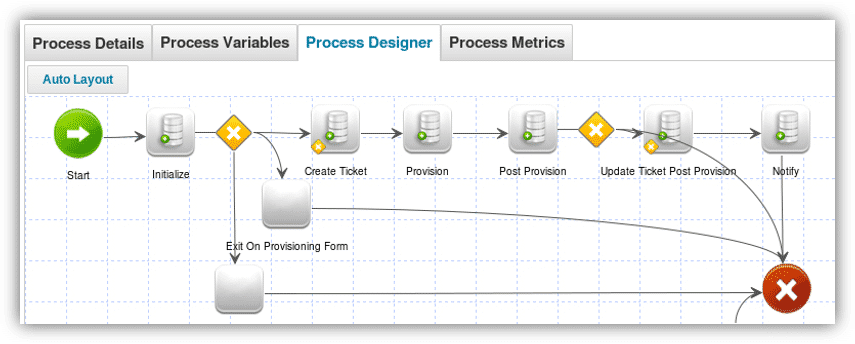

**Panel 2 — variables:** scripts or rules can calculate process-variable values rather than relying on fixed configuration alone.

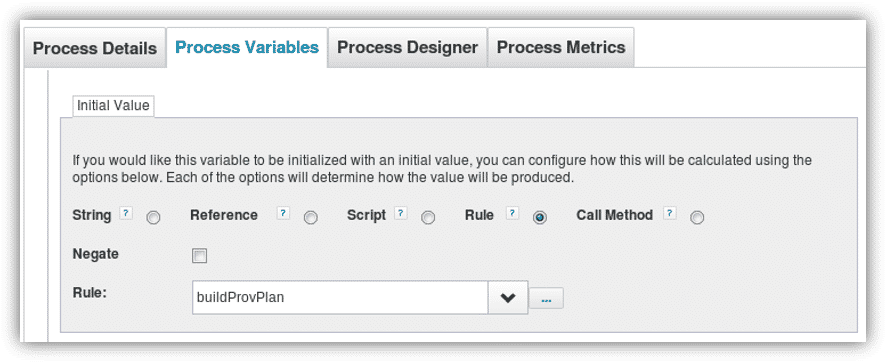

**Panel 3 — actions:** step logic can specify the action performed at a particular point in the process.

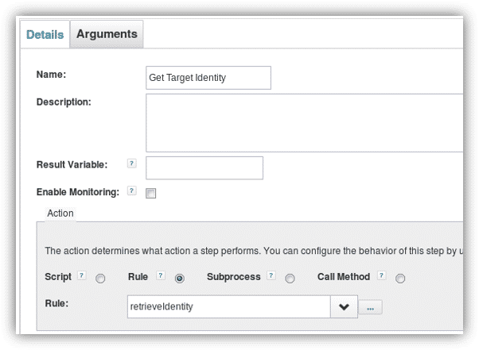

**Panel 4 — human work:** code can calculate who receives a form or approval work item. Choosing an assignee is distinct from defining the form's values or executing a provisioning action.

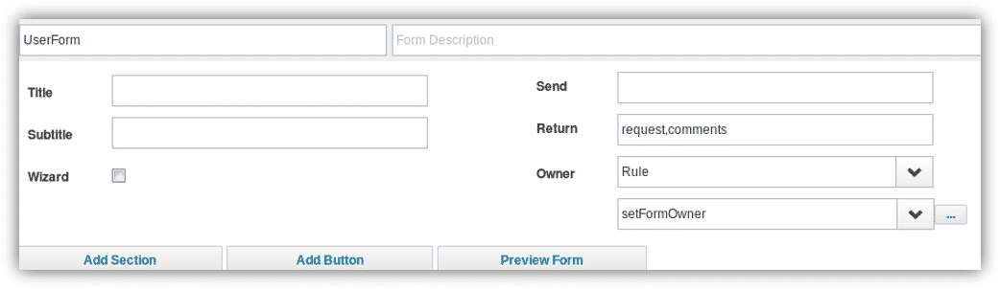

### Provisioning policies

Field logic can calculate values, provide allowed choices or validate user input. The phone-number example validates the value against an appropriate corporate range. A validation hook that checks input, an allowed-values provider and a field-value calculation have different contracts even when they all appear around the same form.

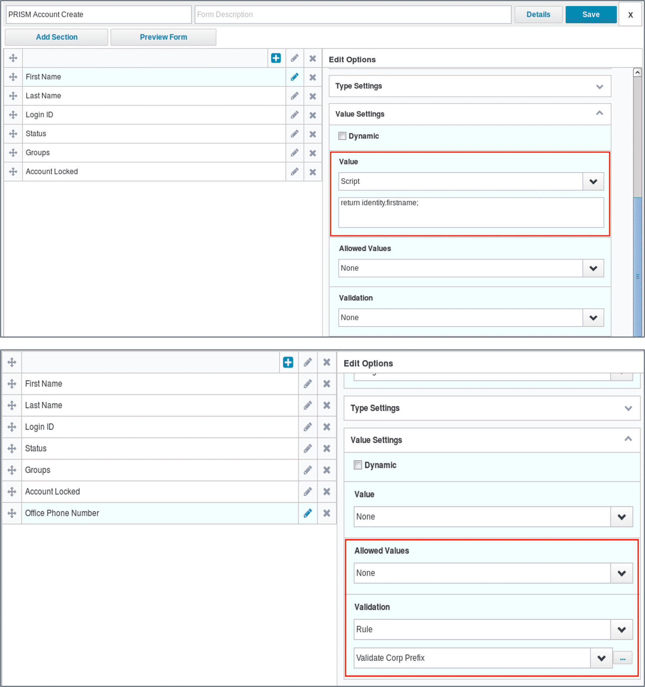

Related practice: [Exercise 5 — region-code customization and certification exclusion](practice-companion.html#practice-5).

## 7. Best Practices

### Controlled logging

Prefer controllable loggers to permanent standard-output dumps. `System.out.println` is useful for a development experiment but should not leave sensitive production values in uncontrolled logs. A custom logger name such as `project.rule.DescriptiveName` gives finer control than broadly enabling the shared rule logger.

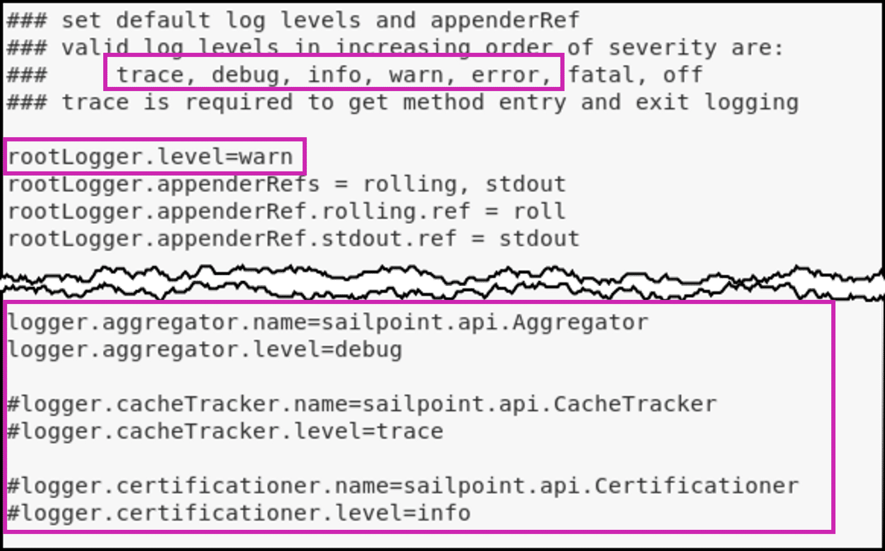

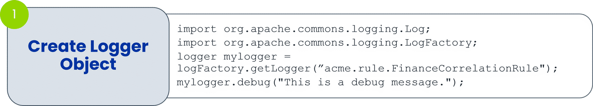

In the course's Log4j2 configuration, a unique properties-key tag identifies the two entries for a logger's name and level. The name must match the logger created by the rule; the arbitrary tag must match across its configuration entries.

```properties
logger.projectLookup.name=project.rule.Lookup
logger.projectLookup.level=warn
```

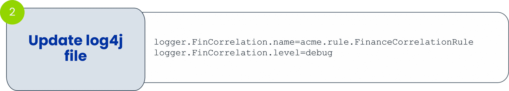

Debug or trace messages can be present in the source but suppressed at the normal level. Raise the relevant logger temporarily when investigating, then review which information the statements disclose. Avoid interpreting the course's 20-second configuration reload example as a universal behavior of every installation.


### Null, void and return-path handling

BeanShell distinguishes an undefined variable (`void`) from a defined variable containing null. Guard the variable before calling methods on it, then check nested results such as a missing manager before reading that manager's attributes. Correct the syntax and use explicit blocks when adapting a lesson snippet; several displayed examples contain typographic or parenthesis errors.

A rewritten illustration of the intended guard pattern is:

```java
if (targetIdentity != void && targetIdentity != null) {
    Identity manager = targetIdentity.getManager();
    if (manager != null) {
        Object title = manager.getAttribute("jobtitle");
        // Use title only after validating what this hook requires.
    }
}
```

This pattern explains the guard; it is not a complete Rule definition, imported artifact or live test.

### Locking, saving and ownership of transactions

Persistent locks are an application-level convention that can span transactions and need explicit release or timeout. Transaction locks operate at database-transaction scope and end with that transaction. The course discusses ObjectUtil helpers and emphasizes appropriate persistent locking for independently modified identities.

Core aggregation, refresh, LCM and certification-generation processes often already manage identity locks. A custom standalone operation needs to establish its own locking responsibilities rather than assuming a surrounding process is present.

The same distinction applies to persistence. If a hook is expected to modify and return an object, the caller may handle saving it. If a standalone rule or an extra side effect modifies an object outside that expected path, explicit save/commit may be necessary. Do not insert commits into every hook simply because a standalone exercise needs them; first identify who owns the transaction.

### Iterators and cache are different resources

A projection query can leave an open database cursor. If a loop stops early, clean it up. The course recommends `Util.flushIterator`, which is safe even after exhaustion; a `finally` block, as in the earlier study example, makes that cleanup explicit on additional exit paths.

`context.decache(object)` evicts one object; no-argument `context.decache()` evicts loaded objects more broadly. Decaching does not close the database connection or flush its open cursors. Use cursor cleanup and cache management for their respective purposes. The course's every-100-objects example illustrates periodic cache control, not a universal batch-size requirement.

### Performance tabs, expanded

**Searching:** return only the needed properties, filter close to the query, and load full objects only when the operation needs them. Projection avoids treating every matching object as an immediate in-memory requirement.

**Iterative Rules:** small per-call work becomes significant at scale. The course's example adds 0.02 seconds per row across 30,000 rows: 600 seconds, or ten minutes. Avoid opening a remote connection for every row when a prepared local lookup or shared state can satisfy the requirement. Aggregation, refresh and certification hooks can run thousands of times within one process.

**Meter Object:** bracket the measured section with a matching `Meter.enterByName` and `Meter.exitByName` name. A meter records counts and timing statistics, which can be inspected through Debug Pages → Call Timings.

```java
import sailpoint.api.Meter;

Meter.enterByName("Project.LookupSection");
try {
    // The operation being measured belongs here.
} finally {
    Meter.exitByName("Project.LookupSection");
}
```

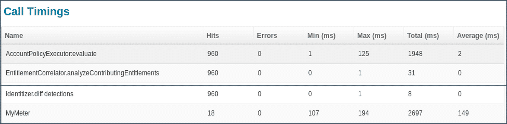

The exercise compares two measured code paths to teach metering. It explicitly says the small training dataset cannot prove one query operation is always faster than another. Compare equivalent work and meaningful volume before drawing performance conclusions.

Related practice: [Exercise 6 — custom logging and performance measurement](practice-companion.html#practice-6).

## 8. Next Steps

The course points implementers toward further technical training and the SailPoint community for questions, examples and product knowledge. Its original education illustration is preserved below. Course names, delivery choices and prerequisite statements describe the source material; present-day availability is not independently verified by this book.

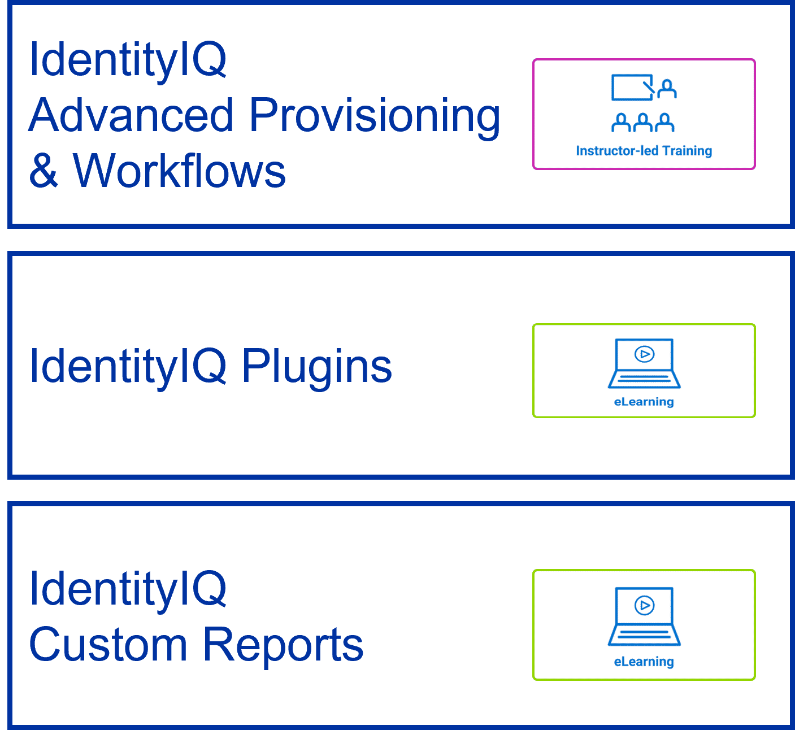

A useful review sequence is to explain a hook's arguments and return contract, locate its API methods, trace its object relationships, and identify transaction, cursor and logging responsibilities. Then work through the supplied exercises in order, comparing observed results to the intended behavior in the guide.


The notes and local media are ready for offline study. The lab exercises, interactive knowledge checks and LMS completion are separate activities; none were submitted or executed during preparation.
