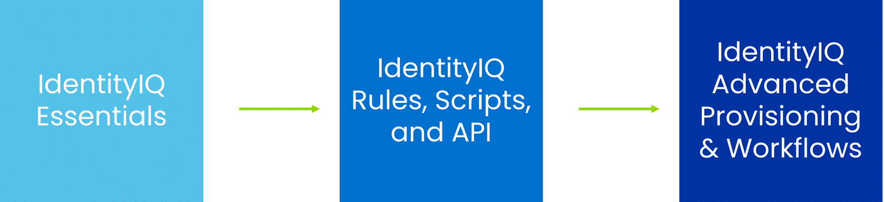
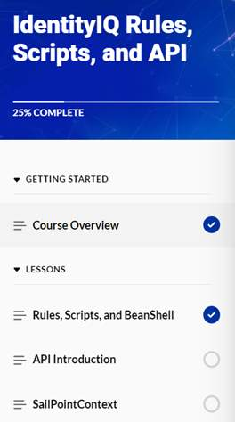

## 1. Course Overview

### Purpose and prerequisites

This course develops the extension skills used by IdentityIQ implementers: writing BeanShell rules and scripts, navigating the SailPoint object model, using SailPointContext, and choosing the right hook for a business requirement. Java familiarity helps because IdentityIQ is a Java application and BeanShell follows Java-like syntax. The course assumes programming fundamentals rather than teaching Java from the beginning.

IdentityIQ Essentials is the foundation for the course. The overview also places this training before advanced provisioning/workflows in its suggested learning sequence. That educational relationship is distinct from any registration gate the platform enforces for a particular account.

The sequence moves from rule structure and execution into API navigation, object retrieval, the data model, common extension patterns and operational quality. The exercises build on earlier artifacts: the region-code lookup created in Exercise 4 is reused by the aggregation customization in Exercise 5.

### Learning resources and navigation

The supplied guide explains the Linux/Skytap training environment and the browser, terminal and editor tools used in the labs. Starter XML lives in the VM's `APITraining/config` directory; a separate solutions directory contains completed practice artifacts. The archived ZIP retains both directories unchanged, but the solutions and separate Answer Key PDF were not used to generate these notes.

The course overview describes a 90-day VM enrollment window for its offering. This is a source-course statement, not a verified expiry date for the current account. The separate VM-access lesson and My lab interface have not been captured in this pass, and no VM was launched or reset.

The player provides expandable images, video demonstrations and unscored knowledge checks. These notes replace the carousel/tabs with expanded sections and retain original media locally. They do not reproduce LMS progress tracking or submit knowledge-check answers.

