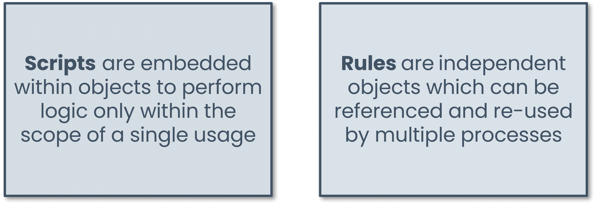
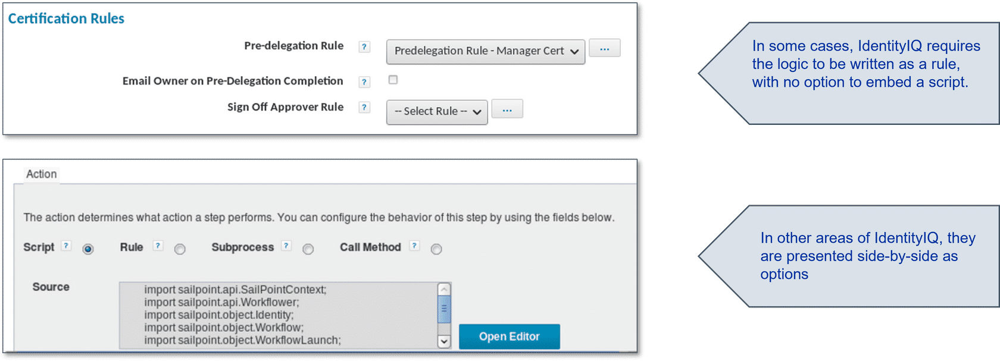
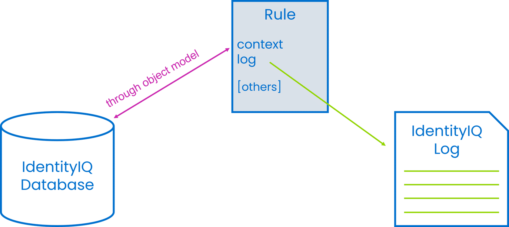
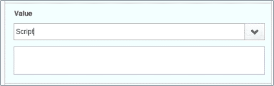
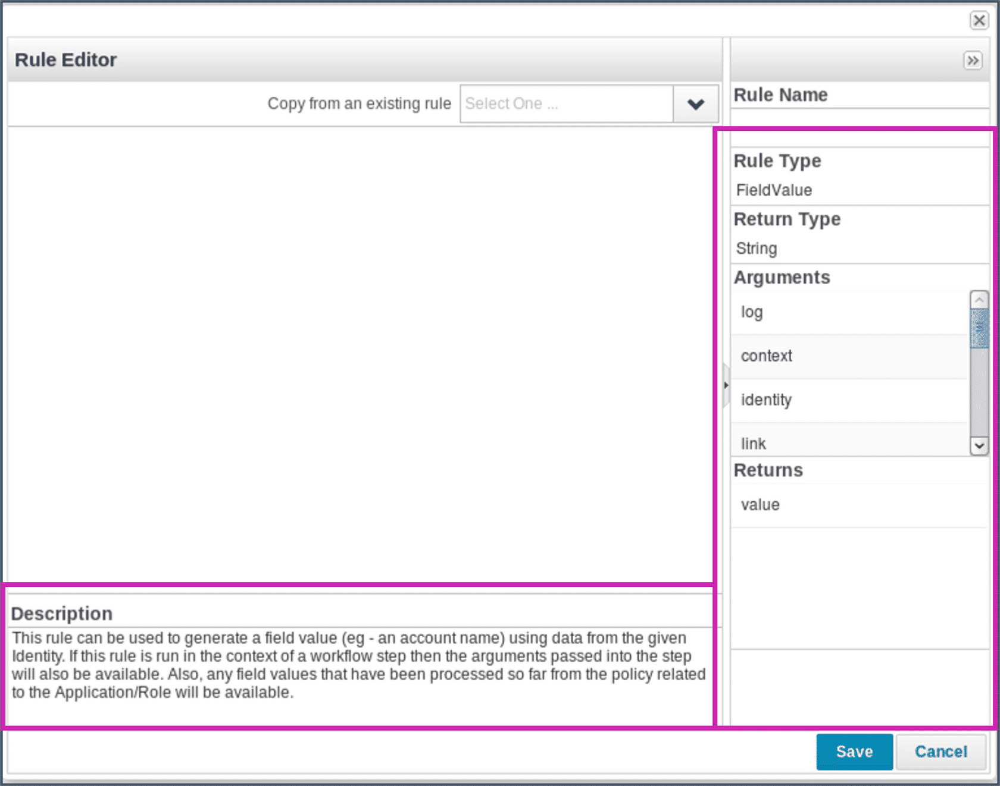
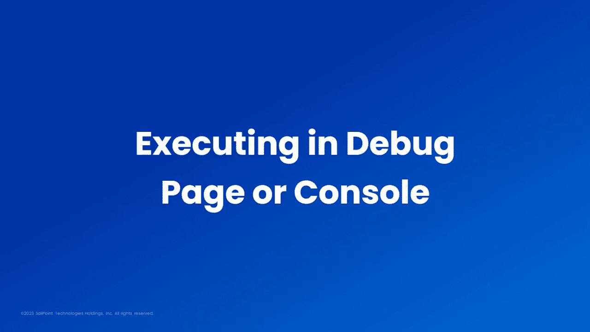
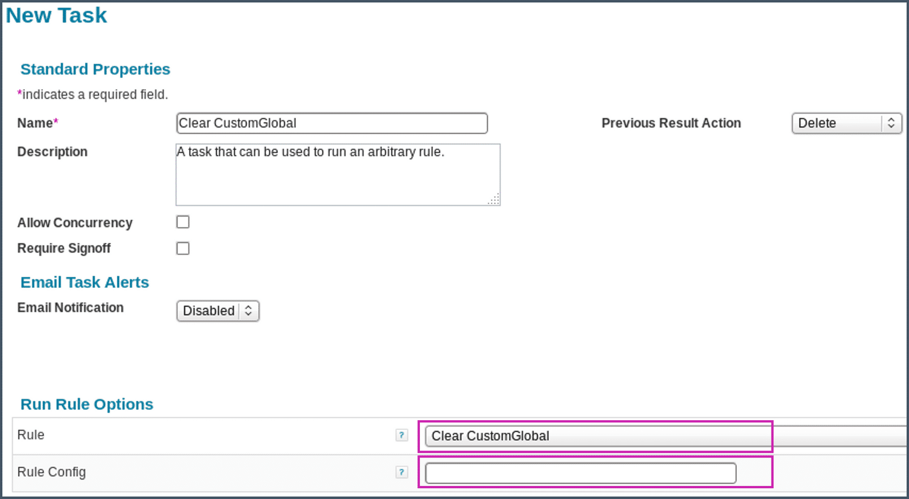

## 2. Rules, Scripts, and BeanShell

### Choose the hook and understand its contract

Rules and scripts are small programmatic extensions that influence a defined process. Common uses include provisioning-field values, workflow-step behavior, certification content, aggregation transformations and provisioning requests. First decide which process should own the business behavior; writing code before choosing the hook can leave correct logic running at the wrong time.



A standalone **Rule** is a reusable object. An inline **Script** is embedded within another definition, such as a form or workflow. The Rule Editor and script controls expose these extension points in the UI. The course notes that, from IdentityIQ 8.3, editing inline scripts requires System Administrator or the EditScripts SPRight; treat this as version-specific course context.



BeanShell is interpreted and Java-like, with conveniences such as loose typing and implicit imports. A rule's input arguments and expected return value are part of its contract. The course identifies `context` as the SailPointContext entry point and `log` as the logger provided to rule/script hooks. Additional arguments depend on the hook: never assume that an argument available in one rule type exists in another.



Return types can be a String, Identity, Map or another object, with some hooks accepting documented alternatives. An owner-selection rule, for example, needs the owner representation its caller expects. Other hooks act by changing an argument rather than returning a value. Custom side effects do not remove the obligation to return the correct type.

### UI and XML representations





A Rule XML definition wraps its BeanShell source and can include a name, type, description and signature. An embedded script instead sits inside the XML of its containing object. Importing XML creates/updates an object; merely saving an external text file does not deploy it.

For study, an illustrative rule-library reference has this shape:

```xml
<ReferencedRules>
  <Reference class="Rule" name="Project Utilities"/>
</ReferencedRules>
```

The library itself contains named methods in its Rule source. Referencing rules can call those methods after the library relationship is declared. This centralizes reusable logic and makes later maintenance less repetitive. Group methods by responsibility instead of building an unrelated collection of utilities in one library. The exercise guide notes that `ReferencedRules` is object metadata and cannot be added simply by typing it into the BeanShell source editor.

### Learn inputs before writing transformations

A useful development sequence is to inspect the signature and descriptions, examine the actual argument data, establish the required output and then find the API methods connecting them. The course shows namespace inspection as a temporary way to discover defined variables and values. Such diagnostic dumps belong in controlled development: they can expose sensitive values and are not suitable as permanent production logging.

Rule examples, shipped sample rules, JavaDoc and the referenced BeanShell documentation help establish the right method and signature. Those external documents are references, not additional files archived in this edition.

### Execute rules in the appropriate setting



[Video: Executing Rules in Debug Page or Console](../videos/01.mp4)

Ad-hoc execution is useful for controlled testing or maintenance. The course's saved demonstration covers Debug Pages and the Console. The exercise guide imports an identity-lookup rule, inspects its XML and invokes it with an arguments file. The Console can take an argument map; a rule designed for the Run Rule task may expect those values nested under `config`.

The Run Rule task provides a scheduled execution path: create the task, select the rule and supply its configuration. Inspect both the result record and the log output, which are different channels. The exercise's result-display adjustment is a template-specific teaching detail, not a reason to modify all task definitions.



Related practice: [Exercise 1 — rule editor, reusable logic, Console and scheduled task](../practice-companion.html#practice-1).

