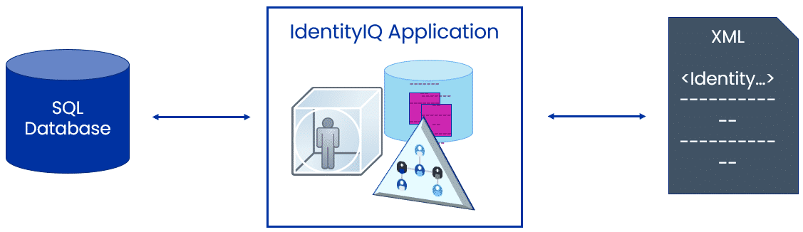
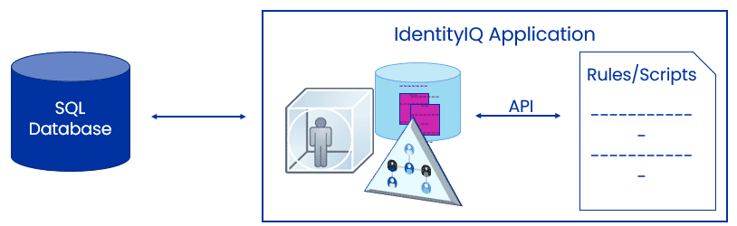
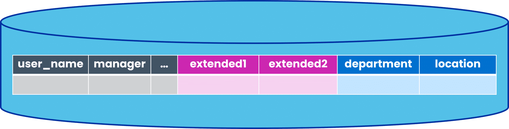
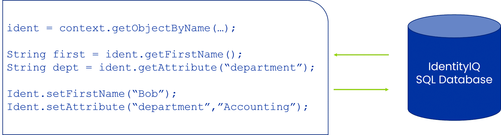
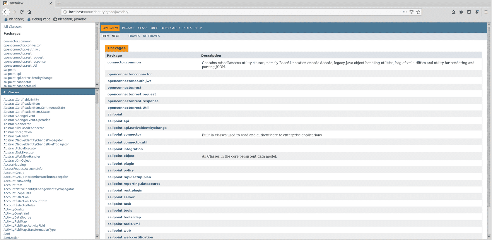
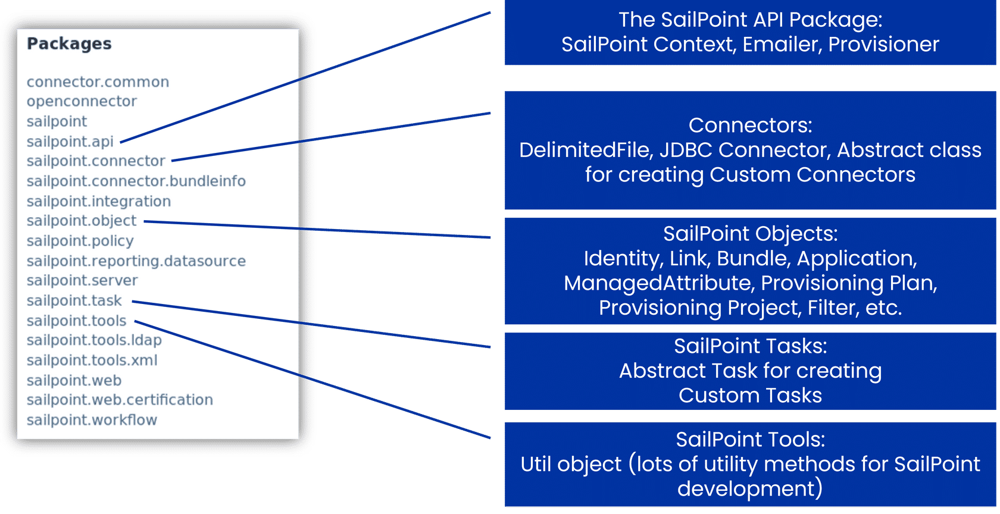
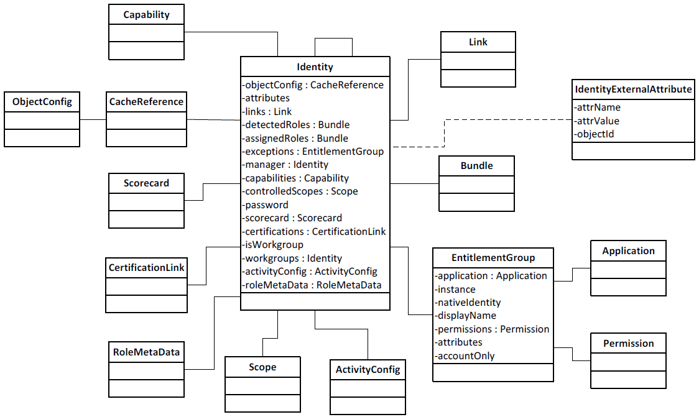

## 3. API Introduction

### Work through the object model

IdentityIQ exposes identities, applications, roles, accounts and certification/provisioning structures as objects. Rules should retrieve and operate on those objects through the API, allowing Hibernate to manage persistence. Direct SQL changes to the **IdentityIQ repository** bypass that model and are not the extension pattern taught here.

That restriction does not mean the training cannot query an external application database. Exercise 4 reads an external lookup table through supplied JDBC logic, and the PRISM test can inspect its target database. Those are separate systems and should not be confused with directly changing IdentityIQ's own internal tables.

### SailPointObject and extended data

Many persistent top-level classes derive from SailPointObject. This supplies common identity/ownership information, timestamps, extension support, object flags, cloning and XML serialization/persistence behavior. Inherited methods may appear in JavaDoc under the parent rather than the selected subclass.

Extended attributes let implementations store additional information. The course describes CLOB storage and, for a supported subset of object types, searchable named/placeholder columns. Its discussion of up to 20 placeholders is about this course's model. Actual column counts and schema changes remain constrained by the deployed release and database.

Standard properties have specific getters/setters, while implementation-defined extensions use attribute access by name. For example, a custom application field does not automatically create a new Java method named after that field. Avoid binding business logic to a numbered placeholder column when an attribute name expresses the intended data more clearly.

`toXml()` is useful for inspecting the structure of supported objects during development. Some non-SailPointObject structures, including provisioning objects derived from AbstractXmlObject, also support it. Producing XML and logging that XML are separate actions; do not assume calling the serializer alone writes a log message.

### Navigate the documentation

Each installation supplies public-API JavaDoc at its base URL plus `/doc/javadoc`. Use the documentation for the actual deployed version. Navigate by package or All Classes, then inspect inheritance, overloads, argument types and return values before writing a call.

| Package or area | Course use |
| --- | --- |
| `sailpoint.api` | Context and process/helper entry points |
| Connector package | Built-in connectors and connector extension classes |
| `sailpoint.object` | Core data objects and their methods |
| Task package | Task-executor extension support |
| `sailpoint.tools` | General utilities for values, collections and formatting |

The Object Model and Usage whitepaper is a second reference for relationships and object properties. Its illustration is retained, but the separately linked whitepaper was not downloaded in this pass.

Exercise 2 retrieves an application's owner and the owner's email, sets the application's extended ownerContact field and persists the change. It also explores a Creation rule's ResourceObject argument and a training-only capability assignment. No administrative capability was granted while preparing this book.

Related practice: [Exercise 2 — API getters, setters and arguments](../practice-companion.html#practice-2).

