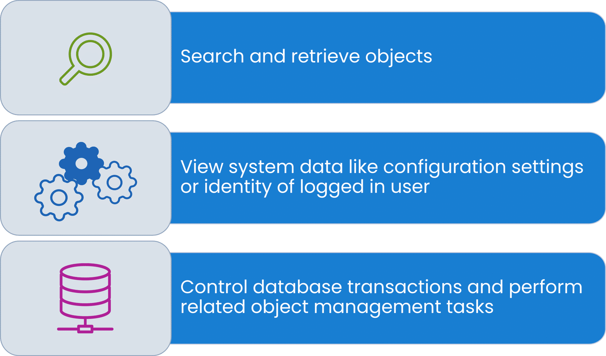
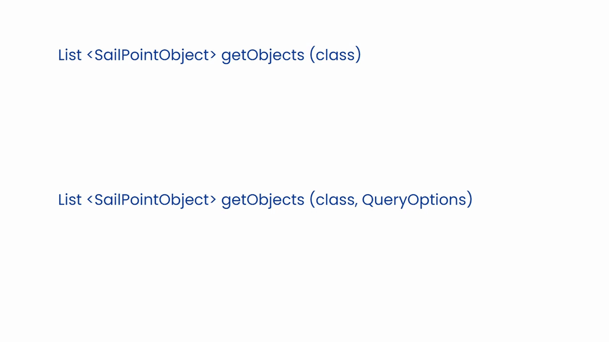
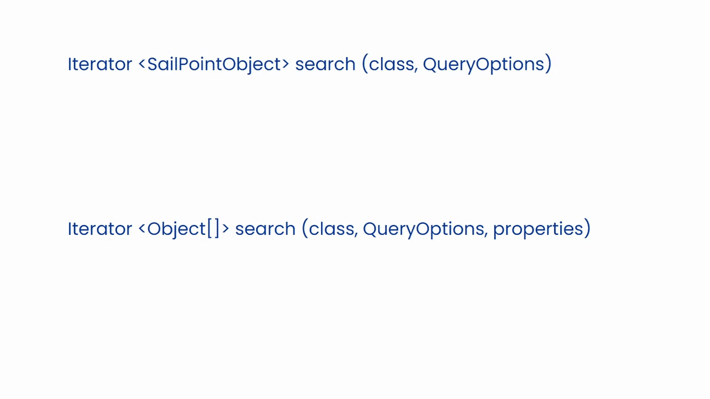

## 4. SailPointContext

### Entry point and retrieval choices

The `context` argument exposes object access, system information and persistence/transaction functions. QueryOptions and Filter describe which objects to retrieve and how to constrain the operation.



`getObjects` returns object collections for appropriate queries. `search` supports iteration and projection, where only chosen properties are initially returned. Single-object methods retrieve by name or GUID. The course examples pass a Java class token such as `Identity.class`; its nearby prose saying the class is a string is inconsistent with those examples, so these notes follow the demonstrated class-token form.



[Video: getObjects](../videos/02.mp4)



[Video: Search and projection queries](../videos/03.mp4)

### Query only the data you need

For bulk operations, the course recommends projecting identifiers and loading full objects just when needed. This avoids loading every large identity into memory at once. It is also possible to project the required values directly when the operation needs no complete object.

Here is a rewritten, read-only study example based on the lesson's search and cleanup patterns:

```java
import sailpoint.object.Identity;
import sailpoint.object.Filter;
import sailpoint.object.QueryOptions;
import sailpoint.tools.Util;
import java.util.Iterator;

QueryOptions qo = new QueryOptions();
qo.addFilter(Filter.eq("department", "Accounting"));
Iterator rows = null;
try {
    rows = context.search(Identity.class, qo, "id");
    while (rows != null && rows.hasNext()) {
        Object[] row = (Object[]) rows.next();
        Identity person = context.getObjectById(Identity.class, (String) row[0]);
        // Inspect person only after checking that the lookup succeeded.
    }
} finally {
    if (rows != null) {
        Util.flushIterator(rows);
    }
}
```

This is explanatory code, not an executed or deployment-tested script. The appropriate overload, class imports and runtime behavior must be checked against the target installation's JavaDoc. The example performs no saves or commits.

`countObjects` answers a count question without loading every matching object. Use it when the logic needs to distinguish no match, one match and several matches before deciding the next action.

### Filters and QueryOptions

A Filter expresses comparisons such as equal, greater-than, prefix matching, multi-valued membership or null checks. `and` requires both conditions; `or` accepts either. Nested combinations need explicit grouping so a department-and-manager clause is not accidentally widened by a surname condition.

Adding separate filters to a QueryOptions combines their criteria as AND in the course example. It is not an implicit OR. QueryOptions also offers ordering, result limits, pagination, grouping and distinct-query controls.


[Video: Filtering](../videos/04.mp4)

The exercise selects Accounting identities in London, projects their IDs, retrieves each identity and changes the location in the lab. The guide explicitly adds `qo.setCloneResults(true)` and notes that its supplied solution file omitted that line. The book preserves that correction in the exercise summary rather than presenting the solution as automatically authoritative.

### System information and transaction responsibilities

`context.getConfiguration()` retrieves the system configuration; a named setting such as `serverRootPath` can support a correctly based work-item link. `getUser()` returns the current identity, while `getUserName()` returns the name. Check for absent values before dereferencing either result.

Context functions also support saving, transaction commit/rollback, object locking and cache management. The fact that a method exists does not mean every rule should call it: the surrounding process may already own those responsibilities. Topic 7 explains those boundaries.

Related practice: [Exercise 3 — targeted search, compound filters and one-at-a-time retrieval](../practice-companion.html#practice-3).

