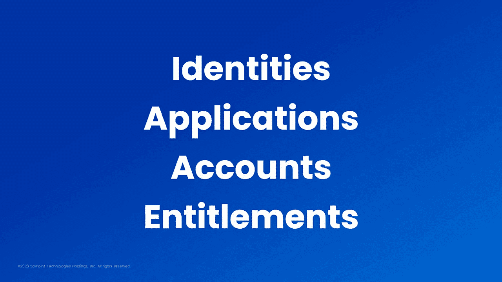
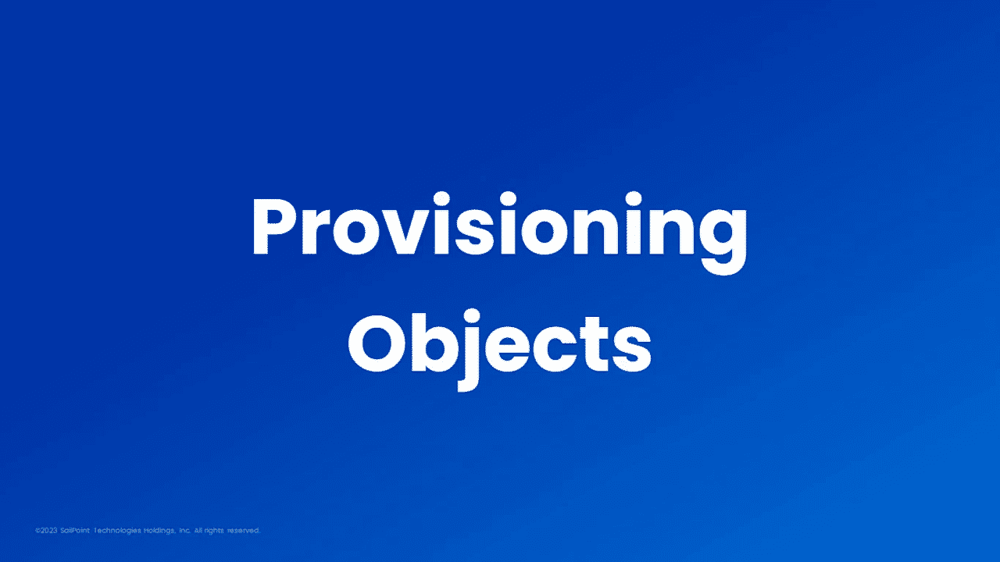
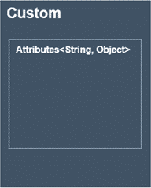

## 5. Object Model

### Core objects and relationships

The written lesson identifies the object families below. Its four saved demonstrations provide the fuller visual walkthrough; they are retained in the same order and remain the source for video-only details.

| Business concept | API object or family | Relationship to keep in mind |
| --- | --- | --- |
| Managed person | Identity | Collects identity attributes and associations to access/accounts |
| Managed system | Application | Defines the resource and its integration configuration |
| User account | Link | Represents an account associated with an identity/application |
| Managed entitlement definition | ManagedAttribute | Represents catalog-level access metadata |
| Role | Bundle | Models grouped access/responsibility |
| Access review | Certification-related objects | Represents review content and decisions |
| Requested target change | ProvisioningPlan and requests | Describes the requested operations |
| Fulfillment outcome | ProvisioningResult | Records the result of a provisioning operation |

These relationships are reinforced by Essentials and the exercise guide. This table does not claim to enumerate every class or field shown inside the videos.

[Video: Identities, applications, accounts and entitlements](../videos/05.mp4)

[Video: Roles](../videos/06.mp4)

[Video: Certifications](../videos/07.mp4)

[Video: Provisioning objects](../videos/08.mp4)

### Custom data belongs in Custom objects

A Custom object wraps an Attributes map of implementation-specific name/value data. Typical uses include reference tables, code-to-description lookups, allowed-value lists and approval configuration. Bringing repeatedly used reference information into a local Custom object can reduce repeated remote lookups inside iterative processes.

Configuration objects also wrap attribute data but are used by the product's own configuration model. The lesson recommends Custom for customer-defined stores so their namespace and purpose remain distinct from core Configuration objects.

### Inspect provisioning results at the right level

Exercise 4 builds a named `regionCodes` Custom object from an external table. It then attaches an After Provisioning rule that examines success/failure and selects notification behavior. The guide notes that a connector may supply the result as a direct argument or attach it to the plan; some can also supply it at AccountRequest level, which the simplified exercise does not fully handle.

An After Provisioning notification failure is not necessarily a failed provisioning action: the rule runs after the target operation. Conversely, sending a success-looking notification is not an independent target-state check. Keep requested change, connector result and post-processing outcome separate.

Related practice: [Exercise 4 — Custom lookup data and provisioning outcomes](../practice-companion.html#practice-4).

