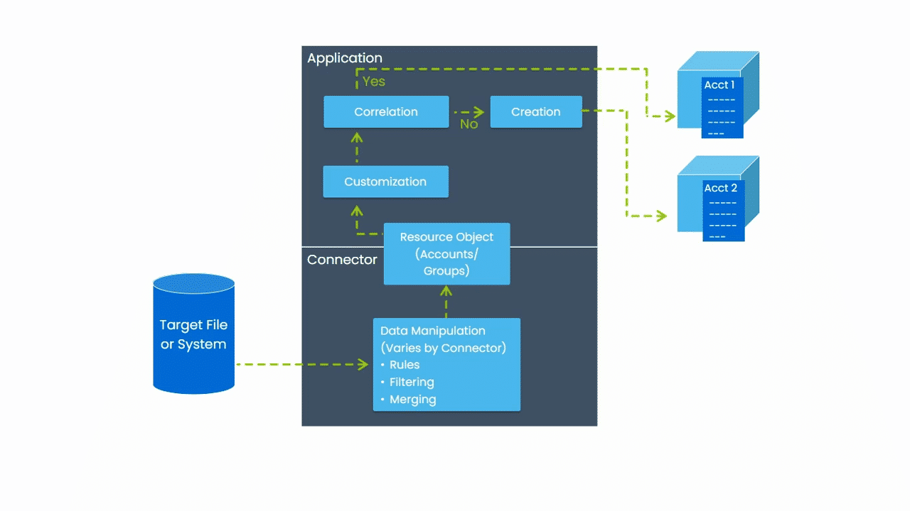
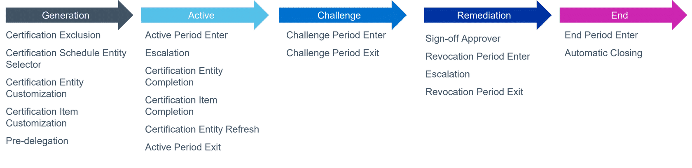
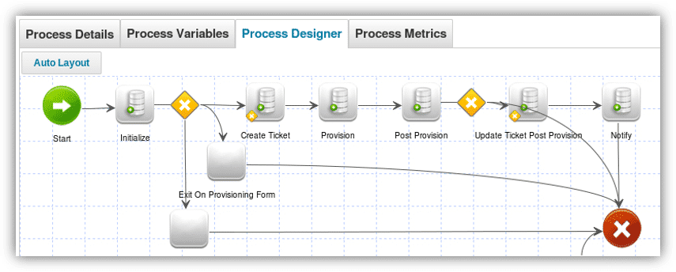
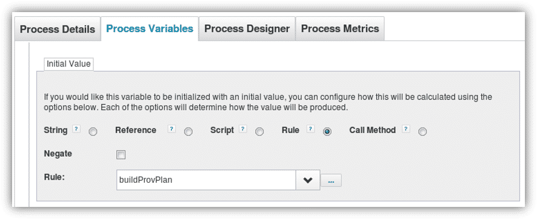
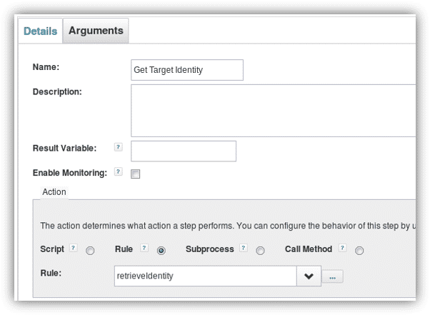
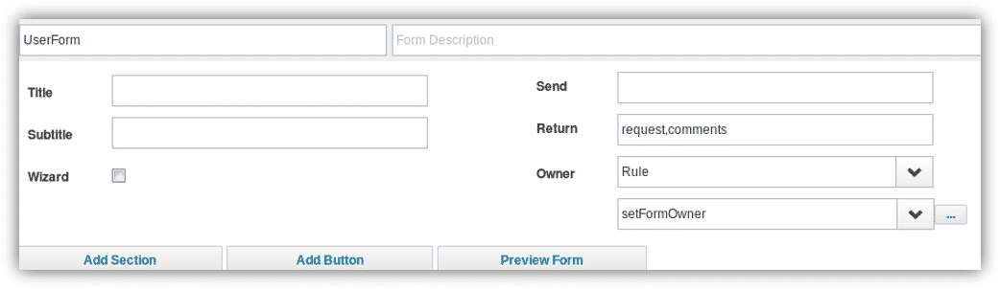
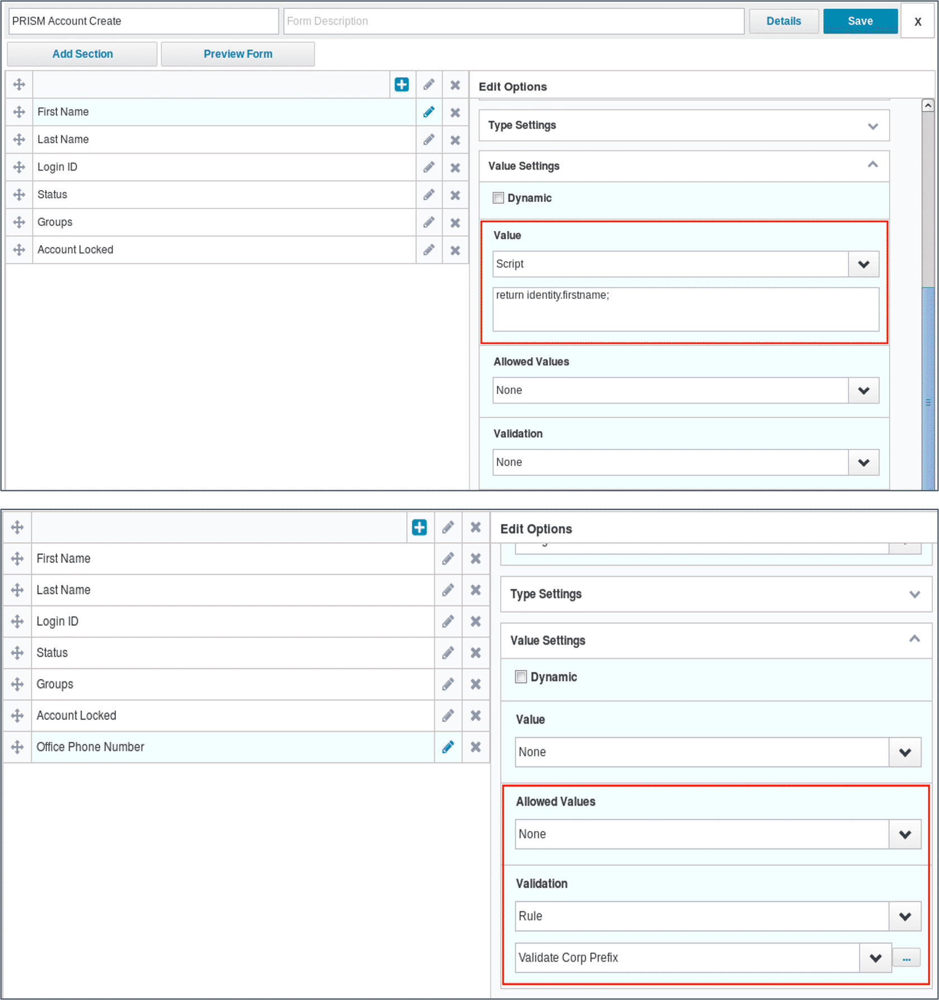

## 6. Common API Uses

### Aggregation extensions

Aggregation hooks transform or interpret incoming application data. Some apply across applications, while others belong to a particular connector's processing model. Choose the hook based on whether the logic concerns raw connector records, normalized resource objects, correlation or later identity behavior.

[Video: Aggregation rules and common API uses](../videos/09.mp4)

The saved video contains the fuller aggregation-rule walkthrough. The written exercise uses a ResourceObject customization to derive regionCode from local reference data, then maps the resulting account attribute into an identity attribute.

### Certification content and behavior

Exclusion rules remove identities/items from an otherwise eligible campaign. A schedule entity selector starts with the narrower included population instead. Those are different ways to establish scope and should not be confused with reviewer assignment.

Pre-delegation can redirect review work during generation. Escalation can reassign overdue work. Sign-off approver rules add another review of decisions. Phase enter/exit rules implement behavior at lifecycle boundaries, such as beginning a challenge period after a custom action.

Exercise 5 excludes contractors and identities with PRISM accounts from a manager campaign. Its all-or-nothing example moves that identity's access items to the exclusion list; excluding only particular PRISM entitlements would need different logic. The lesson preview refers to the lookup as coming from Exercise 3, but the guide actually creates the Custom object in Exercise 4.

### Workflow carousel, expanded

**Panel 1 — process structure:** workflows coordinate multi-step business processes such as access requests and lifecycle events. Their definitions provide rule/script hooks for different purposes.

**Panel 2 — variables:** scripts or rules can calculate process-variable values rather than relying on fixed configuration alone.

**Panel 3 — actions:** step logic can specify the action performed at a particular point in the process.

**Panel 4 — human work:** code can calculate who receives a form or approval work item. Choosing an assignee is distinct from defining the form's values or executing a provisioning action.

### Provisioning policies

Field logic can calculate values, provide allowed choices or validate user input. The phone-number example validates the value against an appropriate corporate range. A validation hook that checks input, an allowed-values provider and a field-value calculation have different contracts even when they all appear around the same form.

Related practice: [Exercise 5 — region-code customization and certification exclusion](../practice-companion.html#practice-5).

