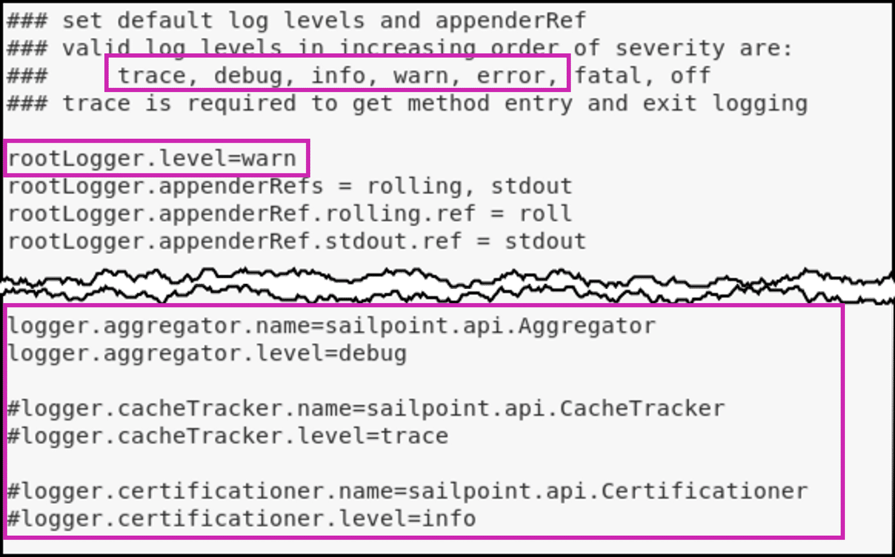
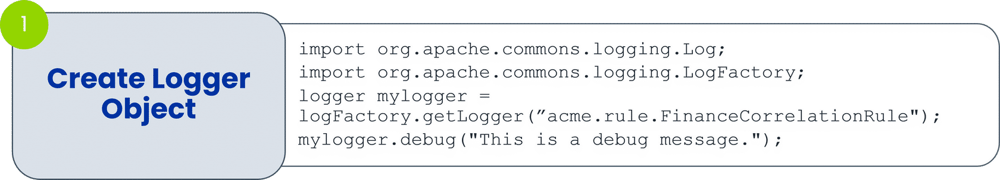
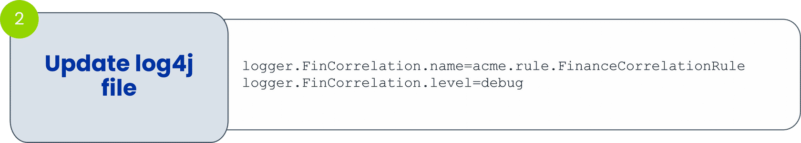
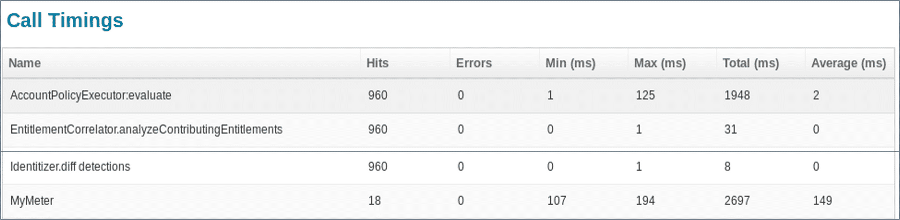

## 7. Best Practices

### Controlled logging

Prefer controllable loggers to permanent standard-output dumps. `System.out.println` is useful for a development experiment but should not leave sensitive production values in uncontrolled logs. A custom logger name such as `project.rule.DescriptiveName` gives finer control than broadly enabling the shared rule logger.





In the course's Log4j2 configuration, a unique properties-key tag identifies the two entries for a logger's name and level. The name must match the logger created by the rule; the arbitrary tag must match across its configuration entries.

```properties
logger.projectLookup.name=project.rule.Lookup
logger.projectLookup.level=warn
```



Debug or trace messages can be present in the source but suppressed at the normal level. Raise the relevant logger temporarily when investigating, then review which information the statements disclose. Avoid interpreting the course's 20-second configuration reload example as a universal behavior of every installation.


### Null, void and return-path handling

BeanShell distinguishes an undefined variable (`void`) from a defined variable containing null. Guard the variable before calling methods on it, then check nested results such as a missing manager before reading that manager's attributes. Correct the syntax and use explicit blocks when adapting a lesson snippet; several displayed examples contain typographic or parenthesis errors.

A rewritten illustration of the intended guard pattern is:

```java
if (targetIdentity != void && targetIdentity != null) {
    Identity manager = targetIdentity.getManager();
    if (manager != null) {
        Object title = manager.getAttribute("jobtitle");
        // Use title only after validating what this hook requires.
    }
}
```

This pattern explains the guard; it is not a complete Rule definition, imported artifact or live test.

### Locking, saving and ownership of transactions

Persistent locks are an application-level convention that can span transactions and need explicit release or timeout. Transaction locks operate at database-transaction scope and end with that transaction. The course discusses ObjectUtil helpers and emphasizes appropriate persistent locking for independently modified identities.

Core aggregation, refresh, LCM and certification-generation processes often already manage identity locks. A custom standalone operation needs to establish its own locking responsibilities rather than assuming a surrounding process is present.

The same distinction applies to persistence. If a hook is expected to modify and return an object, the caller may handle saving it. If a standalone rule or an extra side effect modifies an object outside that expected path, explicit save/commit may be necessary. Do not insert commits into every hook simply because a standalone exercise needs them; first identify who owns the transaction.

### Iterators and cache are different resources

A projection query can leave an open database cursor. If a loop stops early, clean it up. The course recommends `Util.flushIterator`, which is safe even after exhaustion; a `finally` block, as in the earlier study example, makes that cleanup explicit on additional exit paths.

`context.decache(object)` evicts one object; no-argument `context.decache()` evicts loaded objects more broadly. Decaching does not close the database connection or flush its open cursors. Use cursor cleanup and cache management for their respective purposes. The course's every-100-objects example illustrates periodic cache control, not a universal batch-size requirement.

### Performance tabs, expanded

**Searching:** return only the needed properties, filter close to the query, and load full objects only when the operation needs them. Projection avoids treating every matching object as an immediate in-memory requirement.

**Iterative Rules:** small per-call work becomes significant at scale. The course's example adds 0.02 seconds per row across 30,000 rows: 600 seconds, or ten minutes. Avoid opening a remote connection for every row when a prepared local lookup or shared state can satisfy the requirement. Aggregation, refresh and certification hooks can run thousands of times within one process.

**Meter Object:** bracket the measured section with a matching `Meter.enterByName` and `Meter.exitByName` name. A meter records counts and timing statistics, which can be inspected through Debug Pages → Call Timings.

```java
import sailpoint.api.Meter;

Meter.enterByName("Project.LookupSection");
try {
    // The operation being measured belongs here.
} finally {
    Meter.exitByName("Project.LookupSection");
}
```



The exercise compares two measured code paths to teach metering. It explicitly says the small training dataset cannot prove one query operation is always faster than another. Compare equivalent work and meaningful volume before drawing performance conclusions.

Related practice: [Exercise 6 — custom logging and performance measurement](../practice-companion.html#practice-6).

