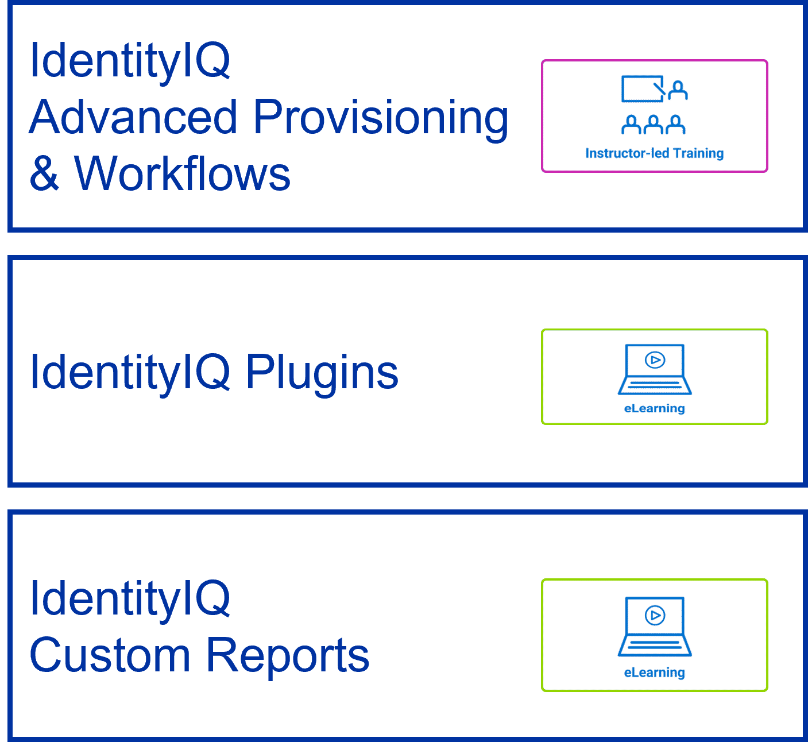

## 8. Next Steps

The course points implementers toward further technical training and the SailPoint community for questions, examples and product knowledge. Its original education illustration is preserved below. Course names, delivery choices and prerequisite statements describe the source material; present-day availability is not independently verified by this book.

A useful review sequence is to explain a hook's arguments and return contract, locate its API methods, trace its object relationships, and identify transaction, cursor and logging responsibilities. Then work through the supplied exercises in order, comparing observed results to the intended behavior in the guide.

The notes and local media are ready for offline study. The lab exercises, interactive knowledge checks and LMS completion are separate activities; none were submitted or executed during preparation.
